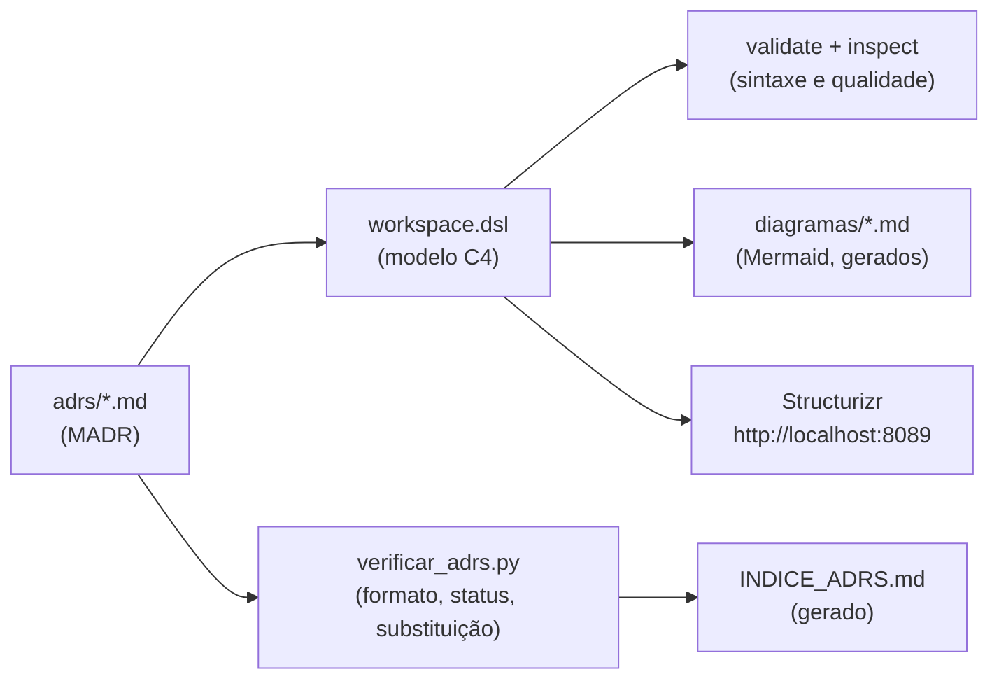

# Lab 1A: Arquitetura como código: C4 e ADR versionados

Aula prática da seção 1 (Fundamentos de Arquitetura de Software), depois da aula 1.9.

| | |
|---|---|
| Aulas relacionadas | 1.8 (ADR na prática) e 1.9 (C4 Model) |
| Ambiente | Docker Compose (Structurizr) e Python 3 |
| Ordem de estudo | Isolado. O lab 9B reaproveita os ADRs e as verificações daqui |

## Objetivo

Nas aulas 1.8 e 1.9 vimos que a arquitetura precisa ser comunicada em níveis diferentes para públicos diferentes (C4) e que as decisões precisam ser registradas para não se perderem (ADR). O problema comum: o diagrama vive em uma ferramenta de desenho, as decisões em um wiki, e os dois ficam desatualizados em semanas.

Neste lab a arquitetura da LunaLog é **código**: um arquivo de modelo (`workspace.dsl`) de onde saem os diagramas de Contexto, Containers e Componentes, e uma pasta de ADRs em Markdown ligada aos elementos do modelo. Uma mudança de decisão aparece como **diff de código e de diagrama no mesmo pull request**, e uma verificação automática barra o que estiver fora do padrão.

## O que você vai ver

- **Um modelo, vários níveis**: dar zoom de Contexto para Containers e Componentes sem redesenhar nada
- Alterar um container no arquivo e ver **todos os diagramas se atualizarem**
- **ADRs** com status (proposto, aceito, substituído), ligados ao elemento do modelo que afetam
- Um **linter do modelo** e um **validador de ADRs** que falham o build quando algo está fora do padrão
- **Revisão de arquitetura por pull request**: o diff de diagrama, o ADR e o código no mesmo lugar

## Arquitetura do lab



- O **modelo** descreve pessoas, sistemas, containers e componentes uma vez só. As visões (`views`) escolhem o que mostrar em cada nível.
- Os **ADRs** usam o formato MADR (Markdown com front matter). A diretiva `!adrs` os liga ao elemento: decisões do sistema ficam no sistema, decisões do rastreamento ficam no container de rastreamento.
- O **Structurizr** (a ferramenta oficial do C4 como código) roda em container: não precisa instalar nada além do Docker.

## Pré-requisitos

- Docker Engine ou Docker Desktop
- Python 3 (só para o validador de ADRs; sem ele, use `docker run --rm -v "$PWD":/w -w /w python:3.12-slim python scripts/verificar_adrs.py adrs`)
- Bash (Git Bash ou WSL no Windows) para o script `scripts/verificar.sh`
- Cerca de 1 GB de disco para a imagem do Structurizr

## Como executar

Na pasta deste lab. Primeiro, **veja** o modelo em ação:

```bash
docker compose up -d
```

Abra http://localhost:8089. Navegue pelas visões:

1. **Contexto** (nível 1): a LunaLog como uma caixa, os usuários e os sistemas externos. É o diagrama para o CEO e para o investidor.
2. **Containers** (nível 2): o que existe dentro da LunaLog (gateway, serviços, fila, banco). É o diagrama para os desenvolvedores.
3. **Componentes-Rastreamento** (nível 3): por dentro do serviço de rastreamento.
4. **Confirmar-entrega** (dinâmico): a sequência de uma confirmação de entrega.
5. Em **Decisions**, os ADRs ligados aos elementos, com o status de cada um.

Os quatro diagramas vêm do **mesmo** arquivo. Leia o `workspace.dsl`: é uma lista de elementos e de relacionamentos, não um desenho.

### Cenário 1: o modelo muda, os diagramas acompanham

Com a interface aberta, edite o `workspace.dsl`. Adicione um cache entre o rastreamento e o banco:

1. Logo antes da linha `banco = container ...`, adicione:

```
            cache = container "Cache de Consultas" "Acelera a consulta do estado da entrega." "Redis" "Banco"
```

2. Logo antes de `lunalog.eventos -> lunalog.notificacao ...`, adicione:

```
        lunalog.rastreamento -> lunalog.cache "Consulta e invalida" "RESP"
```

Atualize a página (F5). O cache aparece no diagrama de **Containers**, já com a seta, e **não** aparece no de **Contexto** (um cache interno é detalhe de container, não interessa ao investidor). Esse é o ponto do C4: cada nível mostra só o que o público daquele nível precisa.

### Cenário 2: a decisão viaja com a mudança

Uma mudança de arquitetura é uma decisão. Registre-a. Crie `adrs/0007-cache-de-consulta-com-redis.md` a partir do modelo em `modelos/adr-modelo.md`:

```markdown
---
status: proposed
date: 2026-10-27
decision-makers: Roberto, Ana
---
# 0007. Cache de consulta do estado da entrega com Redis

## Contexto e problema

O painel consulta o estado das entregas a cada poucos segundos e pressiona o banco.

## Decisão

Proposta: um cache Redis na frente do banco para as consultas de estado, invalidado a cada evento.

## Consequências

* Bom, porque reduz a carga de leitura no banco.
* Ruim, porque introduz invalidação de cache e mais um componente para operar.
```

O ADR nasce como `proposed` e entra no mesmo pull request que a mudança do modelo. Quem revisa vê o **diff do modelo, o diff do diagrama e o texto da decisão** juntos.

### Cenário 3: as verificações automáticas

Rode as verificações que o CI rodaria em cada pull request:

```bash
docker compose down
bash scripts/verificar.sh
```

Ele executa quatro etapas:

1. `validate`: a sintaxe do modelo
2. `inspect`: a qualidade do modelo (relacionamentos sem tecnologia, sistema sem documentação)
3. `verificar_adrs.py`: o formato dos ADRs, o status e as substituições; gera o `INDICE_ADRS.md`
4. `export`: gera os diagramas em Mermaid (`diagramas/*.md`), que o GitHub renderiza

Agora **quebre de propósito** para ver o build falhar:

- Em `workspace.dsl`, apague a tecnologia de um relacionamento (por exemplo, o `"Kafka"` do final de `lunalog.eventos -> lunalog.notificacao`). O `inspect` aponta: *"The relationship between ... is missing a technology"*.
- Em um ADR, troque `status: accepted` por `status: aprovado`. O validador responde: *status inválido 'aprovado'*.
- No ADR 0005, apague a menção ao 0003. O validador responde: *deveria mencionar que substitui o ADR 0003*.

Desfaça as quebras e rode de novo: o build volta a passar.

### Cenário 4: decisão substituída, não apagada

Abra `adrs/rastreamento/0003-mongodb-para-o-rastreamento.md` (status `superseded by ADR-0005`) e o `0005-postgresql-para-o-rastreamento.md`. O ADR 0003 **não foi editado nem apagado**: continua lá, com o contexto da época, apontando para quem o substituiu. É esse histórico que teria poupado os dois dias do novo desenvolvedor da aula 1.8. Veja também o `0006`, ainda `proposed`: uma decisão em discussão aparece no mesmo lugar das aceitas, com um status que diz isso.

## Resultados de referência

| Verificação | Resultado esperado |
|---|---|
| `validate` | sem erros |
| `inspect` | sem pendências |
| `verificar_adrs.py` | 6 ADRs válidos, `INDICE_ADRS.md` gerado |
| `export -f mermaid` | 4 diagramas (Contexto, Containers, Componentes-Rastreamento, Confirmar-entrega) |
| Quebra: relacionamento sem tecnologia | `inspect` falha (saída 1) |
| Quebra: status inválido / substituição sem menção | `verificar_adrs.py` falha (saída 1) |

## Como limpar

```bash
docker compose down
```

O lab não deixa nada além dos arquivos gerados (`diagramas/` e `INDICE_ADRS.md`), que são versionados de propósito: é isso que torna a mudança visível no pull request.

## Estrutura da pasta

```
lab-1a_arquitetura-como-codigo-c4-e-adr/
  README.md
  workspace.dsl                (o modelo C4 da LunaLog)
  docs/01-visao-geral.md       (documentação ligada ao modelo)
  adrs/                        (decisões; as do rastreamento em adrs/rastreamento/)
  modelos/adr-modelo.md        (modelo de ADR para copiar)
  docker-compose.yml           (visualizador Structurizr)
  scripts/
    verificar.sh               (validate + inspect + ADRs + diagramas)
    verificar_adrs.py          (validador de ADRs e gerador do índice)
  ci/arquitetura.yml           (exemplo de pipeline de pull request)
  diagramas/                   (gerados)
  INDICE_ADRS.md               (gerado)
```

## Limites deste lab

- O Structurizr reorganiza os identificadores numéricos dos elementos nos diagramas Mermaid quando o modelo muda. Por isso o diff de um diagrama gerado pode mostrar números trocados além da mudança real. A leitura pelo modelo (`workspace.dsl`) continua sendo a fonte confiável do diff; o diagrama gerado serve para a revisão visual.
- A ferramenta usada é o novo `structurizr/structurizr`. O Structurizr Lite e o CLI antigos foram descontinuados em favor dele, mas os conceitos (DSL, visões, ADRs ligados) são os mesmos.
- O C4 não é uma notação de tudo: não cobre implantação, dados ou segurança. O DSL tem visões de implantação (`deployment`), que ficam fora deste lab.
- O validador de ADRs checa **forma** (campos, status, vínculos), não **mérito**. Se a decisão é boa continua sendo uma conversa. E ele não impede de editar um ADR aceito: isso se resolve com revisão (CODEOWNERS) e com o histórico do Git, assunto do lab 9B.
- Um ADR por decisão **relevante**, não por decisão. Se tudo vira ADR, ninguém lê.
- Os nomes (Roberto, Ana, Camila) e as decisões são fictícios, da LunaLog.

## Para pensar

1. Qual dos quatro níveis do C4 você mais precisa no seu time hoje? E para qual público você hoje desenha só um nível?
2. Num ADR, o que tem mais valor: a decisão, as alternativas descartadas ou as consequências? O que você nunca escreveria só de memória?
3. Quem deveria poder aprovar a mudança de um diagrama de arquitetura? E a mudança do status de um ADR para `accepted`?
4. O diagrama gerado nunca "fica desatualizado" em relação ao modelo. Mas o modelo pode ficar desatualizado em relação ao sistema real. Como você detectaria isso?
