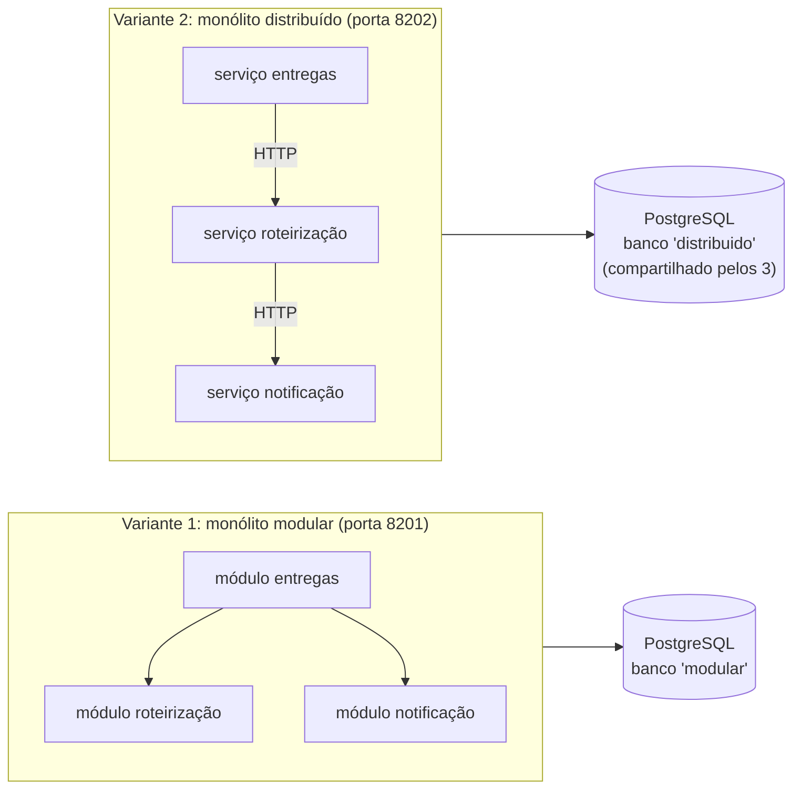

# Lab 2A: Monólito modular e monólito distribuído lado a lado

Aula prática da seção 2 (Estilos Arquiteturais), depois da aula 2.3.

| | |
|---|---|
| Aulas relacionadas | 2.1 (monólito), 2.2 (modular versus distribuído) e 2.3 (quando o monólito mostra seus limites) |
| Ambiente | Docker Compose |
| Ordem de estudo | Isolado. A extração do módulo para um serviço é tema da aula 2.4; o lab 5E aprofunda a migração de esquema sem parada |

## Objetivo

Na aula 2.2 vimos que "monólito" e "microsserviços" não são os dois únicos estilos: existe o **monólito modular**, que tem fronteiras internas claras, e o **monólito distribuído**, que tem a complexidade de rede dos microsserviços sem nenhum dos benefícios. Neste lab o **mesmo domínio** da LunaLog (registrar uma entrega, atribuir a rota, avisar o destinatário) é implementado das duas formas, e você as compara em quatro situações concretas: fronteiras, falha parcial, latência e mudança de esquema.

## O que você vai ver

- No **modular**, uma importação proibida entre módulos quebra a verificação **antes do merge**
- Na falha de um passo da cadeia, o **modular desfaz tudo** (uma transação) e o **distribuído deixa dados órfãos** e duplica entregas no retry
- A **latência** do mesmo caso de uso nas duas implementações, com a mesma carga
- Uma **mudança simples de coluna**: um deploy no modular, três deploys coordenados no distribuído, com erro no intervalo
- O modular como **caminho de extração futura**: a fronteira já existe, falta só trocar a chamada local por uma de rede

## Arquitetura do lab



- **Modular**: uma aplicação, três módulos (`entregas`, `roteirizacao`, `notificacao`) com fronteira pela `api.py` de cada um, e **uma transação** para o caso de uso inteiro.
- **Distribuído**: três serviços em cadeia síncrona (entregas chama roteirização, que chama notificação), cada um com a sua transação, e o **mesmo banco** compartilhado pelos três. A roteirização grava direto na tabela do serviço de entregas.
- O código de negócio é o mesmo nas duas. O que muda é a **arquitetura**.

## Pré-requisitos

- Docker Engine ou Docker Desktop (Compose v2)
- Cerca de 1,5 GB de RAM livres e de disco para as imagens
- As portas 8201 e 8202 livres
- Um shell Bash (Git Bash ou WSL no Windows) para os scripts em `scripts/`

## Como executar

Na pasta deste lab:

```bash
docker compose up -d --build
curl -s -X POST localhost:8201/entregas -H 'Content-Type: application/json' -d '{"codigo":"M1","destino":"Rua A"}'
curl -s -X POST localhost:8202/entregas -H 'Content-Type: application/json' -d '{"codigo":"D1","destino":"Rua A"}'
```

As duas respondem `201` com a entrega roteirizada. Para o aluno, o comportamento é **idêntico**. As diferenças estão por dentro, e aparecem nos cenários.

Para limpar os dados entre os cenários: `curl -s -X POST localhost:8201/admin/limpar` e `curl -s -X POST localhost:8202/admin/limpar`.

### Cenário 1: fronteiras que quebram o build

Abra `modular/.importlinter`: duas regras. (1) Os módulos só se enxergam pela `api.py`; os internos (`servico`, `repositorio`, `calculo`, `canais`) são privados. (2) As dependências andam num só sentido (`entregas -> roteirizacao -> notificacao`), sem ciclos.

```bash
bash scripts/lint.sh
```

Resultado: `Contracts: 2 kept, 0 broken.` Agora o "atalho inocente", que todo time conhece: o módulo de entregas usa direto o cálculo interno da roteirização.

```bash
bash scripts/lint.sh --violar
```

O script injeta `from app.roteirizacao.calculo import calcular` em `entregas/servico.py` e roda a verificação. O que observar: `BROKEN`, com a linha exata (`app.entregas.servico -> app.roteirizacao.calculo (l.2)`) e saída de erro (código 1). Em um pipeline, o pull request não entra. A fronteira deixou de ser uma convenção e virou uma regra verificada.

No distribuído, a fronteira é de **rede**, mas não é de **dados**: a roteirização grava direto na tabela de entregas (`distribuido/app/roteirizacao.py`), e nenhuma ferramenta reclama.

### Cenário 2: uma etapa falha no meio da cadeia

O canal de notificação sai do ar. Primeiro no modular (a falha é ligada por um interruptor):

```bash
curl -s -X POST "localhost:8201/admin/falha/notificacao?ligada=true"
for i in 1 2 3; do curl -s -o /dev/null -w "http=%{http_code}\n" -X POST localhost:8201/entregas -H 'Content-Type: application/json' -d "{\"codigo\":\"M$i\",\"destino\":\"Rua A\"}"; done
curl -s localhost:8201/estado
curl -s -X POST "localhost:8201/admin/falha/notificacao?ligada=false"
```

Depois no distribuído (o serviço de notificação é parado):

```bash
docker compose stop notificacao
for i in 1 2 3; do curl -s -w " http=%{http_code}\n" -X POST localhost:8202/entregas -H 'Content-Type: application/json' -d "{\"codigo\":\"D$i\",\"destino\":\"Rua A\"}"; done
curl -s localhost:8202/estado
docker compose start notificacao
```

O que observar:

| | Resposta ao cliente | Estado do banco depois |
|---|---|---|
| Modular | `500` | `entregas: 0, rotas: 0, entregas_sem_notificacao: 0` (a transação desfez tudo) |
| Distribuído | `502` (após alguns segundos de espera) | `entregas: 3, rotas: 3, notificacoes: 0, entregas_sem_notificacao: 3` |

No distribuído, cada serviço confirmou a **sua** transação antes de chamar o próximo. Quando o último falhou, nada voltou atrás: três entregas ficaram roteirizadas, sem aviso. E o cliente, que recebeu erro, vai **tentar de novo**:

```bash
for i in 1 2 3; do curl -s -o /dev/null -w "retry http=%{http_code}\n" -X POST localhost:8202/entregas -H 'Content-Type: application/json' -d "{\"codigo\":\"D$i\",\"destino\":\"Rua A\"}"; done
curl -s localhost:8202/estado
```

Resultado: `entregas: 6, notificacoes: 3, entregas_sem_notificacao: 3`. O retry **duplicou** as entregas, e as três órfãs continuam lá. É o que a aula 2.2 chamou de pior dos dois mundos: a falha parcial dos sistemas distribuídos, sem a independência que justificaria aceitá-la. (A cura são as sagas, a idempotência e o outbox, assuntos das aulas de microsserviços.)

### Cenário 3: o custo da rede em cada chamada

```bash
curl -s -X POST localhost:8201/admin/limpar; curl -s -X POST localhost:8202/admin/limpar
docker compose --profile ferramentas run --rm k6
```

O k6 aplica a mesma carga (30 requisições por segundo, durante 20 s) nas duas implementações. O que observar:

```
===== LATENCIA DE POST /entregas (mesma carga) =====
modular      mediana=  30 ms  p95=  34 ms  erros=0.00%
distribuido  mediana=  44 ms  p95=  46 ms  erros=0.00%
```

Mesmo trabalho útil (os 20 ms do cálculo da rota são idênticos), cerca de **14 ms a mais** no distribuído: três conexões, três transações e duas chamadas de rede em vez de uma. Em uma máquina local, com a rede quase sem custo. Em produção, com os serviços em hosts diferentes, o custo cresce, e cada salto é mais um ponto que pode falhar ou ficar lento.

### Cenário 4: uma mudança simples de coluna

Uma migração aparentemente trivial: renomear a coluna `status` para `situacao`.

```bash
bash scripts/migrar-coluna.sh
curl -s -w " http=%{http_code}\n" -X POST localhost:8201/entregas -H 'Content-Type: application/json' -d '{"codigo":"M1","destino":"Rua A"}'
curl -s -w " http=%{http_code}\n" -X POST localhost:8202/entregas -H 'Content-Type: application/json' -d '{"codigo":"D1","destino":"Rua A"}'
```

Logo após a migração, **as duas quebram** (`500`): o código ainda procura a coluna antiga. Agora a implantação do código novo, que conhece a coluna nova (`SCHEMA_VERSAO=2`). No modular:

```bash
SCHEMA_VERSAO=2 docker compose up -d --no-deps --force-recreate monolito
curl -s -w " http=%{http_code}\n" -X POST localhost:8201/entregas -H 'Content-Type: application/json' -d '{"codigo":"M2","destino":"Rua A"}'
```

`201`: **um deploy** e acabou. No distribuído, os três serviços usam a tabela, e cada um precisa ser atualizado:

```bash
SCHEMA_VERSAO_ENTREGAS=2 docker compose up -d --no-deps --force-recreate entregas
curl -s -w " http=%{http_code}\n" -X POST localhost:8202/entregas -H 'Content-Type: application/json' -d '{"codigo":"D2","destino":"Rua A"}'    # 502
SCHEMA_VERSAO_ROTEIRIZACAO=2 docker compose up -d --no-deps --force-recreate roteirizacao
curl -s -w " http=%{http_code}\n" -X POST localhost:8202/entregas -H 'Content-Type: application/json' -d '{"codigo":"D3","destino":"Rua A"}'    # 502
SCHEMA_VERSAO_NOTIFICACAO=2 docker compose up -d --no-deps --force-recreate notificacao
curl -s -w " http=%{http_code}\n" -X POST localhost:8202/entregas -H 'Content-Type: application/json' -d '{"codigo":"D4","destino":"Rua A"}'    # 201
```

O que observar: com **dois dos três** serviços atualizados, a cadeia continua quebrada (`502`). Só com os três na versão nova o sistema volta. Os três serviços têm de ser implantados **juntos**, na ordem certa, e há uma janela de erro no meio. Isso é um deploy coordenado: o sinal mais claro do monólito distribuído. Os serviços são "independentes" na teoria, e dependentes no esquema do banco.

Para repetir os cenários: `bash scripts/reverter-coluna.sh`.

### O modular como caminho de extração

Abra `modular/app/entregas/servico.py`. A única linha que fala com a roteirização é `roteirizacao.atribuir_rota(conn, entrega_id, destino)`, uma chamada à `api.py`. Se um dia a roteirização precisar virar um serviço (aula 2.4: requisitos de escala diferentes, um time próprio), a mudança é **local**: troca-se a implementação dessa API por um cliente HTTP, e a fronteira, que já foi imposta e verificada, não se move. No distribuído sem fronteiras de dados, extrair significa primeiro desembaraçar o banco.

## Resultados de referência

Valores obtidos em Docker Desktop (Windows 11, WSL2), com a mesma carga nas duas variantes. Você deve ver números próximos.

| Situação | Monólito modular | Monólito distribuído |
|---|---|---|
| Violação de fronteira (importação proibida) | detectada antes do merge (`BROKEN`, saída 1) | não existe verificação de fronteira de dados |
| Falha no último passo da cadeia | `500`; 0 linhas órfãs (rollback) | `502`; 3 entregas roteirizadas sem notificação |
| Retry do cliente depois da falha | sem duplicação | entregas duplicadas (6 entregas para 3 pedidos) |
| Latência de `POST /entregas` (mediana / p95) | 30 ms / 34 ms | 44 ms / 46 ms |
| Mudança de coluna | 1 deploy | 3 deploys coordenados, `502` no intervalo |
| Quantidade de pontos de falha na rota feliz | 1 processo, 1 banco | 3 processos, 1 banco, 2 chamadas de rede |

## Como limpar

```bash
docker compose down -v
```

## Estrutura da pasta

```
lab-2a_monolito-modular-vs-distribuido/
  README.md
  docker-compose.yml
  db/init.sql                 (dois bancos com o mesmo esquema)
  modular/
    .importlinter             (as regras de fronteira)
    app/{entregas,roteirizacao,notificacao,compartilhado}/
  distribuido/
    app/{entregas,roteirizacao,notificacao}.py   (3 serviços, 1 imagem)
  k6/comparar.js              (a mesma carga nas duas variantes)
  scripts/
    lint.sh                   (import-linter; --violar injeta o atalho proibido)
    migrar-coluna.sh          (renomeia a coluna nos dois bancos)
    reverter-coluna.sh        (desfaz, para repetir)
```

## Limites deste lab

- O distribuído é **propositalmente ingênuo** (cadeia síncrona sobre banco compartilhado) para representar o anti-padrão. Ele pode ser melhorado com timeouts menores, idempotência, outbox e sagas; mas aí já deixou de ser um monólito distribuído e passou a ser microsserviços de verdade, com o custo que a aula 2.4 descreve.
- Os números de latência são de uma máquina local, com a rede entre contêineres quase sem custo. O custo real de rede em produção é maior.
- O lab usa uma única transação no modular. Isso só é possível enquanto os módulos compartilham o banco. É uma vantagem real do estilo, e também o que se perde ao extrair um módulo.
- O import-linter vale para Python. Para outras linguagens existem equivalentes (ArchUnit para Java, dependency-cruiser para JavaScript, NetArchTest para .NET).
- O monólito modular **não** resolve tudo: o deploy continua sendo do conjunto (o sinal da aula 2.3, dois dias para corrigir um bug de notificação). Ele adia a necessidade de microsserviços, e deixa a porta aberta.
- Os dados e as credenciais (`luna`/`luna`) são fictícios, só para o laboratório.

## Para pensar

1. O que, no seu sistema, hoje impede que um módulo use os detalhes internos de outro? Convenção, revisão de código ou uma regra automática?
2. No distribuído, o cliente fez retry e duplicou as entregas. Como você tornaria o `POST /entregas` seguro para repetir?
3. A mudança de coluna exigiu um deploy coordenado. Que técnica de migração de esquema (expand-contract) permitiria implantar os três serviços em qualquer ordem?
4. Qual seria o primeiro módulo que você extrairia para um serviço, e que evidência (de escala, de time, de risco) você pediria antes?
