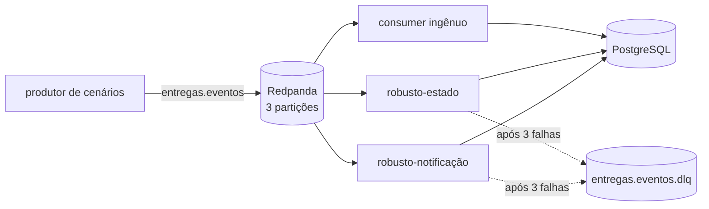

# Lab 2B: EDA na prática - ordem, idempotência e dead-letter queue

Aula prática da seção 2 (Estilos Arquiteturais na Prática), depois da aula 2.10.

| | |
|---|---|
| Aulas relacionadas | 2.9 (producers, consumers e brokers) e 2.10 (ordenação, idempotência e rastreabilidade) |
| Ambiente | Docker Compose |
| Ordem de estudo | Independente |

## Objetivo

Na aula 2.10 vimos que a arquitetura orientada a eventos esconde três problemas atrás da elegância do desacoplamento: eventos chegam fora de ordem, eventos se repetem e uma mensagem problemática pode travar tudo. Neste lab você vê cada um acontecer num barramento real e compara, lado a lado, um consumer ingênuo com um consumer robusto.

O cenário é o da LunaLog: eventos de mudança de status de uma entrega (`criada`, `coletada`, `em_rota`, `entregue`). Quando uma entrega é concluída, o motorista recebe uma comissão de R$ 12. O cliente é notificado a cada mudança de status.

## Arquitetura do lab



- **Redpanda** é o broker (compatível com a API do Kafka). A interface web fica em http://localhost:8088.
- **ingênuo** lê os eventos e aplica na ordem em que chegam, sem nenhuma proteção.
- **robusto-estado** e **robusto-notificação** são dois consumers de times diferentes (grupos diferentes) lendo os mesmos eventos. Ambos são idempotentes, ignoram evento antigo e usam retry com DLQ.
- **PostgreSQL** guarda o estado de cada consumer, para a comparação ficar numa única consulta.

## Pré-requisitos

- Docker Engine ou Docker Desktop com Compose v2
- Cerca de 4 GB de RAM livres
- No Windows, os comandos funcionam no PowerShell e no WSL2

## Como executar

Na pasta deste lab:

```bash
docker compose up -d --build
```

Abra http://localhost:8088 (Redpanda Console) e confira em **Topics** os três tópicos criados.

Para consultar o estado das entregas, em qualquer ponto do lab:

```bash
docker compose exec postgres psql -U lunalog -d lunalog -f /sql/estado.sql
```

Os cenários são executados pelo produtor, um por vez:

```bash
docker compose run --rm produtor <cenario>
```

### Cenário 1: partições e ordem

```bash
docker compose run --rm produtor particoes
```

Os eventos de uma mesma entrega são publicados duas vezes: com chave (o `entrega_id`) e sem chave. Observe a partição de cada evento na saída e, no Console, em **Topics > demo.particoes**.

O que observar: com chave, todos os eventos da entrega caem na mesma partição, e a ordem dentro de uma partição é garantida. Sem chave, eles se espalham, e nada garante que o consumer os leia na ordem em que foram escritos. As linhas da saída aparecem na ordem em que o broker confirma cada mensagem, que pode diferir da ordem em que foram enviadas; repita o comando para ver a distribuição mudar.

### Cenário 2: entrega duplicada

```bash
docker compose run --rm produtor feliz
docker compose run --rm produtor duplicado
docker compose exec postgres psql -U lunalog -d lunalog -f /sql/estado.sql
```

O evento `entregue` da entrega E-100 é entregue duas vezes (at-least-once). O que observar na tabela: a comissão do motorista no consumer ingênuo é R$ 24, e no robusto é R$ 12. Veja a decisão do robusto no log:

```bash
docker compose logs robusto-estado
```

A linha `duplicado ignorado` aparece porque a marca "evento já processado" e o efeito (atualizar a entrega) acontecem na **mesma transação**. Se uma delas falhar, a outra também não vale.

### Cenário 3: evento fora de ordem

```bash
docker compose run --rm produtor fora-de-ordem
docker compose exec postgres psql -U lunalog -d lunalog -f /sql/estado.sql
```

Na entrega E-200, o evento `entregue` (versão 4) chega antes do `em_rota` (versão 3). O que observar: o ingênuo termina a entrega em `em_rota` (estado errado, e o motorista já recebeu a comissão de uma entrega que parece não concluída). O robusto compara a versão do evento com a versão que já aplicou e ignora o evento antigo (`evento antigo ignorado` no log).

### Cenário 4: evento novo que o consumer não conhece, e a DLQ

```bash
docker compose run --rm produtor evento-novo
docker compose logs --tail 20 ingenuo
docker compose logs --tail 20 robusto-estado
```

O produtor passa a publicar `devolvida`, um tipo que os consumers ainda não conhecem, seguido de uma entrega normal (E-301). O que observar:

- O ingênuo cai com `KeyError`, o Docker o reinicia, ele relê a mesma mensagem e cai de novo. A entrega E-301 fica presa atrás dela. No Console, em **Consumer Groups**, o grupo `ingenuo` mostra lag que não anda.
- O robusto tenta 3 vezes, manda a mensagem para `entregas.eventos.dlq` com o motivo nos cabeçalhos e **segue em frente**. A E-301 é processada normalmente. Em **Topics > entregas.eventos.dlq** veja a mensagem e os cabeçalhos `dlq.erro`, `dlq.tentativas` e `dlq.origem`.

### Cenário 5: rastreabilidade com correlation ID

Cada evento carrega o cabeçalho `correlation_id`, o mesmo para todos os eventos de uma entrega. Veja o caminho da entrega E-100 pelos dois consumers:

```bash
# Linux, macOS e WSL2
docker compose logs --no-log-prefix robusto-estado robusto-notificacao | grep E-100
```

```powershell
# PowerShell
docker compose logs --no-log-prefix robusto-estado robusto-notificacao | Select-String E-100
```

A tabela `notificacoes` também guarda o `correlation_id`, o que permite ligar a notificação ao evento que a originou.

### Cenário 6: corrigir o consumer e reprocessar a DLQ

Edite o arquivo `.env` desta pasta e troque `SUPORTA_DEVOLVIDA=0` por `SUPORTA_DEVOLVIDA=1`. Isso representa o deploy de uma nova versão dos consumers que passa a conhecer o tipo `devolvida`.

```bash
docker compose up -d robusto-estado robusto-notificacao
docker compose run --rm produtor reprocessar-dlq
docker compose logs --tail 10 robusto-estado
docker compose exec postgres psql -U lunalog -d lunalog -f /sql/estado.sql
```

O que observar: a E-300 passa para `devolvida`. Como os dois grupos de consumers robustos mandaram a mesma mensagem para a DLQ, o evento chega duas vezes ao `robusto-estado`, e a segunda vez aparece como `duplicado ignorado`. A idempotência protege também o reprocessamento.

## Como limpar

```bash
docker compose --profile ferramentas down -v
```

Para repetir o lab do zero, rode a limpeza e suba de novo. Os cenários usam identificadores fixos (E-100, E-200, E-300), então repeti-los sem limpar mostra eventos duplicados.

## Estrutura da pasta

```
lab-2b_eda-ordem-idempotencia-e-dlq/
  README.md
  docker-compose.yml
  .env                 (SUPORTA_DEVOLVIDA, usado no cenário 6)
  sql/
    init.sql           (tabelas)
    estado.sql         (consulta de comparação)
  app/
    consumidor.py      (consumer ingênuo e robusto)
    produtor.py        (cenários)
    Dockerfile
    requirements.txt
```

## Limites deste lab

- O estado fica em PostgreSQL com a marca de idempotência na mesma transação. Se o efeito do seu consumer não for um banco (por exemplo, uma chamada HTTP a um serviço externo), a idempotência exige outra estratégia, como uma chave de idempotência enviada ao serviço de destino.
- A DLQ aqui é um tópico comum, sem alarme. Em produção, alguém precisa ser avisado quando ela cresce.
- O Redpanda roda com um único nó, sem replicação. Serve para estudar o modelo, não a durabilidade.

## Para pensar

1. A chave de particionamento garante ordem por entrega. O que acontece com essa garantia se o número de partições do tópico passar de 3 para 6 com a plataforma em funcionamento?
2. A idempotência deste lab usa o `event_id`. Em que situação ela falharia (dica: pense em um produtor que reenvia o mesmo fato com um novo `event_id`)?
3. Quem deve olhar a DLQ, com que frequência e com qual alerta? O que acontece se ninguém olhar?
4. A regra "ignorar evento com versão menor" é adequada para o status da entrega. Existe algum tipo de evento em que ignorar o mais antigo seria perder informação importante?
