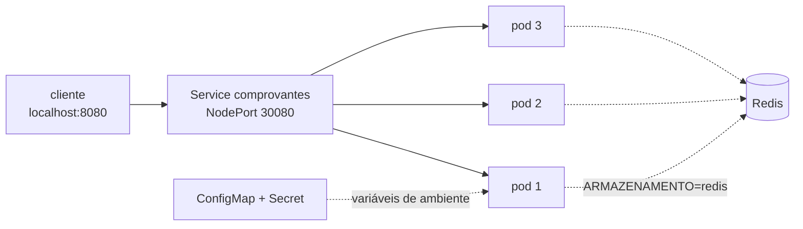

# Lab 2C: Kubernetes local com Kind - stateless, imagem imutável e health checks

Aula prática da seção 2 (Estilos Arquiteturais na Prática), depois da aula 2.11.

| | |
|---|---|
| Aulas relacionadas | 2.11 (contêineres: design stateless e imagem imutável) |
| Ambiente | Kind (Kubernetes local) |
| Ordem de estudo | Trilha Kubernetes local (Kind), passo 1 de 7 |

## Objetivo

Na aula 2.11 vimos que o modelo de contêiner obriga o serviço a externalizar estado, configuração e segredos, e que health checks são contratos entre a aplicação e a plataforma. Neste lab você vê o que acontece quando esses contratos são quebrados e quando são cumpridos, num cluster Kubernetes rodando na sua máquina.

O cenário é o da LunaLog: o serviço de comprovantes de entrega guarda o arquivo no disco do próprio contêiner. No primeiro scale-out, metade dos downloads devolve 404.

## O que você vai ver

- Um cluster com 1 control-plane e 2 workers criado com um comando e descartável
- O erro de design: estado no disco do pod, com 3 réplicas, gerando 404 intermitente
- A correção com **a mesma imagem**: só a configuração muda, o estado vai para o Redis
- Configuração e segredo entrando por ConfigMap e Secret, não pela imagem
- Matar um pod e ver o comprovante continuar disponível
- Readiness: um rollout sem erro para o cliente, e o mesmo rollout sem probes gerando 503
- Liveness: um pod travado sendo reiniciado sozinho

## Arquitetura do lab



- Uma única imagem, `lunalog/comprovantes:1.0.0`. O comportamento muda pela configuração (`ARMAZENAMENTO=local` ou `redis`).
- Três variações do mesmo Deployment, em `k8s/overlays`: `estado-local`, `stateless` e `sem-probes`.

## Pré-requisitos

- Docker Engine ou Docker Desktop
- [kind](https://kind.sigs.k8s.io/) e `kubectl` instalados
- Cerca de 6 GB de RAM livres
- Portas 8080 e 8081 livres no computador
- No Windows, os comandos funcionam no PowerShell e no WSL2

## Como executar

Todos os comandos são executados na pasta deste lab.

### 1. Criar o cluster

```bash
kind create cluster --config kind/cluster.yaml
kubectl get nodes
```

Você deve ver três nós `Ready`: um `control-plane` e dois workers. O cluster se chama `lunalog-arq` e será reaproveitado nos próximos labs da trilha.

### 2. Construir a imagem e carregá-la no cluster

```bash
docker build -t lunalog/comprovantes:1.0.0 app
kind load docker-image lunalog/comprovantes:1.0.0 --name lunalog-arq
```

O Kind não enxerga as imagens locais do Docker por padrão. O `kind load` copia a imagem para dentro dos nós.

### 3. O erro de design: estado no disco do pod

```bash
kubectl apply -k k8s/overlays/estado-local
kubectl -n lunalog rollout status deploy/comprovantes
kubectl -n lunalog get pods -o wide
```

O primeiro rollout leva cerca de 1 minuto, porque cada pod simula 20 segundos de aquecimento. Faça o upload de um comprovante (o arquivo `exemplos/comprovante.json` é o corpo da requisição):

```bash
curl -s -X POST localhost:8080/comprovantes -H "Content-Type: application/json" -d @exemplos/comprovante.json
```

Anote o `id` da resposta e repita o download várias vezes:

```bash
# Linux, macOS e WSL2
for i in $(seq 1 12); do curl -s -o /dev/null -w "%{http_code} " localhost:8080/comprovantes/<id>; done; echo
```

```powershell
# PowerShell
(1..12 | ForEach-Object { curl.exe -s -o NUL -w "%{http_code} " localhost:8080/comprovantes/<id> }) -join ''
```

O que observar: uma mistura de `200` e `404`. O arquivo existe em apenas um dos três pods (o campo `salvo_em` do upload diz qual), e o Service distribui as requisições entre todos.

### 4. A correção: mesma imagem, estado externalizado

```bash
kubectl apply -k k8s/overlays/stateless
kubectl -n lunalog rollout status deploy/comprovantes
kubectl -n lunalog get deploy comprovantes -o wide
```

A coluna `IMAGES` continua mostrando `lunalog/comprovantes:1.0.0`. A única diferença entre os dois overlays é a configuração. Compare os dois arquivos `kustomization.yaml`.

Antes do novo upload, confirme com `kubectl -n lunalog get pods` que restam só os três pods novos: um pod antigo ainda terminando pode receber o upload com o estado local, e os downloads dariam `404` mesmo na versão corrigida. Faça o upload e repita os downloads: agora todos devolvem `200`, não importa qual pod atenda.

Para ver o segredo entrando no pod sem estar na imagem:

```bash
kubectl -n lunalog describe deploy comprovantes
```

Na seção `Environment Variables from` aparecem o ConfigMap e o Secret. Para ver o ConfigMap gerado:

```bash
kubectl -n lunalog get configmap
```

Prove que o estado está fora do pod. Apague um pod e baixe o mesmo comprovante:

```bash
kubectl -n lunalog get pods
kubectl -n lunalog delete pod <nome-de-um-pod>
curl -s localhost:8080/comprovantes/<id>
```

O Deployment cria outro pod e o comprovante continua disponível.

### 5. Readiness: o contrato "posso receber tráfego?"

Em um terminal, deixe um laço rodando contra o download de um comprovante (use o `id` do upload feito na versão stateless, no passo 4). Não use a raiz `/`: ela sempre responde `200`, mesmo com o pod aquecendo, e esconderia o problema. Só as rotas de `/comprovantes` recusam tráfego durante o aquecimento.

```bash
# Linux, macOS e WSL2
while true; do curl -s -o /dev/null -m 3 -w "%{http_code} " localhost:8080/comprovantes/<id>; sleep 0.7; done
```

```powershell
# PowerShell
while ($true) { curl.exe -s -o NUL -m 3 -w "%{http_code} " localhost:8080/comprovantes/<id>; Start-Sleep -Milliseconds 700 }
```

Em outro terminal, acompanhe os pods e dispare um rollout:

```bash
kubectl -n lunalog get pods -w
kubectl -n lunalog rollout restart deploy/comprovantes
```

O que observar: os pods novos ficam `0/1 Running` por cerca de 20 segundos antes de virarem `1/1`, e o laço mostra apenas `200`. A readiness probe manteve o tráfego longe de quem ainda estava aquecendo.

Agora repita sem as probes:

```bash
kubectl apply -k k8s/overlays/sem-probes
kubectl -n lunalog rollout restart deploy/comprovantes
```

O que observar: o laço passa a mostrar `503` (e algumas conexões recusadas) durante o aquecimento. O Kubernetes enviou tráfego a pods que ainda não estavam prontos, porque ninguém contou a ele.

### 6. Liveness: o contrato "devo continuar vivo?"

Volte para a versão com probes e simule um travamento:

```bash
kubectl apply -k k8s/overlays/stateless
kubectl -n lunalog rollout status deploy/comprovantes
curl -s -X POST localhost:8080/admin/travar
kubectl -n lunalog get pods -w
```

A resposta mostra qual pod travou. O que observar: depois de cerca de 15 segundos o `RESTARTS` desse pod passa de `0` para `1`. Para ver o motivo:

```bash
kubectl -n lunalog describe pod <pod-que-travou>
```

Procure por `Liveness probe failed` e `Container comprovantes failed liveness probe, will be restarted` nos eventos.

## Como limpar

Para remover só a aplicação e manter o cluster para os próximos labs:

```bash
kubectl delete namespace lunalog
```

Para apagar o cluster inteiro:

```bash
kind delete cluster --name lunalog-arq
```

## Estrutura da pasta

```
lab-2c_kind-stateless-e-health-checks/
  README.md
  kind/
    cluster.yaml       (1 control-plane, 2 workers, portas 8080 e 8081)
  app/
    main.py            (serviço de comprovantes)
    Dockerfile
    requirements.txt
  k8s/
    base/              (Deployment, Service, Redis, Secret)
    overlays/
      estado-local/    (erro de design: ARMAZENAMENTO=local)
      stateless/       (correção: ARMAZENAMENTO=redis)
      sem-probes/      (stateless sem readiness e liveness)
  exemplos/
    comprovante.json   (corpo do upload)
```

## Limites deste lab

- O Redis roda com uma réplica e sem persistência. Em produção, o estado externalizado precisa de durabilidade (um banco gerenciado ou armazenamento de objetos).
- O aquecimento de 20 segundos é simulado, para tornar o efeito da readiness visível.
- A `liveness` aqui não verifica dependências externas de propósito. Colocar o banco de dados na liveness faz o Kubernetes reiniciar todos os pods quando o banco cai, o que piora o incidente.

## Para pensar

1. Com uma única réplica, o serviço com estado local funcionaria. Por que esse tipo de erro costuma aparecer só em produção?
2. O Redis agora é um ponto único de falha. O que mudou na arquitetura ao trocar o estado local por ele, e o que você faria para reduzir esse risco?
3. Por que a liveness probe não deve consultar o banco de dados, mas a readiness pode?
4. O segredo está no Secret, mas qualquer pessoa com acesso ao namespace consegue lê-lo. O que a trilha de segurança (seção 4) acrescenta a isso?
