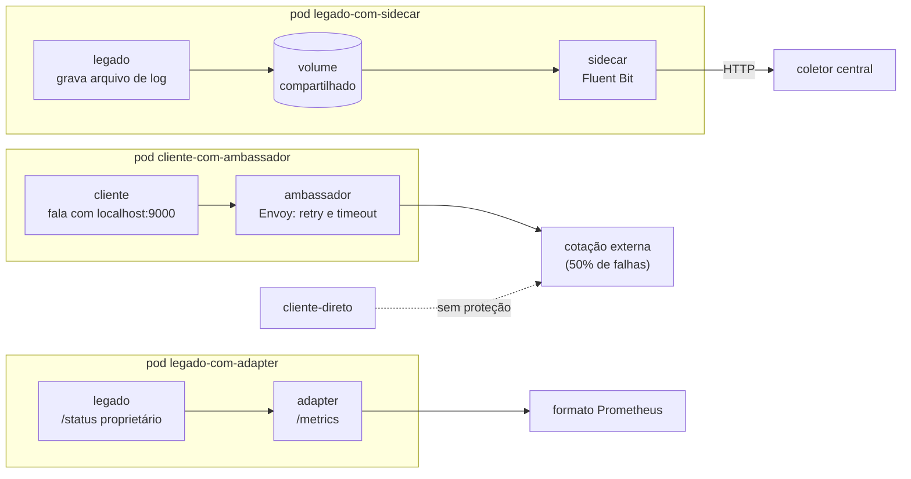

# Lab 2D: Padrões de pod - sidecar, ambassador e adapter

Aula prática da seção 2 (Estilos Arquiteturais na Prática), depois da aula 2.12.

| | |
|---|---|
| Aulas relacionadas | 2.12 (padrões de contêineres: sidecar, ambassador e adapter) |
| Ambiente | Kind (Kubernetes local) |
| Ordem de estudo | Trilha Kubernetes local (Kind), passo 2 de 7 (continua o lab 2C) |

## Objetivo

Na aula 2.12 vimos três padrões que operam dentro do pod e resolvem problemas de infraestrutura sem alterar o código da aplicação. Neste lab você executa os três em um cluster Kubernetes real, cada um em seu pod, e vê o efeito de cada um por comparação: o mesmo problema com e sem o padrão.

O cenário é o da LunaLog: o time de infraestrutura precisa padronizar logs, tornar uma dependência externa menos frágil e expor métricas de uma aplicação legada, em vários serviços, sem tocar no código deles.

## O que você vai ver

- **Sidecar**: uma aplicação que só grava logs em arquivo, e um contêiner auxiliar que lê o arquivo, enriquece cada linha e a envia a um coletor central
- **Ambassador**: um cliente que sofre com uma dependência que falha em 50% das chamadas, e o mesmo cliente protegido por um proxy no mesmo pod que faz retries por ele
- **Adapter**: uma aplicação legada que expõe seu estado em formato proprietário, e um contêiner que o traduz para o formato do Prometheus
- O que os contêineres de um pod **compartilham**: o volume (sidecar), a rede `localhost` (ambassador e adapter)

## Arquitetura do lab



Tudo roda no namespace `padroes`.

## Pré-requisitos

- Docker Engine ou Docker Desktop
- [kind](https://kind.sigs.k8s.io/) e `kubectl` instalados
- Cerca de 4 GB de RAM livres
- O cluster Kind da trilha. Se você ainda não o criou (lab 2C):

```bash
kind create cluster --config ../lab-2c_kind-stateless-e-health-checks/kind/cluster.yaml
```

## Como executar

Na pasta deste lab, aplique todos os manifests e espere os pods ficarem prontos:

```bash
kubectl apply -f manifests/
kubectl -n padroes wait --for=condition=Ready pod --all --timeout=240s
kubectl -n padroes get pods
```

A primeira execução baixa algumas imagens (Fluent Bit, Envoy, Python), então pode levar de 1 a 3 minutos. Repare na coluna `READY`: os pods dos padrões mostram `2/2`, ou seja, dois contêineres por pod, e o `cliente-direto` mostra `1/1`.

Para ver os contêineres de cada pod:

```bash
kubectl -n padroes describe pod legado-com-sidecar
```

### Padrão 1: sidecar

A aplicação `legado` só escreve em `/var/log/app/app.log`. Ela não escreve nada na saída padrão e não sabe falar com nenhum sistema de logs.

```bash
kubectl -n padroes logs legado-com-sidecar -c legado
```

O que observar: **nada**. Para a plataforma, a aplicação não tem logs, porque o `kubectl logs` lê apenas a saída padrão. É assim que muitos sistemas legados chegam ao Kubernetes.

Agora o sidecar:

```bash
kubectl -n padroes logs legado-com-sidecar -c fluent-bit
```

O que observar: as mesmas linhas do arquivo, em JSON, com dois campos que a aplicação não conhece: `pod` (o nome do pod) e `origem`. O Fluent Bit lê o **volume compartilhado** (`emptyDir`) montado nos dois contêineres, enriquece cada linha e a envia. E o destino final:

```bash
kubectl -n padroes logs deploy/coletor
```

O que observar: o coletor central recebeu cada linha, já padronizada. A aplicação não foi alterada. Para padronizar 12 serviços, o time de infraestrutura adiciona o mesmo sidecar a cada pod.

### Padrão 2: ambassador

A "cotação externa" falha em 50% das chamadas. Dois clientes fazem as mesmas chamadas, a cada 0,5 segundo:

```bash
kubectl -n padroes logs cliente-direto --tail 1
kubectl -n padroes logs cliente-com-ambassador -c cliente --tail 1
```

Espere o contador chegar a pelo menos 60 chamadas e repita. O que observar:

- `cliente-direto`: cerca de **metade das chamadas falha**, como seria de esperar de uma dependência que falha metade das vezes.
- `cliente-com-ambassador`: **quase nenhuma falha**. O cliente só fala com `localhost:9000`. O Envoy, no mesmo pod, recebe a chamada, repete até 3 vezes quando a resposta é 5xx e devolve o resultado.

Veja o trabalho do ambassador:

```bash
kubectl -n padroes exec cliente-com-ambassador -c cliente -- wget -qO- http://localhost:9901/stats | grep -E "cluster.externa.upstream_rq_(retry|total):"
```

O que observar: o total de requisições do Envoy à dependência é bem maior que o número de chamadas do cliente, e o contador `upstream_rq_retry` mostra quantas foram retentativas. O cliente não sabe de nada disso.

### Padrão 3: adapter

O `legado` expõe `/status` em um formato próprio, `CHAVE=valor;CHAVE=valor`, que o Prometheus não entende. Veja a saída do adapter (a requisição parte de um pod temporário):

```bash
kubectl -n padroes run curl --rm -i --restart=Never --image=curlimages/curl:8.11.0 -- curl -s http://legado-metricas:9100/metrics
```

O que observar: as mesmas informações no formato de exposição do Prometheus, com `# HELP`, `# TYPE` (counter e gauge) e nomes padronizados. O adapter lê `http://127.0.0.1:8080/status`: o `localhost` é **compartilhado** entre os contêineres de um pod, e é por isso que ele alcança a aplicação sem nenhuma exposição de rede.

Repita o comando algumas vezes: os valores mudam, porque o adapter traduz o estado atual a cada requisição.

## O que os contêineres de um pod compartilham

| Recurso | Compartilhado? | Usado em |
|---|---|---|
| Rede (`localhost`, portas) | sim | Ambassador e adapter |
| Volumes montados | sim, quando declarado | Sidecar (logs) |
| Sistema de arquivos do contêiner | não | |
| Ciclo de vida do pod | sim: nascem e morrem juntos | Os três |

## Como limpar

Para remover só este lab e manter o cluster para os próximos:

```bash
kubectl delete namespace padroes
```

Para apagar o cluster inteiro:

```bash
kind delete cluster --name lunalog-arq
```

## Estrutura da pasta

```
lab-2d_pod-patterns-sidecar-ambassador-adapter/
  README.md
  manifests/
    00-namespace.yaml
    10-sidecar.yaml      (aplicação legada, Fluent Bit e coletor)
    20-ambassador.yaml   (dependência instável, cliente direto e cliente com Envoy)
    30-adapter.yaml      (aplicação legada e adapter para o Prometheus)
```

## Limites deste lab

- As aplicações são pequenos scripts, para o foco ficar nos padrões. O coletor central é um servidor que só imprime. Em produção, o destino é um sistema de logs como Loki ou Elasticsearch.
- Cada pod do ambassador usa um Envoy completo para fazer retries simples. Em uma malha de serviços (service mesh), esse papel é desempenhado por um proxy injetado automaticamente em todos os pods, que é o assunto do lab 4F.
- Os retries do ambassador são seguros aqui porque as chamadas são de leitura (idempotentes). Retry automático em operações que mudam estado exige uma chave de idempotência.
- O Kubernetes recente também tem suporte nativo a contêineres sidecar (`initContainers` com `restartPolicy: Always`), com ordem de inicialização garantida. Aqui o sidecar é um contêiner comum, o modelo mais difundido.

## Para pensar

1. O sidecar de logs precisa estar em **todo** pod que quer logs centralizados. Que alternativa existe (um agente por nó, e não por pod), e quando você preferiria cada uma?
2. O ambassador esconde as falhas do cliente. Em que situações isso é perigoso? (Pense em retry de operações que mudam estado e em falhas que o cliente precisaria saber.)
3. O adapter traduz um formato para outro sem alterar a aplicação. Compare com mudar o código da aplicação legada: o que cada caminho custa e o que cada um arrisca?
4. Esses três contêineres compartilham o ciclo de vida do pod. O que acontece com os logs ainda não enviados se o pod for encerrado?
