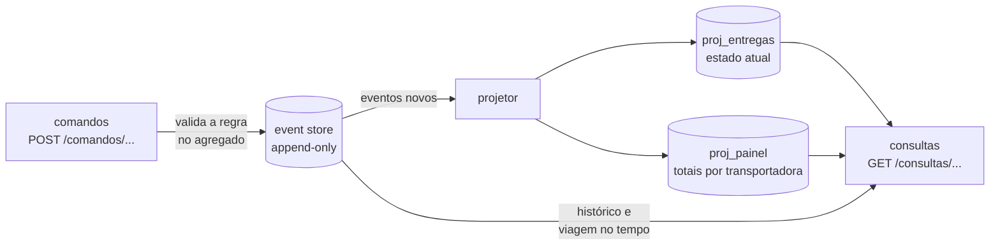

# Lab 2F: CQRS e Event Sourcing sobre o domínio hexagonal

Aula prática da seção 2 (Estilos Arquiteturais), depois da aula 2.14.

| | |
|---|---|
| Aulas relacionadas | 2.14 (CQRS e Event Sourcing: separando leitura, escrita e histórico) |
| Ambiente | Docker Compose (PostgreSQL, FastAPI, Python) |
| Ordem de estudo | Trilha Hexagonal, passo 2 de 2 (evolui o domínio do lab 2E). Pode ser feito sozinho |

## Objetivo

Na aula 2.14 vimos o pedido de um cliente enterprise do setor farmacêutico: trilha de auditoria completa de cada mudança de status de entrega de medicamentos controlados, com histórico **imutável** para fins regulatórios. O modelo atual da LunaLog **sobrescreve** o status: quando uma entrega vai de "em rota" para "entregue", o estado anterior desaparece. O Event Sourcing transforma o log de eventos na fonte da verdade, e o CQRS separa o lado que decide do lado que consulta.

Neste lab você evolui o domínio de entregas do lab 2E: em vez de guardar o estado atual, o sistema guarda os **fatos que aconteceram**, e o estado é derivado deles. Você vê o histórico imutável, a consulta em um instante do passado, **dois modelos de leitura** alimentados pelo mesmo fluxo, a consistência eventual (com um atraso visível), a reconstrução de um modelo por *replay* e o custo real de evoluir o formato de um evento.

## O que você vai ver

- **Event store append-only**: eventos imutáveis, protegidos pelo próprio banco contra `UPDATE` e `DELETE`
- Comandos que **validam a regra** contra o estado reconstruído dos eventos e **acrescentam fatos**
- **Controle otimista de concorrência** pela versão do agregado
- **Duas projeções** com formatos diferentes (estado atual de cada entrega e painel por transportadora), do mesmo fluxo
- A **consistência eventual** entre escrita e leitura, com um atraso proposital visível
- **Replay**: apagar uma projeção e reconstruí-la do zero, com resultado idêntico
- **Consulta no passado**: o estado da entrega em qualquer instante
- A evolução do **esquema de um evento** (upcasting) e o seu custo

## Arquitetura do lab



- O **lado de comando** reconstrói o agregado `Entrega` a partir dos seus eventos (`src/dominio.py`), executa a regra e, se válida, grava **novos eventos**. Ele nunca altera o passado.
- O **lado de consulta** lê **modelos de leitura** (projeções) prontos para cada pergunta, e também o próprio event store (histórico e consulta no passado).
- O **projetor** (`src/projetor.py`) roda **em separado** e atualiza as projeções a partir dos eventos novos. É por isso que a leitura é **eventualmente consistente**.
- A regra de negócio (confirmar só a até 100 m do endereço) é a mesma do lab 2E.

## Pré-requisitos

- Docker Engine ou Docker Desktop (Compose v2)
- Cerca de 1 GB de RAM livre
- A porta 9401 livre

## Como executar

Na pasta deste lab:

```bash
docker compose up -d --build
docker compose --profile ferramentas run --rm testes     # 8 testes do domínio
```

Para encurtar os comandos abaixo:

```bash
B=localhost:9401
c() { curl -s -X POST $B/comandos/entregas/$1/$2 -H 'Content-Type: application/json' -d "$3"; echo; }
```

### Cenário 1: comandos que acrescentam fatos

```bash
c E-1 registrar '{"codigo":"E-1001","transportadora":"rapido","previsao":"2026-11-10","lat":-23.5614,"lon":-46.6559,"ator":"ana"}'
c E-2 registrar '{"codigo":"E-1002","transportadora":"veloz","previsao":"2026-11-11","lat":-23.5632,"lon":-46.6544,"ator":"ana"}'
c E-1 iniciar-rota '{"motorista":"bruno","ator":"ana"}'
c E-1 reagendar '{"nova_previsao":"2026-11-12","motivo":"chuva","ator":"ana"}'
```

Cada resposta lista os **eventos gravados** (`EntregaRegistrada`, `RotaIniciada`, `EntregaReagendada`) e a nova **versão** do agregado. Agora, um comando que a regra de negócio recusa:

```bash
c E-1 confirmar '{"lat":-23.5414,"lon":-46.6559,"ator":"bruno"}'
# {"detail":"motorista a 2224 m do destino (maximo 100 m)"}
```

Nada é gravado: um comando inválido **não produz evento**. A regra mora no domínio (`Entrega.confirmar`), testada sem banco em `tests/test_dominio.py`.

### Cenário 2: duas consultas, dois modelos de leitura

```bash
curl -s $B/consultas/entregas/E-1
curl -s $B/consultas/painel
```

```
{"id":"E-1","status":"em_rota","previsao":"2026-11-12","transportadora":"rapido","reagendamentos":1,"versao":3,"versao_no_event_store":3,"defasagem":0}
[{"transportadora":"rapido","registradas":1,"em_rota":1,"entregues":0,...},{"transportadora":"veloz","registradas":1,...}]
```

O **mesmo fluxo de eventos** alimenta duas projeções de formatos diferentes: o estado atual por entrega (para consultar por id) e os totais por transportadora (para o painel). Cada uma está no formato **que a pergunta pede**, sem junções nem agregações no momento da consulta. Esse é o ponto do CQRS: o modelo de escrita é feito para **proteger as regras**, e o de leitura, para **responder rápido**.

### Cenário 3: consistência eventual, com atraso visível

O projetor roda à parte, então a leitura pode estar um passo atrás da escrita. Para ver isso, aumente o atraso do projetor para 800 ms por evento:

```bash
curl -s -X POST "$B/admin/atraso?ms=800"
c E-1 confirmar '{"lat":-23.5614,"lon":-46.6559,"ator":"bruno"}'
curl -s $B/consultas/entregas/E-1        # logo depois
sleep 3
curl -s $B/consultas/entregas/E-1        # alguns segundos depois
curl -s -X POST "$B/admin/atraso?ms=0"
```

O que observar: logo após o comando, a consulta ainda mostra `"status":"em_rota"` e `"defasagem":1` (a projeção está na versão 3, o event store na 4). Poucos segundos depois, `"status":"entregue"` e `"defasagem":0`. **O comando foi aceito, mas a leitura demora a refletir.** Isso exige decisões de produto: o que a tela mostra logo depois de o usuário agir? (Por exemplo: a própria resposta do comando traz a nova versão, e a interface a usa até a projeção alcançar.)

### Cenário 4: concorrência otimista

Dois operadores agindo sobre a mesma entrega ao mesmo tempo. Cada comando pode dizer em que versão **achava** que a entrega estava:

```bash
c E-2 iniciar-rota '{"motorista":"carla","ator":"ana","versao_esperada":0}'
# {"detail":"conflito: a entrega esta na versao 1, nao na 0"}
```

Se outro comando gravou antes, a versão não confere e o comando é recusado com `409`. No banco, a garantia final é a restrição `UNIQUE (agregado_id, versao)`: dois eventos não ocupam a mesma posição no fluxo, mesmo sem a verificação da aplicação.

### Cenário 5: o histórico é imutável

```bash
curl -s $B/consultas/entregas/E-1/historico | python -m json.tool
```

A API devolve uma lista JSON com um item por evento (sem o `python -m json.tool`, ela vem em uma linha só). Resumido, o resultado é:

```
versao 1  EntregaRegistrada  ana    dados: lat, lon, codigo, previsao, transportadora
versao 2  RotaIniciada       ana    dados: {"motorista": "bruno"}
versao 3  EntregaReagendada  ana    dados: {"motivo": "chuva", "nova_previsao": "2026-11-12"}
versao 4  EntregaConfirmada  bruno  dados: {"lat": -23.5614, "lon": -46.6559, "distancia_m": 0.0}
```

Cada item traz também o `esquema` do evento e o instante `em` que ele foi gravado.

É a trilha de auditoria que o cliente farmacêutico pediu: **quem** fez **o quê** e **quando**, sem que nada tenha sido sobrescrito. E ela é protegida **no banco**, não só na aplicação:

```bash
docker compose exec -T postgres psql -U luna -d eventos -c "UPDATE eventos SET ator = 'fraude' WHERE id = 1"
docker compose exec -T postgres psql -U luna -d eventos -c "DELETE FROM eventos WHERE id = 1"
# ERROR:  o event store e imutavel: UPDATE nao e permitido
# ERROR:  o event store e imutavel: DELETE nao e permitido
```

O gatilho (`sql/init.sql`) recusa qualquer alteração ou exclusão. Um erro ou um fato errado se **corrige com um novo evento** (um cancelamento, um ajuste), nunca editando o passado.

### Cenário 6: consulta no passado

O estado da entrega em um instante qualquer, reconstruído dos eventos. Use o horário do evento 2 (`RotaIniciada`), que aparece no campo `em` do histórico:

```bash
T=$(curl -s $B/consultas/entregas/E-1/historico | python -c "import sys,json; print(json.load(sys.stdin)[1]['em'])")
curl -s -G "$B/consultas/entregas/E-1/em" --data-urlencode "instante=$T"
```

```
{"instante":"...","status":"em_rota","previsao":"2026-11-10","reagendamentos":0,"versao":2}
```

Naquele instante a entrega estava **em rota**, com a previsão **original** (10/11), sem o reagendamento que viria depois. Com o modelo que sobrescreve, essa pergunta ("como estava no dia da disputa?") **não tem resposta**: a informação foi destruída. Aqui, ela vem de graça.

### Cenário 7: replay, e o painel reconstruído do zero

As projeções são **derivadas**, então são descartáveis. Pare o projetor, apague as duas projeções de propósito e reconstrua:

```bash
docker compose stop projetor
docker compose exec -T postgres psql -U luna -d eventos -c "TRUNCATE proj_entregas, proj_painel"
curl -s $B/consultas/painel                                   # []  (vazio)
docker compose --profile ferramentas run --rm replay
curl -s $B/consultas/painel                                   # de volta
docker compose start projetor
```

```
replay de 5 eventos em 0.02 s
impressao digital das projecoes: antes=e3b0c44298fc1c14 depois=eeaf3fa93bb83b61  ->  DIFERENTE
```

O painel volta **idêntico** ao que era. O `DIFERENTE` aparece porque, no momento do replay, as projeções estavam vazias (`antes` é a impressão digital do vazio). Rode o `replay` de novo, agora com as projeções intactas, e a impressão digital antes e depois é igual: `IDENTICA`. O tempo e a impressão digital exatos variam; a contagem de eventos depende de quantos comandos você aceitou até aqui (neste roteiro, 5). Isso muda a forma de evoluir as consultas: para criar uma **nova** projeção (um relatório que o negócio pediu agora), não há migração de dados: escreve-se o código que a atualiza e faz-se um replay do passado inteiro.

### Cenário 8: evoluir o formato de um evento (o custo)

Eventos são imutáveis, mas o formato deles muda com o tempo. A versão 1 de `EntregaReagendada` não tinha o **motivo**; a versão 2 tem. E os eventos antigos **continuam lá**, no formato antigo. Grave um evento antigo, como se fosse do passado:

```bash
curl -s -X POST "$B/admin/evento-antigo?entrega_id=E-2"
curl -s $B/consultas/entregas/E-2/historico
```

O histórico mostra o evento 2 com `esquema 1` e **sem** o motivo: o passado não foi reescrito. A projeção e o agregado o leem normalmente, porque a função `atualizar_esquema` (em `src/dominio.py`) faz o **upcasting**: lê o evento v1 **como** v2, com o motivo `nao_informado`. O teste `test_upcasting_le_o_evento_antigo_no_formato_novo` prova que o evento original não é alterado.

O **custo**: cada mudança de formato exige um *upcaster* que **vive para sempre** (enquanto houver eventos antigos), com testes. Quanto mais versões, mais conversores para manter. Por isso o desenho dos eventos precisa de cuidado: eles são **contratos de longo prazo**, e é mais fácil acrescentar um campo opcional do que mudar o significado de um existente.

## Resultados de referência

| Medida | Resultado |
|---|---|
| Testes do domínio | 8 passam, sem banco |
| Comando que viola a regra | recusado (`422`), nenhum evento gravado |
| Leitura logo depois do comando, com projetor lento | defasagem de 1 versão; depois de poucos segundos, 0 |
| Conflito de versão | `409` |
| `UPDATE` e `DELETE` no event store | negados pelo banco |
| Consulta no passado | estado e previsão originais, sem o reagendamento posterior |
| Replay de 5 eventos | 0,02 s; projeção idêntica à anterior |
| Evento v1 | lido como v2 (`motivo: nao_informado`) sem alterar o original |

## Como limpar

```bash
docker compose down -v
```

## Estrutura da pasta

```
lab-2f_cqrs-e-event-sourcing/
  README.md
  docker-compose.yml, Dockerfile, pytest.ini
  sql/init.sql                 (event store imutável, projeções, controle do projetor)
  src/
    dominio.py                 (agregado Entrega, eventos, comandos e upcasting)
    store.py                   (acrescentar com controle de versão e ler fluxos)
    projecoes.py               (as duas projeções e a impressão digital)
    projetor.py                (atualiza as projeções a partir dos eventos)
    reconstruir.py             (replay)
    api.py                     (comandos e consultas)
  tests/test_dominio.py
```

## Limites deste lab

- **Event Sourcing não é para tudo.** Traz complexidade real (projeções, consistência eventual, evolução de eventos). Vale quando a **história importa** (auditoria, regulação, disputa) ou quando há **vários modelos de leitura**. Para um cadastro simples, é um custo sem retorno. É o critério da próxima aula.
- O lab reconstrói o agregado lendo **todos** os seus eventos. Com fluxos longos (milhares de eventos), usam-se **snapshots** (um estado salvo de tempos em tempos, a partir do qual se aplica só o que veio depois).
- O projetor é **um só** e relê do banco com *polling*. Em produção, usa-se um broker de eventos ou o log do banco para distribuir os eventos, e o projetor precisa ser **idempotente** e tolerar a reentrega.
- O lab não resolve a **publicação confiável** dos eventos para outros sistemas (o padrão *outbox*), nem o **versionamento de projeções** em produção (reconstruir sem tirar a consulta do ar).
- **Dados pessoais e direito ao esquecimento:** um event store imutável conflita com a exigência de apagar dados pessoais (LGPD). Soluções incluem guardar dados pessoais fora dos eventos (referenciados) ou criptografá-los com uma chave por pessoa e descartar a chave (*crypto-shredding*). O lab não trata disso.
- A consulta no passado usa o horário gravado no banco (`ocorrido_em`). Em um sistema real, decida se o que importa é o horário em que o fato **aconteceu** ou o em que foi **registrado**.
- Os dados e as credenciais (`luna`/`luna`) são fictícios.

## Para pensar

1. Em quais partes do seu sistema a pergunta "como isso estava na semana passada?" **não tem resposta** hoje? Quanto custaria não poder responder?
2. Que telas ou fluxos do seu produto toleram uma leitura alguns segundos atrasada, e quais não? O que você faria nos que não toleram?
3. Qual é o evento do seu domínio que você teria mais medo de errar o formato, sabendo que ele viverá para sempre?
4. O Event Sourcing se justifica no seu caso pela auditoria, pelos vários modelos de leitura, ou por nenhum dos dois?
