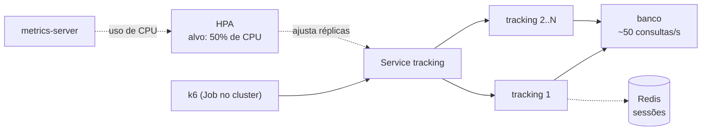

# Lab 3A: Escala horizontal no Kind - HPA sob carga e o custo do estado local

Aula prática da seção 3 (Design de Sistemas Escaláveis), depois da aula 3.1.

| | |
|---|---|
| Aulas relacionadas | 3.1 (escalabilidade horizontal e vertical: fundamentos) |
| Ambiente | Kind (Kubernetes local) |
| Ordem de estudo | Trilha Kubernetes local (Kind), passo 3 de 7 (continua o lab 2D) |

## Objetivo

Na aula 3.1 vimos que a escala horizontal depende de o serviço ser stateless e que adicionar instâncias só ajuda quando o gargalo está onde elas atuam. Neste lab você submete uma API a uma carga crescente em um cluster Kubernetes, vê o autoscaler adicionar réplicas sozinho e descobre três limites da escala horizontal: o tempo de reação, o estado local e o gargalo que fica atrás.

O cenário é o da LunaLog, três dias antes da Black Friday: o serviço de tracking recebe um pico crescente de requisições, e a primeira ideia é "aumentar o servidor".

## O que você vai ver

- O mesmo serviço **sem** autoscaler, saturado: latência na casa dos segundos
- O **HPA** (Horizontal Pod Autoscaler) criando réplicas conforme o uso de CPU, de 1 até 8, e a latência voltando ao normal
- O **tempo de reação** do autoscaler: a escala não é instantânea, e esse atraso é custo real
- O **estado local** no mundo escalado: sessões em memória fazendo o usuário "perder o login" aleatoriamente, e o mesmo serviço com as sessões no Redis
- O **gargalo atrás** da API: 2 ou 8 réplicas da API dão o mesmo resultado ruim, porque o limite está no banco. Escalar o gargalo resolve
- Os limites de CPU (`requests` e `limits`) que sustentam o cálculo do HPA

## Arquitetura do lab



- **tracking**: a API. `/cotacao` consome CPU de verdade (cerca de 25 ms por chamada), `/consulta` depende do banco e `/sessao/...` guarda sessões em memória ou no Redis.
- **banco**: atende uma requisição por vez, 20 ms cada: capacidade fixa de cerca de 50 por segundo, qualquer que seja o número de réplicas da API.
- **metrics-server**: mede o uso de CPU dos pods. O HPA depende dele.

## Pré-requisitos

- Docker Engine ou Docker Desktop
- [kind](https://kind.sigs.k8s.io/) e `kubectl` instalados
- Cerca de 6 GB de RAM livres
- O cluster Kind da trilha (lab 2C). Se ainda não existe:

```bash
kind create cluster --config ../../../02_estilos_arquiteturais/labs/lab-2c_kind-stateless-e-health-checks/kind/cluster.yaml
```

- Se você acabou de fazer o lab 2C no mesmo cluster, apague o namespace dele antes: o Service `comprovantes` ocupa a porta de nó 30080, a mesma da API deste lab, e o `kubectl apply` falha com `provided port is already allocated`.

```bash
kubectl delete namespace lunalog --ignore-not-found
```

## Como executar

Na pasta deste lab, execute os passos de preparo.

**1. Metrics-server** (o manifest oficial, com o ajuste de TLS necessário no Kind):

```bash
kubectl apply -f manifests/00-metrics-server.yaml
kubectl -n kube-system rollout status deploy/metrics-server
kubectl top nodes
```

Se `kubectl top nodes` ainda responder "Metrics API not available", espere 30 segundos e repita.

**2. A imagem da API e a aplicação:**

```bash
docker build -t lunalog/tracking-cpu:1.0.0 app
kind load docker-image lunalog/tracking-cpu:1.0.0 --name lunalog-arq
kubectl apply -f manifests/10-app.yaml
kubectl -n escala wait --for=condition=Available deploy --all --timeout=180s
```

**3. Os scripts do k6, como ConfigMap** (o k6 roda dentro do cluster, como um Job):

```bash
kubectl -n escala create configmap k6-scripts --from-file=k6/
```

A API também fica acessível no seu computador em http://localhost:8080.

### Cenário 1: carga sem autoscaler

Uma réplica, 40 requisições por segundo durante 60 segundos. O manifest vem com 120 s (a duração do Cenário 2), então aqui trocamos para 60 s no caminho:

```bash
# Linux, macOS e WSL2
sed 's/120s/60s/' manifests/20-job-cotacao.yaml | kubectl apply -f -
```

```powershell
# PowerShell
(Get-Content manifests/20-job-cotacao.yaml) -replace '120s','60s' | kubectl apply -f -
```

```bash
kubectl -n escala wait --for=condition=complete job/k6-cotacao --timeout=300s
kubectl -n escala logs job/k6-cotacao | tail -n 20
kubectl -n escala top pods
```

O que observar: a latência média passa de 2 segundos (3 a 4 s em uma medição de referência, com p95 de 4 a 6 s; com 120 s a fila cresce e piora, com falhas), e o `top pods` mostra o pod da API **no limite de CPU (250m)**. Uma réplica só não dá conta: cada chamada custa 25 ms de CPU, e o pod tem teto de 250m, o que equivale a cerca de 10 requisições por segundo.

### Cenário 2: o HPA

Apague o Job anterior, ligue o autoscaler e repita a carga, acompanhando as réplicas em outro terminal:

```bash
kubectl -n escala delete job k6-cotacao
kubectl apply -f manifests/15-hpa.yaml
kubectl apply -f manifests/20-job-cotacao.yaml
kubectl -n escala get hpa tracking -w
```

O que observar, ao longo dos 120 segundos:

- O uso de CPU sobe (`81%/50%`, depois `250%/50%`) e a coluna de réplicas passa de 1 para 3, 5, 7 e 8 (o máximo do HPA), uma linha nova a cada 15 segundos.
- A cada passo, o autoscaler recalcula: `réplicas = réplicas atuais x (uso atual / alvo)`. Quando o uso médio volta para perto de 50%, ele para.
- O resumo do k6 mostra **0% de falhas**, mas a latência média da rodada inteira ainda é alta (de 2 a 6 s, conforme a máquina). O motivo está no próximo item.

**O tempo de reação é custo.** Do início da carga até a estabilização foram cerca de 90 segundos: a métrica é coletada de tempos em tempos, o autoscaler decide, o Kubernetes agenda os pods e eles precisam ficar prontos. Durante esse intervalo, os usuários sofrem. Escala horizontal responde a **tendências**, não a picos súbitos. Para picos previsíveis (a Black Friday!), a resposta é escalar **antes**.

Agora repita a carga com as réplicas já criadas. Faça isso **logo depois que o Job anterior terminar**: sem carga, o HPA começa a reduzir as réplicas em cerca de um minuto, e a comparação perde o sentido.

```bash
kubectl -n escala delete job k6-cotacao
kubectl apply -f manifests/20-job-cotacao.yaml
kubectl -n escala wait --for=condition=complete job/k6-cotacao --timeout=300s
kubectl -n escala logs job/k6-cotacao | tail -n 12
```

O que observar: com as réplicas prontas (7 ou 8), a latência média cai para algumas dezenas de milissegundos (de 60 a 110 ms nas medições de referência) e o p95 para 150 a 280 ms, contra mais de 2 segundos com uma réplica. O mesmo código, a mesma carga, o mesmo custo de CPU por chamada: só mudou o número de instâncias.

Depois que a carga termina, o HPA reduz as réplicas gradualmente (observe com `kubectl -n escala get hpa tracking -w`).

### Cenário 3: o estado local

Desligue o autoscaler, fixe 3 réplicas e crie uma sessão (a API está em `localhost:8080`):

```bash
kubectl -n escala delete hpa tracking
kubectl -n escala scale deploy/tracking --replicas=3
kubectl -n escala rollout status deploy/tracking
curl -s -X POST "localhost:8080/sessao/entrar?usuario=ana"
```

Anote o `sid` da resposta e consulte o perfil várias vezes:

```bash
# Linux, macOS e WSL2
for i in $(seq 1 10); do curl -s -o /dev/null -w "%{http_code} " "localhost:8080/sessao/perfil?sid=<sid>"; done; echo
```

```powershell
# PowerShell
(1..10 | ForEach-Object { curl.exe -s -o NUL -w "%{http_code} " "localhost:8080/sessao/perfil?sid=<sid>" }) -join ''
```

O que observar: uma mistura de `200` e `401`. A sessão existe em apenas um dos 3 pods (cada um guarda as sessões em memória) e o Service distribui as requisições entre todos. É exatamente o problema da LunaLog na aula 3.1, e o motivo pelo qual escalar sem statelessness não funciona.

Externalize as sessões e repita:

```bash
kubectl -n escala set env deploy/tracking SESSOES=redis
kubectl -n escala rollout status deploy/tracking
curl -s -X POST "localhost:8080/sessao/entrar?usuario=ana"
```

Use o novo `sid` na mesma sequência de consultas. O que observar: dez respostas `200`, não importa qual pod atenda.

### Cenário 4: o gargalo atrás da API

O endpoint `/consulta` depende do banco, que atende no máximo cerca de 50 consultas por segundo. A carga é de 80 por segundo.

```bash
kubectl -n escala scale deploy/tracking --replicas=2
kubectl -n escala rollout status deploy/tracking
kubectl -n escala delete job k6-consulta --ignore-not-found
kubectl apply -f manifests/21-job-consulta.yaml
kubectl -n escala wait --for=condition=complete job/k6-consulta --timeout=300s
kubectl -n escala logs job/k6-consulta | tail -n 14
```

Repita com 8 réplicas da API (`kubectl -n escala scale deploy/tracking --replicas=8`, apagando o Job antes). O que observar: **o resultado é igualmente ruim**. Com 2 réplicas, entre um terço e metade das requisições falha (32% a 51%); com 8, o mesmo (33% a 41%), e o p95 fica em 10 segundos (o limite de timeout) nos dois casos. A vazão total fica presa em torno de 60 requisições por segundo, a capacidade do banco. Mais réplicas da API só colocam mais requisições na fila do mesmo gargalo.

Agora escale o gargalo, e não a API:

```bash
kubectl -n escala scale deploy/banco --replicas=3
kubectl -n escala rollout status deploy/banco
kubectl -n escala delete job k6-consulta
kubectl apply -f manifests/21-job-consulta.yaml
kubectl -n escala wait --for=condition=complete job/k6-consulta --timeout=300s
kubectl -n escala logs job/k6-consulta | tail -n 14
```

O que observar: p95 de 40 a 50 ms e **zero falhas**, a 80 requisições por segundo. Escalar horizontalmente funciona quando o gargalo é o que você escala.

## Resultados de referência

| Cenário | Latência média | p95 | Falhas |
|---|---|---|---|
| 1 réplica, 40 req/s (60 s) | 2 a 4 s | 3 a 6 s | 0 a 7% |
| HPA durante a escalada (1 para 8 réplicas, 120 s) | 2,5 a 6 s | 3,5 a 8 s | 0% |
| 8 réplicas prontas, 40 req/s | 0,06 a 0,11 s | 0,15 a 0,28 s | 0 a 1% |
| Sessões em memória, 3 réplicas | | | 6 de 10 consultas com 401 |
| Sessões no Redis, 3 réplicas | | | 0 de 10 |
| `/consulta` 80 req/s, API x2, banco x1 | 6,5 a 7,6 s | 10 s | 32 a 51% |
| `/consulta` 80 req/s, API x8, banco x1 | 4,4 a 5,6 s | 10 s | 33 a 41% |
| `/consulta` 80 req/s, API x8, banco x3 | 0,03 s | 0,04 a 0,05 s | 0% |

Os números dependem da sua máquina; o padrão se mantém.

## Como limpar

Para remover só este lab, mantendo o cluster e o metrics-server para os próximos:

```bash
kubectl delete namespace escala
```

Para apagar o cluster inteiro:

```bash
kind delete cluster --name lunalog-arq
```

## Estrutura da pasta

```
lab-3a_hpa-escala-horizontal/
  README.md
  app/                         (API de cotação: CPU, banco e sessões)
  k6/
    cotacao.js                 (carga que consome CPU)
    consulta.js                (carga que depende do banco)
  manifests/
    00-metrics-server.yaml     (metrics-server com o ajuste de TLS para o Kind)
    10-app.yaml                (API, Redis e banco)
    15-hpa.yaml                (o autoscaler)
    20-job-cotacao.yaml        (carga de CPU, como Job)
    21-job-consulta.yaml       (carga no banco, como Job)
```

## Limites deste lab

- O custo de CPU é simulado com um laço de cálculo (hash). O comportamento do HPA é real, mas os números absolutos dependem da sua máquina.
- O HPA aqui usa janelas curtas de estabilização para caber na aula. Em produção, valores maiores evitam o "flapping" (criar e remover réplicas em sequência).
- O `metrics-server` está com `--kubelet-insecure-tls`, necessário apenas porque o Kind usa certificados autoassinados. Nunca use isso em produção.
- A probe de readiness da API é tolerante de propósito (ver o comentário em `10-app.yaml`). Com uma probe rígida, um pod saturado vira "não pronto" e o HPA deixa de enxergá-lo, justamente quando mais precisa.
- Escalar também consome recursos do cluster: se os nós não têm CPU livre, os pods novos ficam em `Pending`. Em nuvem, isso se resolve com um autoscaler de nós, que acrescenta mais latência à reação.
- Este lab escala sobre CPU. Cargas orientadas a fila escalam melhor por métricas como tamanho da fila (por exemplo, com KEDA).

## Para pensar

1. O HPA levou cerca de 90 segundos para estabilizar. O que isso diz sobre usar autoscaling para lidar com a Black Friday? O que você faria além disso?
2. O tráfego duplicou e a API escalou. O banco, não. Como você descobriria, num sistema de produção, **qual** componente é o gargalo antes de sair adicionando réplicas?
3. Nos cenários com sessão em memória, o usuário perdia o login em algumas requisições. Além de externalizar a sessão, existe outra saída (afinidade de sessão no balanceador)? Quais são as desvantagens dela?
4. Escala vertical (aumentar o limite de CPU de cada pod) também resolveria o cenário 1. Em que situações você preferiria uma ou outra?
