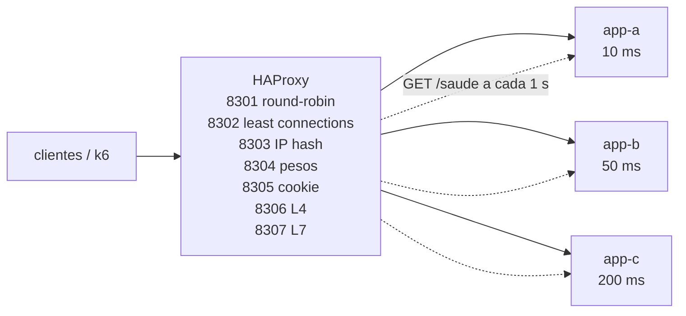

# Lab 3B: Load balancing: algoritmos, afinidade de sessão e camadas L4 e L7

Aula prática da seção 3 (Design de Sistemas Escaláveis), depois da aula 3.3.

| | |
|---|---|
| Aulas relacionadas | 3.3 (load balancing: algoritmos e estratégias) |
| Ambiente | Docker Compose (HAProxy) |
| Ordem de estudo | Independente. Para o balanceamento dentro do Kubernetes, veja a trilha Kind (lab 3A) |

## Objetivo

Na aula 3.3 vimos que o balanceador não é só um distribuidor de requisições: o algoritmo escolhido muda o desempenho, e o design do serviço por trás dele decide se o balanceamento funciona. O caso da LunaLog: um login cai na instância A, a requisição seguinte vai para a B, que não conhece a sessão e responde 401, e cinquenta transportadoras reclamam que "o sistema fica pedindo login toda hora".

Neste lab um único HAProxy expõe **sete balanceadores** em portas diferentes, todos na frente das mesmas três instâncias de capacidades diferentes. Você mede cada algoritmo com a mesma carga, reproduz o problema de sessão, vê o que a afinidade resolve e o que ela custa, compara camadas L4 e L7 e observa o health check retirando uma instância.

## O que você vai ver

- **Round-robin, least connections, IP hash e pesos**, com a distribuição medida por instância e o efeito na latência
- Instâncias de **capacidade desigual** (10, 50 e 200 ms) e por que o round-robin as trata como iguais
- O **problema da sessão local** reproduzido, a **afinidade por cookie** e a solução estrutural (**token assinado**)
- **L4 (TCP) versus L7 (HTTP)**: o que cada camada enxerga e o que consegue decidir
- **Roteamento L7** por caminho e por header
- **Health check ativo** retirando uma instância que caiu

## Arquitetura do lab



- As três instâncias rodam o mesmo código, com **atrasos diferentes** (`ATRASO_MS`): a rápida, a média e a lenta. Cada uma guarda as sessões **na própria memória**, como o serviço de autenticação do caso da aula.
- O HAProxy tem um `frontend` por porta, com algoritmos e camadas distintos (veja `haproxy/haproxy.cfg`, comentado).
- O painel de estatísticas está em http://localhost:8399/stats.

## Pré-requisitos

- Docker Engine ou Docker Desktop (Compose v2)
- As portas 8301 a 8307 e 8399 livres
- Um shell Bash (Git Bash ou WSL no Windows) e `curl` para os scripts

## Como executar

Na pasta deste lab:

```bash
docker compose up -d --build
for p in 8301 8302 8303 8304 8305 8306 8307; do printf "porta $p: "; curl -s localhost:$p/; echo; done
```

Todas as portas respondem com o nome de uma instância. Abra http://localhost:8399/stats para ver os servidores `a`, `b` e `c` de cada balanceador.

### Cenário 1: os algoritmos com a mesma carga

O k6 aplica **30 usuários simultâneos** em cada balanceador, por 12 segundos, um depois do outro:

```bash
docker compose --profile ferramentas run --rm k6
```

O resultado (a coluna final é a fatia de requisições que cada instância recebeu):

```
===== ALGORITMOS (30 usuarios simultaneos, 12s cada) =====
rr         req= 4110 (343/s)  media=  88 ms  p95= 202 ms  | a= 33% b= 33% c= 33%
leastconn  req=12566 (1047/s) media=  29 ms  p95=  54 ms  | a= 77% b= 18% c=  5%
source     req= 1800 (150/s)  media= 203 ms  p95= 205 ms  | a=  0% b=  0% c=100%
peso       req= 8554 (713/s)  media=  42 ms  p95= 201 ms  | a= 60% b= 30% c= 10%
```

O que observar:

- **Round-robin**: um terço para cada instância, **inclusive para a lenta**. Como cada usuário espera a resposta antes de pedir de novo, a instância de 200 ms segura um terço dos usuários, e o conjunto entrega só 343 requisições por segundo.
- **Least connections**: a lenta acumula conexões abertas, então o balanceador a evita. A instância rápida recebe 77% e o conjunto entrega **três vezes mais** (1.047/s), com latência média de 29 ms. O algoritmo se adapta sozinho à capacidade.
- **IP hash (source)**: o mesmo IP cai sempre na mesma instância. Aqui os 30 usuários do k6 vêm de **um só endereço** (como numa empresa atrás de NAT), então **todos** caem na mesma instância. Qual delas depende do hash do IP (nesta medição foi a lenta). Distribuição ruim com clientes concentrados é o risco do IP hash.
- **Pesos** (6, 3 e 1, proporcionais à capacidade): 60%, 30% e 10%. Funciona bem, mas é **manual**: se a capacidade mudar, alguém precisa lembrar de ajustar os pesos.

Os números absolutos variam com a máquina; a ordem entre os algoritmos se mantém.

### Cenário 2: o problema da sessão (caso da aula)

O serviço de autenticação guarda a sessão na memória da instância que fez o login. Com round-robin:

```bash
bash scripts/sessao.sh 8301
```

O que observar: o login acontece em uma instância e as nove requisições seguintes (`/perfil`) vão rodando entre as três. **Só a requisição que cai na mesma instância do login responde 200**; as outras respondem `401`: `3 autenticadas, 6 negadas`. É exatamente o "o sistema fica pedindo login toda hora". O balanceador funcionou perfeitamente, e o serviço é que não aguenta ser balanceado.

### Cenário 3: afinidade de sessão por cookie

O balanceador `8305` insere um cookie (`LB`) que fixa o cliente em uma instância:

```bash
bash scripts/sessao.sh 8305
```

`9 autenticadas, 0 negadas`. A afinidade resolve o sintoma. O custo, porém, é real: (1) a distribuição de carga deixa de ser uniforme, porque quem entrou numa instância fica nela; (2) se essa instância cair, **todas as sessões dela somem** e os usuários precisam logar de novo; (3) escalar para fora (novas instâncias) não alivia os clientes que já estão fixados.

### Cenário 4: a correção estrutural: sessão sem estado

O problema nunca foi o balanceador. Faça o serviço **não guardar o estado na instância**: o login devolve um token assinado, que qualquer instância valida com o mesmo segredo.

```bash
bash scripts/sessao.sh 8301 assinada
```

`9 autenticadas, 0 negadas`, **com round-robin puro**. Sem afinidade, sem estado a perder: qualquer instância atende qualquer requisição e o sistema escala e sobrevive à queda de uma delas. Esta é a lição da aula: *"o problema não é o balanceador, é o design stateful do serviço que o balanceador expôs"*. (O token do lab é uma assinatura simples, para ilustrar; em produção use JWT ou um armazenamento de sessão compartilhado, como o Redis.)

### Cenário 5: L4 e L7

Dois balanceadores na frente dos mesmos servidores. O L4 (`8306`) só repassa bytes TCP; o L7 (`8307`) entende HTTP.

```bash
# L4: o header é ignorado, a distribuição é por conexão
for i in 1 2 3 4 5 6; do curl -s -H 'X-Cliente: premium' localhost:8306/; echo; done | sort | uniq -c

# L7: o header premium vai só para a instância mais rápida
for i in 1 2 3 4 5 6; do curl -s -H 'X-Cliente: premium' localhost:8307/; echo; done | sort | uniq -c

# L7: roteamento por caminho (relatórios pesados isolados na lenta)
for i in 1 2 3 4 5 6; do curl -s localhost:8307/api/relatorios; echo; done | sort | uniq -c
for i in 1 2 3 4 5 6; do curl -s localhost:8307/api/rastreamento; echo; done | sort | uniq -c
```

O que observar:

- **L4**: duas requisições para cada instância, mesmo com o header `premium`. Ele nem enxerga o HTTP: não consegue rotear por caminho, header ou cookie. Em troca, é mais simples e rápido, e serve a qualquer protocolo (bancos, filas, gRPC sem inspeção).
- **L7**: o cliente premium vai **sempre** para a instância `a`; `/api/relatorios` vai **sempre** para a `c` (isolando o trabalho pesado), e `/api/rastreamento` divide entre `a` e `b`. O L7 permite roteamento por conteúdo, afinidade por cookie, reescrita e métricas por rota, ao custo de terminar e interpretar o HTTP.

### Cenário 6: health check ativo

O HAProxy testa `GET /saude` de cada instância a cada segundo; duas falhas seguidas a retiram do pool. Derrube uma instância sob tráfego:

```bash
bash scripts/health.sh
```

O script envia cerca de 3 requisições por segundo ao round-robin e, aos 3 segundos, para a instância `b`. A linha de códigos HTTP mostra **uma única falha** (`000`) em 36 requisições, e depois o tráfego segue normal. O painel termina com `servidor b: DOWN`. Sem o health check, **um terço das requisições** continuaria indo para a instância morta.

Devolva a instância e veja o balanceador reincorporá-la (`rise 2`):

```bash
docker compose start app-b
sleep 6
for i in $(seq 1 9); do curl -s localhost:8301/; echo; done | sort | uniq -c
```

## Resultados de referência

| Medida | Resultado |
|---|---|
| Throughput, round-robin | 343 req/s (um terço das requisições na instância lenta) |
| Throughput, least connections | 1.047 req/s (cerca de 3 vezes o round-robin) |
| Throughput, pesos 6:3:1 | 713 req/s (60%, 30%, 10%) |
| IP hash com todos os clientes atrás de um IP | 100% em uma única instância |
| Sessão local, round-robin | 3 de 9 requisições autenticadas |
| Sessão local, cookie de afinidade | 9 de 9 |
| Token assinado, round-robin | 9 de 9 |
| Falhas com health check ativo ao derrubar uma instância | 1 em 36 requisições |

## Como limpar

```bash
docker compose down
```

## Estrutura da pasta

```
lab-3b_load-balancing-algoritmos-l4-l7/
  README.md
  docker-compose.yml
  haproxy/haproxy.cfg         (7 balanceadores comentados)
  app/main.py, Dockerfile     (instância: capacidade configurável, sessão local e assinada)
  k6/algoritmos.js            (mesma carga em cada algoritmo)
  scripts/
    sessao.sh                 (login e 9 requisições; PORTA [assinada])
    health.sh                 (derruba a instância b sob tráfego)
```

## Limites deste lab

- Tudo roda em uma máquina e com um único balanceador. Em produção, o próprio balanceador precisa ser redundante (pares ativo-passivo, DNS, anycast ou um serviço gerenciado), senão vira ponto único de falha.
- A carga do k6 é de **modelo fechado** (30 usuários que esperam a resposta). Isso evidencia o efeito do algoritmo nas instâncias lentas. Em um modelo aberto (chegadas independentes), a lenta acumularia fila.
- O IP hash do lab é um caso extremo de propósito (um só IP de origem). Com muitos IPs distintos, ele distribui razoavelmente.
- O token assinado é uma ilustração. Ele não expira, não é revogável e não tem rotação de segredo. Veja as aulas de segurança (JWT, OAuth) para o desenho real.
- Os algoritmos mais sofisticados (Maglev, consistent hashing com pesos, balanceamento por latência) não estão no lab. O consistent hashing aparece nos labs de cache e de particionamento.
- O HAProxy resolve os nomes das instâncias pelo DNS do Docker (`resolvers docker`). Sem isso, recriar um contêiner mudaria o IP e o HAProxy continuaria falando com o endereço velho. Em Kubernetes, o Service e o kube-proxy cumprem esse papel.

## Para pensar

1. Em um conjunto de instâncias de capacidade desigual, que algoritmo você escolheria, e por quê? O que mudaria se as instâncias fossem todas iguais?
2. Onde estão as sessões do seu sistema hoje? Se uma instância reiniciasse agora, quantos usuários perderiam o estado?
3. Você usaria afinidade de sessão para um serviço de autenticação? Qual seria o plano para o dia em que a instância fixada cair?
4. Quando vale pagar o custo do L7 (terminar o HTTP no balanceador) e quando o L4 basta?
