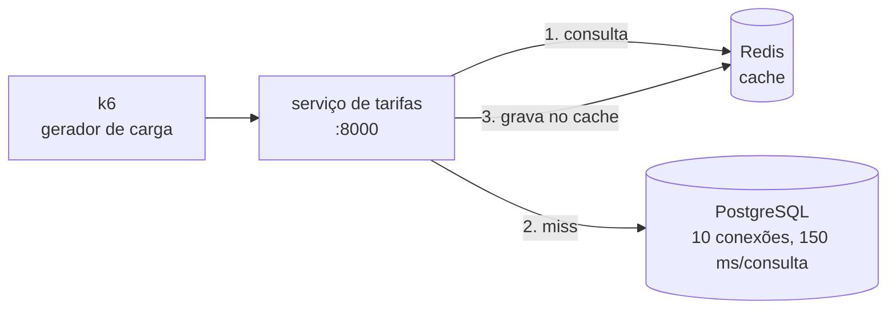

# Lab 3C: Cache-aside, cache stampede e TTL com jitter

Aula prática da seção 3 (Design de Sistemas Escaláveis), depois da aula 3.4.

| | |
|---|---|
| Aulas relacionadas | 3.4 (caching distribuído: padrões e invalidação) |
| Ambiente | Docker Compose |
| Ordem de estudo | Independente |

## Objetivo

Na aula 3.4 vimos que o cache-aside derruba latência e carga no banco, e que ele mesmo pode criar o pico que deveria evitar: quando muitas requisições encontram a chave expirada ao mesmo tempo, todas vão ao banco juntas (cache stampede, ou thundering herd). Neste lab você mede os dois lados, com o número de consultas ao banco por segundo como prova.

O cenário é o da LunaLog: o serviço de tarifas de frete é consultado centenas de vezes por segundo no pico de checkout, e a maioria das consultas é para as mesmas rotas.

## O que você vai ver

- Um banco com consulta cara (150 ms simulados) e capacidade limitada (10 conexões), sem cache
- O mesmo serviço com cache-aside: latência e carga no banco caem, e a taxa de erro some
- O pico no banco no instante em que as chaves expiram juntas
- Duas defesas, que resolvem problemas diferentes: **TTL com jitter** (expiração em massa) e **lock de regeneração** (chave muito quente)
- Um gráfico em texto, sem Grafana, das consultas ao banco por segundo

## Arquitetura do lab



A estratégia de cache é escolhida em cada requisição pelo parâmetro `estrategia`, para comparar sem trocar de versão:

| Estratégia | Comportamento |
|---|---|
| `sem-cache` | Toda requisição vai ao banco |
| `ttl-fixo` | Cache-aside com TTL fixo de 10 s |
| `ttl-jitter` | Cache-aside com TTL aleatório entre 5 s e 15 s |
| `jitter-lock` | Jitter mais lock: só uma requisição reconstrói a chave expirada; as outras esperam |

Dois perfis de tráfego (parâmetro `PERFIL` do k6):

- `quente`: 90% das consultas vão para 5 rotas, como no pico de checkout
- `uniforme`: as consultas se espalham por 200 rotas, todas pré-carregadas no mesmo instante

## Pré-requisitos

- Docker Engine ou Docker Desktop com Compose v2
- Cerca de 2 GB de RAM livres
- Porta 8000 livre. O k6 roda em contêiner, não precisa instalar nada

## Como executar

Na pasta deste lab:

```bash
docker compose up -d --build
```

Consulte uma tarifa duas vezes e veja a origem da resposta mudar de `banco` para `cache`:

```bash
curl -s "localhost:8000/tarifa/R001?estrategia=ttl-fixo"
curl -s "localhost:8000/tarifa/R001?estrategia=ttl-fixo"
```

Os cenários usam o k6 em contêiner. Cada execução dura 35 segundos, a 300 requisições por segundo:

```bash
docker compose run --rm k6 run -e ESTRATEGIA=<estrategia> -e PERFIL=<perfil> -e TAXA=300 -e DURACAO=35s /scripts/carga.js
```

Ao final de cada execução, veja as consultas ao banco por segundo:

```bash
curl -s localhost:8000/stats/grafico
```

### Cenário 1: sem cache

```bash
docker compose run --rm k6 run -e ESTRATEGIA=sem-cache -e PERFIL=quente -e TAXA=300 -e DURACAO=35s /scripts/carga.js
```

O que observar: o banco aguenta cerca de 66 consultas por segundo (10 conexões a 150 ms cada). A carga pede 300. Com o pool saturado, a maior parte das requisições espera, estoura o limite e falha.

### Cenário 2: cache-aside com TTL fixo

```bash
docker compose run --rm k6 run -e ESTRATEGIA=ttl-fixo -e PERFIL=quente -e TAXA=300 -e DURACAO=35s /scripts/carga.js
curl -s localhost:8000/stats/grafico
```

O que observar: erros zeram e a latência cai para milissegundos na maioria das requisições. No gráfico, o banco quase não trabalha, **exceto nos picos periódicos**: são os instantes em que as chaves quentes expiram e dezenas de requisições vão ao banco ao mesmo tempo.

### Cenário 3: expiração em massa, TTL fixo contra TTL com jitter

As 200 rotas são pré-carregadas no mesmo instante, como faria um job de aquecimento depois de um deploy:

```bash
docker compose run --rm k6 run -e ESTRATEGIA=ttl-fixo -e PERFIL=uniforme -e TAXA=300 -e DURACAO=35s /scripts/carga.js
curl -s localhost:8000/stats/grafico

docker compose run --rm k6 run -e ESTRATEGIA=ttl-jitter -e PERFIL=uniforme -e TAXA=300 -e DURACAO=35s /scripts/carga.js
curl -s localhost:8000/stats/grafico
```

O que observar: com TTL fixo, as 200 chaves expiram juntas, o banco recebe ondas de consultas e algumas requisições falham. Com jitter, a mesma carga vira um fluxo contínuo e baixo, sem falhas.

### Cenário 4: chave muito quente, jitter contra jitter com lock

```bash
docker compose run --rm k6 run -e ESTRATEGIA=ttl-jitter -e PERFIL=quente -e TAXA=300 -e DURACAO=35s /scripts/carga.js
curl -s localhost:8000/stats/grafico

docker compose run --rm k6 run -e ESTRATEGIA=jitter-lock -e PERFIL=quente -e TAXA=300 -e DURACAO=35s /scripts/carga.js
curl -s localhost:8000/stats/grafico
```

O que observar: o jitter sozinho ajuda pouco numa chave quente, porque uma única chave continua tendo um único instante de expiração. O lock resolve: quando a chave expira, uma requisição consulta o banco e as demais esperam alguns milissegundos pelo resultado dela. O pico cai para uma fração.

## Resultados de referência

Execução de referência: 300 requisições por segundo, 35 segundos, banco simulado em 150 ms por consulta e 10 conexões. Seus números variam de uma execução para outra, mas o padrão se mantém.

| Perfil | Estratégia | Falhas | p95 | Pico no banco (consultas/s) |
|---|---|---|---|---|
| quente | sem-cache | 64% | 3,2 s | 70 (saturado) |
| quente | ttl-fixo | 0% | 152 ms | 70 |
| quente | ttl-jitter | 0% | 152 ms | 59 |
| quente | jitter-lock | 0% | 82 ms | 22 |
| uniforme | ttl-fixo | 1,4% | 978 ms | 70 |
| uniforme | ttl-jitter | 0% | 151 ms | 34 |
| uniforme | jitter-lock | 0% | 152 ms | 34 |

O p95 de 152 ms nas linhas com cache é a requisição que reconstrói a chave (150 ms do banco). A mediana das requisições fica abaixo de 1 ms.

## Como limpar

```bash
docker compose --profile ferramentas down -v
```

## Variáveis ajustáveis

Edite o arquivo `.env` desta pasta e rode `docker compose up -d` para aplicar:

| Variável | Padrão | Efeito |
|---|---|---|
| `TTL_SEGUNDOS` | 10 | Validade do cache |
| `DB_LATENCIA_SEGUNDOS` | 0.15 | Custo simulado de cada consulta ao banco |
| `DB_POOL_MAX` | 10 | Conexões simultâneas que o banco aceita |

## Estrutura da pasta

```
lab-3c_cache-aside-stampede-e-jitter/
  README.md
  docker-compose.yml
  .env
  sql/init.sql         (200 rotas de tarifa)
  app/
    main.py            (serviço de tarifas e as 4 estratégias)
    Dockerfile
    requirements.txt
  k6/carga.js          (perfis quente e uniforme)
```

## Limites deste lab

- O custo do banco é simulado com `pg_sleep`. O comportamento (saturação do pool) é real, mas os números absolutos não são de um banco de produção.
- O lock de regeneração aqui usa o Redis com `SET NX` e expiração. Em produção, considere o que acontece se o processo que segura o lock morrer (por isso o lock tem prazo).
- Cache resolve leitura repetida. Não ajuda quando o pico é de escrita: esse é o assunto da próxima aula, sobre filas.

## Para pensar

1. O jitter reduziu o pico na expiração em massa mas pouco na chave quente. Por quê? Em que situação do seu sistema cada defesa faria falta?
2. Com TTL de 5 minutos, como na LunaLog, uma tarifa alterada no banco continua errada por até 5 minutos. Para quais dados isso é aceitável e para quais não é?
3. O lock faz as requisições esperarem. O que acontece se quem reconstrói a chave falhar? O que este lab faz nesse caso e o que mais você poderia fazer?
4. Se o Redis cair, todas as requisições passam a ir ao banco ao mesmo tempo. Como proteger o banco nesse cenário? (Pense no circuit breaker e no rate limiting das próximas aulas.)
