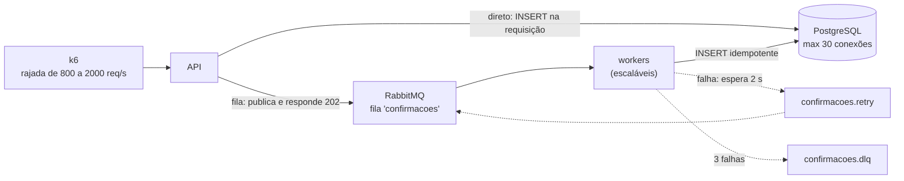

# Lab 3D: Filas absorvendo picos: escrita direta versus fila

Aula prática da seção 3 (Design de Sistemas Escaláveis), depois da aula 3.5.

| | |
|---|---|
| Aulas relacionadas | 3.5 (filas de mensagens e processamento assíncrono) |
| Ambiente | Docker Compose (RabbitMQ, PostgreSQL, FastAPI, k6) |
| Ordem de estudo | Independente. Para o contraste entre fila e log de eventos, veja o lab 2B (Redpanda) |

## Objetivo

Na aula 3.5 vimos o caso da LunaLog: em um pico de 10 mil confirmações simultâneas no fim da tarde, cada confirmação gravava direto no banco, o banco travou e o sistema passou a rejeitar requisições. Com uma fila entre o endpoint e o processador, as confirmações são aceitas na hora e processadas na velocidade que o banco suporta, sem perda de dados.

Neste lab você reproduz isso. A **mesma operação** (registrar uma confirmação) tem dois caminhos: gravar direto no banco dentro da requisição, ou publicar uma mensagem e deixar um worker gravar. Você aplica a mesma rajada nos dois e vê a fila **trocar falha por atraso controlado**, escala os consumidores, e conhece os limites dessa troca.

## O que você vai ver

- A **escrita síncrona** esgotando o pool de conexões do banco sob rajada: mais de 40% das requisições recusadas
- A **mesma rajada enfileirada**: 100% aceitas, em milissegundos, e processadas no ritmo do banco
- A **profundidade da fila** e o **tempo de drenagem**, e como a escala de consumidores o reduz (e onde ela para)
- **Ack, retry com atraso e DLQ** no RabbitMQ: o que acontece com uma mensagem que nunca vai funcionar
- O que acontece quando o **worker morre no meio** do processamento (entrega pelo menos uma vez e idempotência)
- O contraste entre **fila** (RabbitMQ) e **log de eventos** (lab 2B)

## Arquitetura do lab



- **Caminho direto** (`POST /confirmacoes/direto`): usa uma conexão do pool (10) durante a gravação (20 ms de trabalho do banco). Capacidade: cerca de 500 por segundo. Se nenhuma conexão ficar livre em 1 s, responde 503.
- **Caminho da fila** (`POST /confirmacoes/fila`): publica uma mensagem persistente com confirmação do broker e responde `202` (aceita). Um **worker** consome e grava, com 8 mensagens em andamento por vez.
- O banco aceita no máximo **30 conexões**: o gargalo é proposital, como em muitos ambientes reais.
- Gravar duas vezes a mesma confirmação não duplica (`ON CONFLICT DO NOTHING`): a gravação é **idempotente**.

## Pré-requisitos

- Docker Engine ou Docker Desktop (Compose v2)
- Cerca de 2 GB de RAM livres
- As portas 8401 e 15672 livres
- Um shell Bash e `curl` para os scripts

## Como executar

Na pasta deste lab:

```bash
docker compose up -d --build
curl -s localhost:8401/estado
```

Abra a interface do RabbitMQ em http://localhost:15672 (usuário `guest`, senha `guest`, credencial de laboratório) e, na aba **Queues**, deixe a fila `confirmacoes` à vista. A interface atualiza a cada alguns segundos.

### Cenário 1: a rajada na escrita direta

```bash
ALVO=direto docker compose --profile ferramentas run --rm k6
curl -s localhost:8401/estado
```

O k6 envia 800 requisições por segundo durante 10 segundos. O que observar:

```
===== RAJADA (direto) =====
enviadas=7284  aceitas=4279 (58.7%)  recusadas=3005
latencia: mediana=1004 ms  p95=1032 ms
```

- **41% das requisições foram recusadas** (`503: banco saturado`). A capacidade do caminho é de cerca de 500 por segundo; chegaram 800.
- A **latência de todas** foi de cerca de 1 segundo (o tempo que cada requisição esperou por uma conexão antes de desistir). Mesmo as que deram certo ficaram lentas.
- O `estado` mostra `gravadas` igual às aceitas: **as recusadas se perderam**, a menos que o cliente tente de novo (e, se tentar, aumenta a pressão).

É o incidente da LunaLog: o pico excede a capacidade do banco, e o sistema rejeita trabalho.

### Cenário 2: a mesma rajada na fila

Limpe os dados e repita a rajada pelo caminho da fila:

```bash
curl -s -X POST localhost:8401/admin/limpar
ALVO=fila docker compose --profile ferramentas run --rm k6
```

Em **outro terminal**, logo depois de iniciar a rajada, acompanhe a fila e o banco (a cada 2 segundos):

```bash
bash scripts/acompanhar.sh
```

```
===== RAJADA (fila) =====
enviadas=8001  aceitas=8001 (100.0%)  recusadas=0
latencia: mediana=5 ms  p95=6 ms
```

O que observar:

- **100% aceitas**, com **mediana de 5 ms**: publicar na fila é muito mais barato do que gravar no banco. O cliente recebe `202 aceita` e segue a vida.
- A fila **cresce** durante a rajada (o que chega é mais do que o worker grava) e depois **esvazia sozinha**, no ritmo do banco. O script `acompanhar.sh` mostra a profundidade e as linhas gravadas subindo até igualar as 8.001 enviadas: **nenhuma se perdeu**.
- A fila trocou **falha** por **atraso controlado**: em vez de recusar 41%, o sistema aceitou tudo e levou alguns segundos a mais para gravar.

Para ver o efeito com um pico maior, use `TAXA=2000` (cerca de 20 mil mensagens em 10 segundos):

```bash
ALVO=fila TAXA=2000 docker compose --profile ferramentas run --rm k6
```

Todas as 19.948 são aceitas (p95 de 18 ms). Com 1 worker, a fila leva cerca de **60 segundos** para drenar por completo.

### Cenário 3: escalar os consumidores, até onde o banco deixa

O worker processa cerca de 400 mensagens por segundo. Para drenar mais rápido, adicione consumidores:

```bash
docker compose up -d --scale worker=3
curl -s -X POST localhost:8401/admin/limpar
ALVO=fila TAXA=2000 docker compose --profile ferramentas run --rm k6
bash scripts/acompanhar.sh
```

Com 3 workers, a mesma rajada (cerca de 19 mil mensagens) é drenada em cerca de **21 segundos** (contra 60 com um). Mas a escala **tem um teto, e ele é o banco**. Cada worker abre até 8 conexões, e o PostgreSQL do lab aceita 30. Teste com 6:

```bash
docker compose up -d --scale worker=6
docker compose logs worker | grep "too many clients" | head -3
```

O que observar: erros `FATAL: sorry, too many clients already`. Os workers que não conseguem conexão falham, as mensagens vão para o retry e, depois de três falhas, algumas **caem na DLQ**. A escala dos consumidores só ajuda até a capacidade do sistema que está atrás deles. A fila **move** o gargalo, não o elimina, e a DLQ guarda as vítimas em vez de perdê-las silenciosamente.

Volte para um worker: `docker compose up -d --scale worker=1`.

### Cenário 4: ack, retry e DLQ

Uma mensagem que nunca vai funcionar não pode travar a fila nem ser tentada para sempre. O script envia três mensagens "venenosas":

```bash
bash scripts/veneno.sh
bash scripts/acompanhar.sh
docker compose logs worker | grep VENENO
```

O que observar nos logs do worker:

```
falha em VENENO-1 (tentativa 1): vai para confirmacoes.retry
falha em VENENO-1 (tentativa 2): vai para confirmacoes.retry
falha em VENENO-1 (tentativa 3): vai para confirmacoes.dlq
```

Cada falha manda a mensagem para a fila `confirmacoes.retry`, onde ela **espera 2 segundos** (um TTL configurado na fila) e volta para a principal. Na terceira falha, vai para a **`confirmacoes.dlq`**, a fila de cartas mortas, e sai do circuito. Na interface do RabbitMQ, abra a DLQ e use *Get messages*: cada mensagem traz os headers `tentativas: 3` e `erro: mensagem invalida`. Alguém (ou um processo) analisa e decide: corrigir e republicar, ou descartar. Enquanto isso, as mensagens boas continuam fluindo.

### Cenário 5: o worker morre no meio

```bash
curl -s -X POST localhost:8401/admin/limpar
ALVO=fila TAXA=1000 DURACAO=4s docker compose --profile ferramentas run --rm k6
docker compose kill worker
curl -s localhost:8401/estado          # parcial: o worker parou no meio
docker compose start worker
sleep 12
curl -s localhost:8401/estado          # {"gravadas":4000}
```

O que observar: o `estado` logo após o `kill` mostra um valor parcial (por exemplo, 2.155 de 4.000). Ao reiniciar, o worker retoma e o total chega a **exatamente 4.000**. As mensagens que estavam em processamento e não tinham recebido o ack foram **reentregues** pelo RabbitMQ, e a gravação idempotente evitou duplicar as que já tinham ido ao banco. É a garantia *pelo menos uma vez*, mais a idempotência, que formam o *efetivamente uma vez*.

### Fila ou log de eventos?

O lab 2B usa um log de eventos (Redpanda/Kafka). A diferença de modelo: na **fila**, a mensagem é consumida e some; ela representa uma tarefa a ser feita por um consumidor (competindo com outros). No **log**, os eventos permanecem, e cada consumidor mantém a sua posição, podendo reler o passado. Use a fila para distribuir trabalho; use o log para registrar fatos que vários sistemas consomem e que podem precisar ser reprocessados.

## Resultados de referência

Valores medidos em Docker Desktop (Windows 11, WSL2). Os números absolutos variam com a máquina; a relação entre eles se mantém.

| Cenário | Aceitas | Latência na API | Resultado |
|---|---|---|---|
| Escrita direta, 800/s por 10 s | 58,7% (3.005 recusadas) | mediana 1.004 ms | perda de 41% |
| Fila, 800/s por 10 s | 100% | mediana 5 ms, p95 6 ms | tudo gravado, fila drenada em segundos |
| Fila, 2.000/s por 10 s, 1 worker | 100% (19.948) | p95 18 ms | drenagem em cerca de 60 s |
| Fila, 2.000/s por 10 s, 3 workers | 100% (18.948) | p95 421 ms | drenagem em cerca de 21 s |
| 6 workers (30 conexões no banco) | 100% | p95 24 ms | `too many clients`; mensagens na DLQ |
| 3 mensagens venenosas | n/a | n/a | 3 tentativas com espera de 2 s, depois DLQ |
| Worker morto aos 2.155 de 4.000 | n/a | n/a | total final 4.000 (sem perda nem duplicação) |

## Como limpar

```bash
docker compose down -v
```

## Estrutura da pasta

```
lab-3d_filas-absorvendo-picos/
  README.md
  docker-compose.yml
  app/
    api.py                    (os dois caminhos: direto e fila)
    worker.py                 (consumidor com ack, retry com atraso e DLQ)
    Dockerfile
  sql/init.sql
  k6/rajada.js
  scripts/
    acompanhar.sh             (fila, banco e consumidores a cada 2 s)
    veneno.sh                 (3 mensagens que nunca funcionam)
```

## Limites deste lab

- O custo de 20 ms por gravação é **simulado** (`pg_sleep`), para tornar o gargalo previsível. Um banco real tem gargalos de CPU, I/O e travas, mas a dinâmica (capacidade finita, fila que absorve) é a mesma.
- A fila absorve **picos**, não excesso permanente. Se a taxa média de chegada passar a capacidade média de processamento, a fila cresce sem limite: é preciso escalar os consumidores, melhorar o gargalo ou aplicar contrapressão (rate limiting, lab 3E).
- A resposta `202` muda o contrato com o cliente: ele sabe que a confirmação foi **aceita**, não que foi **gravada**. Isso exige que o produto aceite a consistência eventual (e que a consulta de estado reflita isso).
- O RabbitMQ tem **um único nó**. Em produção, usam-se filas replicadas (quorum queues) e discos confiáveis; sem isso, perder o broker perde as mensagens em trânsito.
- A estratégia de retry com TTL é um padrão clássico do RabbitMQ, mas o atraso é fixo. Backoff exponencial e jitter exigem várias filas de espera ou um plugin de mensagens atrasadas.
- A garantia de entrega é *pelo menos uma vez*. Cada consumidor precisa ser idempotente, como a gravação deste lab.
- A ordem das mensagens **não** é garantida com vários consumidores concorrentes. Se a ordem importar, particione por chave (veja o lab 2B).
- As credenciais (`guest`, `luna`) são de laboratório. Nunca as use fora dele.

## Para pensar

1. A fila aceitou 100% e gravou tudo, mas o cliente só soube que a confirmação foi *aceita*. Que tipo de operação do seu sistema não pode responder `202`?
2. O que você monitoraria para saber que a fila está saudável? (Dica: profundidade, idade da mensagem mais antiga, taxa de entrada versus taxa de saída, tamanho da DLQ.)
3. Uma DLQ com mensagens é um sinal. Quem olha para ela no seu time, e o que decide fazer?
4. O tempo de drenagem de 60 segundos foi aceitável aqui. Qual é o tempo máximo que o seu negócio aceita entre "aceita" e "gravada", e como isso define a quantidade de consumidores?
