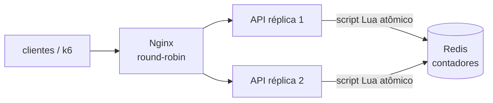

# Lab 3E: Rate limiting: janela fixa, janela deslizante e token bucket

Aula prática da seção 3 (Design de Sistemas Escaláveis), depois da aula 3.8.

| | |
|---|---|
| Aulas relacionadas | 3.8 (rate limiting: algoritmos e estratégias de implementação) |
| Ambiente | Docker Compose (FastAPI, Redis, Nginx, k6) |
| Ordem de estudo | Independente. Complementa o lab 3D (a contrapressão que protege a fila) e o 3F (circuit breaker) |

## Objetivo

Na aula 3.8 vimos o caso da LunaLog: um bug no código de uma transportadora faz a integração enviar 800 requisições por segundo a um único endpoint. Em menos de um minuto o banco está a 100% de CPU e todos os outros clientes são rejeitados. Sem rate limiting **por cliente**, o bug de um terceiro derruba a plataforma inteira.

Neste lab os três algoritmos clássicos (janela fixa, janela deslizante e token bucket) rodam lado a lado, com a mesma carga e o mesmo limite, e você mede onde cada um cede. Depois vê o limite por cliente isolando o parceiro abusivo dos demais, e o limite compartilhado entre réplicas usando o Redis.

## O que você vai ver

- A **janela fixa** deixando passar o **dobro** do limite na virada de janela
- A **janela deslizante** e o **token bucket** com a mesma carga: o limite respeitado a qualquer instante, e a diferença entre "sem rajada" e "rajada controlada"
- O limite **por cliente** (chave de API) **isolando** um parceiro com bug, contra o limite **global**, em que o parceiro normal sofre junto
- A resposta **429 com `Retry-After`** e os headers de limite
- Duas réplicas **compartilhando** o contador pelo Redis, contra contadores locais que permitem o dobro

## Arquitetura do lab



- A API tem três rotas, uma por algoritmo, com o mesmo limite: **10 requisições por janela de 5 segundos**.
  - `/fixa`: janela fixa (um contador por janela de 5 s).
  - `/deslizante`: janela deslizante (guarda o instante de cada requisição e conta as dos últimos 5 s).
  - `/bucket`: token bucket (balde de 10 fichas que se enche a 2 fichas por segundo).
- Os algoritmos executam no Redis como **scripts Lua**, que são atômicos: duas réplicas nunca leem o mesmo valor "velho" ao mesmo tempo (veja `app/main.py`).
- A chave do limite é o header `X-Api-Key` (`?escopo=cliente`, padrão) ou um contador único (`?escopo=global`).

## Pré-requisitos

- Docker Engine ou Docker Desktop (Compose v2)
- Cerca de 1 GB de RAM livre
- As portas 8501 a 8503 livres
- Um shell Bash e `curl`

## Como executar

Na pasta deste lab:

```bash
docker compose up -d --build
for i in 1 2 3; do curl -s -D - -o /dev/null -H 'X-Api-Key: teste' localhost:8501/bucket | grep -iE "^HTTP|x-ratelimit|x-replica"; done
```

Cada resposta traz `X-RateLimit-Limit`, `X-RateLimit-Remaining` e `X-Replica` (qual réplica atendeu). O `Remaining` desce de uma resposta para a outra **mesmo trocando de réplica**: o contador é do Redis, não da réplica.

### Cenário 1: a virada da janela

A janela fixa conta as requisições em fatias do relógio (por exemplo, de 0 a 5 s, de 5 a 10 s). O script envia 10 requisições logo **antes** do fim de uma janela e 10 logo **depois** do início da próxima, para cada algoritmo:

```bash
docker compose --profile ferramentas run --rm cliente python virada.py
```

```
limite: 10 requisicoes por janela de 5 s

algoritmo     antes da virada  depois da virada   em ~0,3 s
fixa                       10                10          20
deslizante                 10                 0          10
bucket                     10                 0          10
```

O que observar:

- **Janela fixa: 20 requisições em 0,3 segundo**, o dobro do limite declarado. Cada janela, isoladamente, respeitou os 10, mas na virada os contadores zeram e o cliente aproveita as duas. Para quem o limite protege (um banco, um fornecedor), a rajada de 20 é real.
- **Janela deslizante: 10**, no máximo, **a qualquer instante**. A segunda leva é negada porque as 10 primeiras ainda estão dentro dos últimos 5 segundos.
- **Token bucket: 10** também, porque o balde estava cheio na rajada inicial (10 fichas) e quase não se reabasteceu em 0,3 s.

A janela fixa é a mais simples e a mais barata (um contador por janela), e é boa para limites grosseiros (cotas por dia, por exemplo). Para proteger contra picos curtos, ela é a mais fraca.

### Cenário 2: deslizante e token bucket não são a mesma coisa

Com a mesma carga, os dois respeitam o limite, mas se comportam de forma diferente depois da rajada. Dez requisições seguidas em cada um, uma pausa, e outras dez:

```bash
K=$RANDOM
# token bucket: 14 seguidas; espera 3 s; 10 seguidas
for i in $(seq 1 14); do curl -s -o /dev/null -w '%{http_code} ' -H "X-Api-Key: b$K" localhost:8501/bucket; done; echo
sleep 3
for i in $(seq 1 10); do curl -s -o /dev/null -w '%{http_code} ' -H "X-Api-Key: b$K" localhost:8501/bucket; done; echo

# janela deslizante: 10 seguidas; espera 2,5 s; 10 seguidas; espera 3 s; 10 seguidas
for i in $(seq 1 10); do curl -s -o /dev/null -w '%{http_code} ' -H "X-Api-Key: d$K" localhost:8501/deslizante; done; echo
sleep 2.5
for i in $(seq 1 10); do curl -s -o /dev/null -w '%{http_code} ' -H "X-Api-Key: d$K" localhost:8501/deslizante; done; echo
sleep 3
for i in $(seq 1 10); do curl -s -o /dev/null -w '%{http_code} ' -H "X-Api-Key: d$K" localhost:8501/deslizante; done; echo
```

O que observar:

- **Token bucket**: as 10 primeiras passam (o balde cheio), uma ou duas a mais se for rápido (o balde já repõe 2 fichas por segundo), e o resto recebe `429`. Depois de 3 segundos de pausa, **cerca de 6 fichas** voltaram, e cerca de 6 a 7 requisições passam. O token bucket **permite rajadas** até a capacidade do balde e **repõe de forma contínua**: o cliente que ficou quieto "acumula crédito". É o modelo certo quando rajadas curtas são legítimas (um app que abre e carrega várias chamadas de uma vez).
- **Janela deslizante**: depois das 10 primeiras, **tudo é negado** por mais de 2,5 s e só **volta a passar quando as primeiras saem da janela de 5 s**. O limite é rígido: nunca mais que 10 em qualquer intervalo de 5 segundos. É o modelo certo quando o limite é uma garantia ("no máximo N por intervalo"), ao custo de guardar um registro por requisição.

### Cenário 3: o parceiro abusivo (limite por cliente x global)

Este é o caso da aula. O k6 simula, ao mesmo tempo, um parceiro com bug (100 requisições por segundo) e um parceiro normal (1 por segundo), por 15 segundos. Primeiro com um limite **por cliente**:

```bash
ESCOPO=cliente docker compose --profile ferramentas run --rm k6
```

```
===== ISOLAMENTO (escopo=cliente) =====
bugado   enviadas= 1501  aceitas=  39  bloqueadas(429)= 1462  (97% bloqueadas)
normal   enviadas=   16  aceitas=  16  bloqueadas(429)=    0  (0% bloqueadas)
```

O parceiro com bug é contido (97% bloqueado), e o parceiro normal **não percebe nada**: 16 de 16 aceitas. Agora com um limite **global**, um balde único para todos:

```bash
ESCOPO=global docker compose --profile ferramentas run --rm k6
```

```
===== ISOLAMENTO (escopo=global) =====
bugado   enviadas= 1501  aceitas=  33  bloqueadas(429)= 1468  (98% bloqueadas)
normal   enviadas=   16  aceitas=   7  bloqueadas(429)=    9  (56% bloqueadas)
```

O parceiro com bug esgota o balde de todos, e o parceiro **normal passa a ter 56% de requisições recusadas**, por culpa de outro. O limite global protege o servidor, mas não protege um cliente do outro. Por isso o limite precisa ser **por cliente** (e, em muitos sistemas, também global, como segunda linha).

Veja o que o parceiro recebe ao ser bloqueado, e como deveria reagir:

```bash
for i in $(seq 1 12); do curl -s -o /dev/null -H 'X-Api-Key: x' localhost:8501/deslizante; done
curl -s -D - -H 'X-Api-Key: x' localhost:8501/deslizante
```

A resposta é `429 Too Many Requests` com `Retry-After: 4` (segundos) e o corpo `{"erro":"limite excedido","tente_novamente_em_ms":...}`. O header diz ao cliente educado **quando voltar**; o cliente com bug vai ignorá-lo, e o servidor continua a bloqueá-lo de forma barata.

### Cenário 4: o limite compartilhado entre réplicas

Duas réplicas atrás de um balanceador round-robin. Se cada uma contar na própria memória, o limite efetivo é o **dobro**:

```bash
docker compose --profile ferramentas run --rm cliente python replicas.py
```

```
limite: 10 requisicoes por janela de 5 s; enviando 20 em sequencia

memoria  aceitas=20 (api1=10, api2=10)  recusadas=0
redis    aceitas=10 (api1=5, api2=5)  recusadas=10
```

O que observar: com o contador **na memória**, cada réplica concede os seus 10, e o cliente passa **20**. Com o contador **no Redis**, as duas somam no mesmo lugar e passam **10**, 5 em cada réplica. Quanto mais réplicas, pior ficaria o contador local. A atomicidade dos scripts Lua garante que duas réplicas simultâneas não "furem" o limite lendo o mesmo valor.

## Resultados de referência

Valores medidos em Docker Desktop (Windows 11, WSL2), limite de 10 por 5 segundos.

| Medida | Resultado |
|---|---|
| Virada de janela, janela fixa | 20 aceitas em 0,3 s (o dobro do limite) |
| Virada de janela, deslizante e bucket | 10 aceitas |
| Token bucket depois de 3 s de pausa | cerca de 6 a 7 requisições aceitas (reposição de 2 por segundo) |
| Janela deslizante logo após a rajada | 100% bloqueada até as primeiras saírem da janela |
| Limite por cliente, parceiro com bug | 97% bloqueado; parceiro normal: 0% bloqueado |
| Limite global, parceiro com bug | parceiro normal: 56% bloqueado |
| Duas réplicas, contador em memória | 20 aceitas (o dobro do limite) |
| Duas réplicas, contador no Redis | 10 aceitas |

## Como limpar

```bash
docker compose down -v
```

## Estrutura da pasta

```
lab-3e_rate-limiting-algoritmos/
  README.md
  docker-compose.yml
  app/main.py                 (os três algoritmos, com scripts Lua no Redis)
  nginx/nginx.conf            (balanceador para as duas réplicas)
  scripts/
    virada.py                 (a virada da janela, por algoritmo)
    replicas.py               (memória x Redis com duas réplicas)
  k6/isolamento.js            (parceiro com bug x parceiro normal)
```

## Limites deste lab

- O limite do lab é pequeno (10 por 5 segundos) para tornar os efeitos visíveis. Em produção, os números vêm de dados de uso e de contratos, e os limites costumam ter vários níveis (por segundo, por minuto, por dia).
- A **janela deslizante em log** (a deste lab) guarda um registro por requisição aceita: precisa de memória proporcional ao limite. Existem aproximações baratas (janela deslizante por contadores de duas janelas) que trocam um pouco de precisão por custo.
- O Redis é um **ponto único** de decisão. Se ele falhar, o que a API faz? (Fail open: deixa passar, arriscando a proteção; fail closed: bloqueia tudo, arriscando a disponibilidade.) O lab não trata essa decisão, mas ela precisa existir no desenho real.
- A identificação do cliente pelo header `X-Api-Key` não é autenticação. Em produção, a chave vem de um mecanismo validado (token, mTLS), senão qualquer um troca de chave para fugir do limite.
- O limite por cliente protege o servidor, mas não cobre ataques distribuídos (muitos clientes legítimos de mentira). Isso exige camadas na borda (WAF, proteção de DDoS).
- O rate limiting de API tem relação com a contrapressão de filas (lab 3D) e com o circuit breaker (lab 3F), mas são mecanismos distintos: o primeiro limita **quem chama**; o segundo protege **de quem é chamado**.

## Para pensar

1. Para cada uma das suas APIs, o limite deveria ser por cliente, por endpoint, global, ou uma combinação? O que acontece com os clientes legítimos quando o limite é muito apertado?
2. Quando você escolheria o token bucket em vez da janela deslizante? Que tipo de cliente se beneficia de poder "acumular crédito"?
3. Se o Redis cair, a sua API deve deixar passar (fail open) ou bloquear tudo (fail closed)? Que risco cada escolha traz?
4. Como o seu cliente educado trata um `429` com `Retry-After`? E o cliente com bug? O que, no servidor, impede o segundo de causar dano?
