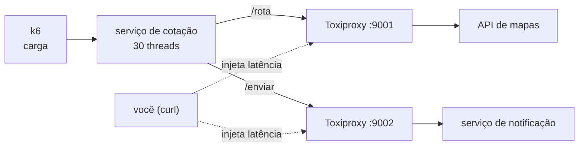

# Lab 3F: Circuit breaker e bulkhead com falhas injetadas

Aula prática da seção 3 (Design de Sistemas Escaláveis), depois da aula 3.9.

| | |
|---|---|
| Aulas relacionadas | 3.9 (circuit breaker e bulkhead: resiliência na comunicação) |
| Ambiente | Docker Compose |
| Ordem de estudo | Trilha Falhas injetadas, passo 1 de 2 (continua no lab 7A) |

## Objetivo

Na aula 3.9 vimos que uma única dependência lenta, sem proteção, esgota o pool de threads do serviço e leva junto tudo o que passa por ele. Neste lab você provoca essa falha de verdade, com latência injetada em tempo real, e repete o mesmo cenário com circuit breaker e bulkhead ligados.

O cenário é o da LunaLog: o serviço de cotação depende de uma API de mapas para calcular a rota e de um serviço de notificação para avisar o cliente. Quando a API de mapas passa a responder em 30 segundos, o que acontece com o resto?

## O que você vai ver

- Uma dependência lenta esgotando as threads do serviço e derrubando também endpoints que **não dependem dela**
- Um circuit breaker nos estados fechado, aberto e meio-aberto, visíveis em um endpoint de estado
- Fallback imediato (frete estimado) enquanto o circuito está aberto, e a recuperação automática depois que a falha acaba
- Um bulkhead isolando a dependência de notificação: ela degrada sozinha, sem afetar a cotação nem o tracking
- Falhas injetadas pelo Toxiproxy durante a aula, sem alterar o código

## Arquitetura do lab



O serviço de cotação tem três endpoints, com dependências diferentes:

| Endpoint | Depende de | Para que serve no lab |
|---|---|---|
| `GET /cotacao/{id}` | API de mapas | Dependência crítica, com fallback (frete estimado) |
| `POST /entregas/{id}/notificar` | Serviço de notificação | Dependência secundária, que pode ser adiada |
| `GET /tracking/{id}` | Ninguém | Mede o dano colateral de uma dependência lenta |

A proteção é escolhida em tempo de execução:

| Proteção | Timeout | Circuit breaker | Bulkhead |
|---|---|---|---|
| `nenhuma` | 30 s | não | não |
| `breaker` | 1 s | sim | não |
| `bulkhead` | 3 s | não | sim (mapas: 10, notificação: 5) |
| `completo` | 1 s | sim | sim |

## Pré-requisitos

- Docker Engine ou Docker Desktop com Compose v2
- Cerca de 2 GB de RAM livres
- Portas 8000 e 8474 livres. O k6 roda em contêiner, não precisa instalar nada
- No PowerShell, use `curl.exe` no lugar de `curl`

## Como executar

Na pasta deste lab:

```bash
docker compose up -d --build
curl -s localhost:8000/cotacao/E-1
curl -s localhost:8000/estado
```

O `/estado` mostra a proteção ativa, o estado dos circuitos, as chamadas em andamento e os contadores.

A carga usa três tipos de tráfego ao mesmo tempo (20 cotações, 15 notificações e 20 consultas de tracking por segundo):

```bash
docker compose run --rm k6 run -e DURACAO=30s /scripts/carga.js
```

No resumo do k6, olhe as linhas com `endpoint:`: elas mostram latência e falhas de cada tipo de tráfego separadamente.

### Cenário 1: API de mapas lenta, sem proteção

```bash
curl -s -X POST "localhost:8000/config?protecao=nenhuma"
curl -s -X POST localhost:8474/proxies/mapas/toxics -H "Content-Type: application/json" -d @toxiproxy/latencia-mapas.json
docker compose run --rm k6 run -e DURACAO=30s /scripts/carga.js
```

O Toxiproxy passa a atrasar em 30 segundos cada resposta da API de mapas. O que observar: não só a cotação falha. O **tracking**, que não chama ninguém, também estoura o limite de 5 segundos. O serviço tem 30 threads e todas ficaram presas esperando os mapas.

Depois deste cenário, reinicie o serviço. As requisições que ficaram na fila continuam consumindo threads por minutos:

```bash
curl -s -X POST localhost:8474/reset
docker compose restart cotacao
```

### Cenário 2: a mesma falha, com circuit breaker e bulkhead

```bash
curl -s -X POST "localhost:8000/config?protecao=completo"
curl -s -X POST localhost:8474/proxies/mapas/toxics -H "Content-Type: application/json" -d @toxiproxy/latencia-mapas.json
docker compose run --rm k6 run -e DURACAO=30s /scripts/carga.js
curl -s localhost:8000/estado
```

O que observar: zero falhas nos três endpoints, e o tracking continua na casa dos milissegundos. No `/estado`, o circuito dos mapas está `aberto` e o contador `mapas_circuito_aberto` mostra quantas cotações foram atendidas pelo fallback em vez de esperar. Só as primeiras chamadas (os `mapas_erro`) pagaram o preço do timeout de 1 segundo, antes de o circuito abrir.

### Cenário 3: recuperação

Remova a falha e observe o circuito voltar sozinho:

```bash
curl -s -X DELETE localhost:8474/proxies/mapas/toxics/lento
curl -s localhost:8000/estado
curl -s localhost:8000/cotacao/E-1
```

O circuito fica aberto por 8 segundos. Depois disso ele passa a `meio-aberto`, deixa passar **uma** chamada de teste e, se ela der certo, volta para `fechado`. Repita os comandos algumas vezes até a cotação voltar a vir de `mapas` em vez de `fallback`.

### Cenário 4: notificação lenta, com e sem bulkhead

A notificação passa a demorar 8 segundos. Primeiro sem proteção:

```bash
curl -s -X POST localhost:8474/reset
docker compose restart cotacao
curl -s -X POST "localhost:8000/config?protecao=nenhuma"
curl -s -X POST localhost:8474/proxies/notificacao/toxics -H "Content-Type: application/json" -d @toxiproxy/latencia-notificacao.json
docker compose run --rm k6 run -e DURACAO=25s /scripts/carga.js
```

O que observar: uma dependência **secundária** derruba tudo. Cotação e tracking falham em mais de 90% das requisições.

Agora com bulkhead:

```bash
curl -s -X DELETE localhost:8474/proxies/notificacao/toxics/lento
docker compose restart cotacao
curl -s -X POST "localhost:8000/config?protecao=bulkhead"
curl -s -X POST localhost:8474/proxies/notificacao/toxics -H "Content-Type: application/json" -d @toxiproxy/latencia-notificacao.json
docker compose run --rm k6 run -e DURACAO=25s /scripts/carga.js
curl -s localhost:8000/estado
```

O que observar: o bulkhead reserva só 5 chamadas simultâneas para a notificação. As demais são adiadas na hora (`notif_adiada` no estado). A cotação e o tracking não sentem nada. A notificação degrada sozinha, e é exatamente isso que se quer.

## Resultados de referência

Execução de referência: 30 threads no serviço, 55 requisições por segundo no total. Seus números variam um pouco, mas o padrão se mantém.

| Falha injetada | Proteção | Cotação | Notificar | Tracking |
|---|---|---|---|---|
| Mapas lento | nenhuma | 100% de falhas | 95% de falhas | 95% de falhas (p95 5 s) |
| Mapas lento | completo | 0% de falhas (p95 5 ms) | 0% | 0% (p95 5 ms) |
| Notificação lenta | nenhuma | 91% de falhas | 100% | 91% (p95 5 s) |
| Notificação lenta | bulkhead | 0% (p95 53 ms) | 0%, 331 adiadas | 0% (p95 5 ms) |

## Como limpar

```bash
docker compose --profile ferramentas down -v
```

## Estrutura da pasta

```
lab-3f_circuit-breaker-e-bulkhead/
  README.md
  docker-compose.yml
  cotacao/main.py           (serviço, circuit breaker e bulkhead)
  dependencias/main.py      (API de mapas e notificação simuladas)
  toxiproxy/
    toxiproxy.json          (os dois proxies)
    latencia-mapas.json     (30 s de latência)
    latencia-notificacao.json (8 s de latência)
  k6/carga.js               (três tipos de tráfego)
```

## Limites deste lab

- O circuit breaker e o bulkhead foram escritos à mão em poucas dezenas de linhas, para o mecanismo ficar visível. Em produção use uma biblioteca madura (resilience4j, Polly, pybreaker) ou deixe isso para o service mesh.
- O breaker decide pela taxa de falhas nas últimas 10 chamadas (mínimo de 5). Os limiares de produção devem ser calibrados com base nos SLOs, como vimos na aula.
- O fallback da cotação é um frete estimado fixo. Em um sistema real, a escolha do fallback é uma decisão de negócio: pode ser um valor em cache, uma estimativa por região ou uma mensagem ao usuário.

## Para pensar

1. O tracking não depende dos mapas e mesmo assim falhou no cenário 1. Que outros recursos compartilhados (conexões de banco, memória, CPU) podem acoplar endpoints independentes no seu sistema?
2. O breaker só abriu depois de algumas chamadas lentas. Como você calibraria o número de chamadas e o limiar de falhas para o SLO do serviço?
3. Fallback é uma decisão de negócio. Para a cotação, um frete estimado é aceitável? E para uma cobrança de pagamento?
4. O bulkhead tem custo: recursos reservados que podem ficar ociosos. Como decidir o tamanho de cada compartimento?
