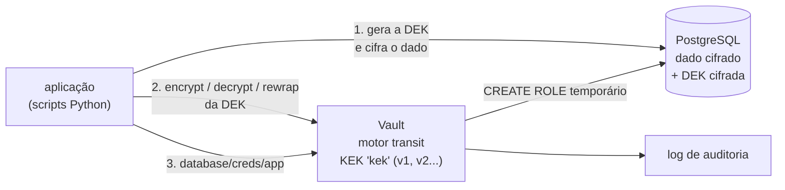

# Lab 4A: Envelope encryption, rotação de chaves e credenciais dinâmicas com Vault

Aula prática da seção 4 (Segurança Arquitetural), depois da aula 4.4.

| | |
|---|---|
| Aulas relacionadas | 4.3 (criptografia em repouso e envelope encryption), 4.4 (gerenciamento e rotação de chaves) e 4.13 (a parte de secrets) |
| Ambiente | Docker Compose (HashiCorp Vault em modo dev, PostgreSQL, Python) |
| Ordem de estudo | Isolado. Complementa o lab 4F (identidade entre serviços) e o 4B (autenticação) |

## Objetivo

Na aula 4.4 vimos o caso da LunaLog: a chave de criptografia ficava numa variável de ambiente, foi parar sem querer em um commit público, e trocá-la exigiu 18 horas de trabalho, uma janela de manutenção de 4 horas e a recriptografia de todos os dados. Com um KMS e envelope encryption, o incidente teria sido uma operação de segundos.

Neste lab você percorre o ciclo de vida das chaves de perto: cifra com **uma chave de dados por registro (DEK)**, protegida por uma **chave mestra (KEK)** que nunca sai do Vault, **rotaciona a mestra sem recriptografar os dados**, mede a diferença contra a abordagem de chave única, revoga o acesso de uma aplicação e troca a senha estática do banco por **credenciais dinâmicas** com prazo.

## O que você vai ver

- **Envelope encryption**: o banco guarda só dados cifrados e a DEK cifrada; a KEK fica no Vault
- **Rotação da KEK e rewrap**: a chave mestra muda, as DEKs são reembrulhadas, e o dado cifrado **não é tocado**
- A chave que vazou: **recriptografar tudo** (chave única em variável de ambiente) contra **rewrap** (envelope), medido
- **Revogar o acesso** de uma aplicação: a decifragem falha, mesmo com os dados e a DEK em mãos
- **Segredo estático versus credencial dinâmica**: um usuário de banco novo a cada pedido, com TTL, gerado e revogado sob demanda
- O **log de auditoria** do Vault e o mapeamento dos conceitos para o AWS KMS

## Arquitetura do lab



- A **KEK** (`kek`) vive no motor *transit* do Vault. A aplicação nunca a vê: só pede "cifre esta DEK" ou "decifre esta DEK".
- Cada registro tem a **sua DEK** (AES-256-GCM), gerada na hora, usada para cifrar o dado e guardada **cifrada** pela KEK ao lado do dado.
- A aplicação tem um **token com política mínima**: cifrar, decifrar, rewrap e ler credenciais de banco. Não pode rotacionar a chave nem mudar a política.
- O **motor de banco** cria e remove usuários temporários no PostgreSQL, com prazo de 60 segundos.

## Pré-requisitos

- Docker Engine ou Docker Desktop (Compose v2)
- Cerca de 1 GB de RAM livre
- A porta 8200 livre (a interface do Vault)

> O Vault roda em **modo dev**: memória, sem unseal, token raiz fixo (`root-lab`). É só para laboratório. Em produção, o Vault usa armazenamento persistente, unseal (ou auto-unseal por um KMS), TLS e tokens de curta duração. Todas as credenciais deste lab são fictícias.

## Como executar

Na pasta deste lab:

```bash
docker compose up -d
docker compose logs setup
```

O contêiner `setup` configura o Vault e termina: ativa a auditoria, cria a KEK, o motor de banco, a política e o token da aplicação. A interface do Vault está em http://localhost:8200/ui (token `root-lab`). Os passos abaixo rodam em um contêiner de ferramentas:

```bash
docker compose --profile ferramentas run --rm lab python passo1_envelope.py
```

### Passo 1: envelope encryption

```bash
docker compose --profile ferramentas run --rm lab python passo1_envelope.py
```

```
O QUE O BANCO GUARDA (um atacante com acesso ao banco veria apenas isto):

  ENT-001  dado=bcf87600f79a3cf213ee71353ce2...  dek_cifrada=vault:v1:LeFqTqMiFSexynNTlPhi5jjGa...

O QUE A APLICACAO LE (com o token dela, que pode pedir ao Vault a decifragem):

  ENT-001  CPF 123.456.789-00 | Av. Paulista, 1000
```

O que observar: o banco guarda bytes ilegíveis e uma DEK cifrada (`vault:v1:...`, onde `v1` é a versão da KEK). Quem rouba o banco **não lê nada**, porque a chave que abre a DEK está no Vault. Quem tem o token da aplicação, sim: a aplicação pede ao Vault que decifre a DEK, usa-a na memória e a descarta. Cada registro tem **uma DEK diferente**: o comprometimento de uma não abre as outras.

### Passo 2: rotação da KEK e rewrap

```bash
docker compose --profile ferramentas run --rm lab python passo2_rotacao.py
```

```
antes:   DEKs por versao da chave mestra: {'v1': 3}
1. kek rotacionada: versao atual = v2
2. registro novo ENT-004 gravado com DEK v2; DEKs por versao: {'v1': 3, 'v2': 1}
   todos os registros (v1 e v2) continuam legiveis
3. rewrap de 4 DEKs: {'v2': 4}
   impressao dos dados cifrados: antes=2d222b807ae0f08b depois=2d222b807ae0f08b  (identica: o dado nao foi recriptografado)
4. min_decryption_version = 2: a v1 foi aposentada
   a copia antiga da DEK v1 (do backup) nao decifra mais: http 400: ciphertext or signature version is disallowed by policy (too old)
```

O que observar:

1. **Rotacionar** a KEK cria a versão 2; registros novos usam a v2, e os antigos **continuam legíveis** (a v1 ainda existe para decifrar).
2. O **rewrap** pede ao Vault que reembrulhe cada DEK da v1 na v2, **sem que a DEK apareça em claro** e **sem tocar nos dados**: a impressão digital dos dados cifrados é a mesma antes e depois.
3. Com `min_decryption_version=2`, a versão antiga da chave está **aposentada**. Uma cópia antiga de uma DEK (de um backup, de um vazamento) **não decifra mais**. Esse é o ciclo completo: rotaciona, reembrulha, aposenta.

### Passo 3: o dia em que a chave vaza

```bash
docker compose --profile ferramentas run --rm lab python passo3_vazamento.py
```

O script prepara 2.000 registros de 50 KB (100 MB cifrados) de duas formas e simula o vazamento da chave:

```
A. chave em variavel de ambiente: recriptografar tudo   1.34 s  (100 MB lidos, decifrados, cifrados e gravados)
B. envelope encryption: rotacao + rewrap das DEKs       0.08 s  (so 2000 DEKs pequenas; o dado nao foi tocado)
B e cerca de 17x mais rapido.
```

O que observar: na abordagem A, trocar a chave exige **ler, decifrar, cifrar e regravar todos os dados**: o custo é proporcional ao **tamanho** dos dados (aqui, 100 MB em um banco local, segundos; em produção, terabytes, horas, com janela de manutenção). Na abordagem B, o custo é proporcional ao **número de registros** (2.000 DEKs de 32 bytes), e o dado nem é lido. Para mudar o volume: `N=5000 TAMANHO=100000 docker compose --profile ferramentas run --rm lab python passo3_vazamento.py`.

(Os 18 horas e as 4 horas de janela da LunaLog vêm de dados em escala de produção; o que o lab mostra é a **proporção** e o motivo dela.)

### Passo 4: revogar o acesso de uma aplicação

```bash
docker compose --profile ferramentas run --rm lab python passo4_revogacao.py
```

O que observar:

1. A aplicação, com o token dela, decifra normalmente.
2. Ela tenta **rotacionar a chave** e recebe `403 permission denied`: a política não permite. **Privilégio mínimo**: quem usa a chave não administra a chave.
3. O administrador **revoga o token**. A decifragem passa a falhar (`invalid token`), mesmo com os dados e a DEK cifrada **ainda no banco**. Sem permissão no Vault, os dados são opacos.
4. Um token novo, com a mesma política, restabelece o acesso.

### Passo 5: credenciais dinâmicas de banco

```bash
docker compose --profile ferramentas run --rm lab python passo5_credenciais_dinamicas.py
```

O script leva cerca de 1 minuto (espera um prazo expirar). O que observar:

- Dois pedidos geram **dois usuários diferentes** no PostgreSQL (`v-token-app-...`), cada um com prazo de 60 segundos. Não existe uma senha de banco para vazar ou esquecer em um arquivo.
- A aplicação conecta, lê os registros e **não consegue apagar** (`DELETE` negado): o privilégio mínimo vale também no banco.
- O administrador **revoga** o lease de um deles: o login falha **na hora** e o usuário é **removido** do banco.
- O outro **expira sozinho** depois do prazo.

Compare com a senha estática: vive em variáveis de ambiente e arquivos, é compartilhada por todas as instâncias, raramente é trocada, e quando vaza, vale até alguém perceber e trocar. A credencial dinâmica **vale por um minuto**, é única por quem pede, e é revogável.

### Passo 6: a trilha de auditoria

```bash
docker compose --profile ferramentas run --rm lab python passo6_auditoria.py
```

O que observar: cada operação (cifrar, decifrar, rotacionar, rewrap, pedir credencial, revogar) aparece com a hora, o caminho, o resultado e **as políticas do token que a fez**. Inclusive as tentativas **negadas** (a rotação tentada pela aplicação). E os valores sensíveis aparecem com **hash** (`hmac-sha256:...`), nunca em claro: o log de auditoria não vira um vazamento. É a resposta para *"quem acessou o quê, e quando?"*.

### Dos conceitos do lab para o AWS KMS

| Neste lab (Vault) | No AWS KMS |
|---|---|
| KEK `kek` no motor *transit* | CMK/KMS key (chave gerenciada pelo cliente) |
| `transit/encrypt` e `transit/decrypt` da DEK | `Encrypt`/`Decrypt` ou, melhor, `GenerateDataKey` (devolve a DEK em claro e cifrada) |
| Rotação (`rotate`) e `rewrap` | Rotação automática anual da chave; `ReEncrypt` |
| `min_decryption_version` | Desabilitar/agendar exclusão de versões antigas |
| Política e token da aplicação | IAM role e key policy |
| Credenciais dinâmicas de banco | IAM database authentication, Secrets Manager com rotação |
| Log de auditoria | AWS CloudTrail |

## Resultados de referência

Valores medidos em Docker Desktop (Windows 11, WSL2). A proporção entre A e B é o que importa.

| Medida | Resultado |
|---|---|
| DEKs por versão antes da rotação | 3 em v1 |
| Depois do rewrap | 4 em v2, dado cifrado inalterado |
| Cópia antiga de DEK v1 após aposentar a v1 | falha: `version is disallowed by policy (too old)` |
| Trocar a chave, 100 MB: recriptografar tudo (A) | 1,34 s |
| Trocar a chave, 100 MB: rotação + rewrap (B) | 0,08 s (cerca de 17 vezes mais rápido) |
| Aplicação tentando rotacionar a KEK | `403 permission denied` |
| Decifragem com o token revogado | `403 invalid token` |
| Credencial dinâmica de banco | usuário temporário novo a cada pedido, prazo de 60 s, revogável na hora |

## Como limpar

```bash
docker compose down -v
```

O Vault em modo dev guarda tudo em memória: parar o contêiner apaga as chaves. Depois de reiniciar, o `setup` configura tudo de novo, mas **os dados cifrados antigos deixam de poder ser lidos** (a KEK nova é outra). É um bom lembrete de que a chave é parte do estado do sistema e precisa de backup e de recuperação, como o banco.

## Estrutura da pasta

```
lab-4a_vault-envelope-encryption-e-rotacao/
  README.md
  docker-compose.yml
  sql/init.sql                 (tabela de registros cifrados)
  vault/
    setup.sh                   (auditoria, KEK, motor de banco, política, token)
    app-policy.hcl             (política mínima da aplicação)
    role.sql                   (comandos que criam o usuário temporário)
  lab/
    comum.py                   (acesso ao Vault, envelope encryption)
    passo1_envelope.py ... passo6_auditoria.py
```

## Limites deste lab

- O **modo dev** do Vault não é seguro: armazenamento em memória, sem unseal, sem TLS, token raiz fixo. Em produção, planeje o armazenamento (Raft), o unseal, a alta disponibilidade, o backup e o TLS.
- A aplicação usa um **token** com ID fixo, o que o Vault avisa ser menos seguro. Em produção, a aplicação se autentica por um método de identidade (Kubernetes, AppRole, cloud IAM) e recebe tokens de curta duração.
- O Vault é um **ponto crítico**: se ele cair, a aplicação não decifra. Tenha uma estratégia de disponibilidade e, onde couber, cache de DEKs com prazo curto.
- A **licença** do Vault mudou para BSL a partir da versão 1.15. O **OpenBao** é um fork de código aberto, com API compatível; a ideia deste lab se aplica a ele. (Não foi testado aqui.)
- A KEK vive no software do Vault. Para exigências regulatórias mais fortes, a chave-raiz fica em um **HSM** ou em um KMS gerenciado.
- O lab guarda o dado sensível no banco cifrado pela aplicação (criptografia de campo). Existem também a criptografia transparente do banco e a do disco; elas protegem de outras ameaças (roubo do disco), mas **não** de quem tem acesso ao banco em execução. Usar as camadas juntas é o desenho típico.
- Os CPFs, endereços e credenciais são **fictícios**.

## Para pensar

1. Onde estão as chaves de criptografia do seu sistema hoje? Quem consegue lê-las? Quanto tempo levaria uma rotação emergencial?
2. Envelope encryption troca "uma chave que protege tudo" por "uma chave por registro, protegida por outra". Que ameaça cada uma dessas camadas reduz?
3. Se o Vault ficar indisponível por 10 minutos, o que a sua aplicação deixa de fazer? O que você aceitaria guardar em cache, e por quanto tempo?
4. Quais credenciais do seu sistema poderiam ser dinâmicas (banco, filas, APIs de terceiros)? O que impede de adotá-las hoje?
