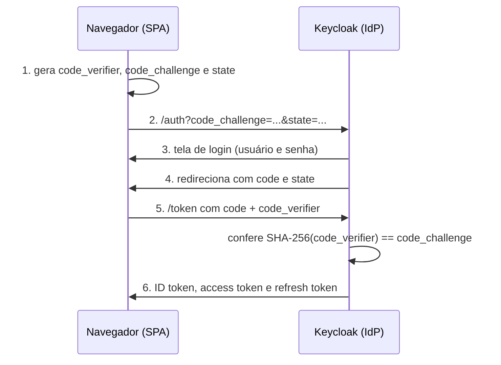

# Lab 4B: OAuth 2.1 e OpenID Connect - Authorization Code com PKCE passo a passo

Aula prática da seção 4 (Segurança Arquitetural), depois da aula 4.6.

| | |
|---|---|
| Aulas relacionadas | 4.6 (OAuth 2.1 e OpenID Connect) e, nos extras, 4.8 (MFA, SSO e autenticação entre serviços) |
| Ambiente | Docker Compose |
| Ordem de estudo | Trilha Identidade e acesso, passo 1 de 3 (continua nos labs 4C e 4D) |

## Objetivo

Na aula 4.6 vimos o fluxo Authorization Code com PKCE e como o OpenID Connect adiciona identidade ao OAuth. Neste lab você executa esse fluxo contra um provedor de identidade real (Keycloak) em um aplicativo de navegador escrito à mão, de modo que cada valor que trafega, cada redirecionamento e cada token fica visível na página.

O cenário é o da LunaLog: funcionários de uma transportadora precisam fazer login na plataforma sem que a LunaLog toque em suas senhas. O login é delegado ao provedor de identidade, e a aplicação recebe apenas tokens.

## O que você vai ver

- O `code_verifier`, o `code_challenge` (SHA-256) e o `state` sendo gerados no navegador, e a URL de autorização montada com eles
- O que o navegador envia ao Keycloak e o que volta: um `code` de uso único
- A troca do `code` por tokens, que exige o `code_verifier`
- Um **atacante que roubou o `code`** e não consegue trocá-lo: o PKCE no trabalho
- Os três tokens decodificados: **ID token** (quem é o usuário, para o aplicativo), **access token** (o que a API aceita) e **refresh token**
- Os campos que importam no access token: `iss`, `aud`, `azp`, `exp` e os papéis do usuário

Extras, ligados à aula 4.8:

- **SSO**: uma segunda aplicação, em outra origem, autenticada sem pedir senha de novo
- **MFA**: um usuário que, no primeiro login, é obrigado a cadastrar um autenticador (TOTP)
- **Client credentials**: um serviço obtendo token sem nenhum usuário envolvido

## Arquitetura do lab



- **Keycloak** em http://localhost:8180, com o realm `lunalog` já importado.
- **Portal da transportadora** em http://localhost:3001 (client `portal`) e **Painel de operações** em http://localhost:3002 (client `painel`): a mesma página, com `client_id` diferente.

## Usuários do realm

| Usuário | Senha | Papel |
|---|---|---|
| `ana` | `ana-exemplo` | operador |
| `roberto` | `roberto-exemplo` | admin |
| `carla` | `carla-exemplo` | operador (obrigada a configurar MFA no primeiro login) |

Console de administração do Keycloak: http://localhost:8180 (usuário `admin`, senha `admin-exemplo`). Todas as credenciais são de exemplo, só para o laboratório.

## Pré-requisitos

- Docker Engine ou Docker Desktop com Compose v2
- Cerca de 1,5 GB de RAM livre
- Portas 8180, 3001 e 3002 livres
- Um navegador

## Como executar

Na pasta deste lab:

```bash
docker compose up -d
```

O Keycloak leva cerca de 15 a 30 segundos para ficar pronto. Quando http://localhost:8180/realms/lunalog/.well-known/openid-configuration responder, siga.

### Cenário 1: o fluxo completo

Abra http://localhost:3001.

1. Clique em **Preparar o login (PKCE)**. A página mostra o `code_verifier` (que fica só no navegador), o `code_challenge` (o SHA-256 dele, que vai na URL) e o `state`, e a URL de autorização montada. Leia os parâmetros: `response_type=code`, `code_challenge_method=S256`, `redirect_uri`.
2. Clique em **Continuar para o Keycloak** e entre com `ana` e `ana-exemplo`. A senha vai para o Keycloak, nunca para a aplicação.
3. De volta ao portal, a página mostra o `code` e o `state` recebidos, e confere o `state` com o que foi enviado. O `code` é de uso único e por si só não vale nada.
4. Clique em **Trocar o code por tokens**. A página faz o POST ao endpoint `/token` com o `code` e o `code_verifier`.

O que observar nos tokens:

- **ID token**: identifica o usuário para o aplicativo (`name`, `email`, `preferred_username`).
- **Access token**: o que uma API aceitaria. Veja `iss` (quem emitiu), `aud` (para qual API), `azp` (para qual cliente foi emitido), `exp` (expira em 60 segundos neste realm) e `realm_access.roles` (o papel de `ana`).
- **Refresh token**: serve para obter novos access tokens sem pedir senha. Deve ser tratado como segredo.

### Cenário 2: o atacante que roubou o code

Repita o fluxo até a tela que mostra o `code`. Em vez de trocar, clique em **Simular um atacante que roubou o code**.

O que observar: o Keycloak responde `HTTP 400: invalid_grant - PKCE code verifier not specified`. Quem intercepta o `code` (em um redirecionamento, em um log, em um histórico) não tem o `code_verifier`, que nunca saiu do navegador, e não consegue trocá-lo por tokens. Repare também que a tentativa **invalidou** o `code` (uso único): o login legítimo precisa recomeçar, e a página oferece o botão para isso.

Esse é o ataque que o PKCE neutraliza, e o motivo de o OAuth 2.1 exigir PKCE em todos os fluxos de Authorization Code, inclusive para clientes públicos, como aplicativos de navegador e mobile.

### Cenário 3 (extra): SSO entre duas aplicações

Com o login do portal ativo, abra http://localhost:3002 (o painel) e faça o mesmo fluxo: **Preparar** e **Continuar para o Keycloak**.

O que observar: o Keycloak **não pede a senha de novo**. Ele reconhece a sessão e devolve o `code` direto. O painel obtém tokens com `azp=painel` para a mesma pessoa (`sub` idêntico). Duas aplicações, um login.

### Cenário 4 (extra): MFA obrigatório

Abra uma janela anônima, acesse http://localhost:3001 e faça o fluxo com `carla` e `carla-exemplo`.

O que observar: depois da senha, o Keycloak obriga a cadastrar um autenticador (TOTP): mostra um QR code e o segredo para digitar manualmente, e exige um código de 6 dígitos para concluir. Só depois disso o `code` é devolvido. Qualquer aplicativo de autenticador serve para testar.

### Cenário 5 (extra): client credentials, serviço a serviço

Um serviço de cobrança precisa chamar a API de tracking sem nenhum usuário. Ele usa o próprio segredo:

```bash
curl -s -d "grant_type=client_credentials" -d "client_id=cobranca" -d "client_secret=cobranca-segredo-de-exemplo" http://localhost:8180/realms/lunalog/protocol/openid-connect/token
```

O que observar: a resposta traz apenas `access_token` (sem ID token nem refresh token). Decodifique o token em um site ou localmente: não há usuário, `azp` é `cobranca` e `aud` é `tracking-api`. É a identidade de uma carga de trabalho, que a aula 4.8 aprofunda.

## Como limpar

```bash
docker compose down -v
```

## Estrutura da pasta

```
lab-4b_oidc-pkce-com-keycloak/
  README.md
  docker-compose.yml
  keycloak/realm-lunalog.json   (realm com usuários, clientes e papéis)
  web/
    index.html
    app.js                      (cliente OIDC escrito à mão)
    nginx.conf                  (serve a mesma página em duas origens)
```

## Limites deste lab

- O aplicativo de navegador é escrito à mão para o fluxo ficar visível. Em um aplicativo real, use uma biblioteca madura de OIDC (por exemplo, oidc-client-ts) e não implemente o protocolo você mesmo.
- Os tokens ficam na `sessionStorage`, o que simplifica o lab. Em uma SPA de produção, o armazenamento de tokens no navegador é uma decisão de segurança com vários trade-offs. O padrão mais seguro é um backend que guarda os tokens (BFF, backend for frontend).
- O Keycloak roda em modo de desenvolvimento, sem HTTPS, com banco em memória. Nunca use esse modo em produção.
- O access token vive 60 segundos neste realm, de propósito, para o lab 4C mostrar tokens expirados. Em produção, valores de 5 a 15 minutos são comuns, com refresh token para renovar.
- O realm tem um cliente `cli-teste` que usa o password grant, só para os scripts do lab 4C. O password grant foi removido do OAuth 2.1 e não deve ser usado em aplicações reais.

## Para pensar

1. O PKCE protege contra o roubo do `code`. Que outras superfícies de ataque continuam abertas em uma SPA (pense em XSS, no armazenamento de tokens e no `redirect_uri`)?
2. O `state` e o `code_challenge` parecem fazer coisas parecidas. Qual ataque cada um impede?
3. O access token tem `aud=tracking-api`. O que uma API deveria fazer se receber um token cujo `aud` é outra API? (Esse é o assunto do próximo lab.)
4. No SSO, a segurança de todas as aplicações passa a depender de uma sessão do provedor de identidade. O que você faria para proteger essa sessão?
