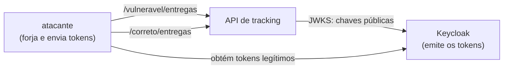

# Lab 4C: JWT - ataques reproduzíveis e validação correta

Aula prática da seção 4 (Segurança Arquitetural), depois da aula 4.7.

| | |
|---|---|
| Aulas relacionadas | 4.7 (JWT: estrutura, validação e armadilhas de implementação) |
| Ambiente | Docker Compose |
| Ordem de estudo | Trilha Identidade e acesso, passo 2 de 3 (continua o lab 4B; segue para o 4D) |

## Objetivo

Na aula 4.7 vimos que um JWT só é seguro se for **validado** corretamente: assinatura, algoritmo, expiração, audience e issuer. Neste lab você ataca duas versões da mesma API, uma com um validador ingênuo e outra com um validador correto, e vê cada falha clássica funcionar na prática.

O cenário é o da LunaLog: uma auditoria de segurança encontra tokens que nunca expiram e APIs que aceitam tokens que não são para elas. Aqui você reproduz o que o auditor fez.

## O que você vai ver

Cinco ataques, cada um com o resultado nas duas APIs:

| Ataque | O que acontece na API ingênua | Na API correta |
|---|---|---|
| Token legítimo adulterado (papel trocado, assinatura mantida) | Recusado: a assinatura protege | Recusado |
| `alg=none`: token sem assinatura | **Aceito**, com papel de admin | Recusado |
| Confusão de algoritmo: HS256 assinado com a chave pública | **Aceito**, com papel de admin | Recusado |
| Token expirado | **Aceito**, mesmo muito depois do `exp` | Recusado |
| Token de outro serviço (`aud` errado) | **Aceito** | Recusado |

E o código dos dois validadores lado a lado, para você ver exatamente o que a versão correta faz a mais.

## Arquitetura do lab



A API (`api/main.py`) expõe a mesma consulta de entrega em dois caminhos, cada um com seu validador. O Keycloak é o do lab 4B, com o mesmo realm `lunalog`.

## Pré-requisitos

- Docker Engine ou Docker Desktop com Compose v2
- Cerca de 1,5 GB de RAM livre
- Portas 8000 e 8180 livres

**Aviso:** o validador ingênuo é inseguro **de propósito**. Nunca copie esse código para um sistema real.

## Como executar

Na pasta deste lab:

```bash
docker compose up -d --build
```

Espere o Keycloak ficar pronto (de 15 a 30 segundos): http://localhost:8180/realms/lunalog/.well-known/openid-configuration deve responder. Os ataques rodam em um contêiner "atacante" que usa só a biblioteca padrão do Python:

```bash
docker compose run --rm atacante python ataques.py <ataque>
```

### Ataque base: a assinatura funciona

```bash
docker compose run --rm atacante python ataques.py base
```

O que observar: um token legítimo é aceito pelas duas APIs. Se alguém altera o conteúdo (aqui, troca o papel para `admin`) mantendo a assinatura original, **as duas recusam**: a assinatura RS256 cobre o conteúdo. É o comportamento esperado de um JWT assinado, e é a razão de ele ser tão usado. As falhas vêm do que as implementações fazem **em volta** da assinatura.

### Ataque 1: `alg=none`

```bash
docker compose run --rm atacante python ataques.py none
```

O atacante monta um token com o cabeçalho `{"alg":"none"}`, o papel `admin` e **nenhuma assinatura**. O que observar: a API ingênua aceita e passa a tratar o atacante como `admin`. Ela lê o campo `alg` do próprio token para decidir como validar, e `none` significa "não valide". A API correta recusa: a lista de algoritmos aceitos é fixa no servidor (`algorithms=["RS256"]`), e o token não tem voz nessa decisão.

### Ataque 2: confusão de algoritmo (RS256 para HS256)

```bash
docker compose run --rm atacante python ataques.py confusao
```

O atacante baixa a chave **pública** da API (qualquer um pode), troca o algoritmo do cabeçalho para HS256 e assina o token com HMAC usando essa chave pública **como se fosse um segredo compartilhado**. O que observar: a API ingênua aceita. Ela escolhe o algoritmo pelo cabeçalho e, para HS256, usa a chave pública como segredo HMAC, que é exatamente o que o atacante usou. A correta recusa, de novo pela lista fixa de algoritmos.

### Ataque 3: token expirado

```bash
docker compose run --rm atacante python ataques.py expirado
```

O token tem vida de 60 segundos neste realm. O script usa o token, espera 65 segundos e o usa de novo. O que observar: a API ingênua aceita o token mesmo depois de expirado; a correta recusa com `token expirado`. É o caso da LunaLog da aula 4.7: sem a checagem de `exp`, o token de um motorista demitido continua valendo para sempre.

### Ataque 4: token de outro serviço (audience)

```bash
docker compose run --rm atacante python ataques.py audience
```

O token é legítimo, emitido pelo Keycloak, mas para o serviço de **relatórios**, que não deveria acessar a API de tracking. O que observar: a API ingênua aceita, porque só confere a assinatura. A correta recusa com `audience invalida`. O `aud` diz **para quem** o token vale. Sem conferi-lo, um token de qualquer serviço vira passe livre para todos os outros.

### Todos os ataques de uma vez

```bash
docker compose run --rm atacante python ataques.py todos
```

## O que o validador correto faz a mais

Compare `validar_ingenuo` e `validar_correto` em `api/main.py`. O correto:

```python
jwt.decode(
    token, chave.key,
    algorithms=["RS256"],              # lista fixa no servidor, nunca o que o token diz
    audience=AUDIENCE,                 # o token tem que ser PARA esta API
    issuer=ISSUER,                     # e emitido pelo provedor esperado
    options={"require": ["exp", "iat", "iss", "aud", "sub"]},  # e precisa expirar
)
```

Cada argumento fecha uma das falhas acima. A chave de verificação vem do JWKS do provedor de identidade, selecionada pelo `kid` do token, nunca de uma configuração local desatualizada.

## Checklist de validação de JWT

1. Verificar a **assinatura**, com algoritmo e chave definidos no servidor.
2. Rejeitar `alg=none` e qualquer algoritmo fora da lista.
3. Exigir e conferir `exp` (e `nbf`, se usado).
4. Conferir `iss` (quem emitiu).
5. Conferir `aud` (para quem é).
6. Tratar o conteúdo do token como informação do emissor, e fazer a **autorização** depois, no servidor.
7. Usar tokens de vida curta e prever como revogar quando necessário.

## Como limpar

```bash
docker compose --profile ferramentas down -v
```

## Estrutura da pasta

```
lab-4c_jwt-armadilhas/
  README.md
  docker-compose.yml
  keycloak/realm-lunalog.json    (o mesmo realm do lab 4B)
  api/
    main.py                      (validador ingênuo e validador correto)
    Dockerfile, requirements.txt
  atacante/
    ataques.py                   (os cinco ataques)
```

## Limites deste lab

- Um JWT **não é revogável** por padrão: enquanto não expira, vale. Por isso a vida curta e, quando necessário, uma lista de tokens revogados ou o uso de tokens opacos com introspecção. Se você precisa revogar uma sessão no mesmo instante, o JWT puro talvez não seja a ferramenta certa.
- Não coloque no token dados que você não aceitaria ver expostos: o payload é apenas codificado em Base64, não é cifrado.
- O ataque `alg=none` e a confusão de algoritmo funcionam aqui porque o validador ingênuo foi escrito à mão. Bibliotecas modernas de JWT, usadas do jeito certo, já recusam esses casos, mas há muito código legado e código escrito às pressas que reimplementa a validação.
- Os tokens vêm do `cli-teste`, que usa o password grant, só para facilitar os scripts. O password grant foi removido do OAuth 2.1.
- Falta aqui, de propósito, o ataque via cabeçalhos `jku` e `kid` maliciosos. É a mesma família de falha (confiar em dados do token para decidir como validá-lo).

## Para pensar

1. As duas primeiras falhas têm a mesma raiz. Qual é? Que princípio de projeto ela viola?
2. A LunaLog tinha tokens de 14 meses sem `exp`. Quais controles, além de conferir o `exp`, você colocaria para limitar o dano de um token vazado?
3. O que um serviço deve fazer quando precisa revogar o acesso de uma pessoa imediatamente, e o seu token ainda tem 10 minutos de validade?
4. A API correta recusou o token do serviço de relatórios por causa do `aud`. Em uma arquitetura com dezenas de serviços, como garantir que cada serviço realmente confere o seu `aud`?
