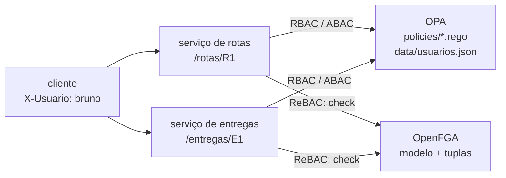

# Lab 4D: Policy-as-code: a mesma regra em RBAC, ABAC e ReBAC com OPA e OpenFGA

Aula prática da seção 4 (Segurança Arquitetural), depois da aula 4.10.

| | |
|---|---|
| Aulas relacionadas | 4.9 (modelos de controle de acesso: RBAC, ABAC e ReBAC) e 4.10 (policy-as-code: OPA, Casbin e OpenFGA) |
| Ambiente | Docker Compose (OPA, OpenFGA, dois microsserviços, Python) |
| Ordem de estudo | Trilha Identidade, passo 3 de 3 (depois dos labs 4B e 4C). Pode ser feito sozinho |

## Objetivo

Na aula 4.10 vimos o caso da LunaLog: 12 microsserviços, 12 implementações diferentes de autorização (enums fixos, tabelas, `if/else` aninhados de 80 linhas), e uma auditoria que encontra inconsistências. A saída é **externalizar a decisão** para um componente dedicado, versionável e testável, e mudar uma política sem fazer deploy dos 12 serviços.

Neste lab a **mesma regra de negócio** (quem pode ver uma rota de entrega) é implementada nos três modelos da aula 4.9, e dois microsserviços **consultam o mesmo ponto de decisão** em vez de decidir sozinhos. Você mede qual modelo acerta, vê onde cada um começa a doer, testa as políticas como código e muda uma regra sem tocar nos serviços.

A regra, em português:

- o **motorista** vê apenas as rotas atribuídas a ele
- o **operador** vê as rotas da sua filial (em horário comercial)
- o **gerente** vê as rotas de todas as filiais da sua transportadora
- o **auditor** da plataforma vê tudo
- ninguém vê dados de outra transportadora
- uma **entrega** tem a visibilidade da rota a que pertence

## O que você vai ver

- A **mesma regra em RBAC, ABAC e ReBAC**, e uma matriz de acesso mostrando quem vê o quê contra o gabarito
- O **RBAC puro vazando** acessos (o bug do motorista que via rotas de outro, da aula 4.5) e **onde o ABAC e o ReBAC começam a doer**
- **OPA com Rego** e **testes unitários de política** (`opa test`), prontos para o CI
- **OpenFGA** com um modelo de relacionamentos (plataforma, transportadora, filial, rota, entrega) e testes do modelo
- **Dois serviços** consultando o mesmo ponto de decisão e ficando consistentes
- **Mudar uma política sem redeploy** dos serviços, e o **log de decisões**
- O comportamento em **falha do ponto de decisão** (negar por segurança)

## Arquitetura do lab



- Os dois **microsserviços** (`rotas` e `entregas`) usam o mesmo código (`app/servico.py`) e **não contêm nenhuma regra de autorização**: montam a pergunta e perguntam ao ponto de decisão (PDP).
- O **OPA** responde RBAC e ABAC com as políticas em Rego (`policies/`). O **OpenFGA** responde ReBAC a partir de um modelo e de tuplas de relacionamento (`fga/store.fga.yaml`).
- O PDP é escolhido por requisição com `?pdp=rbac|abac|rebac`, **só no lab**, para comparar os três com os mesmos serviços. Em um sistema real haveria um.
- Se o PDP não responde, o serviço **nega** (fail closed).

## Pré-requisitos

- Docker Engine ou Docker Desktop (Compose v2)
- Cerca de 1,5 GB de RAM livres
- As portas 8611 e 8612 livres
- Um shell Bash e `curl`

## Como executar

Na pasta deste lab:

```bash
docker compose up -d --build
docker compose logs fga-setup        # a loja do OpenFGA criada com o modelo e as tuplas
curl -s -H 'X-Usuario: bruno' localhost:8611/rotas/R1       # 200
curl -s -H 'X-Usuario: bruno' localhost:8611/rotas/R3       # 403 (abac, o padrão)
```

Os usuários (`ana`, `bruno`, `carla`, `dora`, `eva`, `fabio`, `gil`) estão em `data/usuarios.json`; as rotas (R1 a R3) e entregas (E1 a E3) nos catálogos de `app/catalogos/`.

### Cenário 1: a matriz de acesso nos três modelos

```bash
docker compose --profile ferramentas run --rm cliente sh -c "pip install -q httpx && python matriz.py"
```

O script pergunta ao serviço, para cada usuário e cada rota/entrega, e compara com o gabarito (a regra em português). O resultado do **RBAC**:

```
=== RBAC (hora 10h) ===
          R1   R2   R3   E1   E2   E3
ana      sim VAZA VAZA  sim VAZA VAZA
bruno    sim VAZA VAZA  sim VAZA VAZA
carla   VAZA VAZA  sim VAZA VAZA  sim
...
decisoes erradas: 22 de 42
```

O que observar:

- O **RBAC acertou só 20 de 42**. Todo cargo recebe a permissão "ver rotas", então **todos veem tudo**: o bruno vê a rota da carla (de outra transportadora). É o bug do motorista da aula 4.5. O RBAC responde "este *cargo* pode ver rotas?", não "este *usuário* pode ver *esta* rota?".
- Para o RBAC acertar, seria preciso um papel por (cargo × escopo): `motorista@R1`, `operador@rapido-sp`, `gerente@rapido`... Com 7 usuários, **seriam 7 papéis, um por pessoa**. É a **explosão de papéis**: o modelo perde o sentido.
- **ABAC e ReBAC: 0 erros em 42.**

### Cenário 2: ABAC com OPA, e a política como código

Abra `policies/abac.rego`. São quatro regras curtas, uma por cargo, que combinam atributos do usuário, do recurso e do contexto (a hora). Um mesmo arquivo, versionado no Git, revisado em pull request.

As políticas têm testes unitários, que rodam como qualquer outro teste:

```bash
docker compose --profile ferramentas run --rm opa-test
```

O que observar: `PASS: 9/9`. Os testes cobrem o motorista, o gerente, o operador (inclusive fora do horário) e o auditor, e qualquer mudança que quebre uma regra **falha no CI antes de chegar ao ar**. Isso é policy-as-code: a autorização é código, tem teste, diff e revisão.

Veja o contexto em ação: às 23h o operador deixa de ver as rotas.

```bash
docker compose --profile ferramentas run --rm cliente sh -c "pip install -q httpx && HORA=23 python matriz.py abac"
```

A linha da `ana` fica toda em `nao`, e o script confirma 0 erros (o gabarito também considera o horário). O ABAC expressa **contexto** (hora, local, risco) com naturalidade.

### Cenário 3: ReBAC com OpenFGA, e a consulta reversa

Abra `fga/store.fga.yaml`. Em vez de regras com `if`, há um **modelo de relacionamentos**: uma rota tem uma filial, uma filial pertence a uma transportadora, o gerente da transportadora vê as rotas das suas filiais. A estrutura da organização está em **tuplas** (dados), não em código.

Os modelos de OpenFGA também têm teste:

```bash
docker compose --profile ferramentas run --rm fga model test --tests /modelo/store.fga.yaml
```

`Checks 9/9 passing`. Agora duas coisas que o ReBAC faz bem:

**Mudar a organização sem tocar em código.** A `ana` é operadora de São Paulo e não vê a rota R2 (do Rio). Dê a ela a filial do Rio, só com um dado:

```bash
bash scripts/fga.sh query check usuario:ana viewer rota:R2                 # {"allowed":false}
bash scripts/fga.sh tuple write usuario:ana operador filial:rapido-rj
bash scripts/fga.sh query check usuario:ana viewer rota:R2                 # {"allowed":true}
curl -s -H 'X-Usuario: ana' 'localhost:8611/rotas/R2?pdp=rebac'            # 200, sem deploy nem reinício
bash scripts/fga.sh tuple delete usuario:ana operador filial:rapido-rj     # desfaz
```

**A consulta reversa.** "Quais rotas a dora pode ver?" é uma pergunta natural no ReBAC:

```bash
bash scripts/fga.sh query list-objects usuario:dora viewer rota            # {"objects":["rota:R1","rota:R2"]}
```

Com ABAC, responder a essa pergunta exigiria percorrer todos os recursos e avaliar a política em cada um. Sem ela, não dá para montar uma tela de "minhas rotas" sem um `SELECT` de tudo e um filtro depois.

E onde o ReBAC puro **não** brilha: o **contexto**. Às 23h:

```bash
docker compose --profile ferramentas run --rm cliente sh -c "pip install -q httpx && HORA=23 python matriz.py rebac"
```

A `ana` continua vendo a R1 (`VAZA`): o modelo de relacionamentos não conhece o relógio. (O OpenFGA tem *conditions* para isso, mas é um recurso à parte, fora deste lab.) Por isso, na prática, os modelos **se combinam**.

### Cenário 4: dois serviços, uma decisão, e a mudança de política sem redeploy

Os serviços de **rotas** e de **entregas** não têm regra nenhuma de autorização. A mudança de uma política vale para os dois ao mesmo tempo, sem tocar em nenhum deles:

1. A regra do operador é de 6h às 22h. Pergunte às 21h: `HORA=21 python matriz.py abac` dá **0 erros** (a ana vê a R1).
2. Mude a política: em `policies/abac.rego`, altere `input.hora >= 6` para `input.hora >= 8` e `input.hora < 22` para `input.hora < 20`.
3. Faça o OPA recarregar a política (veja a nota abaixo) e repita a pergunta às 21h.

```bash
docker compose restart opa        # só o OPA; os serviços não são tocados
docker compose --profile ferramentas run --rm cliente sh -c "pip install -q httpx && HORA=21 python matriz.py abac"
```

O que observar: agora a matriz aponta `ana -> R1: negou` e `ana -> E1: negou` (o gabarito do script ainda é o horário antigo, e a divergência é a prova de que o comportamento mudou). **Os dois serviços ficaram no ar o tempo todo, sem deploy**, e os dois mudaram de comportamento ao mesmo tempo, porque os dois perguntam ao mesmo PDP. Desfaça a mudança no arquivo e reinicie o OPA.

> **Nota sobre o recarregamento:** o OPA roda com `--watch` e recarrega sozinho quando o arquivo muda, em Linux e macOS. No Docker Desktop para Windows, o sistema de arquivos montado não envia o evento de mudança, então use `docker compose restart opa`. Em produção, as políticas são distribuídas por *bundles* (um servidor HTTP ou um bucket que o OPA consulta periodicamente), sem reinício.

### O log de decisões

```bash
docker compose logs opa | grep decision_id | tail -1
```

Cada decisão do OPA vira uma linha de log com o `input` completo (quem, o quê, em qual contexto), o resultado e um `decision_id`. É a trilha de auditoria da autorização: dá para responder, depois, "por que o bruno viu a R1 às 10h12?". (Em produção, os logs de decisão seguem para um coletor.)

### Quando o ponto de decisão cai

```bash
docker compose stop opa
curl -s -w ' http=%{http_code}\n' -H 'X-Usuario: bruno' localhost:8611/rotas/R1
docker compose start opa
```

A resposta é `503` com "acesso negado por segurança". O serviço **nega quando não consegue decidir** (fail closed). Essa é a escolha segura para autorização, e tem custo: o PDP vira dependência crítica. Por isso ele precisa de alta disponibilidade, e em muitos desenhos roda como sidecar do serviço (OPA) ou com cache de decisões curto.

## Resultados de referência

| Medida | Resultado |
|---|---|
| RBAC puro contra o gabarito | 22 decisões erradas em 42 (todas acessos indevidos) |
| ABAC (Rego) | 0 erros em 42 |
| ReBAC (OpenFGA) | 0 erros em 42 |
| Testes de política do OPA | 9 de 9 passam |
| Testes do modelo do OpenFGA | 9 checagens e 1 list-objects passam |
| ABAC às 23h | operador negado, 0 erros |
| ReBAC às 23h | operador ainda vê (sem contexto), 2 divergências |
| Mudar a política | os serviços permanecem no ar; o comportamento muda nos dois |
| PDP fora do ar | `503`, acesso negado |

## Como limpar

```bash
docker compose down -v
```

## Estrutura da pasta

```
lab-4d_policy-as-code-opa-e-openfga/
  README.md
  docker-compose.yml
  policies/
    rbac.rego, abac.rego      (as políticas)
    abac_test.rego            (testes unitários das políticas)
  data/usuarios.json          (diretório de usuários e seus atributos)
  fga/store.fga.yaml          (modelo ReBAC, tuplas e testes)
  app/servico.py              (o microsserviço: pergunta ao PDP, não decide)
  app/catalogos/              (rotas e entregas)
  scripts/
    matriz.py                 (a matriz de acesso x gabarito)
    fga.sh                    (atalho para a CLI do OpenFGA)
```

## Limites deste lab

- O PDP é escolhido por parâmetro de requisição só para a comparação. Em produção há um modelo, e o parâmetro não existiria (seria uma brecha).
- A identidade do usuário vem do header `X-Usuario`, **sem autenticação**. Em produção, ela vem de um token validado (labs 4B e 4C), e o serviço passa ao PDP a identidade já verificada.
- No ABAC, os **atributos do recurso** (transportadora, filial, motorista) são enviados pelo serviço no `input`, e o catálogo de **entregas** duplica os atributos da rota. Essa duplicação é uma fonte real de inconsistência: se a rota mudar de motorista e a entrega não, as decisões divergem. No ReBAC, a entrega só guarda a relação com a rota, e a decisão é derivada.
- O diretório de usuários do OPA é um arquivo estático. Em produção, os dados de usuário chegam por bundles, por consultas ao diretório corporativo ou nos tokens (claims).
- O OpenFGA roda em **memória** (os dados somem ao reiniciar). Em produção, usa PostgreSQL ou MySQL e uma estratégia de sincronização das tuplas com a fonte de verdade da organização.
- Casbin, a terceira ferramenta citada na aula 4.10, não está no lab. Ela embute o motor de política na própria aplicação (como biblioteca), em vez de um serviço externo.
- O lab usa o OPA para RBAC e ABAC e o OpenFGA para ReBAC. Isso é uma escolha didática: o OPA também modela relacionamentos, e o OpenFGA aceita condições. Na prática, as equipes costumam **combinar** os modelos.
- As imagens estão **fixadas em versões** no `docker-compose.yml` (OPA 1.21.4, OpenFGA v1.22.0 e fga CLI v0.8.2, as usadas nos resultados de referência), para a saída não mudar quando sair uma versão nova. Para testar uma versão mais recente, troque as tags no compose e refaça os cenários: a sintaxe do Rego e dos comandos do `fga` pode mudar entre versões maiores.
- Os nomes e os dados são fictícios.

## Para pensar

1. Quantos lugares do seu sistema hoje decidem "este usuário pode ver isto"? Se a regra mudar, em quantos serviços você mexeria?
2. O RBAC acertou 20 de 42. Em que partes do seu sistema o "papel" é suficiente, e onde você já cria papéis demais para compensar?
3. Que perguntas do seu produto precisam da consulta reversa ("o que este usuário pode ver?")? Como você as responde hoje?
4. O PDP é uma dependência crítica. Você o executaria como serviço central, como sidecar de cada serviço ou como biblioteca? Que latência e que risco cada opção traz?
