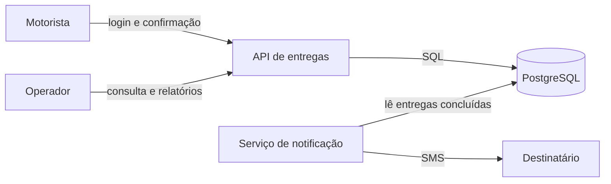
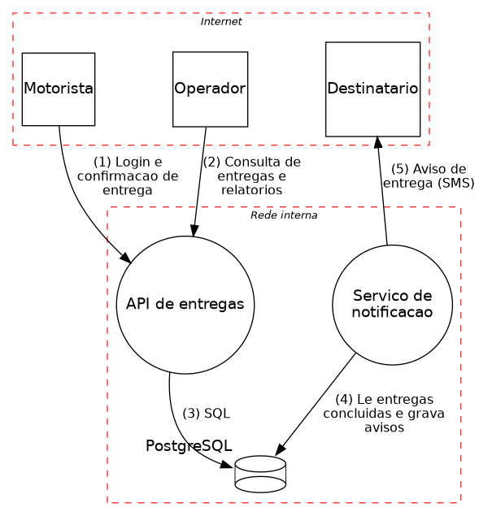
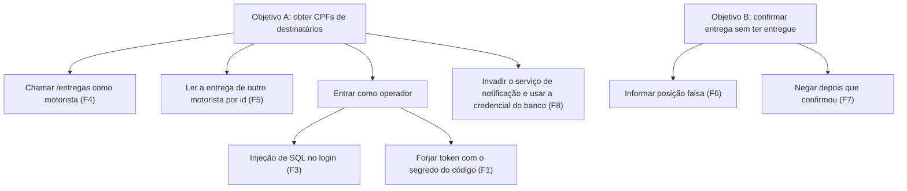

# Lab 4E: STRIDE na prática: diagnóstico e redesign de um sistema inseguro

Aula prática da seção 4 (Segurança Arquitetural), depois da aula 4.12.

| | |
|---|---|
| Aulas relacionadas | 4.11 (threat modeling: STRIDE e árvores de ataque) e 4.12 (secure by design e OWASP Top 10 para arquitetos) |
| Ambiente | Docker Compose (FastAPI, PostgreSQL, pytm, Graphviz) |
| Ordem de estudo | Isolado. Reúne temas dos labs 4A (chaves), 4B (JWT), 4D (autorização) e 5B (SAST) |

## Objetivo

Na aula 4.11 a LunaLog fez threat modeling pela primeira vez, antes de assinar o contrato com o cliente farmacêutico, e o exercício com STRIDE achou três ameaças críticas que ninguém tinha mapeado (um motorista forjando a localização GPS, a falta de uma trilha de auditoria imutável e um endpoint exposto sem autenticação). Nenhuma delas apareceria em uma revisão de código linha a linha, e as três foram achadas **antes de qualquer incidente**.

Neste lab você faz o ciclo completo sobre um sistema inseguro **de propósito**: modela as ameaças **como código**, gera o diagrama de fluxo de dados, **reproduz** cada achado com um ataque de verdade, prioriza por árvore de ataque, vê a versão **redesenhada** barrar os mesmos ataques e lista as ameaças **residuais** que o redesign não resolve.

> **Aviso:** a versão insegura é vulnerável de propósito. Ela só publica a porta em `127.0.0.1`. Nunca a exponha em uma rede nem a use como base de um sistema real. Todos os dados, usuários, senhas e segredos são fictícios.

## O que você vai ver

- Um **modelo de ameaças como código** (pytm, da OWASP) que gera o **diagrama de fluxo de dados** e a lista de ameaças deduzidas dos controles declarados
- **Oito falhas reproduzíveis** no sistema inseguro, classificadas em STRIDE: segredo no código, JWT sem expiração, injeção de SQL, autorização só no front-end, acesso por id (IDOR), GPS forjado, ausência de trilha de auditoria e banco compartilhado com credencial administradora
- A **priorização** por árvore de ataque e por probabilidade e impacto
- O **redesign**, com cada correção ligada à falha que ela resolve, e os **mesmos ataques barrados**
- As **ameaças residuais**: o que continua em aberto depois do redesign
- O que um **scanner de código** (Semgrep) acha, e o que ele não vê

## O sistema



O sistema registra entregas e a confirmação feita pelo motorista (com a posição do aparelho), e notifica o destinatário. Existe em duas versões lado a lado: **inseguro** (`http://localhost:8701`, como ele nasceu) e **seguro** (`http://localhost:8702`, depois do redesign).

## Pré-requisitos

- Docker Engine ou Docker Desktop (Compose v2)
- Cerca de 2 GB de RAM livres e de disco para as imagens
- As portas 8701 e 8702 livres (publicadas só em `127.0.0.1`)
- Um shell Bash e `curl`

## Como executar

Na pasta deste lab:

```bash
bash scripts/preparar.sh        # gera o segredo do JWT da versão segura (arquivo .env, fora do Git)
docker compose up -d --build
docker compose --profile ferramentas build cliente modelo
```

### Passo 1: conheça o sistema inseguro

```bash
curl -s -X POST localhost:8701/login -H 'Content-Type: application/json' -d '{"nome":"bruno","senha":"bruno123"}'
```

O `bruno` é um motorista. Com o token que ele recebe:

```bash
TOKEN=<cole o token aqui>
curl -s localhost:8701/entregas -H "Authorization: Bearer $TOKEN"
```

Abra também http://localhost:8701/ no navegador e entre como `bruno` / `bruno123`: a tela mostra só as **2 entregas dele**. Compare com o `curl` acima, que devolveu **3**. O que o navegador mostra não é o que o servidor devolveu.

### Passo 2: o modelo de ameaças como código

O arquivo `modelo/modelo.py` descreve o sistema em Python: os atores, as fronteiras de confiança, os processos, o banco, os fluxos de dados e **os controles** que cada elemento implementa (autentica a origem? valida entrada? criptografa o fluxo? tem controle de acesso?). A partir dele o pytm gera o diagrama e deduz as ameaças.

```bash
bash scripts/gerar-modelo.sh
```

```
inseguro: 106 ameacas  Very High=10  High=35  Medium=53  Low=6  Very Low=2
seguro: 51 ameacas  Very High=4  High=16  Medium=26  Low=5
```

O diagrama de fluxo de dados (DFD), gerado de `modelo.py`, fica em `docs/dfd-inseguro.png`:



O que observar:

- As **fronteiras de confiança** (as caixas tracejadas) são o ponto de partida do STRIDE: cada fluxo que **atravessa** uma fronteira é um lugar onde um atacante pode agir.
- O pytm lista, por elemento, as ameaças que decorrem dos **controles que faltam**. O sistema inseguro soma **106 ameaças**; o redesenhado, **51**. Os resumos estão em `docs/ameacas-inseguro.md` e `docs/ameacas-seguro.md`.
- Mudar um controle no modelo (por exemplo, `api.controls.validatesInput`) muda a lista. O modelo vira **código revisável**, que acompanha o sistema no Git.

Para cada elemento do DFD, o STRIDE sugere **quais categorias perguntar**:

| Elemento | S (falsificar identidade) | T (adulterar) | R (repudiar) | I (vazar informação) | D (negar serviço) | E (elevar privilégio) |
|---|---|---|---|---|---|---|
| Entidade externa (motorista, operador) | sim | | sim | | | |
| Processo (API, notificação) | sim | sim | sim | sim | sim | sim |
| Armazém de dados (PostgreSQL) | | sim | sim | sim | sim | |
| Fluxo de dados (setas) | | sim | | sim | sim | |

A ferramenta **gera candidatos**; é o arquiteto que decide quais são reais, quais importam e em que ordem tratar. Os oito achados abaixo vieram dessa leitura, e cada um tem uma prova.

### Passo 3: reproduzir os achados

```bash
docker compose --profile ferramentas run --rm cliente python ataques.py
```

```
    STRIDE          falha                                 inseguro    seguro
F1  Spoofing        segredo do JWT no codigo              EXPLORADO   barrado
F2  Spoofing        token sem expiracao                   EXPLORADO   barrado
F3  Tampering       injecao de SQL no login               EXPLORADO   barrado
F4  Info disclosure autorizacao so no front-end           EXPLORADO   barrado
F5  Info disclosure acesso por id (IDOR)                  EXPLORADO   barrado
F6  Tampering       GPS forjado na confirmacao            EXPLORADO   barrado
F7  Repudiation     sem trilha de auditoria               EXPLORADO   barrado
F8  Elevation       banco compartilhado e administrador   EXPLORADO   barrado
```

As evidências de cada linha aparecem logo abaixo da tabela, na saída do script. As falhas, uma a uma:

| Id | STRIDE | O que acontece no sistema inseguro | Prova |
|---|---|---|---|
| F1 | Spoofing | O segredo do JWT (`luna-secret-123`) está no código. Quem lê o repositório forja um token de operador | token forjado aceito em `/relatorio` (200) |
| F2 | Spoofing | O token não expira: um token roubado vale para sempre | claims sem `exp` |
| F3 | Tampering | O login monta o SQL concatenando texto. O nome `ana' --` entra como a `ana`, sem senha | login com 200 |
| F4 | Info disclosure | O servidor devolve as entregas **de todos**, com CPF; o filtro "só as minhas" está no navegador | o `bruno` recebe 3 entregas, 1 de outro motorista, com CPF |
| F5 | Info disclosure | A consulta por id não confere o dono (IDOR) | o `bruno` lê a entrega 2, da `carla` |
| F6 | Tampering | O servidor aceita qualquer posição informada pelo aparelho | confirmar a entrega 1 "a partir de Tóquio": 200 |
| F7 | Repudiation | A confirmação não registra quem, quando, nem de onde | não há auditoria (404): ninguém prova quem confirmou |
| F8 | Elevation | Todos os serviços usam o administrador do banco. Se a notificação for invadida, ela lê CPFs e altera entregas | `SELECT cpf` e `UPDATE` permitidos |

**F6 e F7 são o que a aula 4.11 chamou de GPS forjado e ausência de trilha de auditoria**, as ameaças que um revisor de código dificilmente acharia, porque o código "funciona".

### Passo 4: priorizar com uma árvore de ataque

Nem tudo tem a mesma urgência. Uma árvore de ataque organiza os caminhos até um objetivo do atacante:



Uma priorização simples, por **probabilidade** (1 a 3, o quanto é fácil) vezes **impacto** (1 a 3, o dano para o negócio e para o contrato):

| Falha | Prob. | Impacto | Risco | Observação |
|---|---|---|---|---|
| F3 injeção de SQL | 3 | 3 | **9** | qualquer um, sem conta; dá acesso de operador |
| F6 GPS forjado | 3 | 3 | **9** | ameaça direta ao contrato farmacêutico |
| F4 autorização no front-end | 3 | 2 | 6 | qualquer motorista autenticado |
| F5 IDOR | 3 | 2 | 6 | idem; vaza dados pessoais |
| F1 segredo no código | 2 | 3 | 6 | exige acesso ao repositório, mas dá controle total |
| F7 sem trilha | 2 | 3 | 6 | cria risco regulatório e impede a investigação |
| F2 token sem expiração | 2 | 2 | 4 | agrava os outros |
| F8 banco compartilhado | 1 | 3 | 3 | exige invadir um serviço antes; amplifica o estrago |

A ordem de tratamento sai daqui, não da ordem em que as falhas foram achadas. Os números são julgamento do time (os seus podem diferir); o valor está em **tornar o critério explícito e discutível**.

### Passo 5: o redesign

Cada correção está marcada com `[Cx]` no código da versão segura e responde a uma falha `[Fx]` da insegura. Veja o resumo:

```bash
bash scripts/diff-redesign.sh
```

| Falha | Correção | Onde |
|---|---|---|
| F1 | O segredo vem do ambiente (`.env` gerado, fora do Git), nunca do código | `app/seguro/main.py` |
| F2 | Token de 15 minutos, com `exp`, `aud` e `iss` obrigatórios e algoritmo fixo | idem |
| F3 | Consulta parametrizada; senhas em hash `scrypt`; mesma resposta para usuário e senha errados | idem |
| F4 | A autorização é decidida **no servidor** (motorista vê as dele, operador vê todas); o CPF nem sai do banco nas rotas de consulta | idem |
| F5 | Entrega de outro motorista responde 404 (não revela que existe) | idem |
| F6 | O servidor valida a distância até o destino (máx. 100 m) e o horário do aparelho (janela de 60 s, contra repetição) | idem |
| F7 | Trilha de auditoria **encadeada** (cada linha guarda o hash da anterior), em tabela onde a API só pode inserir | idem e `sql/init.sql` |
| F8 | Um papel de banco por serviço: a API só altera 3 colunas; a notificação só lê `id`, `codigo` e `status` e só escreve em `notificacoes` | `sql/init.sql` |

Reexecute o passo 3 e veja a coluna `seguro`: **8 de 8 barrados**. Para ver a trilha de auditoria criada pela confirmação legítima:

```bash
docker compose --profile ferramentas run --rm cliente python -c "
import httpx
b='http://api-seguro:8000'
t=httpx.post(b+'/login',json={'nome':'ana','senha':'ana123'}).json()['token']
print(httpx.get(b+'/auditoria/1',headers={'Authorization':'Bearer '+t}).json())"
```

O registro mostra quem confirmou, de onde e quando, e o hash que o amarra ao anterior.

### Passo 6: o que um scanner acha, e o que ele não vê

```bash
docker run --rm -v "$PWD/app:/src" semgrep/semgrep semgrep scan --config p/python --config p/jwt --metrics=off /src/inseguro
```

O Semgrep acha **1 problema** na versão insegura (o segredo do JWT no código, F1) e **0** na redesenhada. Ele **não vê** as outras sete: a autorização no front-end, o IDOR, o GPS forjado, a falta de auditoria, a credencial administradora. São falhas de **desenho**, não de linha de código. É o lugar do threat modeling: ele acha o que a ferramenta de código não acha (lab 5B).

### Passo 7: as ameaças residuais

O redesign não zera o risco. O que continua em aberto, e que o modelo (`docs/ameacas-seguro.md`) e a revisão apontam:

| Ameaça residual | Categoria | Próximo passo |
|---|---|---|
| Sem **limite de taxa**: um cliente pode sobrecarregar o login e a confirmação | D (negação de serviço) | rate limiting por cliente (lab 3E) |
| Sem **HTTPS**: o tráfego entre cliente e API vai em texto claro no lab | T, I | TLS na borda e mTLS entre serviços (lab 4F) |
| Segredo do JWT em arquivo `.env` | S | cofre de segredos e rotação (lab 4A) |
| **Tokens** não revogáveis antes de expirar (15 min) | S, E | lista de revogação ou tokens opacos com introspecção |
| A **posição** vem do aparelho, que pode ser comprometido (a validação de distância não impede um GPS falsificado perto do destino) | T | atestação do aparelho, correlação com outros sinais (trilha do trajeto, prova de entrega) |
| A trilha de auditoria **não tem verificador** da cadeia de hashes nem cópia externa | R | verificação periódica e gravação em um armazenamento imutável |
| CPF **em claro** no banco | I | criptografia de campo com envelope encryption (lab 4A) |

Um modelo de ameaças é **vivo**: cada mudança relevante de arquitetura reabre a pergunta "o que pode dar errado aqui?".

## Resultados de referência

| Medida | Resultado |
|---|---|
| Falhas exploradas na versão insegura | 8 de 8 |
| Falhas exploradas na versão redesenhada | 0 de 8 |
| Ameaças deduzidas pelo pytm (inseguro e seguro) | 106 e 51 |
| Achados do Semgrep (inseguro e seguro) | 1 (o segredo do JWT) e 0 |
| Notificação, versão insegura: permissões do banco | lê CPFs e altera entregas |
| Notificação, versão segura: permissões do banco | só `id`, `codigo`, `status`; não altera entregas |

## Como limpar

```bash
docker compose down -v
```

O arquivo `.env` com o segredo fica na pasta (e é ignorado pelo Git). Apague-o se quiser.

## Estrutura da pasta

```
lab-4e_stride-sistema-inseguro/
  README.md
  docker-compose.yml
  app/
    inseguro/main.py          (falhas marcadas [F1] a [F8])
    seguro/main.py            (correções marcadas [C1] a [C8])
  notificacao/notificacao.py  (o mesmo código nas duas versões; muda só a credencial de banco)
  sql/init.sql                (dois bancos; o seguro com papéis de privilégio mínimo e auditoria)
  modelo/
    modelo.py                 (o modelo de ameaças como código, pytm)
    relatorio.py              (resume as ameaças deduzidas)
  scripts/
    preparar.sh               (gera o segredo do JWT)
    gerar-modelo.sh           (DFD e resumo de ameaças das duas variantes)
    ataques.py                (reproduz as 8 falhas nas duas versões)
    diff-redesign.sh          (falha e correção, lado a lado)
  docs/                       (DFDs e resumos gerados)
```

## Limites deste lab

- O sistema é **pequeno** e as falhas são **didáticas**: em um sistema real elas aparecem misturadas, em muito mais código, e o trabalho de modelar é maior.
- O pytm **deduz ameaças dos controles declarados**: se o modelo declara um controle que o código não implementa (ou o contrário), o resultado engana. O modelo precisa ser mantido junto com o sistema, e a conferência é humana.
- A lista do pytm tem **muito ruído** (algumas ameaças genéricas, como "XML Attribute Blowup", não se aplicam a uma API JSON). A triagem é do arquiteto; a ferramenta gera candidatos, não conclusões.
- O STRIDE cobre **ameaças técnicas**. Ameaças de processo, de pessoas e de negócio (fraude interna, engenharia social, risco de fornecedor) precisam de outros métodos.
- O redesign mostra o **desenho** das correções, não uma implementação pronta para produção: sem TLS, sem rate limiting, sem rotação de segredo, sem revogação de tokens (veja as ameaças residuais).
- O lab usa um **hash de senha** (scrypt) com parâmetros modestos e um sal fixo por usuário no seed; em produção, ajuste o custo e use uma biblioteca consagrada.
- Os dados, os nomes e as credenciais são fictícios. **Não coloque dados reais** neste sistema.

## Para pensar

1. Quais fluxos do seu sistema atravessam uma fronteira de confiança? Já foram modelados, ou só os fluxos "principais"?
2. Das oito falhas, quantas um revisor de código acharia? E quantas só aparecem quando alguém pergunta "o que pode dar errado aqui?"?
3. O que, no seu sistema, hoje confia no que o cliente informa (posição, preço, papel do usuário, horário)?
4. Se você só pudesse corrigir **duas** coisas esta semana, quais seriam, e que critério você usaria para defender a escolha para o time?
