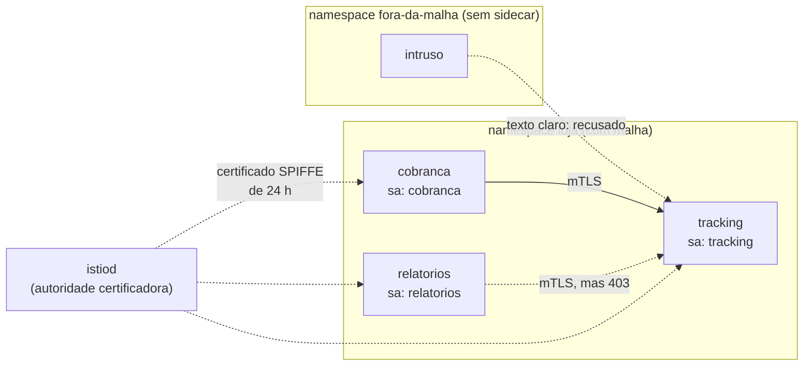

# Lab 4F: Zero trust no Kind: mTLS automático e autorização entre serviços

Aula prática da seção 4 (Segurança Arquitetural), depois da aula 4.13.

| | |
|---|---|
| Aulas relacionadas | 4.2 (autenticação e autorização) e 4.13 (zero trust, service mesh e secrets management) |
| Ambiente | Kind (Kubernetes local) e Istio |
| Ordem de estudo | Trilha Kubernetes local (Kind), passo 4 de 7 (continua o lab 3A; segue para o 5C) |

## Objetivo

Na aula 4.13 vimos que "estar dentro da VPC" não é uma identidade: no modelo zero trust, cada serviço prova quem é a cada chamada, e o que cada um pode fazer é decidido por política, não pela localização na rede. Neste lab você faz isso com um service mesh, **sem alterar uma linha de código dos serviços**:

1. Sem mesh, qualquer pod lê o serviço de tracking, inclusive um pod "intruso" de outro namespace.
2. Com o Istio em modo permissivo, a malha já usa mTLS entre os serviços dela, mas o intruso continua entrando.
3. Com mTLS estrito, o intruso é derrubado: sem certificado da malha, não há conversa.
4. Com uma AuthorizationPolicy, mesmo quem está na malha só faz o que a política permite, com base na **identidade** (SPIFFE) e não no endereço.

O cenário é o da LunaLog: o serviço de tracking devolve dados sensíveis do destinatário (o CPF, fictício aqui), e só a cobrança deveria consultá-lo.

## O que você vai ver

- Um pod fora da malha lendo dados sensíveis, sem nenhuma barreira (o ponto de partida)
- A injeção automática do sidecar (o `istio-proxy`), pods passando de `1/1` para `2/2`
- A diferença entre os modos **PERMISSIVE** e **STRICT** do mTLS
- A **identidade do workload**: um certificado com um SPIFFE ID, emitido pela malha e de curta duração
- Uma **AuthorizationPolicy** negando por identidade e por método (`RBAC: access denied`)
- A prova nas métricas do sidecar de que a chamada foi `mutual_tls` e de qual identidade veio

## Arquitetura do lab



- Os três serviços de `loja` rodam com ServiceAccounts diferentes. É a ServiceAccount que vira identidade: `spiffe://cluster.local/ns/loja/sa/cobranca`.
- O `istiod` é a autoridade certificadora da malha: entrega a cada sidecar um certificado de curta duração e o renova sozinho.
- O `intruso` está em outro namespace, sem sidecar. Ele representa qualquer carga que não faz parte da malha: um pod comprometido, uma ferramenta de debug esquecida.

## Pré-requisitos

- Docker Engine ou Docker Desktop
- [kind](https://kind.sigs.k8s.io/) e `kubectl`
- [Helm](https://helm.sh/) 3 (veja a alternativa em container mais abaixo)
- Cerca de 6 GB de RAM livres e acesso à internet (baixa os charts e as imagens do Istio)
- O cluster Kind da trilha (lab 2C). Se ainda não existe:

```bash
kind create cluster --config ../../../02_estilos_arquiteturais/labs/lab-2c_kind-stateless-e-health-checks/kind/cluster.yaml
```

## Como executar

Na pasta deste lab. Primeiro, **sem a malha**: crie os namespaces e os serviços.

```bash
kubectl apply -f manifests/00-namespaces.yaml
kubectl apply -f manifests/10-servicos.yaml
kubectl -n loja rollout status deploy/tracking
kubectl -n fora-da-malha rollout status deploy/intruso
kubectl -n loja get pods
```

Os pods mostram `1/1`: só o contêiner da aplicação.

### Cenário 1: sem mesh

O `intruso`, de outro namespace, chama o tracking:

```bash
kubectl -n fora-da-malha exec deploy/intruso -- curl -s http://tracking.loja:8000/
```

O que observar: a resposta traz `cpf_destinatario`. O tracking não sabe quem chamou, e a rede não pergunta. Tudo que está "dentro do cluster" é confiável, que é exatamente o modelo que o zero trust rejeita.

### Instalando o Istio

O Istio vem de dois charts do Helm: a base (CRDs) e o `istiod` (o plano de controle). A versão está fixada.

```bash
helm repo add istio https://istio-release.storage.googleapis.com/charts
helm repo update
helm install istio-base istio/base -n istio-system --create-namespace --version 1.24.1 --wait
helm install istiod istio/istiod -n istio-system --version 1.24.1 \
  --set pilot.resources.requests.cpu=50m --set pilot.resources.requests.memory=256Mi \
  --wait --timeout 5m
kubectl -n istio-system get pods
```

Os dois `--set` só reduzem a reserva de recursos para caber em um notebook.

**Sem o Helm instalado?** Rode-o em um container, na rede do Kind (o arquivo de kubeconfig interno aponta para o nó do cluster):

```bash
kind get kubeconfig --name lunalog-arq --internal > /tmp/kc.yaml
docker run --rm --network kind --entrypoint sh -v /tmp/kc.yaml:/kc.yaml:ro -e KUBECONFIG=/kc.yaml alpine/helm:3.16.3 -c "
  helm repo add istio https://istio-release.storage.googleapis.com/charts >/dev/null && helm repo update >/dev/null &&
  helm install istio-base istio/base -n istio-system --create-namespace --version 1.24.1 --wait &&
  helm install istiod istio/istiod -n istio-system --version 1.24.1 --set pilot.resources.requests.cpu=50m --set pilot.resources.requests.memory=256Mi --wait --timeout 5m"
```

(No Windows com PowerShell, troque `/tmp/kc.yaml` por um caminho absoluto seu.)

### Cenário 2: a malha em modo permissivo

Para o Istio injetar o sidecar, rotule o namespace e recrie os pods:

```bash
kubectl label namespace loja istio-injection=enabled
kubectl -n loja rollout restart deploy/tracking deploy/cobranca deploy/relatorios
kubectl -n loja rollout status deploy/tracking
kubectl -n loja get pods
```

O que observar: agora os pods mostram **`2/2`**. O segundo contêiner é o `istio-proxy` (Envoy), que o Istio injetou sem tocar nos manifests da aplicação. Sem nenhuma política, o padrão do Istio é **PERMISSIVE**: ele usa mTLS entre sidecars, mas ainda aceita texto claro de quem não tem sidecar. Teste de novo o intruso:

```bash
kubectl -n fora-da-malha exec deploy/intruso -- curl -s http://tracking.loja:8000/
```

O intruso **ainda lê**. O modo permissivo existe para migrar sem derrubar ninguém, mas não protege nada contra quem está fora da malha.

### Cenário 3: mTLS estrito

```bash
kubectl apply -f manifests/20-mtls-estrito.yaml
kubectl -n fora-da-malha exec deploy/intruso -- curl -s -m 5 http://tracking.loja:8000/ ; echo "exit=$?"
kubectl -n loja exec deploy/cobranca -c cliente -- curl -s http://tracking:8000/
```

O que observar:

- O `intruso` falha: a conexão é encerrada (`command terminated with exit code 56`, uma conexão reiniciada pelo servidor). O sidecar do tracking só fala TLS mútuo e o intruso não tem certificado.
- A `cobranca` continua funcionando, sem mudança de código nem de configuração do cliente. O sidecar dela abre o mTLS por conta própria.

### Cenário 4: autorização por identidade

O mTLS responde "quem é você?". A autorização responde "o que você pode fazer?". Hoje a `relatorios` (que não precisa dos dados de tracking) também lê:

```bash
kubectl -n loja exec deploy/relatorios -c cliente -- curl -s http://tracking:8000/
```

Aplique a política: só a identidade da cobrança, e só o método `GET`.

```bash
kubectl apply -f manifests/30-autorizacao.yaml
kubectl -n loja exec deploy/cobranca    -c cliente -- curl -s -w " http=%{http_code}\n" http://tracking:8000/
kubectl -n loja exec deploy/cobranca    -c cliente -- curl -s -w " http=%{http_code}\n" -X POST http://tracking:8000/
kubectl -n loja exec deploy/relatorios  -c cliente -- curl -s -w " http=%{http_code}\n" http://tracking:8000/
```

O que observar:

| Chamador | Chamada | Resultado |
|---|---|---|
| cobranca | GET | `200` com os dados |
| cobranca | POST | `403 RBAC: access denied` (método não autorizado) |
| relatorios | GET | `403 RBAC: access denied` (identidade não autorizada) |

Os dois chamadores de `loja` estão na malha e têm certificado válido. O que muda é a **identidade** do certificado. Abra `manifests/30-autorizacao.yaml`: a regra cita `cluster.local/ns/loja/sa/cobranca`, não um IP, não um header que o cliente possa forjar. Quando existe ao menos uma política `ALLOW` para o alvo, tudo que ela não permite é negado.

### Inspecionando a identidade

O certificado que o sidecar do tracking apresenta, com o SPIFFE ID e a validade:

```bash
kubectl -n loja exec deploy/tracking -c istio-proxy -- curl -s localhost:15000/certs
```

Procure, em `cert_chain`, o campo `uri` (o SPIFFE ID) e `valid_from` / `expiration_time`. O certificado do **workload** vale **24 horas** e é renovado sozinho; o da autoridade (`ca_cert`) é de longa duração. Roubar o certificado de um pod rende, no máximo, um dia de acesso, e só com aquela identidade.

E a prova de que o tráfego foi mTLS, dita pelas métricas do próprio sidecar do tracking:

```bash
kubectl -n loja exec deploy/tracking -c istio-proxy -- curl -s localhost:15090/stats/prometheus | grep ^istio_requests_total
```

Cada linha traz `source_principal` (quem chamou), `connection_security_policy="mutual_tls"` e `response_code`. É a trilha de auditoria por identidade que o zero trust pede.

## Resultados de referência

Valores obtidos no Kind v0.33, Kubernetes 1.36 e Istio 1.24.1.

| Cenário | Intruso (fora da malha) | Cobrança (GET) | Relatórios (GET) |
|---|---|---|---|
| 1. Sem mesh | lê os dados | lê | lê |
| 2. Malha PERMISSIVE | lê os dados | lê (mTLS) | lê (mTLS) |
| 3. Malha STRICT | recusado (exit 56) | lê | lê |
| 4. STRICT + AuthorizationPolicy | recusado (exit 56) | lê (200) | 403 |

Nas métricas do tracking depois do cenário 4: `source_principal=.../sa/cobranca`, `mutual_tls`, `200` e `403` (o POST); `source_principal=.../sa/relatorios`, `mutual_tls`, `403`. Certificado do workload com validade de 24 horas.

## Como limpar

```bash
kubectl delete namespace loja fora-da-malha
helm uninstall istiod -n istio-system
helm uninstall istio-base -n istio-system
kubectl delete namespace istio-system
```

(Se usou o Helm em container, rode os `helm uninstall` do mesmo jeito, com a mesma imagem.) Deixe o cluster limpo antes de seguir para os próximos labs da trilha: o sidecar do Istio consome memória. Para apagar o cluster inteiro: `kind delete cluster --name lunalog-arq`.

## Estrutura da pasta

```
lab-4f_zero-trust-mtls-no-kind/
  README.md
  manifests/
    00-namespaces.yaml        (loja e fora-da-malha)
    10-servicos.yaml          (tracking, cobranca, relatorios e o intruso)
    20-mtls-estrito.yaml      (PeerAuthentication STRICT)
    30-autorizacao.yaml       (AuthorizationPolicy por identidade)
```

## Limites deste lab

- O Istio completo é pesado para um notebook. O lab usa só o plano de controle (`istiod`) e os sidecars; não instala gateways, telemetria nem o Kiali.
- O `istiod` usa uma **autoridade certificadora de demonstração** embutida. Em produção, plugue uma CA própria (cert-manager, Vault, uma CA corporativa) e proteja a chave raiz.
- Aqui a política é por namespace e por serviço. Em produção, comece por `PERMISSIVE`, meça quem ainda fala em texto claro (as métricas mostram) e só então passe a `STRICT`, serviço a serviço.
- O mTLS protege o **trânsito** e prova a identidade. Ele não protege contra um serviço legítimo e comprometido: por isso a autorização com privilégio mínimo é parte do pacote, não um extra.
- Um service mesh cobre os serviços em Kubernetes. Bancos, filas gerenciadas e serviços fora do cluster precisam de outros mecanismos (TLS no próprio cliente, identidade da nuvem).
- Sidecars têm custo: memória por pod, latência de um salto extra e uma camada a mais para depurar. O modo sem sidecar do Istio (ambient) e alternativas como Linkerd tentam reduzir esse custo; vale comparar antes de adotar.
- Gestão de segredos (o outro tema da aula 4.13) é complementar e não faz parte deste lab: o Vault resolve as credenciais, o mesh resolve a identidade entre serviços.
- Os dados (incluindo o CPF) são fictícios. Nunca use dados reais em laboratórios.

## Para pensar

1. O modo PERMISSIVE deixou o intruso entrar. Em uma migração real, como você descobriria quais clientes ainda falam em texto claro antes de ligar o STRICT?
2. A política citou a identidade `sa/cobranca`. O que acontece se dois serviços diferentes compartilharem a mesma ServiceAccount? O que isso diz sobre como desenhar identidades?
3. Um atacante que invade o pod da cobrança herda as permissões da cobrança. Que camadas além do mesh limitam esse estrago (privilégio mínimo, limites de egress, observabilidade)?
4. O certificado vale 24 horas. Qual é o equilíbrio entre validade curta (menos exposição) e a dependência de a autoridade certificadora estar sempre disponível?
