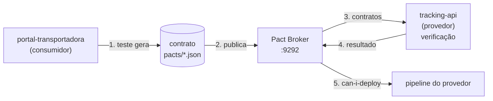

# Lab 5A: Consumer-driven contracts com Pact

Aula prática da seção 5 (CI/CD e Estratégias de Deploy), depois da aula 5.2.

| | |
|---|---|
| Aulas relacionadas | 5.2 (consumer-driven contracts) e 9.5 (compatibilidade de APIs, na parte de detecção antecipada) |
| Ambiente | Docker Compose |
| Ordem de estudo | Independente |

## Objetivo

Na aula 5.2 vimos que o consumidor define o que espera do provedor, e o provedor executa esses contratos como testes antes de qualquer mudança ir para produção. Neste lab você faz o ciclo inteiro: o consumidor gera o contrato, o provedor o verifica com cinco versões diferentes da API, e um Pact Broker responde à pergunta "esta versão pode ir para produção?".

O cenário é o da LunaLog: o portal da transportadora (consumidor) consulta a API de tracking (provedor). Uma mudança no formato da resposta, feita por outro time numa sexta-feira, pode quebrar o portal sem que nenhum teste do provedor perceba.

## O que você vai ver

- O teste do consumidor descrevendo **apenas o que o portal usa** da resposta e gerando o contrato (um arquivo JSON)
- A verificação do provedor contra a API real, com estados de dados preparados para cada interação
- Quatro mudanças na API que o contrato **deixa passar** (campo novo, remoção de campo que ninguém usa) e duas que ele **barra** (campo renomeado, tipo alterado), com a mensagem exata do que quebrou
- Pact Broker guardando contratos e resultados, e o `can-i-deploy` bloqueando a versão incompatível
- O contraste com um teste de integração em ambiente completo: aqui o consumidor e o provedor nunca precisam subir juntos

## Arquitetura do lab



## Pré-requisitos

- Docker Engine ou Docker Desktop com Compose v2
- Cerca de 2 GB de RAM livres
- Porta 9292 livre (somente na parte 2)

Nenhuma instalação de Node é necessária: tudo roda em contêiner.

## Como executar

Na pasta deste lab, construa as imagens uma vez:

```bash
docker compose --profile ferramentas build
```

### Parte 1: contrato e verificação

**1. O consumidor gera o contrato.** O teste do portal descreve a requisição e a resposta que ele espera:

```bash
docker compose run --rm consumer npm test
```

O Pact sobe um servidor falso que responde exatamente o que o teste descreveu, confere se o cliente do portal funciona com ele e, se passar, grava o contrato em `pacts/portal-transportadora-tracking-api.json`. Abra o arquivo: ele só tem `id`, `status` e `previsao_entrega`. Os campos que a API devolve mas o portal não usa (custo interno, observações) **não aparecem**. O contrato é o que o consumidor precisa, nada além.

Repare nas regras de correspondência: `status` e `id` exigem apenas o **tipo** (texto), e `previsao_entrega` exige o **formato** (data ISO 8601). O contrato não amarra valores.

**2. O provedor verifica o contrato.** A variável `CONTRATO` escolhe qual versão da API simular:

```bash
docker compose run --rm -e CONTRATO=original provider npm run verify
```

Resultado: `contrato respeitado`. Agora as outras versões:

| `CONTRATO` | O que a API faz | Esperado |
|---|---|---|
| `original` | Versão atual | passa |
| `aditivo` | Adiciona o campo `motorista` | passa |
| `remove-nao-usado` | Remove campos internos que o portal não usa | passa |
| `quebra-renomeia` | Renomeia `previsao_entrega` para `eta` | **falha** |
| `quebra-tipo` | `previsao_entrega` vira número (epoch) em vez de data ISO | **falha** |

```bash
docker compose run --rm -e CONTRATO=aditivo provider npm run verify
docker compose run --rm -e CONTRATO=remove-nao-usado provider npm run verify
docker compose run --rm -e CONTRATO=quebra-renomeia provider npm run verify
docker compose run --rm -e CONTRATO=quebra-tipo provider npm run verify
```

O que observar:

- Nas duas quebras, o diagnóstico aponta o campo e o motivo: `Actual map is missing the following keys: previsao_entrega` ou `Expected '1793728800000' to match '^\d{4}-...'`. O código de saída do comando é diferente de zero, e é isso que derruba um pipeline de CI.
- Remover um campo que **ninguém consome** passa. Esse é o ganho do contrato guiado pelo consumidor: o provedor pode evoluir e limpar a API sem pedir permissão, desde que não quebre o que alguém usa de fato.

### Parte 2: Pact Broker e can-i-deploy

Em times separados, o contrato não pode ficar numa pasta compartilhada. O Pact Broker guarda os contratos, os resultados de verificação e responde se uma versão pode ser implantada.

**1. Subir o broker** e abrir http://localhost:9292:

```bash
docker compose --profile broker up -d
```

**2. O consumidor publica o contrato** (versão 1.0.0 do portal):

```bash
docker compose run --rm consumer npm test
docker compose run --rm consumer npm run publicar
```

**3. O provedor verifica e publica o resultado**, para três versões da API, e pergunta se pode implantar:

```bash
docker compose run --rm -e PROVIDER_VERSION=1.0.0 -e CONTRATO=original provider npm run verify:broker
docker compose run --rm provider npm run can-i-deploy -- tracking-api 1.0.0

docker compose run --rm -e PROVIDER_VERSION=1.1.0 -e CONTRATO=quebra-renomeia provider npm run verify:broker
docker compose run --rm provider npm run can-i-deploy -- tracking-api 1.1.0

docker compose run --rm -e PROVIDER_VERSION=1.2.0 -e CONTRATO=aditivo provider npm run verify:broker
docker compose run --rm provider npm run can-i-deploy -- tracking-api 1.2.0
```

O que observar: a versão 1.0.0 e a 1.2.0 recebem `SIM`. A versão 1.1.0 recebe `NÃO`, com a linha `verificação FALHOU`. No navegador, em http://localhost:9292, a matriz mostra a relação entre as versões do portal e da API. Em um pipeline real, o `can-i-deploy` é o passo que bloqueia o deploy: ele sai com código diferente de zero quando a resposta é `NÃO`.

## Como limpar

```bash
docker compose --profile broker --profile ferramentas down -v
```

## Estrutura da pasta

```
lab-5a_contract-testing-com-pact/
  README.md
  docker-compose.yml
  consumer/              (portal-transportadora)
    src/clienteTracking.js
    test/tracking.pact.test.js   (gera o contrato)
    scripts/publicar.js          (publica no broker)
  provider/              (tracking-api)
    src/app.js                   (a API e as variações de CONTRATO)
    test/verify.js               (verifica o contrato)
    scripts/can-i-deploy.js
  pacts/                 (contratos gerados)
```

## Limites deste lab

- O `can-i-deploy` aqui consulta a matriz de verificação por versão. Em produção, registre também o **ambiente** em que cada versão foi implantada, para a resposta considerar o que está de fato rodando. O broker avisa disso.
- Os contratos cobrem a **forma** da resposta (campos, tipos, formatos), não o **comportamento** de negócio. Uma mudança de regra que mantém a forma passa pelo contrato, e precisa de outro tipo de teste.
- O Pact aqui está em JavaScript. A ideia vale para qualquer linguagem: existem bibliotecas para Java, Python, Go, .NET e outras.

## Para pensar

1. Na aula 5.2 vimos a LunaLog quebrando o faturamento ao mudar a distância de metros para quilômetros. Qual das duas quebras deste lab se parece mais com esse caso, e o contrato a teria pegado?
2. Se o portal passar a usar o campo `motorista`, o que ele precisa fazer, e quem precisa ser avisado antes da mudança chegar à API?
3. O contrato descreve só o que o consumidor usa. Isso é uma vantagem para quem mantém a API. Qual é o risco para quem a consome, se o time do consumidor não escrever o contrato com cuidado?
4. Compare esse ciclo com um teste de integração que sobe o portal e a API juntos em um ambiente de testes. O que cada um custa e o que cada um pega?
