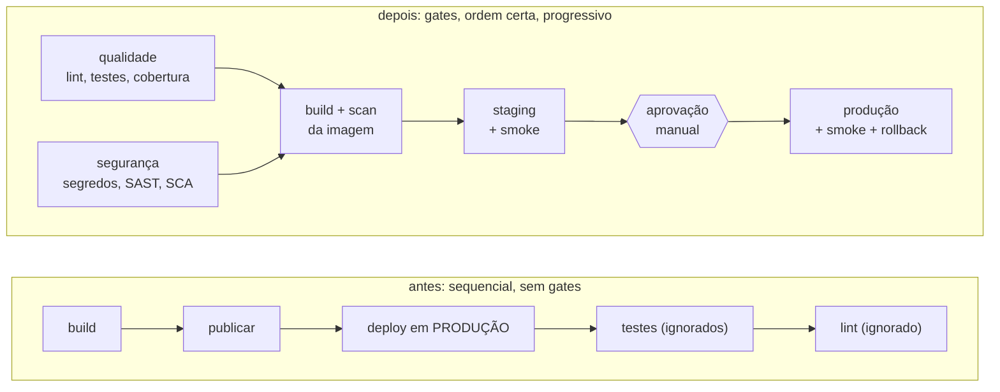

# Lab 5B: Pipeline CI/CD - do pipeline com problemas ao pipeline maduro

Aula prática da seção 5 (CI/CD e Estratégias de Deploy), depois da aula 5.8 e do lab 5E. Fecha a seção.

| | |
|---|---|
| Aulas relacionadas | 5.3 (fundamentos de CI/CD), 5.4 (anatomia de um pipeline maduro) e 5.5 (pipeline como código) |
| Ambiente | Pipeline de CI (GitHub Actions), com simulação local em Docker |
| Ordem de estudo | Independente |

## Objetivo

Na seção 5 vimos o que separa um pipeline que dá confiança de um que apenas automatiza o caos. Neste lab você compara dois pipelines da mesma aplicação: um com os defeitos mais comuns, de propósito, e um maduro, com estágios na ordem certa, gates que realmente barram, segurança embutida, implantação progressiva e rollback automático. Em seguida, submete a ambos as mesmas mudanças ruins e vê o que cada um deixa passar.

O cenário é o da LunaLog: o pipeline original, com todos os problemas da seção, é o material de análise; o pipeline atual é o resultado das decisões que justificam cada melhoria.

## O que você vai ver

**O pipeline com problemas** (`antes/pipeline.yml`), com 11 defeitos anotados no próprio arquivo:

- Roda e implanta até em pull request, com um job único e sequencial
- Segredo escrito no arquivo e impresso no log
- Versão flutuante da action e tag `latest` na imagem
- **Publica e implanta antes de testar**, direto em produção, sem staging, sem smoke test e sem rollback
- Testes e lint com a falha ignorada (`|| true`), e por último
- Nenhuma etapa de segurança

**O pipeline maduro** (`depois/pipeline.yml`):

- **Qualidade primeiro** (lint e testes com gate de cobertura), em paralelo com **segurança** (segredos, SAST e dependências)
- **Gates que barram**: sem `|| true`, e `needs` para nada ser construído se algo falhar antes
- **Build com tag imutável** (a tag Git `v1.2.3` ou o SHA do commit), scan da imagem, e publicação só depois
- **Implantação progressiva**: staging com smoke test, depois produção com **aprovação manual** (`environment` com revisor obrigatório)
- **Rollback automático** se o smoke test de produção falhar
- Menor privilégio (`permissions`), segredos em `Secrets`, e nunca implanta em pull request

**O confronto**: cinco mudanças ruins aplicadas aos dois pipelines, com cronometragem por etapa.

## Arquitetura do lab



## As mudanças ruins

Cada uma representa um problema real que o pipeline deveria barrar:

| Mudança | O que acontece | Quem deveria barrar |
|---|---|---|
| `teste-quebrado` | A regra do frete muda e o teste existente falha | Testes |
| `codigo-inseguro` | Um endpoint passa a usar `eval()` sobre entrada do usuário | SAST (semgrep) |
| `dependencia-vulneravel` | Uma dependência com vulnerabilidade crítica conhecida entra no projeto | SCA (trivy) |
| `segredo-no-codigo` | Uma credencial é escrita no código | Gitleaks |
| `falha-so-em-producao` | O serviço exige uma configuração que só falta em produção | Smoke test em produção + rollback |

## Pré-requisitos

- Docker Engine ou Docker Desktop
- Um shell bash: Linux, macOS, WSL2 ou Git Bash no Windows
- Cerca de 3 GB de RAM livres e acesso à internet na primeira execução (baixa as imagens das ferramentas e a base de vulnerabilidades do Trivy)
- Opcional, para o GitHub Actions de verdade: um fork do repositório

Não é preciso ter Python instalado: tudo roda em contêiner.

## Como executar

### Opção 1: simulação local (sem GitHub)

O simulador executa, na sua máquina, a mesma sequência de etapas dos dois workflows, com cronometragem. Ele trabalha em uma cópia (`.simulacao/`) e não altera os arquivos do lab.

```bash
bash scripts/simular.sh antes
bash scripts/simular.sh depois
```

Sem mudança ruim, os dois passam. Agora o confronto, uma mudança por vez:

```bash
bash scripts/simular.sh antes teste-quebrado
bash scripts/simular.sh depois teste-quebrado
```

Repita com `codigo-inseguro`, `dependencia-vulneravel`, `segredo-no-codigo` e `falha-so-em-producao`. A primeira execução do `depois` leva mais tempo (baixa a base de vulnerabilidades do Trivy); as seguintes usam o cache.

### O que observar

**Com o pipeline `antes`:**

- Em **todas** as mudanças, o resultado é `PIPELINE VERDE`.
- O `teste-quebrado` vai para **produção**; o teste só falha **depois** do deploy, e a falha é ignorada. A mensagem final diz quando o primeiro aviso apareceu e que ele veio depois da produção.
- O `codigo-inseguro`, a `dependencia-vulneravel` e o `segredo-no-codigo` passam sem que ninguém os veja: **não existe etapa de segurança**.
- O `falha-so-em-producao` deixa o serviço **fora do ar em produção, com o pipeline verde**: sem smoke test, ninguém verifica.
- Na etapa de publicação, o segredo aparece impresso no log.

**Com o pipeline `depois`:**

- `teste-quebrado`: barrado nos testes, em cerca de 10 segundos, **antes** de construir qualquer coisa.
- `codigo-inseguro`: barrado no SAST, com o arquivo e a regra violada.
- `dependencia-vulneravel`: barrado no SCA, com a biblioteca, a vulnerabilidade e a versão corrigida.
- `segredo-no-codigo`: barrado pelo Gitleaks.
- `falha-so-em-producao`: passa por todos os gates e pelo staging (onde a configuração existe), mas **falha no smoke test de produção**, e o rollback automático restaura a versão anterior.

Compare o tempo até o primeiro aviso: no `antes`, o aviso chega depois de a versão ir para produção; no `depois`, em segundos e com nada implantado.

### Opção 2: no GitHub Actions

1. Faça um fork do repositório (ou copie esta pasta para um repositório seu).
2. Copie `depois/pipeline.yml` (ou `antes/pipeline.yml`) para `.github/workflows/` na raiz do seu repositório. Os workflows ficam em `antes/` e `depois/` aqui apenas para você ver os dois lado a lado; o GitHub só executa o que está em `.github/workflows/`.
3. Em **Settings > Environments**, crie `staging` e `production`. Em `production`, marque **Required reviewers**: é a aprovação manual.
4. Faça um commit na `main` para disparar qualidade, segurança, build e staging. Crie uma tag `v1.0.0` para disparar também a produção.
5. Para ver os gates barrando, aplique uma das mudanças ruins no seu fork:

```bash
docker run --rm -v "$PWD":/w -w /w python:3.12-slim python scripts/mudanca.py /w teste-quebrado
```

Faça o commit e abra um pull request: o pipeline `depois` valida e barra, sem implantar nada.

Os workflows foram validados com o `actionlint`. As etapas chamam `scripts/etapas.sh`, o mesmo código que o simulador executa.

## Como limpar

Os contêineres de implantação são removidos ao fim de cada simulação. Para remover o que sobrou, a pasta da simulação e o cache do Trivy:

```bash
docker rm -f tracking-producao tracking-staging
rm -rf .simulacao
docker volume rm lab5b-trivy-cache
```

## Estrutura da pasta

```
lab-5b_pipeline-maduro-antes-e-depois/
  README.md
  app/                         (a API de tracking: código e Dockerfile)
  tests/test_api.py            (testes da API)
  requirements-dev.txt, setup.cfg, semgrep-regras.yml
  antes/pipeline.yml           (pipeline com 11 problemas anotados)
  depois/pipeline.yml          (pipeline maduro)
  scripts/
    etapas.sh                  (uma função por etapa; usado pelos workflows e pelo simulador)
    simular.sh                 (simulador local com cronometragem)
    mudanca.py                 (aplica as mudanças ruins)
```

## Limites deste lab

- A "publicação" e a "implantação" são simuladas: o registry é fictício e a implantação é um contêiner Docker local. O que importa é a estrutura do pipeline, não o destino.
- No GitHub Actions, qualidade e segurança rodam em jobs **paralelos**; o simulador as executa em sequência. A ordem de dependência é a mesma.
- A análise estática usa regras próprias no repositório, para ser reproduzível sem serviços externos. Em produção, combine com conjuntos mantidos pela comunidade e com a análise do seu provedor de código.
- O scan de imagem barra apenas vulnerabilidades **críticas com correção disponível**. Um limite mais rígido barraria o pipeline por falhas da imagem base que você não controla; calibrar o gate é uma decisão de risco, não técnica.
- A cobertura de 80% é um gate de exemplo. Cobertura mede o que foi executado, não a qualidade dos testes.
- O rollback aqui é redeploy da versão anterior. Para mudanças de banco de dados, o rollback exige o padrão expand-contract (lab 5E).
- Fixe as versões das actions pelo SHA do commit em ambientes críticos; aqui usamos tags de versão (`@v4`) por legibilidade.

## Para pensar

1. Qual dos 11 problemas do pipeline `antes` você acha mais perigoso, e por quê? Qual deles já aconteceu no seu time?
2. O gate de cobertura exige 80%. O que aconteceria se o time passasse a escrever testes sem asserções só para atingir o número? Que outro sinal você colocaria ao lado?
3. A aprovação manual antes de produção desacelera o deploy. Em que situações você a retiraria, e o que precisaria existir no pipeline para isso ser seguro?
4. O smoke test de produção verifica um endpoint de saúde. Que outras verificações, de negócio, você adicionaria antes de considerar o deploy bem-sucedido?
