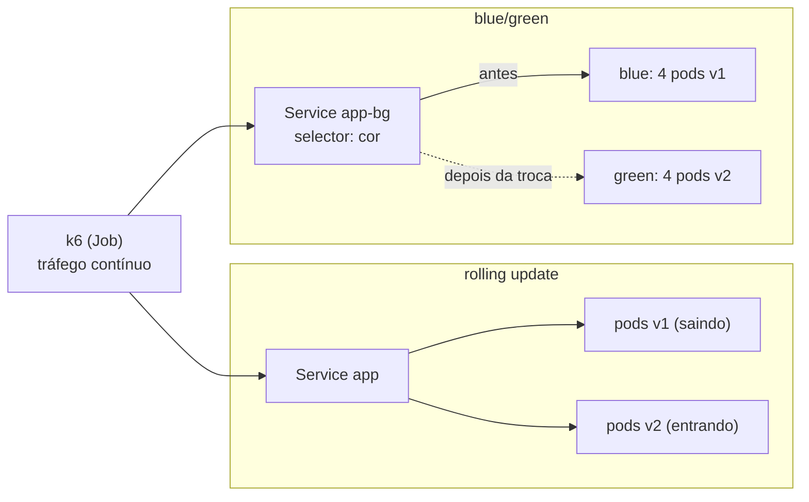

# Lab 5C: Blue/green e rolling update no Kind

Aula prática da seção 5 (CI/CD e Estratégias de Deploy), depois da aula 5.6.

| | |
|---|---|
| Aulas relacionadas | 5.6 (blue/green e rolling deployment: troca de versão com controle) |
| Ambiente | Kind (Kubernetes local) |
| Ordem de estudo | Trilha Kubernetes local (Kind), passo 5 de 7 (continua o lab 4F; segue para o 5D) |

## Objetivo

Na aula 5.6 vimos como trocar de versão sem derrubar o serviço: o rolling update, que substitui as instâncias aos poucos, e o blue/green, que mantém dois ambientes completos e troca o tráfego de uma vez. Neste lab você executa as duas estratégias no Kubernetes com tráfego contínuo e **mede** o que cada uma entrega: erros durante a troca, o que acontece com uma versão defeituosa, o custo em réplicas e a velocidade do rollback. E vê, para contraste, a estratégia que tem downtime.

O cenário é o da LunaLog: um deploy crítico às 14h de uma sexta-feira, no pico de operação das transportadoras.

## O que você vai ver

- **Rolling update** com `maxSurge` e `maxUnavailable`: a troca de v1 para v2 com **zero erros**, e as duas versões atendendo juntas durante a transição
- Uma **versão defeituosa** (nunca fica pronta) entrando no rolling: a troca **trava sozinha**, as réplicas antigas continuam atendendo, e o `rollout undo` resolve
- A estratégia **Recreate**: simples, mas com downtime medido
- **Blue/green**: dois ambientes completos; a troca é mudar o `selector` do Service, e o rollback também
- O **custo**: o dobro de réplicas rodando no blue/green
- A readiness probe como o mecanismo que torna tudo isso seguro

## Arquitetura do lab



- Três imagens da mesma aplicação: `1.0.0`, `2.0.0` e `3.0.0-quebrada` (esta nunca fica saudável).
- O rolling update atende em http://localhost:8080 e o blue/green em http://localhost:8081.
- O k6 roda como Job dentro do cluster e conta as respostas **por versão**.

## Pré-requisitos

- Docker Engine ou Docker Desktop
- [kind](https://kind.sigs.k8s.io/) e `kubectl` instalados
- Cerca de 4 GB de RAM livres
- Os NodePorts 30080 e 30081 livres. Se os labs 2C (namespace `lunalog`) ou 3A (namespace `escala`) ainda estiverem no ar, apague os namespaces deles antes: `kubectl delete namespace lunalog escala --ignore-not-found`. Os Services deles usam as mesmas portas, e o `kubectl apply` falha com `provided port is already allocated`
- O cluster Kind da trilha (lab 2C). Se ainda não existe:

```bash
kind create cluster --config ../../../02_estilos_arquiteturais/labs/lab-2c_kind-stateless-e-health-checks/kind/cluster.yaml
```

## Como executar

Na pasta deste lab, prepare as imagens, a aplicação e os scripts de carga:

```bash
docker build -q -t lunalog/versionado:1.0.0 --build-arg VERSAO=1.0.0 app
docker build -q -t lunalog/versionado:2.0.0 --build-arg VERSAO=2.0.0 app
docker build -q -t lunalog/versionado:3.0.0-quebrada --build-arg VERSAO=3.0.0-quebrada --build-arg QUEBRADA=1 app
kind load docker-image lunalog/versionado:1.0.0 lunalog/versionado:2.0.0 lunalog/versionado:3.0.0-quebrada --name lunalog-arq

kubectl apply -f manifests/00-namespace.yaml -f manifests/10-rolling.yaml
kubectl -n deploy rollout status deploy/app
kubectl -n deploy create configmap k6-scripts --from-file=k6/
```

Confirme que a aplicação responde:

```bash
curl -s localhost:8080/
```

Para gerar tráfego contínuo (30 requisições por segundo), use o Job. Ele precisa ser apagado antes de cada nova execução:

```bash
kubectl -n deploy delete job trafego --ignore-not-found
kubectl apply -f manifests/30-job-trafego.yaml
```

O padrão é um tráfego de 90 segundos. Em cada cenário abaixo, **inicie o tráfego, espere uns 10 segundos e execute a troca**. No final, leia o resumo:

```bash
kubectl -n deploy wait --for=condition=complete job/trafego --timeout=300s
kubectl -n deploy logs job/trafego | tail -n 25
```

No resumo, olhe as três linhas: `http_req_failed` (a taxa de falhas), e `respostas_da_versao_*` (quantas respostas vieram de cada versão).

### Cenário 1: rolling update sem erros

Com o tráfego rodando, troque a imagem de v1 para v2:

```bash
kubectl -n deploy set image deploy/app app=lunalog/versionado:2.0.0
kubectl -n deploy get pods -w
```

O que observar:

- Os pods novos nascem `0/1` e só ficam `1/1` depois que a readiness probe responde. Os antigos só saem quando os novos estão prontos (`maxUnavailable: 0`), então a capacidade nunca cai. Há momentos com 5 pods (`maxSurge: 1`).
- No resumo do k6: **`http_req_failed` em 0,00%** e as respostas divididas entre `1.0.0` e `2.0.0`. Durante a troca, as duas versões atenderam juntas: esse é o ponto de atenção do rolling update. As duas versões precisam ser compatíveis entre si (o lab 5E trata disso para bancos de dados).

### Cenário 2: rolling update com uma versão defeituosa

Reinicie o tráfego e, com ele rodando, troque para a versão que nunca fica saudável:

```bash
kubectl -n deploy set image deploy/app app=lunalog/versionado:3.0.0-quebrada
kubectl -n deploy get pods
kubectl -n deploy rollout status deploy/app --timeout=20s
```

O que observar:

- Aparecem os 4 pods antigos `1/1 Running` e **um pod novo `0/1`** que não fica pronto. O rolling update **não derrubou** nenhum pod antigo, porque o novo nunca ficou pronto.
- `rollout status` fica esperando e termina com `timed out`. A troca travou sozinha, mas o serviço continua atendendo.
- No resumo do k6: **0% de falhas**, todas as respostas da versão boa.

Faça o rollback:

```bash
kubectl -n deploy rollout undo deploy/app
```

A versão defeituosa foi barrada **pela readiness probe**, sem nenhum cliente afetado. Sem a probe, o Kubernetes consideraria o pod novo pronto assim que o processo subisse, e mandaria tráfego a ele (veja o lab 2C).

### Cenário 3: Recreate, a estratégia com downtime

Troque a estratégia do Deployment para `Recreate`, que derruba todas as réplicas antigas antes de subir as novas:

```bash
kubectl apply -f manifests/11-recreate.yaml
kubectl -n deploy set image deploy/app app=lunalog/versionado:2.0.0
kubectl -n deploy rollout status deploy/app
```

Reinicie o tráfego e, com ele rodando, troque de volta:

```bash
kubectl -n deploy set image deploy/app app=lunalog/versionado:1.0.0
```

O que observar: no resumo do k6, **`http_req_failed` em torno de 8%**: durante o intervalo em que não havia nenhum pod pronto, as requisições falharam. É a estratégia mais simples e a única das três com downtime. Pode ser aceitável para um serviço interno de baixa criticidade, mas não para o tracking das transportadoras.

### Cenário 4: blue/green

Remova o rolling e crie os dois ambientes lado a lado:

```bash
kubectl delete -f manifests/10-rolling.yaml
kubectl apply -f manifests/20-blue-green.yaml
kubectl -n deploy rollout status deploy/app-blue
kubectl -n deploy rollout status deploy/app-green
kubectl -n deploy get pods
curl -s localhost:8081/
```

O que observar: **oito pods** (quatro blue com a v1, quatro green com a v2). O green está pronto e aquecido, mas **não recebe tráfego nenhum**: o Service aponta para o blue (`curl` devolve `1.0.0`). A versão nova pode ser testada por completo, sem uma única requisição real, antes da troca. Este é o custo do blue/green: o dobro de réplicas enquanto os dois existirem.

Inicie o tráfego apontando para o blue/green (edite `ALVO` para `app-bg` em `manifests/30-job-trafego.yaml`, ou use o comando de teste abaixo) e, com ele rodando, **troque**:

```bash
kubectl apply -f manifests/21-service-para-green.yaml
curl -s localhost:8081/
```

O que observar: a troca é **instantânea**: o `kubectl apply` leva uma fração de segundo, e a próxima chamada já devolve `2.0.0`. No resumo do k6: **zero falhas** e respostas das duas versões, cada uma no seu período.

Agora o rollback:

```bash
kubectl apply -f manifests/22-service-para-blue.yaml
curl -s localhost:8081/
```

O que observar: a volta para a `1.0.0` também é instantânea, porque o blue nunca foi desligado. Esse é o grande ganho do blue/green: **o rollback não é um novo deploy, é uma troca de ponteiro**.

Para rodar o tráfego do Job contra o blue/green sem editar o arquivo:

```bash
kubectl -n deploy delete job trafego --ignore-not-found
sed 's/value: "app"/value: "app-bg"/' manifests/30-job-trafego.yaml | kubectl apply -f -
```

```powershell
(Get-Content manifests/30-job-trafego.yaml) -replace 'value: "app"','value: "app-bg"' | kubectl apply -f -
```

## Resultados de referência

Mesmo tráfego (30 requisições por segundo), cada troca com a aplicação em 4 réplicas:

| Estratégia | Erros durante a troca | Versão defeituosa | Réplicas durante a troca | Rollback |
|---|---|---|---|---|
| Rolling update | 0% | Trava sozinho, sem impacto | 4 a 5 | `kubectl rollout undo` (segundos, mais um rolling) |
| Recreate | cerca de 8% | Derruba o serviço | 0 a 4 | Novo deploy, com novo downtime |
| Blue/green | 0% | Descoberta antes da troca, com o green já validado | 8 | Trocar o `selector` (instantâneo) |

## Como limpar

Para remover só este lab, mantendo o cluster para os próximos:

```bash
kubectl delete namespace deploy
```

Para apagar o cluster inteiro:

```bash
kind delete cluster --name lunalog-arq
```

## Estrutura da pasta

```
lab-5c_blue-green-e-rolling-no-kind/
  README.md
  app/                              (serviço versionado: main.py e Dockerfile)
  k6/trafego.js                     (tráfego contínuo, com contagem por versão)
  manifests/
    00-namespace.yaml
    10-rolling.yaml                 (RollingUpdate com maxSurge 1 e maxUnavailable 0)
    11-recreate.yaml                (Recreate)
    20-blue-green.yaml              (blue, green e o Service)
    21-service-para-green.yaml      (a troca)
    22-service-para-blue.yaml       (o rollback)
    30-job-trafego.yaml             (o gerador de carga)
```

## Limites deste lab

- O k6 abre uma conexão nova por requisição (`noConnectionReuse`). Em aplicações reais, conexões persistentes (HTTP keep-alive, gRPC, WebSocket) continuam presas aos pods antigos depois da troca do Service, até fecharem. Um Ingress ou uma malha de serviços com troca de tráfego em nível de requisição resolve isso; sem eles, é preciso esvaziar (drenar) as conexões antigas.
- O blue/green aqui usa o `selector` do Service. Ferramentas como Argo Rollouts, Flagger e os controladores de ingress automatizam a troca com verificações e rollback automático (o lab 5D usa o Argo Rollouts).
- As duas versões da aplicação não têm estado compartilhado nem banco de dados. Em um sistema real, **o banco é o ponto crítico** do blue/green e do rolling: as duas versões precisam ser compatíveis com o mesmo schema (lab 5E).
- O blue/green custa o dobro de capacidade apenas enquanto os dois ambientes coexistem. É comum desligar o blue depois de um período de observação.
- A versão "quebrada" falha na readiness. Um defeito que só aparece sob carga ou em um caminho específico passaria pela readiness e exigiria canary com métricas (lab 5D).

## Para pensar

1. O rolling update tem as duas versões atendendo juntas por um tempo. Que tipo de mudança na aplicação ou no banco de dados quebraria nesse intervalo?
2. O blue/green custa o dobro de réplicas. Em que casos esse custo se justifica? E em que casos o rolling update é suficiente?
3. A readiness probe barrou a versão defeituosa. Que tipos de defeito ela **não** consegue barrar, e o que você colocaria para cobrir esses casos?
4. O rollback do blue/green é uma troca de ponteiro. O que impede que o rollback seja instantâneo e seguro quando a v2 já gravou dados em um formato novo?
