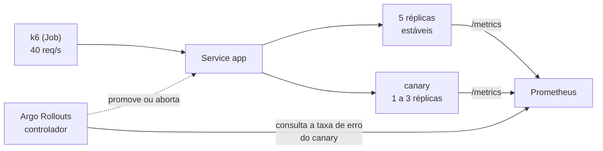

# Lab 5D: Canary release com análise automática e rollback

Aula prática da seção 5 (CI/CD e Estratégias de Deploy), depois da aula 5.8.

| | |
|---|---|
| Aulas relacionadas | 5.7 (canary release e feature flags) e 5.8 (rollback: critérios, automação e o custo de decisões irreversíveis) |
| Ambiente | Kind (Kubernetes local) |
| Ordem de estudo | Trilha Kubernetes local (Kind), passo 6 de 7 (continua o lab 5C; segue para o 7B) |

## Objetivo

Nas aulas 5.7 e 5.8 vimos que o canary expõe uma versão nova a uma fração do tráfego real antes de abri-la para todos, e que o rollback deve ter critérios objetivos e ser automatizado. Neste lab você faz as duas coisas juntas: o Argo Rollouts promove uma versão em etapas (20%, 60%, 100%) e, a cada etapa, consulta **métricas reais no Prometheus**. Se a versão for boa, a promoção segue sozinha. Se for ruim, o rollout é abortado e o tráfego volta para a versão estável, sem ninguém de plantão.

O cenário é o da LunaLog: uma versão nova que funciona em staging com dados sintéticos e esconde um defeito que só aparece com tráfego real.

## O que você vai ver

- Um **Rollout** (o substituto do Deployment) com a estratégia de canary definida como código
- Uma **versão saudável** sendo promovida automaticamente: 20% do tráfego, análise aprovada, 60%, 100%
- Uma **versão com defeito** que **passa na readiness** (o pod sobe e "fica saudável") mas falha em 30% das requisições reais
- A **análise automática**: uma consulta ao Prometheus com um critério objetivo ("menos de 5% de erros 5xx no canary")
- O **aborto automático** em segundos, com a versão estável restaurada, e o impacto limitado a uma fração mínima do tráfego
- O contraste com o que aconteceria sem canary: o defeito iria para 100% dos usuários

## Arquitetura do lab



- O **Rollout** `app` tem 5 réplicas. Sem um roteador de tráfego, o percentual do canary é a proporção de réplicas: 20% é 1 réplica nova entre 5.
- O **Prometheus** coleta o `/metrics` de cada pod e guarda o hash da revisão (`pod_template_hash`), que separa estável e canary.
- A **AnalysisTemplate** `taxa-de-erro` é o critério de aprovação, como código.

## Pré-requisitos

- Docker Engine ou Docker Desktop
- [kind](https://kind.sigs.k8s.io/) e `kubectl` 1.31 ou superior (usa `--patch-file`)
- Cerca de 5 GB de RAM livres e acesso à internet (baixa o instalador do Argo Rollouts)
- O cluster Kind da trilha (lab 2C). Se ainda não existe:

```bash
kind create cluster --config ../../../02_estilos_arquiteturais/labs/lab-2c_kind-stateless-e-health-checks/kind/cluster.yaml
```

## Como executar

Na pasta deste lab, prepare as imagens (três versões da mesma aplicação, uma delas com defeito), o Argo Rollouts e a aplicação:

```bash
docker build -q -t lunalog/canario:1.0.0 --build-arg VERSAO=1.0.0 app
docker build -q -t lunalog/canario:2.0.0 --build-arg VERSAO=2.0.0 app
docker build -q -t lunalog/canario:3.0.0-defeito --build-arg VERSAO=3.0.0-defeito --build-arg ERRO_PCT=30 app
kind load docker-image lunalog/canario:1.0.0 lunalog/canario:2.0.0 lunalog/canario:3.0.0-defeito --name lunalog-arq

kubectl create namespace argo-rollouts
kubectl apply -n argo-rollouts -f https://github.com/argoproj/argo-rollouts/releases/download/v1.7.2/install.yaml
kubectl -n argo-rollouts rollout status deploy/argo-rollouts

kubectl apply -f manifests/00-namespace.yaml
kubectl apply -f manifests/10-prometheus.yaml -f manifests/20-analise.yaml -f manifests/30-rollout.yaml
kubectl -n canario create configmap k6-scripts --from-file=k6/
kubectl -n canario get rollout,pods
```

Espere os 5 pods da aplicação ficarem `1/1`. A aplicação responde em http://localhost:8080.

Leia, antes de seguir, os dois arquivos que definem o canary:

- `manifests/30-rollout.yaml`: os passos (`setWeight: 20`, `analysis`, `setWeight: 60`, `pause`)
- `manifests/20-analise.yaml`: o critério de aprovação, uma consulta PromQL e a condição `result[0] < 0.05`

Para gerar tráfego (40 requisições por segundo, 150 segundos), use o Job. Apague-o antes de cada nova execução:

```bash
kubectl -n canario delete job trafego --ignore-not-found
kubectl apply -f manifests/40-job-trafego.yaml
```

E para acompanhar, em outro terminal:

```bash
kubectl -n canario get rollout app -w
```

### Cenário 1: uma versão saudável

Com o tráfego rodando há uns 15 segundos, lance a versão 2.0.0. O lançamento é um patch na imagem do Rollout:

```bash
kubectl -n canario patch rollout app --type=merge --patch-file releases/v2.json
kubectl -n canario get analysisrun
kubectl -n canario get pods
```

O que observar, ao longo de cerca de 50 segundos:

1. O Rollout passa a `Progressing`, no passo de 20%: **um** pod novo (a v2) aparece entre os 5.
2. Um `AnalysisRun` é criado e fica `Running`. Ele espera 15 segundos (para o canary receber tráfego) e depois consulta o Prometheus a cada 8 segundos.
3. O critério (menos de 5% de erros no canary) é cumprido três vezes, e o `AnalysisRun` vira `Successful`.
4. O Rollout avança para 60%, pausa 10 segundos e promove para 100%. No fim, o estado é `Healthy` e todos os pods rodam a v2.

Quando o Job terminar, leia o resumo:

```bash
kubectl -n canario wait --for=condition=complete job/trafego --timeout=300s
kubectl -n canario logs job/trafego | tail -n 12
```

O que observar: `http_req_failed` em **0,00%**, com as respostas divididas entre `1.0.0` e `2.0.0`. A promoção aconteceu sem ninguém decidir nada: o critério decidiu.

### Cenário 2: uma versão com defeito

Reinicie o tráfego e, com ele rodando há uns 15 segundos, lance a versão defeituosa (30% das requisições devolvem erro 500, mas o pod **passa na readiness**):

```bash
kubectl -n canario delete job trafego
kubectl apply -f manifests/40-job-trafego.yaml
# espere uns 15 segundos
kubectl -n canario patch rollout app --type=merge --patch-file releases/v3-defeito.json
kubectl -n canario get rollout app -w
```

O que observar:

- O canary entra (20%) e o `AnalysisRun` passa a medir. Em cerca de **15 segundos** ele vira `Failed`, porque a taxa de erro do canary passou muito de 5%.
- O Rollout muda para `Degraded` e **volta sozinho para a versão estável** (2.0.0): os pods do canary somem.
- Veja o motivo:

```bash
kubectl -n canario get analysisrun -o jsonpath='{.items[-1:].status.message}'
curl -s localhost:8080/
```

A mensagem diz que a métrica `taxa-de-erro-5xx` falhou, e o `curl` confirma que a versão em produção é a 2.0.0.

Quando o Job terminar, leia o resumo:

```bash
kubectl -n canario wait --for=condition=complete job/trafego --timeout=300s
kubectl -n canario logs job/trafego | tail -n 12
```

O que observar: **cerca de 0,5% das requisições falharam** (31 em 6.000), todas durante os poucos segundos em que o canary existiu, e a versão defeituosa atendeu apenas cerca de 1,5% do tráfego. Sem canary, uma troca completa levaria o defeito a **100%** dos usuários, com 30% de falha, até alguém notar e reverter à mão.

O ponto central: a readiness probe **não** barrou essa versão, porque o pod estava "saudável". O defeito só aparece em tráfego real, e só a **métrica de negócio** o pega.

## Resultados de referência

| Cenário | Tempo até o desfecho | Erros para o usuário | Quem decidiu |
|---|---|---|---|
| Versão saudável | cerca de 50 s até 100% | 0% | O critério de métricas (aprovou) |
| Versão com defeito | cerca de 16 s até o aborto | cerca de 0,5% das requisições | O critério de métricas (reprovou) |
| (Referência) rolling sem análise, mesma versão defeituosa | nunca aborta | cerca de 30%, até alguém reverter | Ninguém |

## Como limpar

Para remover só este lab:

```bash
kubectl delete namespace canario
```

Para remover também o Argo Rollouts:

```bash
kubectl delete namespace argo-rollouts
```

(As definições de recurso, as CRDs, permanecem no cluster; são inofensivas.) Para apagar o cluster inteiro: `kind delete cluster --name lunalog-arq`.

## Estrutura da pasta

```
lab-5d_canary-e-rollback-automatico/
  README.md
  app/                         (serviço com /metrics e defeito simulado)
  k6/trafego.js
  releases/                    (patches que "lançam" cada versão)
    v1.json, v2.json, v3-defeito.json
  manifests/
    00-namespace.yaml
    10-prometheus.yaml         (Prometheus mínimo)
    20-analise.yaml            (o critério de aprovação)
    30-rollout.yaml            (o Rollout com o canary)
    40-job-trafego.yaml
```

## Limites deste lab

- Sem um roteador de tráfego (Ingress, Gateway API ou service mesh), o percentual do canary é aproximado pela proporção de réplicas. Com um roteador, o Argo Rollouts divide o tráfego com precisão (por exemplo, 5% de fato, mesmo com 5 réplicas).
- Os critérios são curtos para caber na aula (3 medições de 8 segundos). Em produção, o canary costuma durar de minutos a horas, com critérios mais amplos: latência, saturação e métricas de negócio, comparados com a versão estável.
- A análise aqui olha só a taxa de erros. Compare também o canary com a linha de base (o estável) e use janelas maiores para evitar falsos positivos com pouco tráfego.
- O Argo Rollouts aborta e restaura a versão estável, mas **não desfaz mudanças em banco de dados**: o canary que grava dados em formato novo deixa rastros que o aborto não apaga. Por isso, o expand-contract (lab 5E) é pré-requisito de qualquer canary que toque no schema.
- Feature flags (aula 5.7) são o complemento: o canary expõe uma **versão** a uma parcela do tráfego; a flag expõe uma **funcionalidade** a uma parcela dos usuários, sem novo deploy. Ferramentas como OpenFeature e flagd cobrem esse caso.
- O instalador do Argo Rollouts é baixado de um endereço da internet (versão fixada). Para ambientes sem acesso, espelhe o arquivo no seu repositório.

## Para pensar

1. A readiness probe não barrou a versão defeituosa. Que defeitos ela barra e quais não? Que métricas você usaria como critério de canary no seu sistema?
2. O critério aqui é "menos de 5% de erros". Como você escolheria esse número? O que acontece se for apertado demais ou frouxo demais?
3. Com pouco tráfego, o canary pode não gerar dados suficientes para a análise concluir. Como você trataria um serviço de baixo volume?
4. O aborto restaurou a versão estável da aplicação. E se a versão defeituosa tivesse gravado dados corrompidos no banco durante os 16 segundos? O que o rollback automático não consegue desfazer?
