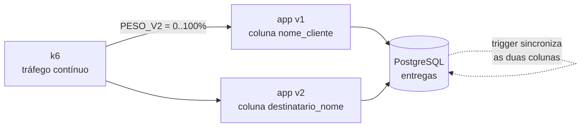

# Lab 5E: Expand-contract - migração de schema reversível em quatro fases

Aula prática da seção 5 (CI/CD e Estratégias de Deploy), depois da aula 5.8.

| | |
|---|---|
| Aulas relacionadas | 5.8 (rollback e o padrão expand-contract) e 8.5 (migração de dados, como prévia) |
| Ambiente | Docker Compose |
| Ordem de estudo | Independente |

## Objetivo

Na aula 5.8 vimos que reverter a aplicação é fácil, mas reverter uma mudança de banco de dados não é, e que o padrão expand-contract torna a migração reversível. Neste lab você renomeia uma coluna em produção sem downtime e sem ponto sem volta, com duas versões da aplicação rodando ao mesmo tempo sobre o mesmo banco, e mede o resultado com tráfego contínuo.

O cenário é o da LunaLog: a coluna `nome_cliente` da tabela de entregas precisa passar a se chamar `destinatario_nome`. A versão 1 da aplicação usa o nome antigo e a versão 2 usa o novo. Num deploy gradual (rolling), as duas convivem durante um tempo.

## O que você vai ver

- O que quebra quando o rename é feito de uma vez só: a versão antiga falha em 100% das requisições
- As quatro fases do expand-contract: **expand**, **backfill**, **migração do código** e **contract**
- Escrita dupla feita pelo próprio banco (um trigger), para as duas versões lerem e gravarem sem perceber a diferença
- Tráfego contínuo medido por versão: zero erros durante todo o deploy gradual
- Rollback funcionando em qualquer fase, até a última
- O ponto sem volta: depois do contract, a versão antiga deixa de funcionar

## Arquitetura do lab



O parâmetro `PESO_V2` do k6 representa o avanço do deploy gradual: `0` é só a v1 (antes do deploy), `50` é metade a metade (meio do deploy) e `100` é só a v2 (deploy concluído).

## Pré-requisitos

- Docker Engine ou Docker Desktop com Compose v2
- Cerca de 2 GB de RAM livres
- Portas 8001 e 8002 livres

## Como executar

Na pasta deste lab:

```bash
docker compose up -d --build
```

Dois atalhos usados abaixo. Para executar um arquivo SQL no banco:

```bash
docker compose exec -T postgres psql -U lunalog -d lunalog -v ON_ERROR_STOP=1 -f /sql/<arquivo>.sql
```

Para gerar tráfego (12 segundos, 40 requisições por segundo, entre leituras, criações e atualizações):

```bash
docker compose run --rm k6 run -e PESO_V2=<0 a 100> -e DURACAO=12s /scripts/carga.js
```

No resumo do k6, procure as linhas `{ versao:v1 }` e `{ versao:v2 }`: o percentual é a **taxa de falhas** de cada versão.

### Passo 0: a linha de base

```bash
docker compose run --rm k6 run -e PESO_V2=0 -e DURACAO=12s /scripts/carga.js
```

A v1 sozinha: `0.00%` de falhas.

### Cenário 1: o rename direto

```bash
docker compose exec -T postgres psql -U lunalog -d lunalog -f /sql/rename-direto.sql
docker compose run --rm k6 run -e PESO_V2=50 -e DURACAO=12s /scripts/carga.js
```

O que observar: a v2 funciona (`0.00%`) e a v1 falha em `100.00%` das requisições, porque a coluna `nome_cliente` deixou de existir enquanto ela ainda estava em produção. Num deploy real, esse é o intervalo em que as duas versões convivem.

Volte ao estado inicial antes de seguir:

```bash
docker compose exec -T postgres psql -U lunalog -d lunalog -f /sql/reverter-rename.sql
```

### Cenário 2: expand-contract

**Fase 1, expand.** Adiciona a coluna nova e um trigger que mantém as duas sincronizadas. Só acrescenta, nada que a v1 usa muda:

```bash
docker compose exec -T postgres psql -U lunalog -d lunalog -v ON_ERROR_STOP=1 -f /sql/1-expand.sql
docker compose run --rm k6 run -e PESO_V2=0 -e DURACAO=12s /scripts/carga.js
```

A v1 continua em `0.00%`. Leia o arquivo `sql/1-expand.sql`: o trigger copia uma coluna na outra a cada gravação, em qualquer direção.

**Fase 2, backfill.** Copia os dados antigos para a coluna nova:

```bash
docker compose exec -T postgres psql -U lunalog -d lunalog -v ON_ERROR_STOP=1 -f /sql/2-backfill.sql
docker compose exec -T postgres psql -U lunalog -d lunalog -f /sql/3-verificar.sql
```

A verificação mostra `nova_coluna_vazia = 0` e `divergentes = 0`. Não avance sem esse resultado.

**Fase 3, migração do código.** O deploy gradual da v2, com as duas versões convivendo:

```bash
docker compose run --rm k6 run -e PESO_V2=50 -e DURACAO=12s /scripts/carga.js
docker compose run --rm k6 run -e PESO_V2=100 -e DURACAO=12s /scripts/carga.js
docker compose exec -T postgres psql -U lunalog -d lunalog -f /sql/3-verificar.sql
```

Zero falhas nas duas versões, e as colunas continuam consistentes, mesmo com as duas escrevendo ao mesmo tempo.

**O rollback ainda é possível.** Simule um problema na v2 e volte para a v1:

```bash
docker compose run --rm k6 run -e PESO_V2=0 -e DURACAO=12s /scripts/carga.js
```

A v1 volta a funcionar com `0.00%`, e vê os dados que a v2 gravou, porque o trigger manteve a coluna antiga em dia.

**Fase 4, contract.** Só depois que nenhuma instância da v1 estiver em execução e a v2 estiver estável, remova o que sobrou:

```bash
docker compose exec -T postgres psql -U lunalog -d lunalog -v ON_ERROR_STOP=1 -f /sql/4-contract.sql
docker compose run --rm k6 run -e PESO_V2=100 -e DURACAO=12s /scripts/carga.js
docker compose run --rm k6 run -e PESO_V2=50 -e DURACAO=12s /scripts/carga.js
```

A v2 continua em `0.00%`. Mas, se você tentar fazer o rollback para a v1 agora, ela falha em `100.00%`. Esse é o ponto sem volta, e é por isso que o contract é a **última** fase e só roda quando você tem certeza.

## Resumo das fases

| Fase | O que faz | A v1 funciona? | Rollback possível? |
|---|---|---|---|
| 0. Estado inicial | Só a coluna antiga | sim | não se aplica |
| 1. Expand | Adiciona a coluna nova e o trigger | sim | sim |
| 2. Backfill | Copia os dados antigos | sim | sim |
| 3. Migração do código | Deploy gradual da v2 | sim | sim |
| 4. Contract | Remove a coluna antiga e o trigger | **não** | **não** |

## Como limpar

```bash
docker compose --profile ferramentas down -v
```

Para repetir o lab do zero, rode a limpeza e suba de novo: o banco volta ao estado inicial.

## Estrutura da pasta

```
lab-5e_expand-contract-migracao-reversivel/
  README.md
  docker-compose.yml
  app/main.py            (a mesma imagem roda como v1 ou v2)
  k6/carga.js            (tráfego com PESO_V2)
  sql/
    init.sql             (estado inicial: 5 mil entregas)
    rename-direto.sql    (o caminho ingênuo)
    reverter-rename.sql
    1-expand.sql
    2-backfill.sql
    3-verificar.sql
    4-contract.sql
```

## Limites deste lab

- O backfill de 5 mil linhas roda numa única transação. Em tabelas grandes, faça em lotes com commit entre eles, para não segurar locks.
- A escrita dupla aqui é feita por trigger no banco, o que funciona para qualquer versão da aplicação. A alternativa é a própria aplicação escrever nas duas colunas na versão intermediária (dual-write na aplicação), com mais controle e mais código.
- O `SET NOT NULL` do contract varre a tabela e, em tabelas grandes, pode exigir um `CHECK ... NOT VALID` seguido de `VALIDATE CONSTRAINT`. Foge do escopo do lab.
- O mesmo princípio vale para mensagens em filas e eventos: a mudança de formato de uma mensagem também precisa passar pelas fases expand e contract.

## Para pensar

1. Em que momento exato o rollback deixa de ser possível? Que evidência você exigiria antes de executar o contract?
2. O trigger resolve a convivência das duas versões. Que custo ele adiciona ao banco enquanto existir? Por que ele deve ser removido no fim?
3. Se a v2 tiver um bug que corrompe dados gravados na coluna nova, o que o trigger faz com a coluna antiga? O rollback ajuda ou piora?
4. Como você aplicaria as mesmas quatro fases a uma mudança de formato de um evento publicado num broker, como o `entregue` do lab 2B?
