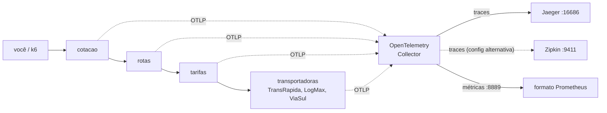

# Lab 6A: OpenTelemetry ponta a ponta - logs, métricas e traces

Aula prática da seção 6 (Observabilidade e Monitoramento), depois da aula 6.5.

| | |
|---|---|
| Aulas relacionadas | 6.2 (logs), 6.4 (tracing distribuído) e 6.5 (OpenTelemetry) |
| Ambiente | Docker Compose |
| Ordem de estudo | Trilha Observabilidade, passo 1 de 3 (continua nos labs 6B e 6C) |

## Objetivo

Nas aulas da seção 6 vimos os três pilares da observabilidade e o OpenTelemetry como padrão que separa a instrumentação do backend. Neste lab você instrumenta um fluxo de cotação de frete uma única vez e o observa pelos três sinais: encontra o trecho lento em um trace, liga os logs ao trace pelo `trace_id` e vê as métricas saírem no formato do Prometheus. Depois troca o backend de traces apenas editando a configuração do Collector, sem tocar na aplicação.

O cenário é o da LunaLog: uma cotação de frete passa por quatro serviços e demora mais de 3 segundos, sem que nenhum serviço, sozinho, pareça lento.

## O que você vai ver

- Quatro serviços encadeados (`cotacao`, `rotas`, `tarifas`, `transportadoras`) com instrumentação automática e um span manual de negócio
- Um único trace atravessando os quatro, e o span lento que esconde segundos de latência
- Logs em JSON com `trace_id` e `span_id`, correlacionáveis ao trace
- O Collector como ponto único de saída: os traces vão para o **Jaeger** e, trocando uma linha do `.env`, para o **Zipkin**, sem reinstrumentar
- As métricas de cada requisição disponíveis em formato Prometheus (o que o lab 6B usa)
- O que acontece com o trace quando um serviço **não propaga** o contexto

## Arquitetura do lab



Os quatro serviços usam a mesma imagem, com papéis diferentes. A aplicação só conversa com o Collector (OTLP). Para onde os dados vão depois é decisão do Collector.

## Pré-requisitos

- Docker Engine ou Docker Desktop com Compose v2
- Cerca de 3 GB de RAM livres
- Portas 8000, 8889, 9411 e 16686 livres

## Como executar

Na pasta deste lab:

```bash
docker compose up -d --build
```

### Cenário 1: um trace, quatro serviços

```bash
curl -s "localhost:8000/cotacao?destino=SP"
```

A resposta traz o `trace_id`. Copie-o, abra o Jaeger em http://localhost:16686, escolha o serviço `cotacao`, clique em **Find Traces** e abra o trace (ou busque direto pelo `trace_id`).

O que observar:

- Uma cascata de spans que atravessa os quatro serviços. A requisição inteira leva cerca de 3,1 segundos.
- O span `consultar_transportadora` da **ViaSul** ocupa 2,8 segundos desses 3,1. Os outros dois ficam em 90 e 140 milissegundos. Nenhum serviço, olhado sozinho, parece lento: é o trace que mostra onde o tempo foi.
- Clique no span `consultar_transportadora`: os atributos `transportadora.nome` e `transportadora.preco` foram adicionados por um **span manual** no código. A instrumentação automática cobre HTTP; a regra de negócio é você quem anota.
- Os spans `GET /cotacao`, `GET /rota` e `GET /tarifa` vêm da instrumentação automática, sem uma linha de código nos serviços.

### Cenário 2: do trace aos logs

Cada linha de log é um JSON com `trace_id` e `span_id`. Com o `trace_id` da resposta:

```bash
# Linux, macOS e WSL2
docker compose logs --no-log-prefix | grep <trace_id>
```

```powershell
# PowerShell
docker compose logs --no-log-prefix | Select-String <trace_id>
```

O que observar: as linhas dos quatro serviços aparecem juntas, ligadas pelo mesmo `trace_id`. Do trace você chega aos logs, e de um log você chega ao trace. Compare com logs sem identificador de correlação, em que seria preciso alinhar timestamps manualmente.

### Cenário 3: as métricas

Gere um pouco de carga e consulte as métricas no endpoint do Collector:

```bash
docker compose run --rm k6 run /scripts/carga.js
curl -s localhost:8889/metrics | grep http_server_duration_milliseconds_count
```

O que observar: a duração das requisições de cada serviço aparece como histograma, já no formato do Prometheus. Isso vem da mesma instrumentação, sem código adicional. O lab 6B coloca um Prometheus para coletar esses dados.

### Cenário 4: trocar o backend sem reinstrumentar

Edite o arquivo `.env` e troque o valor de `COLLECTOR_CONFIG` para `collector-zipkin.yaml`. Depois recrie só o Collector:

```bash
docker compose up -d otel-collector
curl -s "localhost:8000/cotacao?destino=RJ"
```

Abra o Zipkin em http://localhost:9411 e busque o trace. Ele está lá, com os mesmos quatro serviços. O que mudou: um arquivo de configuração do Collector (compare `collector/collector-jaeger.yaml` e `collector/collector-zipkin.yaml`: a diferença é só o `exporter` de traces). **A aplicação não foi tocada, nem reconstruída, nem reiniciada.**

Volte `COLLECTOR_CONFIG` para `collector-jaeger.yaml` quando quiser.

### Cenário 5: um serviço que não propaga o contexto

No `.env`, troque `ROTAS_PROPAGA=1` por `ROTAS_PROPAGA=0` e recrie o serviço `rotas`:

```bash
docker compose up -d rotas
curl -s "localhost:8000/cotacao?destino=MG"
```

Procure o trace no Jaeger. O que observar: o trace da requisição agora tem só **dois** serviços, `cotacao` e `rotas`. As chamadas seguintes (`tarifas`, `transportadoras`) aparecem em traces separados, cada um começando no meio do caminho. O `rotas` deixou de enviar o cabeçalho `traceparent` ao chamar o próximo serviço, e a cadeia se quebrou. Basta um serviço sem propagação para o trace deixar de contar a história inteira.

Volte `ROTAS_PROPAGA` para `1` e rode `docker compose up -d rotas`.

## Como limpar

```bash
docker compose --profile ferramentas down -v
```

## Estrutura da pasta

```
lab-6a_opentelemetry-ponta-a-ponta/
  README.md
  docker-compose.yml
  .env                    (Collector ativo, tempo da ViaSul, propagação)
  app/
    main.py               (os 4 papéis e o span manual)
    telemetria.py         (toda a configuração do OpenTelemetry)
    Dockerfile
    requirements.txt
  collector/
    collector-jaeger.yaml
    collector-zipkin.yaml
  k6/carga.js
```

## Limites deste lab

- Todos os traces são coletados (sem amostragem). Em produção, o volume obriga a definir uma estratégia de amostragem (aula 6.8).
- Os logs vão para a saída padrão e são lidos com `docker compose logs`. Em produção, um coletor (como o próprio OpenTelemetry Collector ou um agente de logs) os envia para um sistema de busca.
- A instrumentação aqui usa a API Python do OpenTelemetry. O padrão é o mesmo em Java, Go, .NET, Node.js e outras linguagens.
- As versões das bibliotecas estão fixadas para o lab ser reproduzível. A instrumentação do OpenTelemetry evolui rápido e alguns nomes de métricas mudam entre versões.

## Para pensar

1. O trace mostrou onde o tempo foi gasto, mas não o que fazer a respeito. O que você mudaria no fluxo de transportadoras? (Pense em paralelismo, timeouts e no circuit breaker da seção 3.)
2. Qual é o custo de ter um único serviço sem propagação de contexto numa cadeia de oito serviços? Como você garantiria, em escala, que todos propagam?
3. Se você tivesse instrumentado com o SDK proprietário de uma ferramenta de mercado, o que seria necessário para trocar de fornecedor? Compare com o que você fez no cenário 4.
4. Os atributos do span manual (`transportadora.nome`, `transportadora.preco`) ajudam a diagnosticar. Que cuidados você tomaria para não registrar dados sensíveis como atributos?
