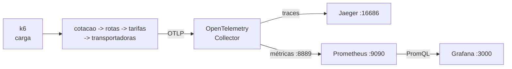

# Lab 6B: Prometheus, PromQL e Grafana - métricas RED e dashboard efetivo

Aula prática da seção 6 (Observabilidade e Monitoramento), depois da aula 6.8.

| | |
|---|---|
| Aulas relacionadas | 6.3 (métricas e cardinalidade), 6.6 (Prometheus e PromQL) e 6.7 (Grafana) |
| Ambiente | Docker Compose |
| Ordem de estudo | Trilha Observabilidade, passo 2 de 3 (continua o lab 6A; segue para o 6C) |

## Objetivo

Neste lab você coloca um Prometheus para coletar as métricas que o OpenTelemetry já produz, escreve as consultas PromQL do método RED (taxa, erros e duração) e monta um dashboard como código no Grafana. No caminho, provoca de propósito o erro clássico de iniciantes com Prometheus, a explosão de cardinalidade, e compara um painel confuso com um painel desenhado para diagnóstico.

O cenário é o da LunaLog: o mesmo fluxo de cotação do lab 6A, agora com métricas, erros injetados e um painel de plantão.

## O que você vai ver

- O Prometheus coletando as métricas por **pull**, e o modelo de séries temporais com rótulos
- As consultas PromQL do RED: `rate`, `sum by` e `histogram_quantile`
- Erros injetados na cadeia de serviços e a taxa de erro aparecendo na métrica
- A **explosão de cardinalidade**: um rótulo `cliente_id` transforma 5 séries em mais de mil em um minuto
- Um dashboard provisionado como código, com hierarquia de **sintomas** (no topo) e **causas** (abaixo)
- Um painel confuso ao lado, para comparar o que torna um painel inútil às 2h da manhã

## Arquitetura do lab



É a stack do lab 6A com dois componentes novos: **Prometheus** (coleta e consulta) e **Grafana** (visualização). O Grafana já sobe com o Prometheus configurado como fonte de dados e os dois dashboards carregados (sem login, só para o laboratório).

## Pré-requisitos

- Docker Engine ou Docker Desktop com Compose v2
- Cerca de 3 GB de RAM livres
- Portas 3000, 8000, 9090 e 16686 livres

## Como executar

Na pasta deste lab:

```bash
docker compose up -d --build
docker compose run --rm k6 run -e TAXA=10 -e DURACAO=90s /scripts/carga.js
```

Enquanto a carga roda, abra o Grafana em http://localhost:3000 e o Prometheus em http://localhost:9090.

### Cenário 1: as métricas no Prometheus

No Prometheus, em **Graph**, execute estas consultas, uma por vez:

```promql
http_server_duration_milliseconds_count
```

O que observar: são **contadores** que só crescem, um por combinação de serviço, rota e código de status. Cada combinação de rótulos é uma **série temporal**. Em **Status > Targets**, veja o Collector sendo coletado a cada 5 segundos: o Prometheus vai buscar os dados (pull), a aplicação não os envia.

Agora a taxa, que é o que interessa:

```promql
sum(rate(http_server_duration_milliseconds_count[1m])) by (job)
```

`rate` transforma o contador em requisições por segundo na janela de 1 minuto, e `sum by (job)` agrega por serviço. Como a janela é de 1 minuto, os valores só ficam estáveis (perto de 10 por segundo, com a carga de 10 req/s) depois de uns 90 segundos de carga: antes disso, a taxa aparece menor.

### Cenário 2: o método RED

Com erros injetados, edite o `.env` e troque `ERRO_VIASUL_PCT=0` por `ERRO_VIASUL_PCT=10`. Aplique e gere carga:

```bash
docker compose up -d
docker compose run --rm k6 run -e TAXA=10 -e DURACAO=90s /scripts/carga.js
```

As três consultas do RED para a cotação:

```promql
# Rate: requisições por segundo
sum(rate(http_server_duration_milliseconds_count{job="cotacao"}[1m]))

# Errors: percentual de respostas 5xx
100 * (sum(rate(http_server_duration_milliseconds_count{job="cotacao",http_status_code=~"5.."}[1m])) or vector(0))
    / sum(rate(http_server_duration_milliseconds_count{job="cotacao"}[1m]))

# Duration: latência p95
histogram_quantile(0.95, sum(rate(http_server_duration_milliseconds_bucket{job="cotacao"}[1m])) by (le))
```

O que observar: a taxa de erro fica perto de 10%, a mesma proporção das chamadas injetadas (a janela de 1 minuto leva uns 60 segundos para encher; depois, o valor oscila entre uns 8% e 13%, porque a falha é sorteada). A taxa fica perto de 10 por segundo, e o p95 em algumas centenas de milissegundos. A latência é um **histograma**: o `histogram_quantile` estima o percentil a partir dos baldes (`le`). Repare que o erro aparece em todos os serviços da cadeia, porque cada um repassa a falha do seguinte como `502`. Para achar a origem, o trace do lab 6A mostra qual serviço falhou primeiro.

### Cenário 3: o dashboard

Abra http://localhost:3000. O painel inicial é **LunaLog - Cotação: visão operacional**:

- A linha de cima, **sintomas**, responde "o cliente está sendo bem atendido?": taxa de erro, latência p95, volume e cotações por destino.
- A linha de baixo, **causas**, responde "em qual serviço está o problema?": latência, erro e volume por serviço, com um filtro de serviço.

Agora abra o outro dashboard (**LunaLog - tudo**, no menu de dashboards). Dezoito painéis sem unidade, sem hierarquia, mostrando contadores crus. Compare: às 2h da manhã, com um incidente, qual dos dois ajuda a decidir para onde olhar em segundos?

Os dois painéis são arquivos JSON em `grafana/dashboards/`, carregados automaticamente. Se você os edita e salva, o arquivo é a fonte de verdade: dashboard como código, versionado como qualquer outro.

### Cenário 4: explosão de cardinalidade

Antes, anote o número de séries da métrica de cotações e o total do Prometheus:

```promql
count(lunalog_cotacoes_total)
prometheus_tsdb_head_series
```

Agora adicione o cliente como rótulo. No `.env`, troque `METRICA_COM_CLIENTE=0` por `METRICA_COM_CLIENTE=1`, aplique e rode a carga com clientes diferentes:

```bash
docker compose up -d cotacao
docker compose run --rm k6 run -e TAXA=40 -e DURACAO=50s /scripts/carga-clientes.js
```

Repita as duas consultas. O que observar: a métrica de cotações passa de **5 séries para mais de mil** em menos de um minuto (no ensaio, entre 1.450 e 1.670), com apenas 2 mil requisições e 5 mil clientes possíveis. O total do Prometheus (`prometheus_tsdb_head_series`) vai de uns 1.000 para uns 2.400. Cada valor novo de `cliente_id` cria uma série nova. Com 80 mil usuários, como na LunaLog, o resultado é um Prometheus que consome memória e disco sem parar e degrada o próprio monitoramento.

A regra: rótulo só para valores de **poucas possibilidades** (destino, status, serviço). Identificadores de usuário, de pedido ou de requisição não são rótulos de métrica: ficam em logs e traces.

Volte `METRICA_COM_CLIENTE` para `0` e rode `docker compose up -d cotacao`. Repare que as séries criadas **não somem na hora**: o `count(lunalog_cotacoes_total)` continua alto por uns 5 a 6 minutos depois do último pedido com cliente, porque as séries antigas só expiram depois desse tempo. Rótulo ruim cobra o preço mesmo depois de removido.

## Como limpar

```bash
docker compose --profile ferramentas down -v
```

## Estrutura da pasta

```
lab-6b_prometheus-promql-e-grafana/
  README.md
  docker-compose.yml
  .env                          (ERRO_VIASUL_PCT, METRICA_COM_CLIENTE)
  app/                          (os 4 serviços; igual ao lab 6A, com erro injetado e métrica de negócio)
  collector/collector.yaml
  prometheus/prometheus.yml     (coleta por pull)
  grafana/
    provisioning/               (fonte de dados e carregamento dos dashboards)
    dashboards/
      painel-efetivo.json
      painel-confuso.json
  k6/
    carga.js
    carga-clientes.js
```

## Limites deste lab

- A latência por serviço é cumulativa: cada serviço espera o seguinte, então o p95 de `cotacao` inclui o de `rotas`, que inclui o de `tarifas`. Por isso os valores se parecem. Para achar o trecho lento, combine a métrica com o trace do lab 6A.
- Os baldes padrão do histograma são largos. Em produção, calibre os baldes em torno dos seus SLOs.
- O Prometheus aqui guarda apenas 2 horas de dados e sem alta disponibilidade. Para retenção longa e escala, existem soluções como Thanos, Mimir e VictoriaMetrics.
- O acesso ao Grafana sem login é uma facilidade de laboratório. Nunca faça isso em produção.

## Para pensar

1. O painel efetivo coloca sintomas no topo e causas abaixo. Que painéis você precisaria adicionar para o seu serviço, e quais dos 18 do painel confuso você descartaria?
2. Um desenvolvedor propõe adicionar `user_id` como rótulo para "poder ver a latência de cada usuário". O que você responde, e onde essa informação deveria ficar?
3. O p95 mascara os piores casos. Quando você olharia para o p99 ou o máximo, e quando um percentil alto demais atrapalha?
4. A métrica de erro mostra 10%, mas não diz **qual** transportadora falhou. Que sinal (métrica, log, trace) responde a essa pergunta, e como você chegaria a ele a partir do painel?
