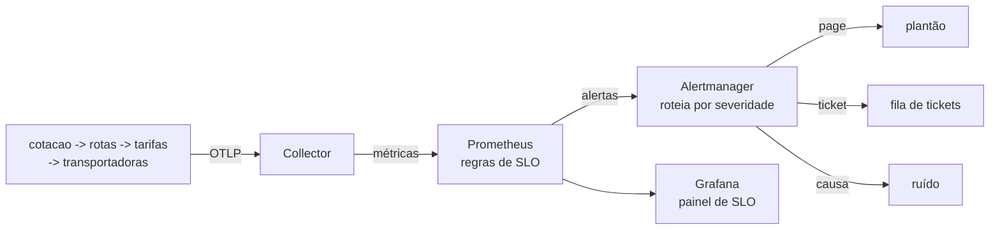

# Lab 6C: Alertas por SLO - burn rate e error budget

Aula prática da seção 6 (Observabilidade e Monitoramento), depois da aula 6.8 e do lab 6B.

| | |
|---|---|
| Aulas relacionadas | 6.8 (alertas baseados em SLO), 7.1 (SLI, SLO e SLA) e 7.2 (error budget) |
| Ambiente | Docker Compose |
| Ordem de estudo | Trilha Observabilidade, passo 3 de 3 (continua o lab 6B) |

## Objetivo

Na aula 6.8 vimos que alertas por causa (CPU alta, memória alta) geram ruído e fadiga, e que alertas baseados em SLO avisam quando o usuário está de fato sendo afetado. Neste lab você define o SLO da cotação, escreve os alertas de **burn rate** (velocidade de consumo do error budget) e compara, **no mesmo incidente**, o que um alerta por causa e um alerta por SLO fazem com a atenção de quem está de plantão.

O cenário é o da LunaLog: 180 alertas por semana, 163 deles falsos positivos, e os 17 reais enterrados no ruído.

## O que você vai ver

- Um SLO de 99% de disponibilidade para a cotação e o error budget de 1% que ele implica
- Regras de gravação (recording rules) que calculam o SLI em várias janelas
- O alerta de **queima rápida** (acorda o plantão) e o de **queima lenta** (vira ticket), cada um com duas janelas de tempo
- Um incidente real gerando **um** alerta de plantão, e o mesmo incidente gerando **quatro** alertas por causa
- Um pequeno vazamento de erros (1%) que não aciona o SLO, mas aciona o alerta por causa
- O Alertmanager roteando por severidade e a política de congelar deploys quando o orçamento acaba
- Um dashboard de SLO com SLI, orçamento restante e burn rate

## Arquitetura do lab



É a stack do lab 6B com dois componentes novos: o **Alertmanager** e um **receptor** que simula os destinos (plantão, tickets e ruído) imprimindo o que recebe.

## Conceitos usados

- **SLI**: a medida do que o usuário sente. Aqui, a proporção de cotações sem erro 5xx.
- **SLO**: o objetivo para o SLI. Aqui, 99%. O **error budget** é o que sobra: 1% de erros permitidos.
- **Burn rate**: quantas vezes mais rápido que o permitido o orçamento está sendo gasto. Burn rate 1 gasta o orçamento exatamente no ritmo de esgotá-lo no fim da janela do SLO; burn rate 10 o esgota dez vezes mais rápido.
- **Duas janelas por alerta**: a janela longa confirma que o problema é consistente; a curta confirma que ainda está acontecendo. Juntas, evitam disparar por um pico isolado e evitam continuar alertando depois que o problema passou.

**Atenção às janelas.** Para caber numa aula, o lab usa janelas de **segundos e minutos** e uma janela de SLO de **15 minutos**. Em produção, o SLO é medido em 30 dias e as janelas típicas dos alertas são 1 hora/5 minutos (queima rápida) e 6 horas/30 minutos (queima lenta). A lógica é a mesma.

## Pré-requisitos

- Docker Engine ou Docker Desktop com Compose v2
- Cerca de 3 GB de RAM livres
- Portas 3000, 8000, 9090, 9093 e 16686 livres

## Como executar

Na pasta deste lab:

```bash
docker compose up -d --build
docker compose run -d --rm k6 run -e TAXA=10 -e DURACAO=15m /scripts/carga.js
```

A carga roda em segundo plano por 15 minutos. Abra o painel **LunaLog - SLO da cotação** em http://localhost:3000, o Prometheus em http://localhost:9090/alerts e o Alertmanager em http://localhost:9093.

Para acompanhar as notificações, em outro terminal:

```bash
docker compose logs -f receptor
```

A "alavanca" do laboratório é a variável `ERRO_VIASUL_PCT` do arquivo `.env`: o percentual de chamadas à transportadora ViaSul que falham. Para aplicar uma mudança, edite o `.env` e rode `docker compose up -d` (só o serviço de transportadoras é recriado).

### Cenário 1: sistema saudável

Com `ERRO_VIASUL_PCT=0`, veja o painel: SLI em 100%, orçamento restante em 100%, burn rate em zero, nenhum alerta. Leia as regras em `prometheus/rules/slo.yml` com calma: o SLI, as janelas, os limites de burn rate e os rótulos de severidade.

### Cenário 2: um pequeno vazamento (1% de erro)

Troque para `ERRO_VIASUL_PCT=1`, aplique com `docker compose up -d` e espere cerca de 1 minuto e meio.

O que observar:

- No `receptor`, aparecem alertas **por causa** (`ErroEmServico`) para alguns serviços da cadeia. Alguém no canal de ruído foi avisado.
- Os alertas de SLO **não disparam**: 1% de erro significa burn rate 1, exatamente o ritmo permitido. O orçamento não está em risco.
- Pergunta: esse alerta por causa merece acordar alguém? O usuário foi afetado de forma que importa?

### Cenário 3: um incidente de verdade (30% de erro)

Troque para `ERRO_VIASUL_PCT=30`, aplique e espere cerca de 2 minutos. Acompanhe o `receptor`.

O que observar, em ordem de chegada:

1. Quatro alertas **por causa**, um por serviço da cadeia (`cotacao`, `rotas`, `tarifas`, `transportadoras`), para o **mesmo** incidente.
2. `SLOQueimaRapida` com destino **PLANTAO**: um único alerta, dizendo que o orçamento de erro está sendo consumido 10 vezes mais rápido que o permitido. Esse é o que acorda alguém.
3. `OrcamentoDeErroBaixo` e `SLOQueimaLenta` com destino **TICKET**: viram trabalho para o dia útil, sem acordar ninguém. O primeiro traz a política: congelar deploys de funcionalidades até recuperar o orçamento.

No painel de SLO, o orçamento restante vai a zero e fica negativo: o SLO da janela foi violado. O gráfico de burn rate mostra a janela curta subindo antes da longa.

### Cenário 4: recuperação

Volte para `ERRO_VIASUL_PCT=0`, aplique e espere uns 3 minutos.

O que observar: o alerta de plantão é resolvido primeiro (as janelas dele são curtas), depois os alertas por causa e o de queima lenta. O `OrcamentoDeErroBaixo` **continua disparando** por mais tempo, porque o orçamento só se recupera quando os erros saem da janela de 15 minutos do SLO. Na prática, é por isso que a política de congelamento de deploys dura enquanto o orçamento está baixo, e não só enquanto o incidente dura.

## Resultados de referência

Medidos em execuções do próprio lab, com a carga de 10 requisições por segundo:

| Situação | Alertas por causa | Alertas por SLO | Para onde vai |
|---|---|---|---|
| 0% de erro | 0 | 0 | |
| 1% de erro | 2 a 4 (ruído) | 0 | ruído |
| 30% de erro | 4 (um por serviço) | 3 (1 page, 2 tickets) | plantão e tickets |
| Recuperação | resolvidos em ~1 min | page resolvido em ~2 min, ticket em ~4 min | |

O primeiro alerta de plantão disparou cerca de 50 segundos depois do início do incidente.

## Como limpar

```bash
docker compose --profile ferramentas down -v
```

## Estrutura da pasta

```
lab-6c_alertas-por-slo-burn-rate/
  README.md
  docker-compose.yml
  .env                          (ERRO_VIASUL_PCT)
  app/                          (os 4 serviços, igual ao lab 6B)
  collector/collector.yaml
  prometheus/
    prometheus.yml
    rules/slo.yml               (SLI, burn rate e alertas)
  alertmanager/alertmanager.yml (roteamento por severidade)
  receptor/                     (simula plantão, tickets e ruído)
  grafana/
    provisioning/
    dashboards/
      slo-cotacao.json          (painel de SLO)
      painel-efetivo.json       (painel RED do lab 6B)
  k6/carga.js
```

## Limites deste lab

- O SLI usa apenas a taxa de erros 5xx. Um SLO de produção costuma combinar disponibilidade e latência (por exemplo, "99% das requisições respondem sem erro e em menos de 1 segundo").
- As janelas e o limite de burn rate foram reduzidos para a aula. Em produção, derive-os do SLO e da janela de 30 dias, e valide com o histórico real de incidentes.
- O receptor só imprime. Em produção, os destinos são o sistema de plantão (PagerDuty, Opsgenie ou similar), o canal de chat e a ferramenta de tickets.
- O alerta `ErroEmServico` está aqui como **antipadrão**, só para comparação.

## Para pensar

1. No cenário 2, o alerta por causa disparou e o de SLO não. Se o time ignora o ruído por hábito, qual é o risco no dia em que o alerta por causa avisar de algo grave?
2. Por que o alerta de queima rápida exige **duas** janelas? O que aconteceria com uma só, curta? E com uma só, longa?
3. O `OrcamentoDeErroBaixo` sugere congelar deploys de funcionalidades. Quem decide essa política na sua empresa, e como o time de produto reage a ela?
4. O SLO de 99% foi escolhido por quem? Como você descobriria qual disponibilidade os seus usuários realmente percebem e pagam para ter?
