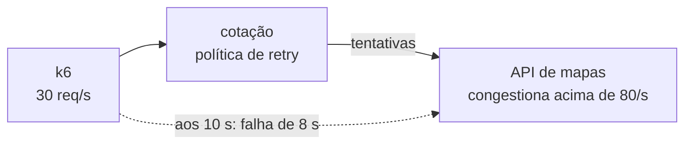

# Lab 7A: Retry, timeout, backoff e fallback sob falha

Aula prática da seção 7 (Resiliência e Confiabilidade), depois da aula 7.4.

| | |
|---|---|
| Aulas relacionadas | 7.3 (retry, timeout e backoff exponencial) e 7.4 (fallback gracioso e graceful degradation) |
| Ambiente | Docker Compose |
| Ordem de estudo | Trilha Falhas injetadas, passo 2 de 2 (continua o cenário do lab 3F) |

## Objetivo

Na aula 7.3 vimos que retry sem critério transforma uma falha transitória em cascata, e na 7.4 que o fallback mantém o sistema parcialmente funcional. Neste lab você submete a mesma falha de 8 segundos a quatro políticas de retry e vê, em gráficos por segundo, o que cada uma faz com o cliente e com a dependência. O resultado mais surpreendente: retry imediato e retry com backoff e jitter, sozinhos, produzem o mesmo desastre.

O cenário continua o do lab 3F: o serviço de cotação depende da API de mapas. Aqui a falha é **transitória**: a API fica fora do ar por 8 segundos e volta.

## O que você vai ver

- Sem retry: a falha dura exatamente o que a causa durou, e o sistema se recupera sozinho
- Retry imediato: a **falha sobrevive à causa**. Os clientes insistem, a API de mapas congestiona e não consegue se recuperar enquanto a insistência continuar
- Backoff exponencial com jitter: melhora a distribuição no tempo, mas **não reduz a amplificação**, e o resultado é o mesmo
- Retry com **orçamento** e **fallback**: a amplificação cai a 1,02 tentativa por requisição, o usuário não vê erro e a API recupera em segundos
- Gráficos por segundo (em texto) do que o cliente viu e do que a API de mapas recebeu

## Como o lab modela o problema

A API de mapas (`mapas/main.py`) recusa chamadas por dois motivos:

1. **A falha injetada**: um endpoint força 8 segundos de indisponibilidade. É a causa original.
2. **Congestionamento**: se chegarem mais de 80 chamadas em 1 segundo (a carga normal é de 30), a API engasga e recusa **tudo** pelos 5 segundos seguintes.

O segundo ponto é um modelo simplificado, de propósito, de um fenômeno real: sistemas sobrecarregados perdem capacidade (filas, pools esgotados, caches frios), e os retries mantêm a sobrecarga. A causa original pode ter acabado há minutos e o sistema continua fora do ar porque os clientes não deixam ele respirar.

## As quatro políticas

| Política | O que faz |
|---|---|
| `sem-retry` | Uma tentativa, timeout de 1 segundo |
| `retry-imediato` | Até 4 tentativas, uma logo após a outra |
| `backoff-jitter` | Até 4 tentativas, esperando um tempo aleatório entre 0 e um teto que dobra a cada tentativa (full jitter) |
| `completo` | Backoff com jitter, **orçamento de retries** (retry só se houver ficha; cada requisição ganha 0,1 ficha) e **fallback** (uma estimativa de frete quando tudo falha) |

Todas as políticas com retry têm um prazo total (deadline) de 3 segundos por requisição.

## Arquitetura do lab



## Pré-requisitos

- Docker Engine ou Docker Desktop com Compose v2
- Cerca de 1 GB de RAM livre
- Portas 8000 e 9000 livres

## Como executar

Na pasta deste lab:

```bash
docker compose up -d --build
```

Cada execução dura 45 segundos: 30 requisições por segundo, e aos 10 segundos a API de mapas fica fora do ar por 8 segundos. Rode uma política por vez:

```bash
docker compose run --rm k6 run -e POLITICA=<politica> /scripts/carga.js
```

Ao final, veja o que o cliente viu e o que a API de mapas recebeu:

```bash
curl -s localhost:8000/resultados/grafico
curl -s localhost:9000/estatisticas/grafico
```

No gráfico da cotação, cada linha é um segundo: `ok`, `fb` (fallback) e `erro` são os resultados entregues ao usuário, e `tent` é quantas tentativas foram feitas à API de mapas. No gráfico da API de mapas, as colunas são chamadas recebidas e atendidas; o `!` marca os segundos acima do limite de congestionamento.

### Cenário 1: sem retry

```bash
docker compose run --rm k6 run -e POLITICA=sem-retry /scripts/carga.js
```

O que observar: erros durante os 8 segundos da falha (e mais um ou dois de transição) e **nada depois**. Cada requisição fez 1 tentativa. A API de mapas recebe 30 chamadas por segundo o tempo todo e se recupera sozinha quando a causa acaba. É o piso: o usuário vê o erro, mas o sistema não piora a situação.

### Cenário 2: retry imediato

```bash
docker compose run --rm k6 run -e POLITICA=retry-imediato /scripts/carga.js
```

O que observar:

- Durante a falha, as tentativas à API de mapas sobem de 30 para 120 por segundo: cada requisição tenta 4 vezes.
- Esses 120 por segundo passam do limite de 80. A API congestiona.
- **Quando a causa original acaba (aos 18 segundos), a falha continua.** A API segue recusando tudo porque os clientes continuam mandando 120 chamadas por segundo, e o congestionamento se renova a cada 5 segundos. O teste inteiro termina com cerca de 77% das requisições falhando, e 3,3 tentativas por requisição.

O retry transformou uma falha de 8 segundos em uma falha que só termina quando alguém para de insistir.

### Cenário 3: backoff exponencial com jitter

```bash
docker compose run --rm k6 run -e POLITICA=backoff-jitter /scripts/carga.js
```

O que observar: o resultado é praticamente igual ao do cenário 2. A API continua congestionada. O backoff com jitter espalha as tentativas no tempo (evita que todos os clientes retentem no mesmo instante), mas com um fluxo contínuo de requisições a **quantidade total** de tentativas continua sendo quatro vezes a carga. Backoff resolve o problema da sincronização, não o da amplificação.

### Cenário 4: orçamento de retries e fallback

```bash
docker compose run --rm k6 run -e POLITICA=completo /scripts/carga.js
```

O que observar:

- Durante a falha, a coluna `fb` mostra o fallback atendendo o usuário: **zero erros** no resultado final.
- As tentativas à API de mapas ficam em cerca de 33 por segundo, só 10% acima da carga normal. O orçamento de retries impede a amplificação.
- Assim que a causa acaba (aos 18 segundos), a API de mapas atende normalmente de novo: a recuperação é imediata, porque ela nunca chegou a congestionar.
- No total, 1,02 tentativa por requisição.

## Resultados de referência

Mesma falha de 8 segundos, 30 requisições por segundo, 45 segundos de teste:

| Política | Erros ao usuário | Tentativas por requisição | A API de mapas se recupera? |
|---|---|---|---|
| `sem-retry` | 241 (18%) | 1,00 | sim, assim que a causa acaba |
| `retry-imediato` | 1050 (78%) | 3,33 | não, congestionada até o fim do teste |
| `backoff-jitter` | 1050 (78%) | 3,33 | não, congestionada até o fim do teste |
| `completo` | 0 (240 respostas por fallback) | 1,02 | sim, em cerca de 1 segundo |

## Como limpar

```bash
docker compose --profile ferramentas down -v
```

## Estrutura da pasta

```
lab-7a_retry-timeout-backoff-e-fallback/
  README.md
  docker-compose.yml
  .env                  (LIMITE_CONGESTAO)
  mapas/main.py         (API de mapas, com falha injetada e congestionamento)
  cotacao/main.py       (as quatro políticas de retry)
  k6/carga.js           (carga e gatilho da falha)
```

## Limites deste lab

- O congestionamento é um modelo simples (limite de chamadas por segundo e uma pausa de 5 segundos). Sistemas reais degradam de formas mais graduais, mas a dinâmica de realimentação é a mesma.
- O orçamento de retries aqui é um balde de fichas fixo (10% de retries sobre as requisições). Bibliotecas maduras (Envoy, gRPC, resilience4j) oferecem retry budgets e limites configuráveis.
- O fallback é uma estimativa fixa. Na LunaLog da aula 7.4, o fallback é uma rota calculada em cache para as rotas mais comuns; aqui o objetivo é mostrar o efeito, não o conteúdo do fallback.
- O retry só é seguro para operações **idempotentes**. Para operações que mudam estado (como a confirmação de entrega do lab 3.11), é preciso uma chave de idempotência antes de ligar o retry.
- O circuit breaker do lab 3F é a outra metade da defesa: ele corta as tentativas quando a dependência já está claramente fora do ar.

## Para pensar

1. Por que o retry com backoff e jitter, sozinho, não evitou o congestionamento? Que outro mecanismo você precisaria colocar ao lado dele?
2. O orçamento de 10% é uma escolha. Que riscos você assume com um orçamento maior? E com um menor?
3. O fallback entregou uma estimativa de frete. Para quais respostas do seu sistema um fallback desse tipo seria aceitável e para quais seria perigoso?
4. Todas as chamadas na cadeia (cliente, gateway, serviço, dependência) tentam novamente 4 vezes. Quantas chamadas a dependência recebe por uma única requisição do usuário? (Dica: multiplique.)
