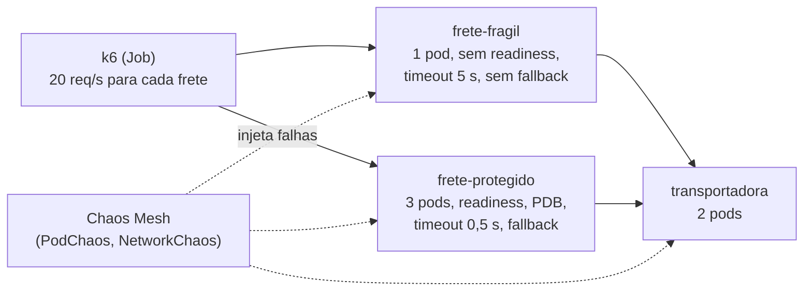

# Lab 7B: Chaos engineering no Kind: hipótese, experimento e resultado

Aula prática da seção 7 (Resiliência e Confiabilidade), depois da aula 7.5.

| | |
|---|---|
| Aulas relacionadas | 7.5 (chaos engineering: testando resiliência de forma deliberada); também retoma 7.3 (timeout e retry) e 7.4 (fallback) |
| Ambiente | Kind (Kubernetes local) e Chaos Mesh |
| Ordem de estudo | Trilha Kubernetes local (Kind), passo 7 de 7 (continua o lab 5D) |

## Objetivo

Na aula 7.5 vimos que chaos engineering não é quebrar coisas por esporte: é um **experimento**, com estado estacionário, hipótese, um ataque controlado e uma condição de abortar. Neste lab você faz isso de verdade, injetando falhas reais (matar pods, deixar a rede lenta, derrubar uma dependência) em **dois serviços de frete que rodam lado a lado**: um sem as proteções do curso e um com elas.

O mesmo ataque, na mesma hora, nos dois. O resultado confirma ou refuta a hipótese, e mostra o que as proteções (réplicas, readiness, timeout curto, fallback) realmente compram.

## O que você vai ver

- O **estado estacionário** definido em números: erros abaixo de 1% e p95 abaixo de 800 ms
- A **hipótese** de cada experimento escrita antes de atacar, e o veredito depois (confirmada ou refutada)
- **Pod kill**: perder um pod do serviço
- **Latência de rede** na dependência: o lento que é pior que o fora do ar
- **Dependência fora do ar**: o serviço degrada em vez de falhar
- O **raio de explosão** controlado (duração limitada, um alvo por vez) e a **condição de abortar** (o teste para quando a hipótese é violada)

## Arquitetura do lab



- Os dois fretes rodam **a mesma imagem**; só a configuração muda. O que se compara são as decisões de arquitetura, não o código.
- O **k6** gera tráfego constante e mede, por alvo, a taxa de erros e a latência. As hipóteses viram `thresholds`.
- O **Chaos Mesh** injeta as falhas a partir de arquivos YAML em `experimentos/`.

## Pré-requisitos

- Docker Engine ou Docker Desktop
- [kind](https://kind.sigs.k8s.io/) e `kubectl`
- [Helm](https://helm.sh/) 3 (veja a alternativa em container no lab 4F)
- Cerca de 6 GB de RAM livres e acesso à internet (baixa o Chaos Mesh e o k6)
- Um shell Bash para o script (Git Bash ou WSL no Windows); os comandos manuais também são mostrados
- O cluster Kind da trilha (lab 2C). Se ainda não existe:

```bash
kind create cluster --config ../../../02_estilos_arquiteturais/labs/lab-2c_kind-stateless-e-health-checks/kind/cluster.yaml
```

## Como executar

Na pasta deste lab. Primeiro a imagem e o **Chaos Mesh** (o operador que injeta as falhas):

```bash
docker build -q -t lunalog/frete-caos:1.0.0 app
kind load docker-image lunalog/frete-caos:1.0.0 --name lunalog-arq

helm repo add chaos-mesh https://charts.chaos-mesh.org
helm install chaos-mesh chaos-mesh/chaos-mesh -n chaos-mesh --create-namespace --version 2.8.6 \
  --set chaosDaemon.runtime=containerd --set chaosDaemon.socketPath=/run/containerd/containerd.sock \
  --set dashboard.create=false --wait --timeout 8m
kubectl -n chaos-mesh get pods
```

Os dois `--set` do `chaosDaemon` dizem ao Chaos Mesh onde está o runtime de contêineres do Kind (containerd). O painel web fica desligado para economizar memória.

Agora os serviços:

```bash
kubectl apply -f manifests/00-namespace.yaml
kubectl apply -f manifests/10-transportadora.yaml -f manifests/20-frete-fragil.yaml -f manifests/30-frete-protegido.yaml
kubectl -n caos get pods
```

Leia, antes de seguir, os dois fretes e compare:

- `manifests/20-frete-fragil.yaml`: 1 réplica, sem readiness, sem PDB, timeout de 5 s e nenhuma alternativa
- `manifests/30-frete-protegido.yaml`: 3 réplicas espalhadas, readiness, PodDisruptionBudget, timeout de 0,5 s e fallback (devolve uma tabela local, "degradada")

### O método: um experimento por vez

O script `scripts/rodar-experimento.sh` executa as etapas de um experimento: confirma o estado estacionário, inicia o tráfego de medição, espera 15 segundos, injeta a falha, aguarda o fim e remove o experimento.

```bash
bash scripts/rodar-experimento.sh experimentos/e1-pod-kill.yaml
```

Cada execução leva cerca de 90 segundos e termina com um quadro assim:

```
===== RESULTADO DO EXPERIMENTO =====
fragil     requisicoes= 1201  erros=  1.75%  p95=   11 ms  degradadas=  0.0%  HIPOTESE REFUTADA
protegido  requisicoes= 1201  erros=  0.42%  p95=   11 ms  degradadas=  0.0%  HIPOTESE CONFIRMADA
```

Sem o script, os passos manuais são: `kubectl -n caos create configmap k6-scripts --from-file=k6/`, `kubectl apply -f manifests/40-job-experimento.yaml`, esperar uns 15 segundos, `kubectl apply -f experimentos/<arquivo>.yaml` e, no fim, `kubectl -n caos logs job/experimento | tail`.

### Cenário 0: o estado estacionário

Antes de atacar, é preciso saber como o sistema é quando está bem. Rode o tráfego sem nenhuma falha:

```bash
kubectl -n caos create configmap k6-scripts --from-file=k6/ --dry-run=client -o yaml | kubectl apply -f -
kubectl -n caos delete job experimento --ignore-not-found
kubectl apply -f manifests/40-job-experimento.yaml
kubectl -n caos wait --for=condition=complete job/experimento --timeout=150s
kubectl -n caos logs job/experimento | grep -A3 RESULTADO
```

O que observar: os dois fretes em **0,00% de erros e cerca de 10 ms de p95**. Esse é o estado estacionário, e a hipótese de cada experimento é "continua assim durante a falha". Sem essa linha de base, nenhum resultado é interpretável.

### Experimento 1: perder um pod

**Hipótese:** "se um pod do frete morrer, o cliente quase não percebe (erros abaixo de 1%)."

```bash
bash scripts/rodar-experimento.sh experimentos/e1-pod-kill.yaml
```

O ataque (`PodChaos`, `pod-kill`) mata um pod de cada frete, de uma vez e sem aviso. O que observar:

- O **frágil** tem um único pod. Enquanto o substituto sobe, não há ninguém para atender: cerca de 1,75% das requisições da janela de 60 segundos falham. **Hipótese refutada.**
- O **protegido** tem 3 pods: perder um tira um terço da capacidade, mas os outros atendem. O erro vai a cerca de 0,4% a 0,7%. **Hipótese confirmada, mas com folga pequena**: as requisições que já estavam a caminho do pod morto, ou que chegaram antes de o Kubernetes atualizar a lista de endereços, falham. Réplicas reduzem o impacto, não o zeram. Retry com idempotência (aula 7.3) reduziria ainda mais.

### Experimento 2: a dependência fica lenta

**Hipótese:** "se a transportadora ficar lenta, o frete continua respondendo rápido (p95 abaixo de 800 ms)."

```bash
bash scripts/rodar-experimento.sh experimentos/e2-latencia-na-dependencia.yaml
```

O ataque (`NetworkChaos`, `delay`) adiciona 2 segundos de latência de rede nas respostas da transportadora, por 30 segundos. O que observar:

- O **frágil** fica preso esperando a dependência: p95 de **cerca de 5 s** (o limite do timeout dele) e **30% a 40% de erros** na janela. Lento não é "quase certo": é pior que fora do ar, porque cada chamada segura uma conexão e uma fatia de capacidade por segundos.
- O **protegido** desiste em 0,5 s e devolve a tabela local: **0% de erros, p95 de cerca de 510 ms**. Quase metade das respostas é "degradada" (veio da tabela, não da transportadora), e é essa a troca: valor aproximado agora em vez de erro.

### Experimento 3: a dependência sai do ar

**Hipótese:** "sem a transportadora, o frete segue atendendo, ainda que com resposta degradada."

```bash
bash scripts/rodar-experimento.sh experimentos/e3-dependencia-fora.yaml
```

O ataque (`PodChaos`, `pod-failure`) torna **todos** os pods da transportadora indisponíveis por 25 segundos. O que observar:

- O **frágil**: **cerca de 34% de erros** na janela. Quando a dependência cai, o frete cai junto: a falha se propaga (aulas 7.3 e 7.4).
- O **protegido**: **0% de erros**, e cerca de 43% das respostas degradadas. A dependência caiu e o cliente ficou com um serviço funcionando com informação menos precisa.

### Experimento 4: a condição de abortar

Todo experimento precisa de um critério para parar. Os ataques de `duration` terminam sozinhos, mas e se o estrago for maior que o previsto? Este experimento mata **todos** os pods do frete protegido de uma vez, com a condição de abortar ligada:

```bash
bash scripts/rodar-experimento.sh experimentos/e4-ataque-grande-abortar.yaml sim
```

Com `ABORTAR=sim`, o k6 interrompe o teste assim que o alvo protegido viola a hipótese (erros acima de 1%). O que observar:

- O teste termina em **cerca de 20 segundos**, em vez de 60, com a mensagem `thresholds ... were crossed; ... stopping test prematurely`.
- O script então remove o experimento (`kubectl delete -f`), e o Deployment reconstrói os pods.

Este é o botão de emergência do chaos engineering: **raio de explosão pequeno** (um alvo, uma duração), **monitoramento durante o ataque** e **uma regra objetiva para abortar**. Em produção o gatilho viria do alerta de SLO, e o aborto removeria o objeto de caos (`kubectl delete`) automaticamente.

## Resultados de referência

Valores obtidos no Kind v0.33 (1 control-plane e 2 workers), Chaos Mesh 2.8.6, 20 req/s por alvo durante 60 s (1.200 requisições por alvo). Você deve ver números próximos.

| Experimento | Frágil (erros / p95) | Protegido (erros / p95 / degradadas) | Hipótese no protegido |
|---|---|---|---|
| 0. Sem falha (estado estacionário) | 0% / 10 ms | 0% / 11 ms / 0% | confirmada |
| 1. Pod kill | 1,75% / 10 ms | 0,4% a 0,7% / 11 ms / 0% | confirmada, com folga pequena |
| 2. Latência de 2 s na dependência | 31% a 41% / 5.000 ms | 0% / 508 ms / 49% | confirmada |
| 3. Dependência fora do ar | 34% / 5.000 ms | 0% / 507 ms / 43% | confirmada |
| 4. Mata todos os pods (com abortar) | 0% | 2,6% e o teste abortou | refutada, e foi interrompido |

No frágil, as hipóteses dos experimentos 1, 2 e 3 foram **refutadas**. A diferença entre as colunas é o valor das proteções do curso, medido.

## Como limpar

```bash
kubectl delete namespace caos
helm uninstall chaos-mesh -n chaos-mesh
kubectl delete namespace chaos-mesh
```

(As CRDs do Chaos Mesh permanecem no cluster; são inofensivas. Para removê-las: `kubectl get crd -o name | grep chaos-mesh.org | xargs kubectl delete`.) Para apagar o cluster inteiro: `kind delete cluster --name lunalog-arq`.

## Estrutura da pasta

```
lab-7b_chaos-engineering-no-kind/
  README.md
  app/                           (serviço de frete e transportadora, mesma imagem)
  k6/experimento.js              (tráfego, thresholds = hipóteses, quadro de resultado)
  manifests/
    00-namespace.yaml
    10-transportadora.yaml       (a dependência)
    20-frete-fragil.yaml         (sem proteções)
    30-frete-protegido.yaml      (réplicas, readiness, PDB, timeout curto, fallback)
    40-job-experimento.yaml      (o tráfego de medição)
  experimentos/
    e1-pod-kill.yaml
    e2-latencia-na-dependencia.yaml
    e3-dependencia-fora.yaml
    e4-ataque-grande-abortar.yaml
  scripts/rodar-experimento.sh
```

## Limites deste lab

- **Não rode estes experimentos em produção** sem o preparo que a aula 7.5 descreve: observabilidade, um raio de explosão pequeno, aviso aos times e um botão de emergência. Aqui o ambiente é descartável.
- A medição é feita por um cliente sintético (o k6). Em produção, o estado estacionário vem das métricas reais (SLIs/SLOs, lab 7A), não de um gerador de carga.
- O ataque de pod kill é **sem aviso** (`gracePeriod: 0`), o pior caso. Um encerramento gracioso (SIGTERM, drenagem de conexões) teria erros menores.
- O Chaos Mesh pede privilégios amplos no cluster (o daemon roda privilegiado nos nós). É uma ferramenta para ambientes controlados, com acesso restrito a quem pode criar objetos de caos.
- Falhas de nó (queda de um worker, `kubectl drain` com PodDisruptionBudget) e de zona não são exercitadas aqui. O PDB do frete protegido só entra em ação em manutenção voluntária, não em `pod-kill`.
- O fallback devolve uma resposta degradada com um valor fixo. Em produção, é uma decisão de **negócio**: que valor aproximado é aceitável, e por quanto tempo? (Aula 7.4.)
- O fallback mascara a falha da dependência. Sem uma métrica de "respostas degradadas" e um alerta, o time só descobre depois. O quadro do lab mostra essa métrica de propósito.

## Para pensar

1. O experimento 1 confirmou a hipótese no frete protegido, mas por pouco. Que mudança reduziria mais o erro no pod kill: mais réplicas, retry com idempotência, ou um encerramento gracioso? Qual o custo de cada uma?
2. No experimento 2, o frágil falhou **por esperar**. Que valor de timeout você escolheria para uma chamada entre serviços do seu sistema, e como derivaria esse número?
3. O protegido respondeu 43% a 49% com dados degradados e o cliente não viu erro. Isso é uma vitória ou um problema escondido? Que alerta você criaria?
4. Se você pudesse executar só um experimento de caos no seu sistema esta semana, qual seria a hipótese, qual a condição de abortar e quem precisa ser avisado?
