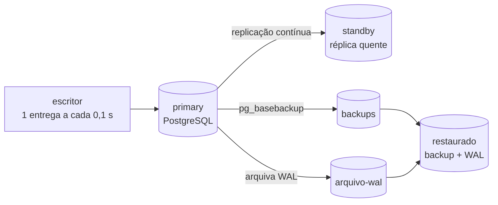

# Lab 7C: Disaster recovery - restore no tempo, standby e medição de RTO e RPO

Aula prática da seção 7 (Resiliência e Confiabilidade), depois da aula 7.6.

| | |
|---|---|
| Aulas relacionadas | 7.6 (RTO, RPO e estratégias de continuidade) e 7.7 (multi-região, na parte de discussão) |
| Ambiente | Docker Compose |
| Ordem de estudo | Independente |

## Objetivo

Na aula 7.6 vimos que RTO (quanto tempo posso ficar fora) e RPO (quanto dado posso perder) são parâmetros da arquitetura, e que as estratégias de recuperação se escalonam em custo e complexidade. Neste lab você faz um desastre acontecer num PostgreSQL real e **mede** o RTO e o RPO de duas estratégias diferentes, lado a lado: promover uma réplica quente (warm standby) e restaurar o banco a partir de backup mais o log de transações arquivado (backup-restore).

O cenário é o da LunaLog: o banco primário em São Paulo sofre uma falha de disco. O contrato com o cliente farmacêutico exige RTO de 1 hora e RPO de 15 minutos. Quem descobre o RPO real só na hora da restauração está descobrindo tarde.

## O que você vai ver

- Um banco recebendo escritas contínuas, com backup base e **arquivamento contínuo do WAL** (o diário de tudo que é gravado)
- Um **erro humano** (um `DELETE` sem `WHERE`) desfeito com **restauração para um ponto no tempo** (PITR), recuperando os dados até o instante antes do erro
- A **perda total do primário** (processo morto e disco apagado) e duas recuperações a partir do mesmo desastre:
  - **Standby promovido**: recuperação em segundos, praticamente sem perda de dados
  - **Backup mais WAL arquivado**: recuperação mais lenta e com perda dos últimos segundos de escrita
- RTO e RPO como **números medidos**, e não como promessas de contrato

## Arquitetura do lab



- **primary**: o banco de produção. Arquiva cada segmento de WAL no volume `arquivo-wal` (a cada 1 MB ou a cada 10 segundos, o que vier primeiro).
- **standby**: réplica por streaming, assíncrona, que segue o primário em tempo real.
- **escritor**: grava uma entrega a cada 0,1 segundo e imprime cada confirmação recebida do banco. O último `confirmado id=N` é o que o banco **garantiu** ao cliente.
- **restaurado**: sobe sob demanda, a partir do backup base mais o WAL arquivado.

## Pré-requisitos

- Docker Engine ou Docker Desktop com Compose v2
- Cerca de 2 GB de RAM livres
- No Windows, os comandos funcionam no PowerShell e no WSL2

## Como executar

Na pasta deste lab:

```bash
docker compose up -d --build
docker compose logs --tail 3 escritor
```

O `escritor` já está gravando. Confirme também que a réplica está seguindo o primário:

```bash
docker compose exec -T primary psql -U lunalog -d lunalog -c "SELECT client_addr, state, sync_state FROM pg_stat_replication"
```

O que observar: `state = streaming` e `sync_state = async`. **Assíncrona** significa que o primário confirma a escrita ao cliente sem esperar a réplica receber. É rápido, mas é de onde vem o RPO maior que zero da réplica.

### Passo 1: o backup base

Um backup completo, em um instante do tempo, para onde a restauração vai começar:

```bash
docker compose exec -T -u postgres primary pg_basebackup -U lunalog -D /backups/base -Fp -X stream -c fast
```

Depois dele, o WAL que o primário gera continua sendo arquivado. Backup mais WAL permite chegar a **qualquer instante** posterior.

### Cenário 1: erro humano e restauração no tempo (PITR)

Anote o instante imediatamente antes do erro (com microssegundos) e quantas linhas existem:

```bash
docker compose exec -T primary psql -U lunalog -d lunalog -At -c "SELECT to_char(now() AT TIME ZONE 'UTC','YYYY-MM-DD HH24:MI:SS.US')||'+00', (SELECT count(*) FROM entregas)"
```

Agora o erro: alguém esquece o `WHERE`.

```bash
docker compose exec -T primary psql -U lunalog -d lunalog -c "DELETE FROM entregas"
docker compose exec -T primary psql -U lunalog -d lunalog -At -c "SELECT count(*) FROM entregas"
```

Os dados sumiram (restam só as linhas que o `escritor` gravou depois). Aguarde cerca de **20 segundos** para o segmento de WAL com o erro ser arquivado. Edite o arquivo `.env`, preencha `ALVO` com o instante anotado e suba o banco restaurado:

```bash
docker compose --profile restauracao up -d restaurado
docker compose logs restaurado
docker compose exec -T restaurado psql -U lunalog -d lunalog -At -c "SELECT count(*), max(id) FROM entregas"
```

O que observar:

- O log mostra `starting point-in-time recovery` e `recovery stopping before commit of transaction ...`: o PostgreSQL reproduziu o WAL e **parou antes do commit do `DELETE`**.
- O banco restaurado tem as linhas que existiam no instante anotado. O erro não aconteceu, para ele.
- O RPO desse cenário é **zero**: nada que foi gravado antes do erro se perdeu. Só se perde o que foi gravado depois do instante-alvo, e isso é uma escolha sua.

Remova o banco restaurado antes do próximo cenário:

```bash
docker compose --profile restauracao rm -sf restaurado
```

Esvazie o `ALVO` no arquivo `.env` (deixe `ALVO=` sem valor).

### Cenário 2: perda do primário, duas estratégias

Aguarde alguns segundos com o `escritor` gravando. Anote o último id confirmado ao cliente e **destrua o primário** (processo morto e disco apagado):

```bash
docker compose logs --tail 1 escritor
docker compose kill -s SIGKILL primary
docker compose rm -sf primary
docker volume rm lab-7c-dr_pgdata-primary
```

O `escritor` passa a falhar em silêncio, porque o banco sumiu. O `id` anotado é o último dado que o banco garantiu ao cliente.

**Estratégia A: promover o standby.**

```bash
docker compose exec -T standby psql -U lunalog -d lunalog -c "SELECT pg_promote()"
docker compose exec -T standby psql -U lunalog -d lunalog -At -c "SELECT pg_is_in_recovery(), max(id) FROM entregas"
```

O que observar: a promoção leva **menos de 2 segundos** (RTO; no ensaio, de 0,4 a 1,5 s) e o `max(id)` do standby é igual ou próximo ao último id confirmado (RPO de zero a poucas linhas, o atraso da replicação assíncrona). Ele pode até ser 1 ou 2 maior que o id que você anotou, porque o log do `escritor` chega com um pequeno atraso.

**Estratégia B: restaurar do backup mais o WAL arquivado**, sem alvo (reproduz tudo que foi arquivado):

```bash
docker compose --profile restauracao up -d restaurado
docker compose logs restaurado
docker compose exec -T restaurado psql -U lunalog -d lunalog -At -c "SELECT max(id) FROM entregas"
```

O que observar:

- O log termina com `PRONTO. RTO medido ... segundos`.
- O `max(id)` fica **abaixo** do último id confirmado. A diferença são as gravações que estavam no segmento de WAL ainda não arquivado quando o disco foi perdido. Com o arquivamento forçado a cada 10 segundos e uma gravação a cada 0,1 segundo, a perda típica fica entre 0 e cerca de 100 linhas (no ensaio, de 22 a 53). Esse é o RPO da estratégia.
- O RTO medido pelo script fica em **1 a 3 segundos** (banco pequeno).

**Um detalhe que vale conferir (se você fez o Cenário 1 antes):** rode `SELECT count(*), min(id) FROM entregas` no standby promovido e no banco restaurado. O `min(id)` não é 1: as linhas apagadas pelo `DELETE` do Cenário 1 continuam apagadas **nos dois**. O erro humano foi replicado para o standby e reproduzido do WAL arquivado. Uma réplica, sozinha, não protege contra erro humano; só a restauração para um ponto **antes** do erro (PITR) o desfaz.

## Resultados de referência

Execução de referência deste lab (banco de cerca de 30 MB, uma gravação a cada 0,1 s):

| Estratégia | RTO medido | Linhas perdidas | RPO equivalente | Custo de manter |
|---|---|---|---|---|
| Standby promovido | de 0,4 a 1,5 s | 0 | próximo de zero (atraso da replicação) | um segundo banco ligado o tempo todo |
| Backup mais WAL arquivado | de 1 a 3 s | de 22 a 53 | de 3 a 7 s de escrita (limite: o intervalo de arquivamento, 10 s) | armazenamento de backup e de WAL |

**Atenção ao RTO do backup.** O banco do lab tem 30 MB, e a restauração leva segundos. O RTO de uma restauração cresce com o tamanho do banco e com a quantidade de WAL a reproduzir: um banco de terabytes leva horas, como o caso da LunaLog (6 horas). Por isso o RTO precisa ser **testado com o tamanho real dos dados**, e não estimado.

### Onde cada estratégia da aula se encaixa

| Estratégia | RTO típico | RPO típico | Custo | Neste lab |
|---|---|---|---|---|
| Backup e restauração | horas | do último backup, ou do último WAL arquivado | mais baixo | Estratégia B |
| Pilot light | dezenas de minutos | atraso da replicação | médio: infraestrutura mínima ligada | não implementada |
| Warm standby | minutos a segundos | atraso da replicação | alto: ambiente reduzido sempre ligado | Estratégia A |
| Active-active multi-região | próximo de zero | próximo de zero | muito alto, com complexidade de consistência | não implementada |

## Como limpar

```bash
docker compose --profile restauracao down -v
```

Para repetir o lab do zero, rode a limpeza e suba de novo. Os volumes de dados e de backup são apagados.

## Estrutura da pasta

```
lab-7c_disaster-recovery-rto-rpo/
  README.md
  docker-compose.yml
  Dockerfile              (PostgreSQL com as pastas de arquivo e backup)
  .env                    (ALVO: instante-alvo da restauração)
  init/                   (permissão de replicação e tabela inicial)
  scripts/
    escritor.sh           (gera escritas contínuas)
    standby.sh            (cria a réplica)
    restaurar.sh          (restauração e medição do RTO)
```

## Limites deste lab

- O banco é pequeno de propósito, então o RTO da restauração é artificialmente baixo. Veja a nota acima.
- A réplica e o primário estão no mesmo computador, na mesma rede. Em um desastre real de região ou datacenter, a réplica precisa estar **em outro lugar**, e a latência entre eles passa a custar RPO.
- O WAL é arquivado em um volume local. Em produção, vai para armazenamento durável e separado (um bucket de objetos, por exemplo), idealmente em outra região.
- A replicação síncrona (RPO zero) existe no PostgreSQL, mas troca latência de escrita por segurança: cada commit espera a réplica confirmar. É uma decisão de arquitetura, não de configuração.
- Ferramentas como pgBackRest, WAL-G e Barman automatizam backup, retenção e restauração em escala. O mecanismo é o mesmo que você viu aqui.
- Multi-região e multi-cloud (aula 7.7) não são reproduzíveis localmente com fidelidade. Aqui você mede o que se paga em RTO e RPO; a aula discute o que custa evitar até isso.

## Para pensar

1. O contrato da LunaLog exige RTO de 1 hora e RPO de 15 minutos. Qual das duas estratégias deste lab atende? E se o banco tivesse 2 TB?
2. A replicação assíncrona perdeu poucas linhas. O que mudaria com a replicação síncrona, e o que isso custaria para o usuário em cada gravação?
3. O PITR desfez o `DELETE`, mas todas as gravações feitas **depois** do instante-alvo se perderiam na restauração. Como você decidiria o instante-alvo, e o que faria com os dados posteriores?
4. Quando foi a última vez que a sua empresa **restaurou** um backup de produção para valer? Um backup que nunca foi testado é uma suposição, não uma estratégia.
