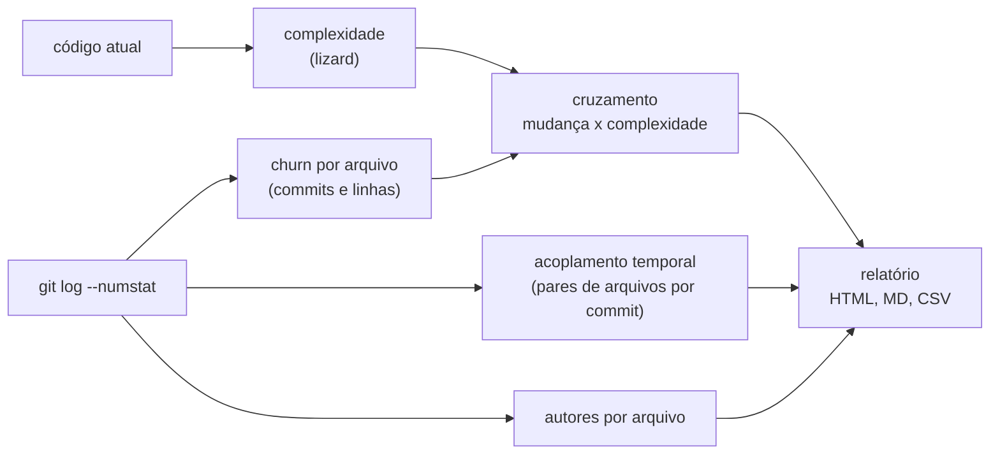
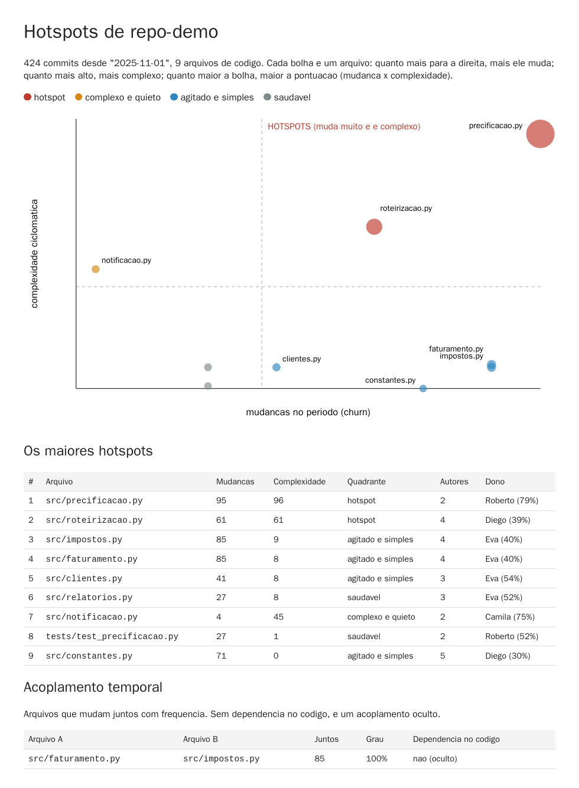

# Lab 8A: Diagnóstico de débito técnico por hotspots no histórico do Git

Aula prática da seção 8 (Modernização de Sistemas Legados), depois da aula 8.1.

| | |
|---|---|
| Aulas relacionadas | 8.1 (diagnóstico de sistemas legados: tipos de débito e sinais de alerta) |
| Ambiente | Código local (Git e Python), com Docker opcional |
| Ordem de estudo | Isolado. Alimenta a decisão de por onde começar nos labs 8B, 8C e 8D |

## Objetivo

Na aula 8.1 vimos o caso da LunaLog no ano três: o monólito original ainda existe, o onboarding leva três semanas e qualquer mudança no módulo de billing "quebra" algo aleatório em outro módulo. O diagnóstico revelou quatro tipos de débito ao mesmo tempo. A pergunta que vem depois é: **por onde começar?** Um sistema legado tem milhares de arquivos, e ninguém tem tempo de melhorar todos.

Neste lab você responde com dados, usando só o **histórico do repositório**: cruzando a **frequência de mudança** de cada arquivo (do Git) com a sua **complexidade** (cálculo estático). O código que **muda muito e é complexo** é onde o débito mais custa: é lá que o time paga os juros todo dia. O código complexo que ninguém toca é só um risco adormecido, e o que muda muito mas é simples costuma ser configuração. Você também descobre os arquivos que **mudam sempre juntos** sem se importarem (acoplamento oculto) e os que dependem de **uma pessoa só** (risco de conhecimento).

## O que você vai ver

- O **churn** (mudanças por arquivo) extraído do `git log`
- A **complexidade** por arquivo e o **cruzamento** dos dois, em quatro quadrantes
- O **acoplamento temporal**: arquivos que mudam juntos, sem dependência no código
- A **concentração de conhecimento**: quem faz a maior parte dos commits de cada arquivo
- Um **relatório visual** (HTML) e tabelas (Markdown e CSV)
- **Como rodar no repositório do próprio aluno**

## O método



Quatro quadrantes, a partir de um limite de 40% do valor máximo (ajustável em `--limite`):

| Quadrante | Muda muito | É complexo | O que fazer |
|---|---|---|---|
| **hotspot** | sim | sim | prioridade: é onde o débito custa mais |
| complexo e quieto | não | sim | risco adormecido; deixe em paz, a menos que precise mexer |
| agitado e simples | sim | não | geralmente configuração ou cola; olhe o acoplamento |
| saudável | não | não | nada a fazer |

## Pré-requisitos

- Docker Engine ou Docker Desktop (para rodar sem instalar nada), **ou** Python 3.12 e Git locais com `pip install lizard`
- Um repositório Git com histórico (o lab gera um de demonstração)

## Como executar

Na pasta deste lab:

```bash
docker compose build
docker compose run --rm analise python gerar_repositorio.py
docker compose run --rm analise python hotspots.py /dados/repo-demo --desde 2025-11-01
```

(No Git Bash do Windows, prefixe com `MSYS_NO_PATHCONV=1`, para o caminho `/dados/...` não ser reescrito.)

### Passo 1: o repositório de demonstração

O primeiro comando cria um repositório com **424 commits em um ano**, de cinco pessoas, e **padrões plantados de propósito** (veja o comentário no início de `scripts/gerar_repositorio.py`). A análise tem de descobri-los, sem saber de antemão.

### Passo 2: a análise

```
424 commits, 9 arquivos analisados (limites: 38 mudancas e complexidade 38, ou seja, 40% do maximo)

 # arquivo                    mudancas complex.  quadrante          autores  dono
 1 src/precificacao.py              95       96  hotspot                  2  Roberto (79%)
 2 src/roteirizacao.py              61       61  hotspot                  4  Diego (39%)
 3 src/impostos.py                  85        9  agitado e simples        4  Eva (40%)
 4 src/faturamento.py               85        8  agitado e simples        4  Eva (40%)
 5 src/clientes.py                  41        8  agitado e simples        3  Eva (54%)
 6 src/relatorios.py                27        8  saudavel                 3  Eva (52%)
 7 src/notificacao.py                4       45  complexo e quieto        2  Camila (75%)
 8 tests/test_precificacao.py       27        1  saudavel                 2  Roberto (52%)
 9 src/constantes.py                71        0  agitado e simples        5  Diego (30%)

Acoplamento temporal:
  src/faturamento.py <-> src/impostos.py: juntos em 85 commits (100%); dependencia no codigo: NAO (oculto)
```

O que observar, arquivo a arquivo:

- **`precificacao.py`**: 95 mudanças e complexidade 96. É o **hotspot** número um: o arquivo onde mais se mexe e o mais difícil de mexer. E 79% dos commits são de **uma pessoa só** (o Roberto): se ele sair, o conhecimento sai junto. É o primeiro candidato a refatorar ou extrair, e a primeira pessoa com quem conversar.
- **`roteirizacao.py`**: o segundo hotspot, mais distribuído entre os autores.
- **`notificacao.py`**: complexidade 45, mas só **4 mudanças** em um ano. É o "complexo e quieto". A tentação é reescrever por ser feio. Os dados dizem: **deixe em paz**. Refatorar o que ninguém muda é custo sem retorno.
- **`constantes.py`**: **71 mudanças**, complexidade zero. É configuração. Muita mudança, nenhum débito de código (talvez um sinal de que a configuração deveria sair do código).
- **`faturamento.py` e `impostos.py`**: simples, mas mudam **juntos em 100% dos commits (85)** e **um não importa o outro**. É acoplamento temporal **oculto**: a regra de impostos e a de faturamento são, na prática, uma só, e quem muda uma esquece a outra. Nenhuma ferramenta de dependência de código acharia isso.

### Passo 3: o relatório visual

Abra `saida/relatorio.html` no navegador:



Cada bolha é um arquivo; quanto mais à direita, mais ele muda; quanto mais alta, mais complexo; quanto maior, maior a pontuação (mudança × complexidade). As linhas pontilhadas separam os quadrantes. O canto superior direito é o dos hotspots. Passe o mouse sobre uma bolha para ver os números. Os mesmos dados estão em `saida/hotspots.md` (tabelas para colar em uma discussão) e `saida/hotspots.csv` (para abrir em uma planilha).

### Passo 4: a janela de tempo importa

O histórico antigo pode mentir: um arquivo que era um hotspot há dois anos pode estar calmo hoje. Analise só os últimos três meses:

```bash
docker compose run --rm analise python hotspots.py /dados/repo-demo --desde "3 months ago" --saida /tmp/recente
```

A lista muda: o `precificacao.py` continua em primeiro (28 mudanças recentes), e o `notificacao.py` some (nenhuma mudança no período). (O repositório de demonstração termina poucos dias antes do dia em que você roda o lab, então a janela de "3 meses atrás" funciona em qualquer data; os números dessa janela podem variar em uma ou duas mudanças.) **O período é uma decisão**: use janelas curtas (3 a 6 meses) para priorizar a próxima iniciativa e longas (12 meses ou mais) para entender a história.

### Passo 5: no repositório do aluno

Monte o seu repositório (somente leitura) e aponte o script para ele:

```bash
docker compose run --rm -v "/caminho/do/seu/repo:/alvo:ro" analise python hotspots.py /alvo --desde "12 months ago" --ext py,js,ts,java --ignorar tests/,docs/,node_modules/
```

Dicas de leitura dos resultados:

1. Comece pelos **3 primeiros hotspots**. Não tente consertar a lista inteira.
2. Para cada um, pergunte: **por que muda tanto?** (regra de negócio instável, falta de modularidade, uma classe que faz de tudo?)
3. Olhe a coluna **dono**: um hotspot de uma pessoa só é uma urgência dupla.
4. Veja o **acoplamento temporal**: pares de arquivos sem dependência no código são candidatos a unir (ou a separar de verdade).
5. Ignore o que é gerado ou de terceiros (`--ignorar`) e os commits em massa (o script já ignora commits com mais de 15 arquivos no acoplamento).

## Resultados de referência

| Medida | Resultado |
|---|---|
| Histórico gerado | 424 commits, 5 autores, 9 arquivos de código |
| Hotspots encontrados | `precificacao.py` (95 mudanças, complexidade 96) e `roteirizacao.py` (61 e 61) |
| Complexo e quieto | `notificacao.py` (4 mudanças, complexidade 45) |
| Agitado e simples | `constantes.py` (71 mudanças, complexidade 0) e outros |
| Acoplamento oculto | `faturamento.py` e `impostos.py`: 85 commits juntos (100%), sem dependência no código |
| Concentração de conhecimento | `precificacao.py`: 79% dos commits de uma pessoa |
| Janela de 3 meses | `notificacao.py` sai da lista; `precificacao.py` segue em primeiro |

## Como limpar

```bash
docker compose down -v
```

Remove o volume com o repositório de demonstração. Os relatórios ficam em `saida/` (ignorada pelo Git).

## Estrutura da pasta

```
lab-8a_hotspots-diagnostico-de-debito/
  README.md
  Dockerfile, docker-compose.yml
  scripts/
    gerar_repositorio.py       (histórico de demonstração, com padrões plantados)
    hotspots.py                (a análise: churn, complexidade, acoplamento, autores, relatórios)
  docs/relatorio.png           (captura do relatório)
  saida/                       (relatório gerado)
```

## Limites deste lab

- A **complexidade** usada é a ciclomática do código **atual** (via `lizard`). Ela não vê a complexidade conceitual (um módulo com regras de negócio obscuras, mas com poucos desvios). Para um arquivo grande, a quantidade de linhas também pesa; o script mostra `nloc` no CSV.
- O **churn** conta commits, não esforço nem valor. Um arquivo com muitas mudanças pode ser só "um lugar onde todo mundo registra algo" (uma tabela de rotas, um arquivo de tradução). Interprete com o time.
- **Renomeações e extrações** quebram o histórico de um arquivo (o `--no-renames` do script trata cada caminho separadamente). Em um repositório que mudou muito de estrutura, o histórico fica fragmentado.
- O **acoplamento temporal** é uma heurística: arquivos que mudam juntos por acaso (um commit enorme) geram falsos positivos, e a checagem de dependência é um simples "o nome do módulo aparece no outro".
- A análise **aponta onde olhar**, não **o que fazer**. A decisão de reescrever, refatorar ou substituir é da aula 8.2.
- O histórico do lab é **sintético**, com padrões plantados. Em um repositório real, os padrões são mais ruidosos e pedem leitura crítica.
- Dados de autoria em repositórios reais são **dados pessoais**: use-os para entender o risco de conhecimento, não para avaliar pessoas.

## Para pensar

1. Quais são os 3 maiores hotspots do seu sistema? Já existe algum plano para eles, ou eles são "conhecidos e tolerados"?
2. Há no seu repositório um arquivo complexo e quieto que o time tem vontade de reescrever? O que os dados dizem sobre o retorno disso?
3. Quais pares de arquivos mudam sempre juntos no seu sistema sem dependência explícita? O que isso revela sobre a modelagem?
4. Quantas pessoas conseguem alterar, com segurança, o seu maior hotspot hoje?
