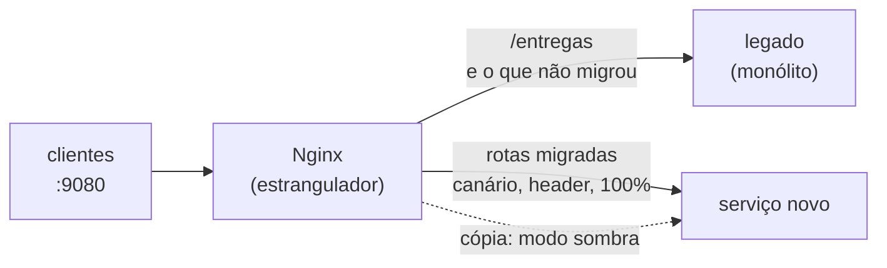

# Lab 8B: Strangler Fig com proxy - migrando rota a rota

Aula prática da seção 8 (Modernização de Sistemas Legados), depois da aula 8.3.

| | |
|---|---|
| Aulas relacionadas | 8.3 (Strangler Fig: migrando sistemas em produção sem downtime) |
| Ambiente | Docker Compose |
| Ordem de estudo | Trilha Modernização do legado, passo 1 de 4 (continua nos labs 8C, 8D e 9C) |

## Objetivo

Na aula 8.3 vimos o padrão Strangler Fig: colocar um proxy na frente do sistema legado e migrar funcionalidade por funcionalidade para o sistema novo, sem parar o negócio e sem "big bang". Neste lab você faz isso com um monólito legado e um serviço novo de verdade, atrás de um Nginx: migra uma rota por canário, testa outra em modo sombra, vê o rollback ser uma linha de configuração e acompanha o legado perder tráfego.

O cenário é o da LunaLog: o monólito de 2021 atende cotação, clientes, entregas e relatórios. O serviço novo assume essas rotas aos poucos, de forma invisível para as transportadoras.

## O que você vai ver

- Um proxy na frente do legado, **transparente**: nada muda para o cliente
- **Migração rota a rota**: `/cotacao`, `/clientes` e `/relatorios` vão para o serviço novo, `/entregas` fica no legado
- **Canário**: 20% das chamadas de uma rota vão para o novo, o resto continua no legado
- **Header `X-Beta`**: a equipe testa o novo em produção, antes de abrir para os clientes
- **Modo sombra** (shadow traffic): o novo recebe uma cópia do tráfego real, sem que o cliente seja afetado
- **Rollback** em uma linha de configuração e um `reload`
- **Progresso da migração** medido pelo tráfego que o legado ainda recebe, por rota

## Arquitetura do lab



- O **proxy** em http://localhost:9080 é o único endereço que os clientes conhecem.
- O **legado** está exposto também em http://localhost:9081 e o **novo** em http://localhost:9082, apenas para você consultar as estatísticas de cada um (`/estatisticas`).
- A **tabela de migração** é o arquivo `nginx/rotas.conf`.

## Pré-requisitos

- Docker Engine ou Docker Desktop com Compose v2
- Cerca de 1 GB de RAM livre
- Portas 9080, 9081 e 9082 livres

## Como executar

Na pasta deste lab:

```bash
docker compose up -d --build
```

Para aplicar qualquer mudança em `nginx/rotas.conf` ou em `nginx/sombra-clientes.conf`, salve o arquivo e recarregue o Nginx (sem derrubar nada):

```bash
docker compose exec proxy nginx -s reload
```

### Passo 0: o proxy é transparente

```bash
curl -si "localhost:9080/cotacao?peso_kg=10&distancia_km=100"
curl -s localhost:9080/clientes/C-1
curl -s localhost:9080/entregas/E-100
curl -s localhost:9080/relatorios/mensal
```

O que observar: todas as respostas vêm do legado (o campo `servico` e o header `X-Destino` dizem `legado`). O proxy não muda nada para o cliente. É o primeiro passo do Strangler Fig, e já tem valor: a partir daqui, qualquer rota pode ser desviada sem que o cliente perceba.

Veja a estatística do legado:

```bash
curl -s localhost:9081/estatisticas
```

Ele conta as chamadas recebidas por rota. Esse é o medidor do progresso da migração.

### Passo 1: modo sombra em `/clientes`

A rota `/clientes` já começa em modo sombra: o legado responde ao cliente, e o Nginx envia **uma cópia** de cada chamada ao serviço novo, cuja resposta é descartada (`sombra-clientes.conf`). Faça algumas chamadas e compare:

```bash
for i in 1 2 3; do curl -s -o /dev/null localhost:9080/clientes/C-1; done
curl -s localhost:9081/estatisticas
curl -s localhost:9082/estatisticas
```

```powershell
1..3 | ForEach-Object { curl.exe -s -o NUL localhost:9080/clientes/C-1 }
```

O que observar: o legado contou as chamadas, e o novo também, marcadas como `(sombra)`. Veja também `docker compose logs novo`: as linhas dizem que são cópias do tráfego. O serviço novo está sendo testado com tráfego **real**, sem nenhum risco para o cliente: se ele errar, ninguém vê. Quando as respostas da sombra se mostram corretas por tempo suficiente, a rota está pronta para o canário.

### Passo 2: canário em `/cotacao`

Em `nginx/rotas.conf`, no bloco `$cotacao_pct`, remova o `#` da linha `#20%    novo;`. Fica assim:

```nginx
split_clients "${request_id}" $cotacao_pct {
    20%    novo;
    *      legado;
}
```

Recarregue o Nginx e conte para onde vão 100 chamadas:

```bash
for i in $(seq 1 100); do curl -si "localhost:9080/cotacao?peso_kg=1&distancia_km=1" | grep -i x-destino; done | sort | uniq -c
```

```powershell
1..100 | ForEach-Object { (curl.exe -s -D - -o NUL "localhost:9080/cotacao?peso_kg=1&distancia_km=1" | Select-String 'X-Destino').Line } | Group-Object | Select-Object Count, Name
```

O que observar: cerca de 20% das chamadas (uma variação em torno de 20) vão para `novo`; o resto, para `legado`. O cliente não sabe qual atendeu, porque o contrato é o mesmo (`frete` com o mesmo valor). Aumente o percentual aos poucos (20%, 50%, 100%), observando o serviço novo a cada passo.

### Passo 3: testar em produção com `X-Beta`

Com o canário em 20%, force o serviço novo com o header:

```bash
curl -si -H "X-Beta: 1" "localhost:9080/cotacao?peso_kg=10&distancia_km=100"
```

O que observar: com `X-Beta: 1`, **100%** das chamadas vão para o novo, independentemente do percentual. A equipe pode validar o novo em produção, com dados reais, antes de abri-lo para os clientes.

### Passo 4: 100% e rollback

Para migrar tudo: troque `*      legado;` por `*      novo;` no bloco de `/cotacao` (e deixe a linha `20%` comentada). Recarregue e confirme que todas as chamadas vão para `novo`.

Agora, o rollback. Suponha que o serviço novo apresentou um problema em produção. Desfaça a mudança (volte para `*      legado;`) e recarregue:

```bash
docker compose exec proxy nginx -s reload
```

O que observar: logo depois do `reload`, todo o tráfego volta para o legado (o `reload` é gracioso: os processos antigos do Nginx terminam o que já atendiam, então espere cerca de 1 segundo antes de contar de novo; no ensaio, sem essa espera, 3 de 10 chamadas ainda foram ao serviço novo). **O rollback é uma linha de configuração.** Isso é possível porque o legado continua intacto e funcionando durante toda a migração: ele só é desligado quando a última rota migra, e não antes.

### Passo 5: o que falta migrar

Migre `/relatorios` do mesmo jeito (bloco `$relatorios_pct`) e `/clientes` (bloco `$clientes_pct`, e apague a linha do `sombra-clientes.conf` para parar de copiar o tráfego). **Migre também a `/cotacao` de novo** (`*      novo;`): depois do rollback do passo anterior, ela voltou ao legado. Consulte as estatísticas do legado antes das mudanças e depois delas:

```bash
curl -s localhost:9081/estatisticas
```

Faça chamadas a todas as rotas e repita. O que observar: o legado só continua recebendo `/entregas`. A rota `/entregas` ainda não pode migrar: o modelo dela é cheio de resquícios do passado (status numérico, data em `dd/mm/aaaa`, valor com vírgula) e o serviço novo não tem como assumi-la sem herdar esse modelo. Esse é o assunto do próximo lab, a camada anticorrupção.

## Como limpar

```bash
docker compose down -v
```

Se você alterou `nginx/rotas.conf`, desfaça as alterações (comente de novo a linha `20%` e volte `* legado;`) antes de repetir o lab.

## Estrutura da pasta

```
lab-8b_strangler-fig-com-proxy/
  README.md
  docker-compose.yml
  servicos/
    legado.py              (o monólito, com estatísticas por rota)
    novo.py                (o serviço novo; ainda sem /entregas)
    Dockerfile
  nginx/
    nginx.conf             (rotas, header X-Destino, modo sombra)
    rotas.conf             (TABELA DE MIGRAÇÃO: o arquivo que você edita)
    sombra-clientes.conf   (liga e desliga a cópia do tráfego de /clientes)
```

## Limites deste lab

- As respostas do legado e do novo são iguais por construção. Em uma migração real, o modo sombra deve **comparar** as respostas e registrar as divergências. Isso costuma ser feito com um serviço comparador ou com ferramentas de teste de tráfego. Aqui a sombra mostra apenas que o novo recebe e processa o tráfego.
- A divisão por percentual usa o identificador da requisição, então a mesma pessoa pode cair em destinos diferentes entre uma chamada e outra. Para uma experiência estável por usuário, a divisão deve usar um identificador de sessão ou de cliente.
- O Nginx serve de estrangulador por simplicidade. Na prática, esse papel costuma ser de um API Gateway, de um balanceador de carga com pesos por destino ou de uma malha de serviços.
- Rotas que escrevem dados (POST, PUT) exigem cuidado extra: legado e novo precisam concordar sobre a fonte da verdade dos dados. Esse é o assunto do lab 8D.
- Em produção, observe cada passo da migração com os sinais da seção 6: taxa de erro, latência e saturação do serviço novo, comparados ao legado.

## Para pensar

1. O legado só pode ser desligado quando a última rota migrar. O que faz muitas empresas nunca desligarem o legado, e como você evitaria isso?
2. Qual rota você migraria primeiro no seu sistema e por quê? (Pense em risco, valor e independência de dados.)
3. O modo sombra não afeta o cliente, mas afeta o serviço novo e as dependências dele. Que cuidados você teria com rotas que fazem escrita?
4. O header `X-Beta` permite testar em produção. Quem deveria poder enviar esse header, e como impedir que clientes comuns o usem?
