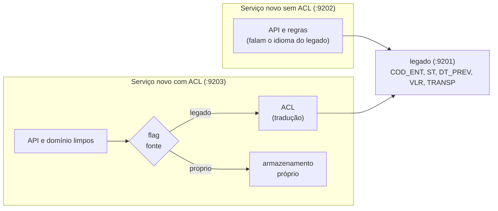

# Lab 8C: Anti-corruption layer e Branch by Abstraction

Aula prática da seção 8 (Modernização de Sistemas Legados), depois da aula 8.4.

| | |
|---|---|
| Aulas relacionadas | 8.4 (Anti-corruption Layer e Branch by Abstraction) |
| Ambiente | Docker Compose (Python, FastAPI, pytest) |
| Ordem de estudo | Trilha Modernização do legado, passo 2 de 4 (continua o lab 8B; segue para os labs 8D e 9C) |

## Objetivo

Na aula 8.4 vimos que um sistema novo com modelo de domínio limpo, ao conviver com um legado de 40 tabelas de 2021, corre o risco de ser **contaminado** pelo modelo antigo: o time acaba replicando no sistema novo as mesmas estruturas que queria abandonar. A defesa é a **Anti-corruption Layer** (ACL): uma camada de tradução que protege o domínio novo. E, para trocar o legado pelo sistema novo sem um big bang, o padrão **Branch by Abstraction**: esconder a fonte de dados atrás de uma interface, construir a nova implementação por trás dela e trocar por uma flag.

Neste lab você vê o problema acontecer (um serviço novo sem ACL, contaminado), vê a ACL resolvê-lo, vê o legado mudar de formato sem quebrar o serviço protegido e faz a troca de fonte com paridade comprovada e rollback instantâneo. O legado é o mesmo estilo do lab 8B (nomes crípticos, status numérico, datas e valores em formatos mistos).

## O que você vai ver

- O **legado** devolvendo campos crípticos, status numéricos e datas e valores em **formatos mistos**
- O **serviço novo sem ACL**: o domínio novo herda os nomes, os códigos e os formatos do legado, e **quebra** quando o legado muda
- O **serviço novo com ACL**: traduz nos **dois sentidos**, isola o domínio, e **falha de forma clara** diante de um dado que não sabe traduzir
- **Branch by Abstraction**: uma interface, duas implementações (legado e própria), escolhidas por uma **flag**
- **Testes de contrato** e de **paridade**: a prova de que a nova implementação devolve o mesmo que o legado
- O roteiro de **remoção** da implementação antiga

## Arquitetura do lab



- O **legado** (`legado/legado.py`) guarda e devolve o modelo antigo. Um interruptor (`POST /admin/formato?modo=novo`) o faz mudar de formato, simulando uma alteração do time do legado.
- O **serviço sem ACL** (`novo/sem_acl.py`) é a versão ingênua: usa o modelo do legado direto.
- O **serviço com ACL** (`novo/com_acl/`) tem o domínio limpo (`dominio.py`), a tradução em um só lugar (`acl.py`) e a abstração com duas implementações (`fonte.py`).

## Pré-requisitos

- Docker Engine ou Docker Desktop (Compose v2)
- Cerca de 1 GB de RAM livre
- As portas 9201, 9202 e 9203 livres (as 9080 a 9082 são do lab 8B)

## Como executar

Na pasta deste lab:

```bash
docker compose up -d --build
curl -s localhost:9201/entregas/E-2
```

### Cenário 1: o legado e o modelo antigo

Consulte as seis entregas do legado (`E-1` a `E-6`) e repare nas diferenças entre elas:

```bash
for i in 1 2 3 4 5 6; do curl -s localhost:9201/entregas/E-$i; echo; done
```

```
{"COD_ENT": "E-2", "ST": 2, "DT_PREV": "04/11/2026", "VLR": "1.250,50", "TRANSP": "VELOZ EXPRESS S/A"}
{"COD_ENT": "E-3", "ST": 1, "DT_PREV": "2026-11-05", "VLR": "89.9", "TRANSP": "TRANSRAPIDA LTDA"}
{"COD_ENT": "E-4", "ST": 9, "DT_PREV": "06/11/2026", "VLR": 45, "TRANSP": "LOG BOREAL ME"}
{"COD_ENT": "E-5", "ST": "2", ...
```

O que observar: nomes crípticos (`ST`, `VLR`), status **numérico** (e às vezes texto: `"2"`), datas em **dois formatos** (`04/11/2026` e `2026-11-05`), valores com **vírgula**, com **ponto** e até **numérico**, e a transportadora como um texto em maiúsculas com sufixo societário. Cada diferença dessas, se for parar no sistema novo, vira código de tratamento espalhado.

### Cenário 2: o serviço novo sem ACL

```bash
curl -s localhost:9202/entregas/E-2
```

```
{"COD_ENT":"E-2","ST":2,"DT_PREV":"04/11/2026","VLR":"1.250,50","TRANSP":"VELOZ EXPRESS S/A","atrasada":false,"valor_reais":1250.5}
```

Funciona, e é exatamente o problema: o serviço "novo" **devolve o modelo do legado** (`COD_ENT`, `ST`, `VLR`). Abra `novo/sem_acl.py` e procure as marcas `[C]` (contaminação): a regra de "atrasada" usa `int(d["ST"]) == 2` (o código numérico do legado), o formato de data `dd/mm/aaaa` e a vírgula decimal estão **dentro das regras de negócio**. Os consumidores do serviço novo também passam a depender do vocabulário do legado, e ele não pode ser abandonado sem quebrá-los.

Agora o legado muda de formato (o time dele passou a devolver status em texto, data ISO e valor com ponto):

```bash
curl -s -X POST "localhost:9201/admin/formato?modo=novo"
curl -s -w ' http=%{http_code}\n' localhost:9202/entregas/E-2        # Internal Server Error
```

O serviço novo **quebra** (`500`): ele assumia os formatos antigos. A mudança de um sistema que o time novo nem controla derrubou o sistema que ele deveria ter protegido.

### Cenário 3: o serviço novo com ACL

Com o legado ainda no modo novo:

```bash
curl -s localhost:9203/entregas/E-2
```

```
{"id":"E-2","status":"em_rota","previsao":"2026-11-04","valor":{"centavos":125050,"moeda":"BRL"},
 "transportadora":{"id":"veloz","nome":"Veloz Express"},"atrasada":false,"fonte":"legado"}
```

O serviço **continua funcionando**, e a resposta é o modelo **limpo**: `status` como texto claro, `previsao` em ISO, `valor` em centavos (inteiro, para não errar com ponto flutuante), `transportadora` como objeto. Volte o legado ao formato antigo (`curl -s -X POST "localhost:9201/admin/formato?modo=antigo"`) e repita: o resultado é **idêntico**. A ACL absorveu as duas versões.

Abra `novo/com_acl/acl.py`. É o **único** arquivo que conhece o legado: o mapa de status (`1`, `"2"`, `"EM_ROTA"` viram o mesmo `em_rota`), os dois formatos de data, os valores (`"1.250,50"`, `"89.9"`, `45`), os nomes de transportadora. O `dominio.py` não importa nada do legado, e nenhuma das suas regras mudou.

A ACL traduz também no **sentido contrário**. Registre uma entrega pelo serviço novo, no modelo limpo:

```bash
curl -s -X POST localhost:9203/entregas -H 'Content-Type: application/json' \
  -d '{"id":"E-7","status":"em_rota","previsao":"2026-12-24","valor_centavos":123456,"transportadora_id":"boreal"}'
curl -s localhost:9201/ultima-escrita
```

```
{"COD_ENT": "E-7", "ST": 2, "DT_PREV": "24/12/2026", "VLR": "1234,56", "TRANSP": "LOG BOREAL ME"}
```

O legado recebeu **no idioma dele**. Durante a coexistência, o serviço novo escreve no modelo limpo e a ACL "fala legado" por ele.

E quando o legado devolve algo que a ACL **não sabe traduzir**? Grave um status inexistente direto no legado:

```bash
curl -s -X POST localhost:9201/entregas -H 'Content-Type: application/json' \
  -d '{"COD_ENT":"E-8","ST":7,"DT_PREV":"01/12/2026","VLR":"10,00","TRANSP":"VELOZ EXPRESS S/A"}'
curl -s -w ' http=%{http_code}\n' localhost:9203/entregas/E-8
```

A resposta é um `502` com a mensagem `o legado devolveu algo que a ACL nao sabe traduzir: status desconhecido no legado: 7`. A ACL **falha de forma clara e na fronteira**, em vez de deixar um dado estranho entrar no domínio e causar um erro obscuro três camadas depois.

### Cenário 4: Branch by Abstraction

Veja `novo/com_acl/fonte.py`. O serviço novo só depende de `FonteDeEntregas` (obter e salvar), e há duas implementações: `FonteLegado` (lê e escreve no legado pela ACL) e `FontePropria` (o armazenamento do serviço novo; aqui em memória, e no lab 8D, em um banco dedicado). Uma **flag** escolhe qual usar, em tempo de execução:

```bash
curl -s localhost:9203/admin/fonte                                  # {"fonte":"legado", ...}
curl -s localhost:9203/entregas/E-3 | grep -o '"fonte":"[a-z]*"'    # legado
curl -s -X POST localhost:9203/admin/fonte -H 'Content-Type: application/json' -d '{"fonte":"proprio"}'
curl -s localhost:9203/entregas/E-3 | grep -o '"fonte":"[a-z]*"'    # proprio
```

O resultado (campos, valores e atraso) é o mesmo nas duas fontes; só o campo `fonte` muda. A troca é **instantânea e reversível**: para voltar, `{"fonte":"legado"}`. Sem deploy, sem janela, com rollback de um comando.

Como saber que dá para trocar? Pelos **testes**:

```bash
docker compose --profile ferramentas run --rm testes
```

O que observar: `36 passed`. Entre eles:

- `test_acl.py`: a tradução, nos dois sentidos, com todos os formatos mistos, e as falhas claras
- `test_dominio.py`: as regras de negócio, **sem nenhuma menção ao legado**
- `test_contrato_fonte.py`: a mesma bateria contra **as duas** implementações, e os testes de **paridade** (`FonteLegado.obter(id) == FontePropria.obter(id)` para as seis entregas, inclusive quando o legado muda de formato)

A paridade comprovada é o critério para virar a flag em produção.

### O roteiro de remoção (a quarta etapa do padrão)

Branch by Abstraction tem quatro etapas, e o lab mostrou as três primeiras:

1. **Introduzir a abstração:** todo o código passa a usar `FonteDeEntregas` (feito: `main.py` só conhece a interface).
2. **Construir a nova implementação** atrás da mesma interface (`FontePropria`) e provar a paridade (os testes).
3. **Trocar pela flag**, primeiro em ambientes de teste e depois em produção, observando; o rollback é voltar a flag (visto no cenário 4).
4. **Remover a implementação antiga:** quando a nova estiver estável em produção, apague `FonteLegado`, a ACL e a flag. O domínio, a API e os testes de negócio **não mudam**, porque nunca souberam do legado. (O lab deixa essa etapa como roteiro, para você conferir que `pytest tests/test_dominio.py` não depende da ACL.)

## Resultados de referência

| Medida | Resultado |
|---|---|
| Serviço sem ACL, legado no formato antigo | funciona, mas devolve o modelo do legado |
| Serviço sem ACL, legado muda de formato | `500` (quebra) |
| Serviço com ACL, legado muda de formato | `200`, resposta idêntica |
| Dado que a ACL não sabe traduzir | `502` com mensagem clara |
| Escrita pela ACL | o legado recebe `COD_ENT`, `ST`, `DT_PREV` (dd/mm/aaaa), `VLR` (vírgula) e `TRANSP` |
| Troca de fonte (legado para própria) | instantânea, mesma resposta, reversível |
| Testes | 36 passam (ACL, domínio, contrato e paridade) |

## Como limpar

```bash
docker compose down -v
```

## Estrutura da pasta

```
lab-8c_anti-corruption-layer-e-branch-by-abstraction/
  README.md
  docker-compose.yml, Dockerfile, pytest.ini
  legado/legado.py             (o legado: formatos mistos, interruptor de formato)
  novo/
    sem_acl.py                 (a versão contaminada, com marcas [C])
    com_acl/
      dominio.py               (o modelo limpo)
      acl.py                   (a tradução, único arquivo que conhece o legado)
      fonte.py                 (a abstração e as duas implementações)
      main.py                  (a API e a flag)
  tests/
    test_acl.py, test_dominio.py, test_contrato_fonte.py
```

## Limites deste lab

- O legado do lab é um serviço HTTP simples. Um legado real tem 40 tabelas, regras escondidas em procedures e dados sujos que a ACL precisa tratar um a um. A ACL cresce com o legado: mantenha-a **pequena, testada e isolada**.
- A ACL do lab é **tolerante** (aceita os dois formatos). Uma ACL real também precisa decidir **o que fazer com dados inválidos**: rejeitar, corrigir, enviar para uma fila de análise. A decisão é de negócio.
- A `FontePropria` do lab é em memória. A migração dos **dados** de verdade (backfill, dual-write, reconciliação) é o tema do lab 8D.
- O Branch by Abstraction aqui usa uma flag em memória. Em produção, a flag viria de um serviço de feature flags, com liberação gradual por usuário ou percentual (lab 9C).
- A "data de hoje" do domínio é fixa (`2026-11-02`) para os resultados serem repetíveis. Em produção, o relógio seria uma dependência injetada (como no lab 2E).
- O padrão de ACL pode ser implementado como biblioteca (como aqui), como serviço próprio (um *adapter* na frente do legado) ou como parte de um gateway. A escolha depende de quantos consumidores a precisam.
- Todos os dados são fictícios.

## Para pensar

1. Em que pontos do seu sistema novo (ou do que você está planejando) o vocabulário do legado já "vazou"? Quantos arquivos você precisaria mexer se o legado mudasse o formato de uma data?
2. A ACL falhou de forma clara diante de um status desconhecido. Em um sistema real, o que o negócio quer que aconteça com essa entrega?
3. Quanto tempo você deixaria a `FonteLegado` e a flag no código depois da troca? Que sinal diria que é hora de remover?
4. O que a paridade comprovada **não** garante? (Dica: carga, concorrência, dados que o legado nunca devolveu.)
