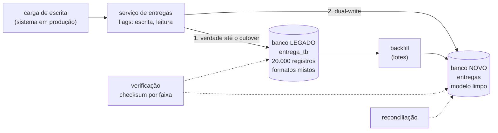

# Lab 8D: Migração de dados: backfill, dual-write e reconciliação

Aula prática da seção 8 (Modernização de Sistemas Legados), depois da aula 8.5.

| | |
|---|---|
| Aulas relacionadas | 8.5 (migração de dados: estratégias e o problema da compatibilidade) |
| Ambiente | Docker Compose (PostgreSQL com dois bancos, Python) |
| Ordem de estudo | Trilha Modernização do legado, passo 3 de 4 (continua o lab 8C; segue para o 9C). Retoma a tradução do 8C e o expand-contract do 5E |

## Objetivo

Na aula 8.5 vimos o caso da LunaLog: migrar os dados históricos de entrega do banco do monólito para o banco dedicado do novo serviço, com **dual-write** durante cinco semanas, validação de consistência antes do **cutover** e rollback imediato se a validação falhasse. O resultado foi zero perda de dados e zero downtime. Modernizar a aplicação sem migrar os dados é modernizar metade do sistema.

Neste lab você percorre o caminho inteiro em um banco legado com **20.000 registros** em formato antigo (e dados sujos), **sem parar o sistema**: copia o histórico (**backfill**), mede o que ficou para trás porque o sistema continua escrevendo, liga o **dual-write**, vê uma falha de escrita no banco novo virar divergência, **reconcilia**, migra o que sobrar sob demanda (**lazy migration**) e faz o **cutover** da leitura e depois da escrita, com **rollback** disponível em cada passo.

## O que você vai ver

- **Backfill** em lotes, idempotente, com uma **quarentena** para o que não pode ser traduzido
- A verificação de **contagem e checksum por faixa de ids**, e o efeito da **escrita concorrente**: o backfill, sozinho, nunca basta
- O **dual-write** mantendo os dois bancos iguais, e o que acontece quando uma das escritas **falha**
- A **reconciliação** que encontra e conserta as divergências
- A **migração preguiçosa** (lazy): migrar o que for lido
- O **cutover** em duas etapas (leitura e depois escrita) e o **rollback** em cada uma
- A **CDC** como alternativa ao dual-write (explicada; não executada)

## Arquitetura do lab



- O **legado** guarda tudo como texto, em formatos mistos (status numérico, data `dd/mm/aaaa` ou ISO, valor com vírgula ou ponto). Cerca de **2% dos registros são inválidos de propósito** (status inexistente, data `N/D`).
- O **novo** tem o modelo limpo e tipado, e uma tabela de **quarentena** para o que não migra.
- O **serviço** escreve e lê conforme **duas flags**: `escrita` (`legado`, `dupla`, `novo`) e `leitura` (`legado`, `novo`, `preguicosa`).
- A **tradução** (`app/traducao.py`) é a mesma ideia da ACL do lab 8C, agora aplicada em massa.

## Pré-requisitos

- Docker Engine ou Docker Desktop (Compose v2)
- Cerca de 1 GB de RAM livre
- A porta 9301 livre

## Como executar

Na pasta deste lab:

```bash
docker compose up -d --build
docker compose --profile ferramentas build migrador
curl -s localhost:9301/admin/flags            # {"escrita":"legado","leitura":"legado","falha_novo":false}
```

Os scripts de migração rodam no contêiner `migrador`. Para encurtar os comandos abaixo:

```bash
alias migrar='docker compose --profile ferramentas run --rm migrador python'
```

(Sem `alias`, use o comando por extenso. O contêiner `migrador` usa o mesmo código de tradução do serviço.)

### Passo 1: backfill com o sistema em produção

Em um terminal, inicie uma carga de escrita (40 escritas por segundo, por 15 s). Ela representa o sistema **em produção**: o legado não para durante a migração. Cerca de 3 segundos depois, em outro terminal, execute o backfill:

```bash
migrar carga.py 15 40          # terminal 1
migrar backfill.py             # terminal 2, uns 3 s depois
```

```
  lote ate E-020000: 20000 lidas, 19572 migradas, 428 em quarentena
backfill concluido em 0.7 s: 20036 lidas, 19608 migradas, 428 em quarentena
carga concluida em 15 s: 600 escritas ok (123 entregas novas), 0 erros
```

O que observar: o backfill copia em **lotes de 1.000**, com **upsert** (rodar de novo não duplica nem estraga), e os **428 registros inválidos** (cerca de 2%) vão para a **quarentena**, com o motivo, em vez de sumirem ou derrubarem a migração. Aqui são 0,7 segundo; com bilhões de linhas, seriam horas, e é por isso que o sistema não pode parar enquanto isso.

### Passo 2: verificar, e o que a escrita concorrente fez

```bash
migrar verificar.py --detalhe
```

```
legado: 20123 registros (19695 traduziveis, 428 invalidos)
novo:   19608 entregas, 428 na quarentena
faixas de 1.000 ids: 21, divergentes: 21
linhas: faltando no novo=87  diferentes=367  a mais no novo=0
RESULTADO: DIVERGENTE
```

O que observar: **as 21 faixas divergem.** Enquanto o backfill copiava, o sistema continuou escrevendo: 123 entregas novas (as que o backfill ainda não alcançou ou já tinha passado) e centenas de registros alterados depois de copiados. O backfill de uma tabela viva **nunca termina sozinho**. A verificação compara, por faixa de 1.000 ids, a **contagem** e um **checksum** do conteúdo traduzido (a forma canônica de cada registro); quando a faixa diverge, o detalhe aponta as linhas. Ela sai com código 1, para servir de verificação em um pipeline ou de plantão.

Primeiro corte do atraso, com um **backfill delta** (só o que mudou desde a última execução):

```bash
migrar backfill.py --delta
migrar verificar.py
```

O delta copia **595** registros (os alterados) e a verificação passa a `CONSISTENTE`. Mas só porque a carga parou. Enquanto o sistema escreve, o delta sempre ficará um passo atrás. É a hora do dual-write.

### Passo 3: dual-write

```bash
curl -s -X POST localhost:9301/admin/flags -H 'Content-Type: application/json' -d '{"escrita":"dupla"}'
migrar carga.py 8 40
migrar verificar.py
```

Com `escrita=dupla`, cada escrita grava no **legado primeiro** (ele continua sendo a verdade; se falhar, a requisição falha) e **depois no novo**. Resultado: 320 escritas com o sistema no ar, e a verificação diz `CONSISTENTE`: os dois bancos acompanham um ao outro.

Veja `app/api.py`, a função `gravar`, o ramo `dupla`: se a escrita no **novo** falhar, a requisição **não** falha: a divergência vai para a `fila_reparo`. Para ver isso acontecer, simule uma falha no banco novo:

```bash
curl -s -X POST localhost:9301/admin/flags -H 'Content-Type: application/json' -d '{"falha_novo":true}'
migrar carga.py 4 40
curl -s -X POST localhost:9301/admin/flags -H 'Content-Type: application/json' -d '{"falha_novo":false}'
migrar verificar.py
```

O que observar: a carga termina com **0 erros** (o cliente não percebeu nada), e a verificação aponta `RESULTADO: DIVERGENTE`: os registros escritos durante a falha estão corretos no legado e **desatualizados ou ausentes no novo**. Este é o risco do dual-write: **duas escritas não são atômicas**. Uma pode dar certo e a outra, não, e sem um mecanismo de reparo o desvio é silencioso.

### Passo 4: reconciliação

```bash
migrar reconciliar.py
migrar verificar.py
```

```
reconciliacao: 160 registros reparados no novo; fila de reparo tinha 160 itens (agora vazia)
...
RESULTADO: CONSISTENTE
```

O job compara linha a linha, regrava no novo o que falta ou difere (a **verdade** até o cutover é o legado) e esvazia a fila de reparo. Em produção, ele roda **continuamente** (de hora em hora, ou a cada ciclo) durante as semanas de coexistência, e o seu relatório de divergências é o **critério de saída**: o cutover só acontece depois de dias seguidos com zero divergência.

### Passo 5: migração preguiçosa (lazy)

Alguns dados podem ficar sem backfill (porque são raramente lidos) e ser migrados **quando alguém os consultar**. Simule uma ausência apagando cinco registros do banco novo e leia por um deles:

```bash
docker compose exec -T postgres psql -U luna -d novo -c "DELETE FROM entregas WHERE id BETWEEN 'E-000010' AND 'E-000014'"
curl -s -X POST localhost:9301/admin/flags -H 'Content-Type: application/json' -d '{"leitura":"novo"}'
curl -s localhost:9301/entregas/E-000012                      # 404: o novo não tem
curl -s -X POST localhost:9301/admin/flags -H 'Content-Type: application/json' -d '{"leitura":"preguicosa"}'
curl -s localhost:9301/entregas/E-000012                      # fonte: "legado (migrada agora)"
curl -s localhost:9301/entregas/E-000012                      # fonte: "novo"
```

Na primeira leitura em modo `preguicosa`, o serviço não acha no novo, busca no legado, **traduz, grava no novo** e devolve; na segunda, já vem do novo. Para um registro inválido, a resposta é um `422` claro (`registro no legado nao pode ser migrado`), em vez de um erro genérico. Os outros quatro apagados continuam ausentes do novo: **rode `migrar reconciliar.py` antes do Passo 6** para repará-los. Sem isso, a verificação do cutover dá `DIVERGENTE` (`faltando no novo=4`).

### Passo 6: cutover da leitura e depois da escrita

O cutover é feito em **duas etapas**, cada uma com rollback:

```bash
# 1. Leitura: passa a servir do novo
curl -s -X POST localhost:9301/admin/flags -H 'Content-Type: application/json' -d '{"leitura":"novo"}'
migrar verificar.py          # CONSISTENTE: a leitura do novo devolve o mesmo que o legado

# 2. Escrita: o novo passa a ser a verdade; o legado recebe uma cópia
curl -s -X POST localhost:9301/admin/flags -H 'Content-Type: application/json' -d '{"escrita":"novo"}'
migrar carga.py 6 40
migrar verificar.py          # CONSISTENTE: o legado continua recebendo cópia
docker compose exec -T postgres psql -U luna -d novo -c "SELECT origem, count(*) FROM entregas GROUP BY origem ORDER BY 2 DESC"
```

O que observar:

- Na **leitura** pelo novo, o `curl` mostra `"fonte":"novo"`, e a verificação confirma a paridade **antes** de mandar usuários para lá.
- Na **escrita** pelo novo, as linhas ganham a origem `novo-primario`. O backfill e a reconciliação **não sobrescrevem** essas linhas (a cláusula `WHERE origem <> 'novo-primario'` do upsert), porque a partir daqui o novo é a verdade. O **legado ainda recebe uma cópia** de cada escrita, o que mantém o **rollback** possível: se o novo apresentar problemas, volta-se à escrita no legado, que está atualizado.
- O **rollback** é só mudar as flags de volta:

```bash
curl -s -X POST localhost:9301/admin/flags -H 'Content-Type: application/json' -d '{"escrita":"dupla","leitura":"legado"}'
```

Só quando o novo estiver estável (semanas), desliga-se a cópia para o legado e se aposenta o banco antigo.

### Alternativa ao dual-write: CDC

O dual-write tem um problema estrutural: as duas escritas ficam **no código da aplicação** e não são atômicas. A alternativa é o **CDC (Change Data Capture)**: uma ferramenta (por exemplo, o **Debezium**) lê o **log de transações** do banco legado e publica cada mudança em um fluxo (Kafka), de onde um consumidor atualiza o banco novo. Vantagens: **não altera a aplicação legada**, captura inclusive as escritas feitas por fora dela (jobs, scripts, DBAs), e preserva a ordem das mudanças. Custos: uma infraestrutura a mais (Kafka e o conector), a tradução de esquema em um consumidor e a atenção ao **atraso** (consistência eventual). Esta parte **não é executada neste lab**; o desenho (backfill, verificação, reconciliação, cutover) é exatamente o mesmo: o CDC apenas substitui a etapa do dual-write.

## Resultados de referência

Valores medidos em Docker Desktop (Windows 11, WSL2).

| Passo | Resultado |
|---|---|
| Legado | 20.000 registros; 428 inválidos (cerca de 2%) |
| Backfill sob carga de escrita | 0,7 s; 19.608 migrados e 428 em quarentena |
| Verificação logo após o backfill | 21 faixas de 21 divergentes (87 faltando e 367 diferentes) |
| Backfill delta | 595 registros; `CONSISTENTE` com a carga parada |
| Dual-write ligado, 320 escritas | `CONSISTENTE` |
| Falha de escrita no novo, 160 escritas | cliente sem erros; `DIVERGENTE` (160 linhas) |
| Reconciliação | 160 reparados; fila vazia; `CONSISTENTE` |
| Leitura preguiçosa | `legado (migrada agora)` e depois `novo`; inválido dá `422` |
| Cutover da leitura e da escrita | `CONSISTENTE` nas duas etapas; origem `novo-primario` protegida |
| Rollback | uma chamada de flags |

## Como limpar

```bash
docker compose down -v
```

## Estrutura da pasta

```
lab-8d_migracao-de-dados-dual-write/
  README.md
  docker-compose.yml
  db/init.sql                  (dois bancos; o legado com 20.000 registros sujos)
  app/
    api.py                     (o serviço: flags de escrita e leitura, dual-write, leitura preguiçosa)
    traducao.py                (legado <-> novo)
  scripts/
    backfill.py                (cópia em lotes, idempotente, com quarentena e modo --delta)
    verificar.py               (contagem e checksum por faixa de ids)
    reconciliar.py             (repara o novo a partir do legado)
    carga.py                   (escrita contínua, o "sistema em produção")
    comum.py
```

## Limites deste lab

- O volume é pequeno (20.000 linhas, 0,7 s). Em um banco real, o backfill leva horas ou dias, precisa de **limitação de taxa** para não sufocar o legado, de pontos de retomada e de monitoramento de progresso.
- A verificação compara o **banco inteiro** em memória, o que só funciona em escala pequena. Em produção, ela é feita **por faixa e em paralelo**, comparando checksums calculados nos próprios bancos (`md5` agregado por faixa), e só desce às linhas nas faixas divergentes.
- O dual-write do lab grava o legado e o novo em sequência, **sem transação distribuída**. Existem desenhos mais robustos (outbox transacional, CDC) que eliminam a janela de divergência.
- A reconciliação trata o **legado como verdade**. Depois do cutover da escrita, a direção se inverte (o novo é a verdade) e o que o legado recebe é só uma cópia.
- Os dados inválidos foram para a **quarentena**, mas o lab não os trata. Em um projeto real, alguém (ou algum processo) precisa **decidir** o que fazer com cada categoria: corrigir na origem, descartar com aprovação, migrar com um valor padrão. É uma decisão de negócio.
- O lab não trata **exclusões** (um registro apagado no legado depois de copiado) nem **alterações de esquema** durante a migração (veja o expand-contract no lab 5E).
- Os dados são fictícios, e as credenciais (`luna`/`luna`) são só do laboratório.

## Para pensar

1. O backfill terminou e a verificação ainda mostrou 21 faixas divergentes. Que sinal você usaria, em um sistema real, para decidir que o dual-write pode ser ligado?
2. No dual-write, qual escrita deve ser a "verdade"? O que muda se a escolha for a oposta? E se uma das duas falhar de forma permanente?
3. Qual deve ser o critério de saída do cutover (por exemplo, "7 dias seguidos com zero divergência")? Quem decide, e quem pode abortar?
4. O que você faria com os 2% de registros inválidos? Quem é dono dessa decisão?
