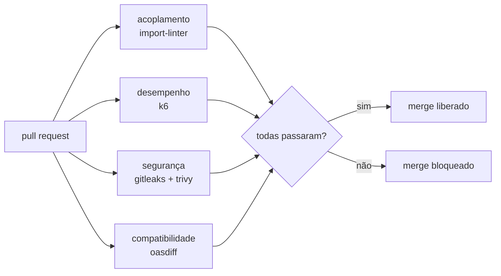

# Lab 9A: Fitness functions no CI - acoplamento, desempenho, segurança e compatibilidade

Aula prática da seção 9 (Arquitetura Evolutiva e Governança), depois da aula 9.2.

| | |
|---|---|
| Aulas relacionadas | 9.2 (fitness functions) e 9.5 (compatibilidade de APIs, na parte de detecção de breaking changes) |
| Ambiente | Pipeline de CI (GitHub Actions), com simulação local em Docker |
| Ordem de estudo | Independente |

## Objetivo

Na aula 9.2 vimos que fitness functions são testes automatizados que verificam, a cada mudança, se a arquitetura continua saudável. Neste lab você executa quatro delas sobre uma API pequena, uma para cada atributo de qualidade (acoplamento, desempenho, segurança e compatibilidade), e simula um pull request que degrada a arquitetura de uma forma específica, para ver qual verificação o barra e o que ela diz.

O cenário é o da LunaLog: a arquitetura foi desenhada com camadas e módulos independentes, mas o tempo e a pressa corroem esse desenho. As fitness functions são o que impede que a degradação aconteça em silêncio.

## O que você vai ver

As quatro fitness functions, e a mudança que faz cada uma falhar:

| Fitness function | O que verifica | Ferramenta | Mudança que a faz falhar |
|---|---|---|---|
| **Acoplamento** | Camadas (`api` > `dominio` > `infra`) e módulos de domínio independentes entre si | import-linter | `tarifas` passa a importar `clientes` ("só um atalho") |
| **Desempenho** | p95 de latência abaixo de 150 ms e menos de 1% de erros | k6 (thresholds) | Um cálculo passa a levar 400 ms |
| **Segurança** | Nenhum segredo no código e nenhuma dependência com vulnerabilidade crítica | Gitleaks e Trivy | Uma dependência vulnerável entra no projeto |
| **Compatibilidade** | A API atual não quebra quem consome o contrato publicado (v1) | oasdiff | O campo `frete` da resposta é renomeado para `valor_frete` |

Além disso:

- Cada regra de arquitetura é **código** no repositório (`app/.importlinter`, `k6/orcamento.js`, `contrato/openapi-v1.json`), revisada em pull request como qualquer outro código
- Cada fitness function sai com código diferente de zero quando falha: é isso que bloqueia o merge
- Uma mudança normal passa nas quatro, em menos de um minuto: as fitness functions não atrapalham o trabalho comum

## Arquitetura do lab



A API de exemplo (`app/lunalog`) tem três camadas: `api` (HTTP), `dominio` (tarifas e clientes, independentes entre si) e `infra` (os dados). As regras de dependência entre elas são a primeira fitness function.

## Pré-requisitos

- Docker Engine ou Docker Desktop
- Um shell bash: Linux, macOS, WSL2 ou Git Bash no Windows
- Cerca de 2 GB de RAM livres e acesso à internet na primeira execução (baixa as imagens das ferramentas)

Não é preciso ter Python nem Node instalados: tudo roda em contêiner.

## Como executar

### Passo 1: uma mudança normal

O simulador cria uma cópia do lab em `.simulacao/`, aplica a mudança (se houver) e roda as quatro fitness functions, mostrando quais passam. Os arquivos originais não são alterados.

```bash
bash scripts/simular.sh
```

O que observar: as quatro passam (`PASSOU`) e o resultado é `PR LIBERADO`. A primeira execução leva mais tempo, porque baixa as imagens e a base de vulnerabilidades do Trivy.

### Passo 2: o atalho que acopla (acoplamento)

```bash
bash scripts/simular.sh acoplamento
```

O que observar: só a fitness function de acoplamento falha, e a mensagem é precisa: `lunalog.dominio.tarifas is not allowed to import lunalog.dominio.clientes`, com o arquivo e a linha. O contrato das camadas continua respeitado (`KEPT`); o dos domínios independentes está `BROKEN`. Abra `app/.importlinter`: a regra tem 15 linhas. A arquitetura que era um desenho no wiki virou um teste.

### Passo 3: a lentidão que ninguém mediu (desempenho)

```bash
bash scripts/simular.sh desempenho
```

O que observar: só o desempenho falha. A linha com `✗ http_req_duration` mostra latência de cerca de 400 ms contra o orçamento de 150 ms no p95. O código continuou funcionando e os testes funcionais passariam, mas a regressão de desempenho foi barrada antes de chegar à produção. Abra `k6/orcamento.js`: o orçamento é um `threshold` de três linhas.

### Passo 4: a dependência vulnerável (segurança)

```bash
bash scripts/simular.sh seguranca
```

O que observar: só a segurança falha, e o relatório do Trivy mostra a biblioteca, a vulnerabilidade crítica e a versão que corrige.

### Passo 5: o breaking change (compatibilidade)

```bash
bash scripts/simular.sh compatibilidade
```

O que observar: só a compatibilidade falha. O oasdiff compara a especificação OpenAPI da API atual com a do contrato publicado (`contrato/openapi-v1.json`) e aponta: `removed the required property 'frete' from the response with the '200' status`. Quem consome `/frete` quebraria. O código passa em todos os outros testes, porque ele funciona: o que mudou foi o **contrato**.

## Como colocar no seu CI

O arquivo `ci/fitness-functions.yml` é um workflow do GitHub Actions com um job por fitness function. Copie-o para `.github/workflows/` e, na proteção da branch `main`, marque os quatro jobs como verificações obrigatórias (required checks). A partir daí, nenhum merge acontece sem as quatro passarem. O workflow chama `scripts/fitness.sh`, o mesmo código que o simulador executa.

Para começar com poucas e crescer: escolha a fitness function do atributo que mais dói no seu sistema, escreva a regra, faça ela passar no estado atual e só então a torne obrigatória.

## Como limpar

O simulador remove a própria cópia de trabalho ao final. Para remover o cache do Trivy e os contêineres que sobraram em caso de interrupção:

```bash
docker rm -f fitness-9a-app
docker network rm fitness-9a-rede
docker volume rm lab9a-trivy-cache
rm -rf .simulacao
```

## Estrutura da pasta

```
lab-9a_fitness-functions-no-ci/
  README.md
  app/
    lunalog/
      api/ dominio/ infra/   (as três camadas)
    .importlinter            (fitness function de acoplamento)
    Dockerfile, requirements.txt
  k6/orcamento.js            (fitness function de desempenho)
  contrato/openapi-v1.json   (o contrato publicado, base da compatibilidade)
  ci/fitness-functions.yml   (workflow do GitHub Actions)
  scripts/
    fitness.sh               (as quatro fitness functions)
    simular.sh               (simula um pull request)
    mudanca.py               (aplica as mudanças que degradam a arquitetura)
```

## Limites deste lab

- As fitness functions aqui são de **estado atual**: comparam com regras fixas. As mais poderosas são **de tendência**: "a latência não pode piorar mais de 20% em relação ao deploy anterior". Para isso, guarde o resultado do pipeline anterior (um artefato do CI, por exemplo) e compare.
- O k6 mede uma API local, em um contêiner, sob carga leve. Os números absolutos são do seu computador; o ponto é o mecanismo de orçamento com falha automática.
- O import-linter trata de Python. O mesmo conceito existe em outras linguagens: ArchUnit (Java), NetArchTest (.NET), dependency-cruiser (JavaScript) e Go com análises de importação.
- O contrato de compatibilidade precisa ser **atualizado deliberadamente** quando você publica uma versão nova (`v2`). O objetivo é que o breaking change seja uma decisão consciente, e não um efeito colateral.
- Nem tudo vira fitness function. Decisões que dependem de contexto e de conversa (como escolher entre dois modelos de dados) continuam exigindo governança humana: é o assunto da próxima aula.

## Para pensar

1. Qual atributo de qualidade mais dói na sua arquitetura hoje? Que fitness function você escreveria primeiro, e qual seria o limite?
2. A regra de independência entre `tarifas` e `clientes` tem um propósito: manter a possibilidade de extraí-los como serviços separados. O que aconteceria na extração se o "atalho" tivesse passado despercebido por dois anos?
3. Uma fitness function que falha com frequência e é ignorada ("é só um aviso") é pior que nenhuma. Como você calibraria o limite para ela ser levada a sério?
4. Quem pode alterar a regra de uma fitness function? Se qualquer um puder afrouxá-la em um pull request, o que a protege?
