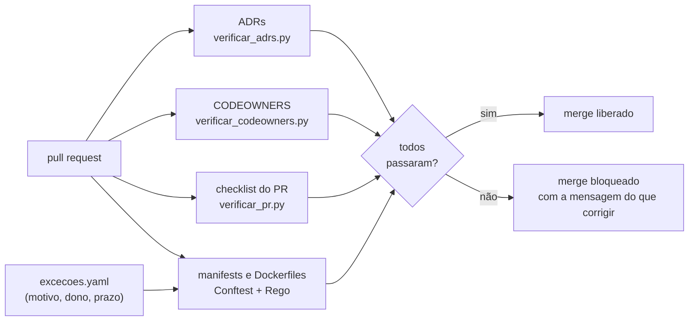

# Lab 9B: Governança como código: ADRs validados e guardrails de build

Aula prática da seção 9 (Arquitetura Evolutiva e Governança), depois da aula 9.3.

| | |
|---|---|
| Aulas relacionadas | 9.3 (governança lean: ADRs e guilds no lugar de comitês) |
| Ambiente | CI e Docker (Conftest e OPA, Python, GitHub Actions) |
| Ordem de estudo | Isolado. Reaproveita os ADRs e o validador do lab 1A, e complementa as fitness functions do lab 9A |

## Objetivo

Na aula 9.3 vimos o caso da LunaLog: cinco times de engenharia criaram um Comitê de Arquitetura que aprovava toda decisão técnica relevante. Em seis semanas havia 40 decisões na fila, e os times paravam sprints esperando. O comitê foi dissolvido e substituído por **ADRs versionados no repositório**, uma guild que dissemina padrões e **verificações automáticas de conformidade**. Velocidade e coerência foram recuperadas.

Neste lab você constrói a terceira parte, as verificações: **o que o comitê fazia na mão, feito por máquina em cada pull request**. ADRs com formato validado, responsáveis por área (CODEOWNERS), um checklist arquitetural no pull request e políticas que bloqueiam manifests e Dockerfiles fora do padrão, com **exceções que têm dono e prazo**.

## O que você vai ver

- **Validação de ADRs** no CI: formato, status, responsáveis e substituições
- **CODEOWNERS** validado: nenhuma área sem dono, áreas críticas com dois responsáveis
- Um **checklist arquitetural** no template de pull request, conferido por máquina
- **Políticas** (Conftest e OPA) que bloqueiam manifests sem limites de recursos, com imagem `latest`, sem sondas de saúde, rodando como root ou sem dono, e Dockerfiles sem `USER`
- **Testes das próprias políticas**, porque uma regra de governança é código
- **Exceções com prazo**: o que dispensa uma regra tem motivo e responsável, e **volta a reprovar quando vence**
- O que **automatiza** e o que **continua exigindo conversa**

## Arquitetura do lab



## Pré-requisitos

- Docker Engine ou Docker Desktop
- Python 3.12 ou superior (os validadores são scripts de uma biblioteca padrão, sem dependências)
- Bash (Git Bash ou WSL no Windows)
- Acesso à internet para baixar a imagem do Conftest (`openpolicyagent/conftest`)

## Como executar

Na pasta deste lab. Primeiro, o estado "limpo": todos os guardrails sobre o conteúdo do repositório.

```bash
bash scripts/verificar.sh
```

```
== 1. ADRs: formato, status, responsaveis e substituicoes
6 ADRs validos em adrs
== 2. CODEOWNERS: toda area tem dono; areas criticas tem dois
CODEOWNERS valido: 12 regras, areas criticas com dois responsaveis
== 4. Politicas: testes unitarios das proprias regras
15 tests, 15 passed
== 5. Manifests do Kubernetes (manifestos/aprovados e manifestos/novo)
24 tests, 24 passed
== 6. Dockerfiles
4 tests, 4 passed
RESULTADO: todos os guardrails passaram.
```

Este é o "pull request verde". Repare que é rápido e que dá uma resposta objetiva. Agora, o que cada guardrail barra.

### Cenário 1: ADRs com formato validado

Os ADRs de `adrs/` são os do lab 1A. Em `exemplos-invalidos/adrs/` há três ADRs ruins de propósito:

```bash
python scripts/verificar_adrs.py exemplos-invalidos/adrs --sem-indice
```

```
3 problema(s) nos ADRs:
  - 0010-sem-secao-decisao.md: falta a seção '## Decisão'
  - 0011-status-invalido.md: status inválido 'aprovado pelo comite' (use proposed, accepted, rejected, deprecated ou superseded by ADR-NNNN)
  - 0012-sem-responsavel.md: falta o campo 'decision-makers' no front matter
```

O que observar: o validador confere a **forma**: um ADR sem a seção de decisão, com um status fora do vocabulário (que quebraria qualquer ferramenta que lê os ADRs) e sem um responsável. Ele **não** julga se a decisão é boa: isso continua sendo conversa. O que antes dependia de um revisor lembrar do padrão agora é uma mensagem automática, em segundos, no próprio pull request.

### Cenário 2: CODEOWNERS e o checklist do pull request

O `CODEOWNERS` diz **quem revisa o quê**, e o GitHub pede a revisão automaticamente. Mas um arquivo desses apodrece (pastas novas sem dono, uma área crítica com um revisor só). O validador cuida disso:

```bash
python scripts/verificar_codeowners.py CODEOWNERS
```

`CODEOWNERS valido: 12 regras, areas criticas com dois responsaveis`. Teste quebrando: remova a linha `/manifestos/` e rode de novo, ou deixe só um responsável em `/adrs/`: ele reprova e diz qual.

O **template de pull request** (`modelos/pull_request_template.md`) traz um checklist arquitetural: decisão registrada, reversibilidade, segurança e dados, operação e exceções. O CI confere que ele foi **preenchido**:

```bash
python scripts/verificar_pr.py exemplos-pr/completo.md       # checklist arquitetural completo
python scripts/verificar_pr.py exemplos-pr/incompleto.md     # 3 pendencia(s) ...
python scripts/verificar_pr.py exemplos-pr/sem-checklist.md  # 5 pendencia(s) ...
```

O que observar: a máquina confere que o autor **leu e respondeu** o checklist, e reprova a descrição sem ele. Ela **não** consegue saber se a resposta é verdadeira: isso é com o revisor humano (os `CODEOWNERS` que o GitHub chamou). É a divisão de trabalho certa: a máquina garante que a pergunta foi feita, a pessoa julga a resposta.

### Cenário 3: políticas para manifests e Dockerfiles

As políticas em `politicas/` estão em Rego e rodam com o **Conftest**. Veja `politicas/k8s.rego`: cinco regras que bloqueiam e uma que só avisa.

| Regra | O que bloqueia | Por quê |
|---|---|---|
| `sem-limites` | contêiner sem limite de CPU ou memória | um vizinho barulhento derruba o nó |
| `imagem-latest` | imagem com tag `latest` ou sem tag | o deploy deixa de ser reproduzível |
| `sem-probes` | contêiner sem `readinessProbe` | tráfego chega antes de o pod estar pronto |
| `roda-como-root` | pod sem `runAsNonRoot` | um comprometimento vira acesso total |
| `sem-dono` | carga sem o label `lunalog.io/dono` | ninguém sabe quem chamar |
| `replica-unica` (aviso) | 1 réplica | uma queda do pod é uma indisponibilidade |

Os manifests de `manifestos/aprovados/` passam; os de `manifestos/reprovados/` quebram cada regra, uma a uma:

```bash
bash scripts/demonstrar-reprovacoes.sh
```

Um trecho do resultado:

```
FAIL - manifestos/reprovados/imagem-latest.yaml - lunalog.k8s - notificacao: a imagem 'lunalog/notificacao:latest' nao tem versao fixa (use uma tag imutavel) [imagem-latest]
FAIL - manifestos/reprovados/roda-como-root.yaml - ... o pod nao exige runAsNonRoot [roda-como-root]
FAIL - manifestos/reprovados/varios-problemas.yaml - ... [imagem-latest] ... [sem-dono] ... [sem-limites] ... [sem-probes] ... [roda-como-root]
WARN - manifestos/reprovados/varios-problemas.yaml - ... apenas 1 replica [replica-unica]
```

O que observar: cada mensagem diz **o que está errado, em qual arquivo e qual regra**, com o nome da regra entre colchetes. O `FAIL` bloqueia; o `WARN` só avisa (e o CI pode endurecer com `--fail-on-warn`). O mesmo vale para o Dockerfile: `dockerfiles/reprovado/Dockerfile` quebra `base-latest`, `sem-user` e `add-url`.

### Cenário 4: um pull request de verdade

Simule um desenvolvedor propondo um manifest ruim e depois um bom:

```bash
bash scripts/simular-pr.sh ruim      # copia um manifest com 6 problemas para manifestos/novo/ e roda tudo
bash scripts/simular-pr.sh bom       # o mesmo, com um manifest conforme
```

O primeiro termina com `RESULTADO: 1 etapa(s) reprovada(s). O merge fica bloqueado.` e a lista dos seis problemas; o segundo, com `todos os guardrails passaram`. O arquivo de simulação é removido ao final. Em um repositório real, a pasta `manifestos/novo/` seria a pasta dos seus manifests, e o `ci/governanca.yml` rodaria isto em cada pull request (copie-o para `.github/workflows/`).

### Cenário 5: exceções com dono e prazo

Nenhuma regra serve a todos os casos. Em vez de desligar a regra (ou de abrir um "jeitinho"), a exceção é um **registro rastreável**. Veja `excecoes/excecoes.yaml`:

```yaml
  - regra: imagem-latest
    carga: legado-relatorios
    motivo: "Imagem de terceiro que só publica a tag latest; substituição prevista no ADR-0008."
    responsavel: camila
    expira: "2100-12-31"
  - regra: sem-limites
    carga: batch-migracao
    motivo: "Job pontual de migração de dados (lab 8D); remover depois da migração."
    responsavel: roberto
    expira: "2026-09-30"        # VENCIDA de propósito
```

O que observar:

- `manifestos/aprovados/legado-relatorios.yaml` usa uma imagem `:latest` e **passa**: tem exceção vigente.
- `manifestos/reprovados/excecao-vencida.yaml` (o job `batch-migracao`) **volta a reprovar** quando o prazo vence, com a mensagem `a excecao da regra 'sem-limites' venceu em 2026-09-30; renove com justificativa ou corrija`. A exceção não vira permanente por esquecimento.
- Criar ou renovar uma exceção é um **pull request** no arquivo `excecoes/`, que o `CODEOWNERS` manda para **dois** revisores. A decisão fica visível, assinada e com data.

(O prazo da primeira exceção está em 2100 só para o lab continuar reproduzível. Em produção, use prazos curtos, como um trimestre.)

### Cenário 6: as próprias políticas têm testes

Uma regra de governança com um erro de lógica barra o que não devia ou, pior, deixa passar o que devia barrar. Por isso as políticas têm testes unitários (`politicas/k8s_test.rego`, `politicas/dockerfile_test.rego`):

```bash
docker run --rm -v "$PWD:/p" -w /p openpolicyagent/conftest:latest verify -p politicas
```

`15 tests, 15 passed`: um manifest conforme não gera reprovações; cada regra dispara no caso certo; réplica única só avisa; uma exceção vigente dispensa e uma vencida reprova. Uma mudança em uma política que quebre um desses testes **não passa no CI**. É o princípio da aula 4.10 (policy-as-code) aplicado à governança.

## O que automatizar e o que continua sendo conversa

| O que o comitê fazia na mão | O que virou verificação | O que continua exigindo gente |
|---|---|---|
| Conferir se o ADR segue o padrão | `verificar_adrs.py` | se a decisão é boa e se as alternativas foram honestas |
| Saber quem revisa cada área | `CODEOWNERS` e seu validador | decidir quem deve ser dono de uma área nova |
| Lembrar de perguntar sobre reversibilidade e segurança | o checklist do pull request | julgar se a resposta é verdadeira |
| Exigir limites, sondas, usuário não root, dono | políticas Rego no CI | decidir quando uma exceção é justa |
| Aprovar exceções "no corredor" | `excecoes.yaml` com prazo, em pull request | aceitar ou recusar o motivo |
| Discutir padrões e rumo técnico | (nada) | a guild: disseminar, convencer e evoluir as regras |

O guardrail é o que libera o time para andar rápido: o que está dentro do padrão passa sem pedir licença. A conversa fica para o que é **novo**, **arriscado** ou **exceção**. Foi essa a troca que a LunaLog fez ao dissolver o comitê.

## Resultados de referência

| Verificação | Resultado |
|---|---|
| Conteúdo do repositório | todos os guardrails passam (6 ADRs, 12 regras de CODEOWNERS, 15 testes de política, 24 verificações de manifest, 4 de Dockerfile) |
| 3 ADRs inválidos | 3 problemas (seção, status e responsável) |
| Pull request sem checklist ou incompleto | 5 e 3 pendências |
| Manifests reprovados | 15 reprovações e 1 aviso |
| Dockerfile reprovado | 3 reprovações (`base-latest`, `sem-user`, `add-url`) |
| Exceção vigente | a regra é dispensada |
| Exceção vencida | a regra volta a reprovar, com mensagem clara |

## Como limpar

Nada para limpar: o lab não deixa serviços em execução. O arquivo de simulação do `simular-pr.sh` é removido por ele mesmo.

## Estrutura da pasta

```
lab-9b_governanca-como-codigo-guardrails/
  README.md
  CODEOWNERS
  adrs/                          (os ADRs do lab 1A)
  exemplos-invalidos/adrs/       (3 ADRs ruins de propósito)
  manifestos/
    aprovados/                   (manifests conformes, um com exceção vigente)
    reprovados/                  (um manifest por regra quebrada, mais um com todas)
    novo/                        (a pasta que o simular-pr.sh usa)
  dockerfiles/aprovado, reprovado
  politicas/
    k8s.rego, k8s_test.rego
    dockerfile.rego, dockerfile_test.rego
  excecoes/excecoes.yaml
  modelos/pull_request_template.md, adr-modelo.md
  exemplos-pr/                   (corpos de PR: completo, incompleto, sem checklist)
  scripts/
    verificar.sh                 (todos os guardrails, na ordem do CI)
    verificar_adrs.py, verificar_codeowners.py, verificar_pr.py
    demonstrar-reprovacoes.sh, simular-pr.sh
  ci/governanca.yml              (pipeline de exemplo para o GitHub Actions)
```

## Limites deste lab

- O lab roda tudo **localmente**, com o mesmo conteúdo que o CI rodaria. O que só existe no GitHub (a proteção de branch que exige os checks, a revisão obrigatória dos donos) é configuração do repositório, não parte do código do lab: lembre-se de **exigir** os checks e a revisão do `CODEOWNERS` na proteção da branch principal, senão o guardrail é só um aviso.
- Um guardrail **bloqueia** o que sabe descrever. Ele não vê o que não foi escrito como regra: a qualidade da decisão, o acoplamento sutil, o risco do negócio. Combine com as **fitness functions** do lab 9A, com revisão humana e com a guild.
- As regras do lab são simples e de propósito. Regras de verdade crescem com o tempo, e quanto mais regras, mais exceções e mais ruído. Trate cada regra como um produto: com dono, com testes e com um custo de manutenção.
- O checklist do pull request confere que foi **preenchido**, não que é **verdadeiro**. Marcar tudo sem pensar derrota o propósito; o antídoto é a cultura e a revisão, não mais automação.
- O Conftest valida **arquivos**. Para impor as mesmas regras **no cluster** (admission control), existem o OPA Gatekeeper e o Kyverno, que reaproveitam o mesmo raciocínio.
- Os nomes (`@lunalog/arquitetura`, `@roberto`, `@camila`) são fictícios. Ajuste o `CODEOWNERS` para os usuários e times reais do seu repositório.

## Para pensar

1. Quantas das decisões e revisões do seu time hoje são "conferir se seguiu o padrão"? Quantas dessas poderiam ser um check automático?
2. Que regra, se fosse automática, mais evitaria incidentes no seu sistema? E qual regra você **não** automatizaria, e por quê?
3. Quem aprova uma exceção no seu time hoje? Ela tem prazo? O que acontece quando o prazo passa?
4. Se uma regra automática barrar um pull request que está "certo", qual é o caminho para o autor, e quanto tempo ele leva?
