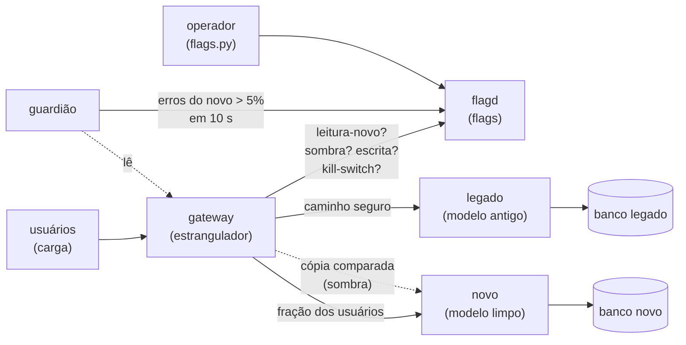

# Lab 9C: Migração incremental ponta a ponta: marcos, flags e critérios de rollback

Aula prática da seção 9 (Arquitetura Evolutiva e Governança), depois da aula 9.6. É o capstone da trilha Modernização do legado.

| | |
|---|---|
| Aulas relacionadas | 9.6 (migrações incrementais em sistemas em produção), com as técnicas das aulas 8.3, 8.4 e 8.5 e o expand-contract do lab 5E |
| Ambiente | Docker Compose (Python, PostgreSQL, flagd) |
| Ordem de estudo | Trilha Modernização do legado, passo 4 de 4 (retoma os labs 8B, 8C, 8D e 5E). Pode ser feito sozinho |

## Objetivo

Na aula 9.6 vimos o plano da LunaLog para os componentes restantes do monólito: **oito marcos em 14 meses**, cada um com **critério de sucesso mensurável**, **critério de rollback explícito** e comunicação para os interessados. O plano combina Strangler Fig, expand-contract e dual-write, e **nenhum big bang**: a plataforma fica no ar o tempo todo.

Os labs anteriores mostraram cada técnica isolada. Aqui elas **trabalham juntas**, em uma migração de ponta a ponta de uma rota de entregas, com tráfego de usuários passando o tempo todo. Em vez de uma lista de comandos, você segue **seis marcos**, cada um com o seu critério de saída medido por máquina, opera as **flags** que controlam a exposição, vê um **guardião** executar o critério de rollback sozinho durante um **game day**, e termina com o **legado desligado** e o sistema funcionando.

## O que você vai ver

- Um **estrangulador** (gateway) que decide, por requisição, se a resposta vem do legado ou do novo
- **Flags de verdade** (flagd, o padrão OpenFeature): liberação **gradual por usuário**, **modo sombra**, **modo de escrita** e um **kill switch**, alteráveis em tempo de execução
- **Seis marcos** com critério de saída mensurável e um **painel de progresso**
- O **modo sombra** comparando o novo com o legado, sem afetar o cliente, e **acusando** o que está desatualizado
- O **dual-write**, a **reconciliação** e a virada da escrita
- O **guardião**: critério de rollback automático (taxa de erros do novo acima de 5% em 10 s liga o kill switch)
- O **game day**: injetar uma falha de verdade e ver o sistema se proteger sem que o usuário perceba
- Desligar o legado ao final

## Arquitetura do lab



- O **gateway** (`app/gateway.py`) é o único endereço dos clientes. A cada requisição, consulta o flagd e escolhe o caminho. Se não conseguir avaliar uma flag, escolhe o **caminho seguro**: o legado. Ele também traduz o legado para o modelo limpo (a ACL do lab 8C).
- O **flagd** guarda as flags em um arquivo JSON (`flags/flags.json`) que ele recarrega sozinho quando muda. Em produção, as flags viriam de um serviço de feature flags, com revisão e auditoria.
- O **guardião** (`scripts/guardiao.py`) executa o critério de **rollback**. A decisão de **avançar** continua sendo humana.
- Os bancos, o backfill, a verificação e a reconciliação são os do lab 8D, resumidos (`scripts/dados.py`).

## As flags

| Flag | Tipo | O que faz |
|---|---|---|
| `kill-switch-novo` | booleana | se ligada, **tudo volta ao legado** (leitura e escrita) |
| `leitura-novo` | booleana, com liberação gradual (`fractional`) | os usuários, de forma estável, que leem do novo: 0%, 5%, 25%, 100% |
| `sombra` | booleana | o novo recebe uma cópia das leituras e o resultado é comparado |
| `escrita` | texto | `legado`, `dupla` (dual-write) ou `novo` (o novo é a verdade; o legado recebe uma cópia) |

A liberação gradual é **por usuário**, não por requisição: o mesmo usuário vê sempre o mesmo comportamento, o que evita a experiência de "ora funciona, ora não". O percentual vive na flag, não no código.

## Os seis marcos

| Marco | Critério de saída (medido pelo painel) | Critério de rollback |
|---|---|---|
| **M1** Histórico copiado | o banco novo tem as mesmas entregas do legado | refazer o backfill |
| **M2** Dual-write consistente | escrita em `dupla`, bancos consistentes e fila de reparo vazia | voltar a `escrita=legado` |
| **M3** Sombra sem divergência | 100 ou mais comparações e **zero** divergências | não liberar nenhum usuário; investigar |
| **M4** Canário saudável | leitura do novo acima de 0% e **menos de 1% de erros** | kill switch (automático acima de 5%) |
| **M5** Leitura 100% e escrita no novo | leitura em 100%, `escrita=novo`, kill switch desligado | voltar as flags (o legado ainda tem uma cópia) |
| **M6** Legado sem tráfego | 100% das leituras vêm do novo e **nenhuma** chega ao legado | religar o legado, que ainda existe |

Cada marco tem o seu **critério de saída** (quando se avança) e o seu **critério de rollback** (quando se volta), definidos **antes** de começar, como pede a aula 9.6.

## Pré-requisitos

- Docker Engine ou Docker Desktop (Compose v2)
- Cerca de 2 GB de RAM livres
- A porta 9501 livre
- Um shell Bash (Git Bash ou WSL no Windows)

## Como executar

Na pasta deste lab:

```bash
docker compose up -d --build
docker compose --profile ferramentas build ferramentas
```

### Modo rápido: a jornada inteira em 4 minutos

```bash
bash scripts/jornada.sh
```

O script percorre os dez passos abaixo, com tráfego de usuários o tempo todo, e termina com o painel de marcos. É a forma de **ver tudo acontecer**; as seções seguintes explicam cada passo para você repetir à mão.

Para facilitar os comandos manuais:

```bash
F="docker compose --profile ferramentas run --rm -T ferramentas python"
```

### Passo 0: o ponto de partida

```bash
$F flags.py mostrar
$F progresso.py
```

Tudo no legado (`leitura 0%`, `escrita=legado`), e os seis marcos **pendentes**. O painel é a **linguagem comum** entre engenharia e quem acompanha a migração: cada marco, o seu critério e a situação atual.

### Passo 1 (M1): o backfill

```bash
$F dados.py backfill
$F dados.py verificar
```

Copia as 2.000 entregas do legado, traduzindo o modelo antigo (datas e valores em formatos mistos) para o limpo, e confirma a **consistência**. M1 atendido.

### Passo 2: a sombra acusa o que está desatualizado

O novo está igual ao legado **agora**, mas o legado continua recebendo escritas. Ligue o modo sombra (sem liberar nenhum usuário) e gere tráfego:

```bash
$F flags.py sombra on
$F carga.py 12 40
curl -s localhost:9501/metricas | python -c "import sys,json; m=json.load(sys.stdin); print(m['sombra_iguais'], m['sombra_divergentes'])"
```

```
carga: 480 requisicoes em 12 s | ok=480 erros_para_o_cliente=0 | leituras: novo=0 legado=426
sombra: iguais = 421 | divergentes = 5
```

O que observar: nenhum usuário foi afetado (todas as leituras vieram do legado), mas a sombra **comparou o novo com o legado e achou 5 divergências**: são entregas que o sistema atualizou **depois** do backfill, e o novo ficou para trás. **É para isso que a sombra serve**: descobrir, antes de expor qualquer usuário, que o novo ainda não está pronto. Sem o dual-write, o novo envelhece.

### Passo 3 (M2): dual-write e reconciliação

```bash
$F flags.py escrita dupla
$F dados.py reconciliar
$F dados.py verificar
```

Com `escrita=dupla`, cada escrita grava no legado (a verdade) e depois no novo. A reconciliação repara o que ficou para trás. M2 atendido.

### Passo 4 (M3): a sombra sem divergência

```bash
curl -s -X POST localhost:9501/admin/zerar          # nova janela de medição
$F carga.py 15 40
```

Agora, `sombra: iguais = 534, divergentes = 0`. Com 100 ou mais comparações e zero divergência, **M3 atendido**: o novo devolve **exatamente** o que o legado devolveria, em tráfego real.

### Passo 5 (M4): o canário, com a flag

```bash
$F flags.py leitura 5
$F carga.py 12 40
$F flags.py leitura 25
$F carga.py 12 40
$F progresso.py
```

Com `leitura 5`, cerca de 5% dos **usuários** passam a ler do novo (no resultado, 20 leituras do novo contra 423 do legado); com `leitura 25`, cerca de um quarto. **Nenhuma mudança de código ou de deploy**: só a flag. A taxa de erros do novo e as latências aparecem em `/metricas` e no painel. **M4 atendido** quando o canário roda com menos de 1% de erros.

### Passo 6: o game day, com rollback automático

É o teste que prova o critério de rollback. Ligue o guardião e **injete uma falha de verdade** no novo (50% das chamadas devolvem erro):

```bash
docker compose up -d guardiao
curl -s -X POST localhost:9501/admin/zerar
docker compose exec -T novo python -c "import urllib.request; urllib.request.urlopen(urllib.request.Request('http://localhost:8000/admin/falha?pct=50', method='POST'))"
$F carga.py 25 40
docker compose logs guardiao | grep ROLLBACK
```

```
carga: 1000 requisicoes em 25 s | ok=1000 erros_para_o_cliente=0 | leituras: novo=31 legado=858
guardiao-1  | 18:18:11 ROLLBACK AUTOMATICO: 25 erros em 53 leituras do novo (47%) nos ultimos 10 s; kill switch LIGADO
erros do novo = 31 | fallbacks para o legado = 31 | kill switch = True
```

O que observar, e é o resultado mais importante do lab:

1. **Zero erros para o cliente** (`erros_para_o_cliente=0`). Quando o novo falhou, o gateway **respondeu pelo legado** (31 *fallbacks*): o usuário não percebeu nada.
2. O **guardião detectou** que mais de 5% das leituras do novo falharam em 10 segundos (47%) e **ligou o kill switch sozinho**, sem ninguém de plantão. A partir daí, **todo o tráfego** vai para o legado, e o novo para de receber chamadas, o que também alivia o serviço que estava mal.
3. O critério de rollback estava **escrito antes** (acima de 5% em 10 s, mínimo de 20 leituras) e foi **executado por máquina**. É a diferença entre "vamos ficar de olho" e um critério.

### Passo 7: a recuperação consciente

O novo se recuperou. **Voltar não é automático**: uma pessoa decide, depois de reconciliar o que a falha deixou para trás. Durante o game day, o dual-write gravou no legado coisas que o novo, falhando, não recebeu (a fila de reparo registrou):

```bash
docker compose exec -T novo python -c "import urllib.request; urllib.request.urlopen(urllib.request.Request('http://localhost:8000/admin/falha?pct=0', method='POST'))"
$F dados.py reconciliar                     # repara o que a falha deixou (95 registros, na execução de referência)
$F flags.py kill off
$F flags.py sombra off
$F flags.py leitura 50
$F carga.py 12 40
```

O guardião continua vigiando. A retomada é por etapas (50%), com critério, não um "ufa, voltou".

### Passo 8 (M5): a virada

```bash
curl -s -X POST localhost:9501/admin/zerar
$F flags.py leitura 100
$F flags.py escrita novo
$F carga.py 15 40
$F dados.py verificar
$F dados.py reconciliar-legado
$F dados.py verificar
```

Com `leitura 100` e `escrita novo`, o novo passa a ser **a verdade**: lê e grava. O legado ainda **recebe uma cópia** de cada escrita (para o rollback ser possível). Uma observação de honestidade: essa cópia é feita **depois** da escrita no novo, e duas escritas **concorrentes no mesmo registro** podem se inverter lá. Por isso a verificação (e a reconciliação no sentido contrário, `reconciliar-legado`) continua existindo até o legado ser desligado. **M5 atendido.**

### Passo 9 (M6): desligar o legado

```bash
docker compose stop legado
$F carga.py 8 40
$F progresso.py
```

Com 100% das leituras no novo e nenhuma chegando ao legado, **M6 atendido**: o legado está pronto para ser desligado. Ele foi parado (não removido), e o sistema segue funcionando: `320 requisicoes, 0 erros`. Se algo aparecer, `docker compose start legado` e a flag `kill on` devolvem tudo, porque o legado e a cópia dos dados continuam lá. Só **depois de um período de observação** (semanas, em um sistema real) o legado é aposentado de vez.

## Resultados de referência

Valores medidos em Docker Desktop (Windows 11, WSL2); o painel depende do tráfego, e os números variam um pouco entre execuções.

| Passo | Resultado |
|---|---|
| Backfill | 2.000 entregas, consistente |
| Sombra com escrita só no legado | 421 iguais e **5 divergentes** (o novo envelheceu) |
| Reconciliação com dual-write | 54 registros reparados; consistente |
| Sombra com dual-write | 534 iguais e **0** divergentes |
| Canário de 5% | 20 leituras no novo de 443; 0 erros para o cliente |
| Game day (50% de falha no novo) | **0 erros para o cliente**; rollback automático após 53 leituras do novo (47% de erros); 31 fallbacks |
| Virada (leitura 100%, escrita no novo) | 540 leituras no novo e 0 no legado; consistente após a reconciliação |
| Legado parado | 320 requisições e 0 erros |
| Duração da jornada completa | cerca de 3,5 minutos |

## Como limpar

```bash
docker compose --profile "*" down -v
```

(O `--profile "*"` inclui o guardião e as ferramentas, que estão em perfis. Sem ele, o volume das flags pode ficar em uso.)

## Estrutura da pasta

```
lab-9c_migracao-incremental-ponta-a-ponta/
  README.md
  docker-compose.yml
  db/init.sql                  (legado com 2.000 entregas e o novo vazio)
  flags/flags.json             (as flags iniciais, lidas pelo flagd)
  app/
    gateway.py                 (o estrangulador: flags, sombra, fallback, escrita)
    legado.py, novo.py         (os dois serviços; o novo aceita injeção de falha)
    traducao.py                (legado <-> novo)
  scripts/
    jornada.sh                 (a jornada inteira, em ~4 minutos)
    flags.py                   (operar as flags)
    dados.py                   (backfill, verificação e reconciliações)
    carga.py                   (tráfego de usuários)
    guardiao.py                (o critério de rollback automático)
    progresso.py               (o painel de marcos)
```

## Limites deste lab

- A imagem do **flagd** está fixada na versão `v0.18.2` no `docker-compose.yml` (a tag `latest` dele é construída a partir do ramo principal do projeto, e pode mudar sem aviso). Para experimentar uma versão mais nova, troque a tag e refaça a jornada.
- As **flags** ficam em um arquivo que o flagd recarrega. Em produção, use um serviço de flags com **revisão, auditoria e permissões** (uma flag mal posta derruba o sistema tanto quanto um deploy ruim), e trate as flags de migração como **temporárias**: remova-as depois da migração, para não virarem débito.
- O **guardião** olha uma janela de 10 segundos e um único sinal (a taxa de erros). Um critério real combina vários (latência, saturação, erros de negócio) e se compara com a linha de base do legado, com janelas maiores para evitar falsos alarmes.
- A **liberação gradual por usuário** depende de um identificador estável (`X-Usuario`). Em produção, ele vem do token do usuário. Atenção a clientes sem identificação (anônimos): precisam de uma regra à parte.
- A **escrita dupla** do gateway não é atômica (o lab explica as consequências no passo 8). Para um sistema de verdade, considere o **outbox transacional** ou o **CDC** (veja o lab 8D) no lugar de gravar nos dois lados pela aplicação.
- Aqui migra-se **uma rota** (entregas) de um serviço. Uma migração real tem **vários** componentes, cada um com o seu ciclo de marcos, e dependências entre eles (o plano de oito marcos em 14 meses da aula 9.6).
- O **volume** do lab é pequeno (2.000 entregas). Em um banco real, o backfill leva horas, a verificação precisa ser feita por faixas e em paralelo, e o game day é feito em ambiente de pré-produção, com cuidado.
- A **comunicação** (para as equipes, a operação e o negócio) faz parte de cada marco e **não está** no lab: o painel de marcos é a base dela, mas alguém precisa avisar, no tempo certo, quem será afetado.
- Todos os dados e credenciais (`luna`/`luna`) são fictícios.

## Para pensar

1. Para o seu próximo componente a migrar, quais seriam os marcos? Qual é o **critério de saída** e qual é o **critério de rollback** de cada um, escritos antes de começar?
2. O guardião faz o rollback sozinho, mas **não** avança sozinho. Por quê? Que decisões você nunca delegaria a uma máquina?
3. O modo sombra achou 5 divergências antes de qualquer usuário ser afetado. Que outros "ensaios sem consequência" você poderia criar na sua migração?
4. O que precisa continuar existindo (o legado, a cópia dos dados, a flag) enquanto o rollback ainda for possível? Por quanto tempo, e quem decide quando desligar?
