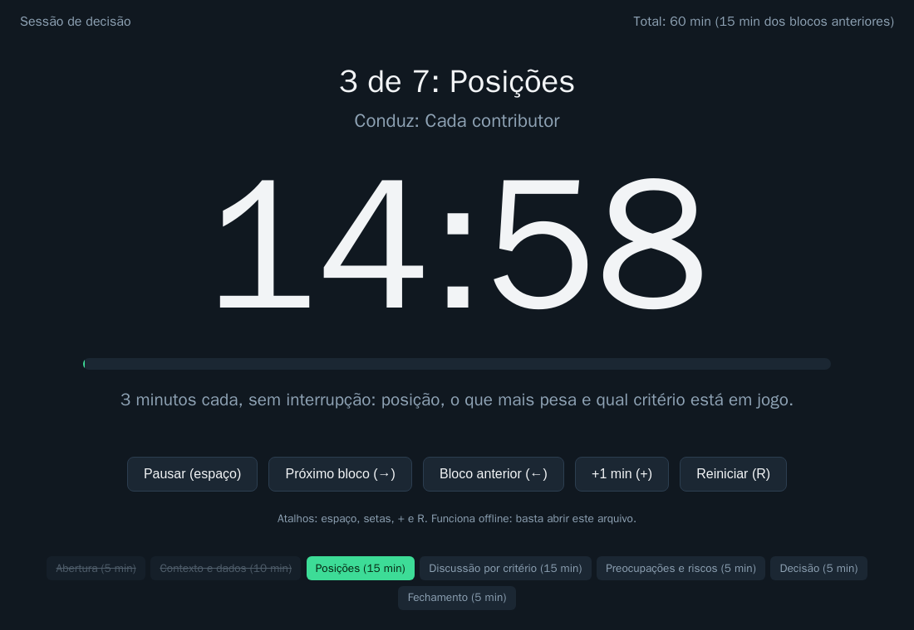

# Lab 10A: Kit de facilitação: DACI, ADR ao vivo e reescrita de code review com CNV

Aula prática da seção 10 (Liderança Técnica e Comunicação), depois da aula 10.5.

| | |
|---|---|
| Aulas relacionadas | 10.2 (comunicando decisões para múltiplos públicos), 10.4 (CNV em code reviews e decisões) e 10.5 (facilitando decisões em grupo) |
| Ambiente | Material pronto (Markdown, uma página HTML offline e Python para conferência) |
| Ordem de estudo | Independente. Usa o formato de ADR dos labs 1A e 9B |

## Objetivo

Um arquiteto de alto impacto é medido tanto pelas decisões que toma quanto pela forma como o time as toma junto. As aulas desta seção mostraram quatro situações da LunaLog: uma decisão que precisa ser **comunicada de três formas** (10.2), um feedback de code review que **bloqueia** em vez de abrir a conversa (10.4), e uma reunião de quatro engenheiros seniores que, **sem estrutura**, dura duas horas e termina em "vamos pensar mais" (10.5).

Este lab é um **kit pronto** para você reproduzir com o seu próprio time, sem instalar nada: uma **sessão de decisão cronometrada** com DACI e ADR escrito ao vivo, **exercícios de reescrita de feedback** com os quatro passos da CNV, e uma **mesma decisão contada para três públicos**. Há também um verificador, para mostrar que até a comunicação se confere (os números são os mesmos em todas as versões?).

## O que tem no kit

| Pasta | O que é | Para quê |
|---|---|---|
| `01_daci/` | Modelo de DACI em branco e um exemplo preenchido (Istio ou Linkerd), mais um exemplo ruim | definir **quem faz o quê** antes da reunião |
| `02_sessao_de_decisao/` | Agenda de 60 minutos, um **cronômetro offline** (`cronometro.html`), o roteiro do **ADR ao vivo** e o ADR resultante | conduzir a sessão com tempo e registro |
| `03_feedback_cnv/` | Guia dos quatro passos, cinco comentários para reescrever e o gabarito | treinar o feedback que abre a conversa |
| `04_uma_decisao_tres_publicos/` | A mesma decisão (billing em SaaS) para o tech lead, o CFO e o board, com os fatos em um arquivo | praticar a comunicação por público |
| `scripts/verificar_kit.py` | Confere o DACI, o ADR e a consistência das três versões | provar que a comunicação foi bem feita |

## Como executar

Não há nada para instalar. Abra os arquivos no editor ou no navegador. O verificador usa Python 3:

```bash
python scripts/verificar_kit.py
```

```
[DACI] exemplo-service-mesh.md: ok (1 Driver, 1 Approver, contribuintes, informados e prazo)
[ADR] adr-resultado-exemplo.md: ok
[PUBLICO] para-tech-lead.md (349 palavras): ok
[PUBLICO] para-cfo.md (278 palavras): ok
[PUBLICO] para-board.md (234 palavras): ok

RESULTADO: o kit esta consistente
```

### Passo 1: o DACI, antes da reunião (`01_daci/`)

O DACI responde, **antes** da sessão, a quatro perguntas: quem **conduz** (Driver), quem **decide** (Approver, uma pessoa só), quem **contribui** (Contributors) e quem **será avisado** (Informed). Abra `exemplo-service-mesh.md`: a decisão de qual service mesh a LunaLog adota (o cenário da aula 10.5), com quatro engenheiros seniores, quatro posições firmes e um prazo.

O que observar:

- A decisão está escrita como uma **pergunta que se responde com "A" ou "B"**, com **prazo**.
- Há **um Driver, um Approver**, contribuintes (segurança, plataforma, o time mais afetado) e informados.
- Os **critérios foram combinados antes** de discutir as opções: é o que transforma uma disputa de preferência em uma análise.

Agora compare com `exemplo-daci-ruim.md` (dois Approvers, sem informados, sem prazo, uma única opção). O verificador aponta cada problema:

```bash
python scripts/verificar_kit.py --ruins
```

```
[DACI] exemplo-daci-ruim.md: 3 problema(s)
   - deve haver exatamente 1 Approver (A), ha 2
   - deve haver ao menos 1 Informed (I)
   - falta 'Decisão até:' com uma data AAAA-MM-DD
```

**Dois Approvers significam nenhum:** se duas pessoas decidem, a decisão vai para negociação, e a reunião não termina.

### Passo 2: a sessão cronometrada (`02_sessao_de_decisao/`)

Abra `cronometro.html` no navegador (funciona sem internet):



A agenda tem **7 blocos em 60 minutos**: abertura (5), contexto e dados (10), posições (15, com 3 minutos para cada um), discussão **por critério** (15), preocupações e riscos (5), decisão (5) e fechamento (5). O cronômetro mostra o bloco, quem conduz, o tempo restante (que fica **amarelo no último minuto** e **vermelho e piscando** ao estourar), e tem atalhos: espaço para pausar, setas para trocar de bloco, `+` para acrescentar um minuto. Para adaptar a agenda ao seu time, edite a lista `AGENDA` no próprio arquivo.

As regras da sessão (`agenda-60min.md`) são o que faz a estrutura funcionar:

1. **Decidir é diferente de concordar.** "Discordo e me comprometo" é um resultado válido.
2. **O Approver decide depois de ouvir**, e diz a decisão e o porquê em voz alta.
3. **Critério antes de opção.** Discutir "Istio ou Linkerd" é preferência; discutir "qual atende melhor o requisito de mTLS" é análise.
4. **Se o tempo acabar**, o Approver decide com o que existe, ou marca a pergunta exata que falta, com responsável e data. "Vamos pensar mais" não é um resultado.

### Passo 3: o ADR escrito ao vivo

O ADR é preenchido **durante** a sessão, em uma tela compartilhada, não depois. O roteiro (`adr-ao-vivo-modelo.md`) diz **em que bloco** cada seção é escrita: o contexto e os critérios na abertura, os argumentos nas discussões, as preocupações viram consequências. Todos veem e corrigem na hora ("não foi isso que eu disse"), o que elimina a discussão sobre a ata depois da reunião.

O resultado está em `adr-resultado-exemplo.md`: um ADR 0008 completo, no formato dos labs 1A e 9B. Repare nas **consequências**: a preocupação do Diego (custo operacional) está **registrada**, com data para ser revisitada. Registrar uma discordância é uma forma de ouvi-la.

### Passo 4: reescrever feedback com a CNV (`03_feedback_cnv/`)

Leia o `guia-cnv.md` (observação, sentimento, necessidade, pedido) e a tabela de **observação versus julgamento**. Depois faça o exercício: **cinco comentários** de code review que poderiam ter acontecido na LunaLog, como o da aula ("esse código está horrível, parece que foi feito às pressas"). Reescreva cada um e só então abra o `gabarito.md`.

O que o gabarito mostra, nos cinco casos:

- A **informação técnica foi preservada** (230 linhas e seis responsabilidades; caminho de erro sem teste; `SELECT *` em 40 colunas; um critério ausente no ADR), e às vezes ficou **mais precisa**.
- O **julgamento sobre a pessoa saiu** ("horrível", "de novo", "mil vezes").
- Cada comentário termina com um **pedido concreto e recusável**.
- Quando o problema se repete (o `SELECT *`), o pedido mais honesto é por um **guardrail automático** (lab 9B), não por mais reprimendas.

E um custo honesto: a versão reescrita é **mais longa**. Vale para os comentários que importam; um detalhe óbvio dispensa os quatro passos.

### Passo 5: uma decisão, três públicos (`04_uma_decisao_tres_publicos/`)

O cenário da aula 10.2: a LunaLog precisa aprovar a migração do módulo de billing para um SaaS. `decisao-base.md` traz os **fatos** (R$ 42.000 por mês hoje, R$ 26.000 com o SaaS, R$ 150.000 de integração, 3 meses, retorno em 9,4 meses, uma única pessoa que domina o billing) e o que cada público precisa ouvir. Leia as três versões, lado a lado:

| Documento | Palavras | A pergunta que responde | O que tem | O que **não** tem |
|---|---|---|---|---|
| `para-tech-lead.md` | cerca de 350 | "Funciona e dá para voltar atrás?" | integração, lock-in, reversibilidade, o plano de migração | só custo |
| `para-cfo.md` | cerca de 280 | "Quanto custa, quando se paga, qual o risco do número?" | custo, retorno, premissas, o que pode mudar o resultado | jargão técnico |
| `para-board.md` | cerca de 230 | "O que isso protege ou ameaça no negócio?" | o risco de negócio, a decisão pedida | detalhes e siglas |

As três são **verdadeiras**, cada uma no vocabulário certo. O verificador confere que os **mesmos números** aparecem nas três, que cada uma tem os termos que o seu público precisa ouvir, que o **jargão proibido** não aparece e que o **tamanho** é razoável. Quando você rodar `--ruins`, ele aponta uma versão para o CFO com o custo errado (R$ 40.000) e cheia de "webhook" e "idempotência", e uma versão para o board longa demais, cheia de siglas.

Note o que o verificador **não** consegue: dizer se o texto é bom, persuasivo ou honesto. Ele garante a **consistência**, e o resto é com a sua leitura (e a de outra pessoa).

## Como usar com o seu time

1. **Antes da próxima decisão relevante:** copie `01_daci/modelo-daci.md`, preencha e envie com o convite. Se não conseguir preencher, a decisão não está pronta para uma sessão.
2. **Na sessão:** projete o `cronometro.html` e o ADR em branco; o Driver conduz, o Approver decide.
3. **Depois:** o ADR entra no repositório por pull request (e passa pelos guardrails do lab 9B).
4. **No code review desta semana:** escolha um comentário seu e reescreva com os quatro passos antes de enviar.
5. **Na próxima apresentação:** escreva a decisão para os três públicos, comece pelos **fatos** e pela **decisão pedida**, e rode o verificador.

## Resultados de referência

| Verificação | Resultado |
|---|---|
| DACI do exemplo (service mesh) | 1 Driver, 1 Approver, contribuintes, informados e prazo: ok |
| DACI ruim | 3 problemas (dois Approvers, sem informados, sem prazo) |
| ADR do exemplo | formato válido |
| Três versões da decisão do billing | mesmos fatos nas três; vocabulário e tamanho adequados |
| Versões ruins | 29 problemas apontados (custo diferente, jargão, tamanho, termos ausentes) |
| Cronômetro | 7 blocos, 60 minutos, alerta no último minuto e ao estourar |

## Como limpar

Nada a limpar. O kit não deixa processos nem arquivos além dos que você abrir.

## Estrutura da pasta

```
lab-10a_kit-de-facilitacao-daci-adr-e-cnv/
  README.md
  01_daci/                         modelo-daci.md, exemplo-service-mesh.md, exemplo-daci-ruim.md
  02_sessao_de_decisao/            agenda-60min.md, cronometro.html, adr-ao-vivo-modelo.md, adr-resultado-exemplo.md
  03_feedback_cnv/                 guia-cnv.md, exercicio-reescrita.md, gabarito.md
  04_uma_decisao_tres_publicos/    decisao-base.md, fatos.json, para-tech-lead.md, para-cfo.md, para-board.md, ruins/
  scripts/verificar_kit.py
  docs/cronometro.png
```

## Limites deste lab

- **Ferramentas não substituem prática.** Um cronômetro e um modelo não fazem uma boa facilitação: ela se aprende conduzindo sessões, errando e pedindo feedback aos participantes. Comece por decisões de baixo risco.
- O DACI e a agenda são **pontos de partida**. Times pequenos podem juntar Driver e Approver (com cuidado); decisões muito simples dispensam a sessão; decisões muito controversas podem pedir duas sessões (uma de análise, outra de decisão).
- A CNV é uma **ferramenta de comunicação**, não uma garantia de aceitação, e não substitui a clareza técnica. Se a intenção é vencer a discussão, as palavras suaves não a escondem.
- O verificador de consistência é **simples de propósito** (confere números, termos e tamanho). Ele não avalia o conteúdo.
- Os nomes, os números e os cenários são fictícios, da LunaLog.

## Para pensar

1. Qual foi a última decisão do seu time que durou duas reuniões e terminou em "vamos pensar mais"? O que um DACI e um relógio teriam mudado?
2. Se você escrever hoje o último comentário duro que fez em um code review com os quatro passos, o que muda para quem lê, e o que continua igual?
3. Para a sua próxima decisão técnica relevante, quem é o Approver? Todos concordam com isso?
4. Qual dos três públicos você tem mais dificuldade de convencer? O que ele precisa ouvir que você costuma deixar de dizer?
